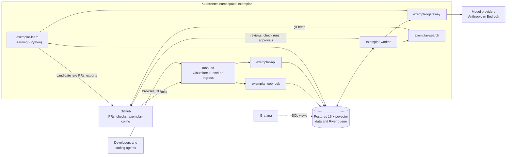
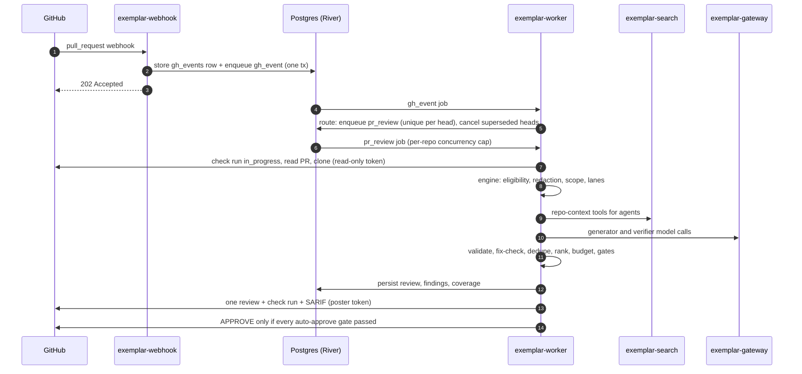
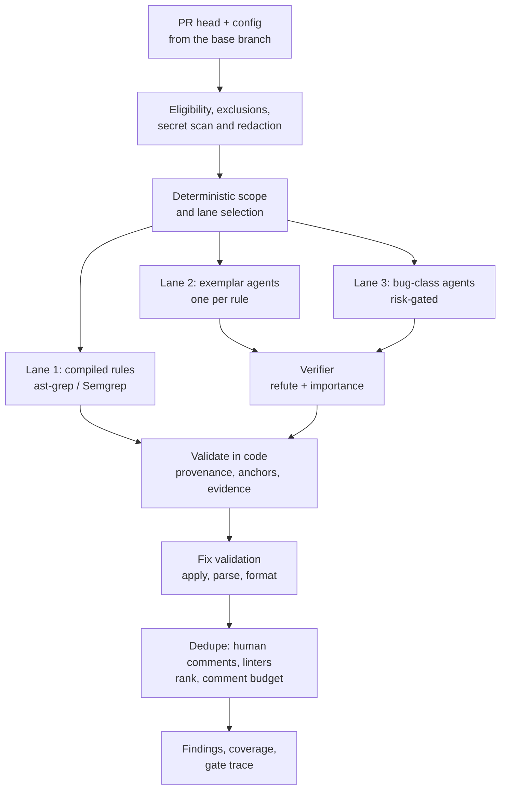
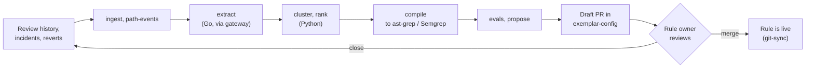
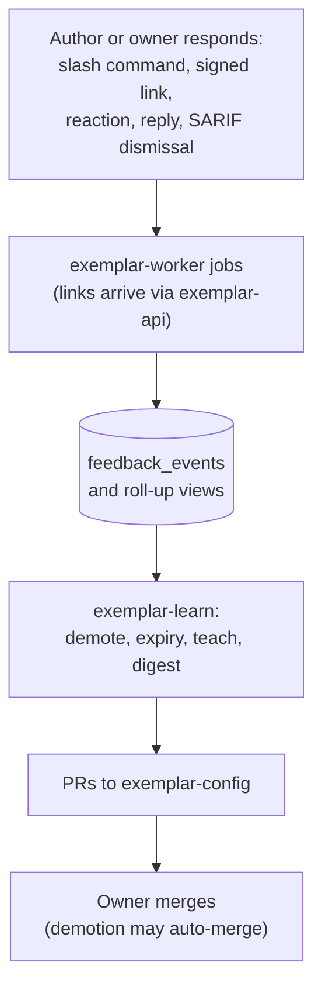
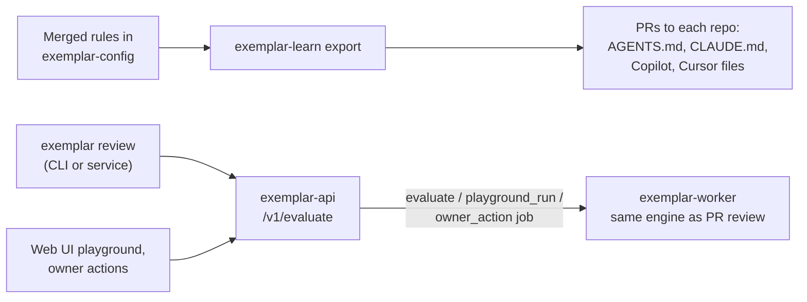

# Architecture

How Exemplar is put together **as built in this repository**: the processes, how they talk, and the paths work takes through them. The target design, with its reasoning, is in the [technical spec](docs/spec/technical-spec.md) (§2 for components, §6 for the review pipeline, §8 for the learning plane, §13 for security). What is built and what is not is tracked in [`docs/plans/README.md`](docs/plans/README.md).

## System context

Exemplar is a GitHub App. It reviews pull requests against rules that teams own in a git repository, `exemplar-config`. It learns candidate rules from review history and demotes rules that people say are wrong.

Every service is a Go binary from one module (`cmd/*`), shipped in one image. The Python learning jobs ship in a second image. All state lives in one Postgres database, and all asynchronous work is a [River](https://riverqueue.com) job in that same database: there is no separate message broker or workflow engine.

## Components

| Binary | Kubernetes kind | Role | Talks to |
|---|---|---|---|
| [`exemplar-webhook`](cmd/exemplar-webhook) | Deployment | Verifies `X-Hub-Signature-256`, stores the raw delivery in `gh_events` keyed by `X-GitHub-Delivery`, and enqueues a `gh_event` job in the same transaction. No business logic. | Postgres only |
| [`exemplar-worker`](cmd/exemplar-worker) | Deployment | Runs every River job: routes events, reviews PRs, posts results, records feedback, and runs `/v1/evaluate`, playground and owner-action jobs plus the periodic jobs. The only component that writes to PRs. | Postgres, GitHub, gateway, search |
| [`exemplar-gateway`](cmd/exemplar-gateway) | Deployment | The only holder of model-provider credentials. Routes each stage through an ordered provider list with failover, scans requests for secrets, enforces spend and rate limits, and records every call in `model_calls`. | Providers, Postgres; accepts traffic from worker and learn only |
| [`exemplar-search`](cmd/exemplar-search) | StatefulSet | Holds the git mirror and a zoekt index with ctags symbols, and answers `search_text`, `find_definition`, `find_references`, `dependents` and `read_file` over an internal API. | GitHub (fetch); accepts traffic from worker only |
| [`exemplar-api`](cmd/exemplar-api) | Deployment | Sign-in (GitHub OAuth and/or OIDC), signed feedback links, the `/ui/` web UI, and `/v1/evaluate` for the CLI and services. Enqueues work for the worker instead of running the engine itself. | Postgres, GitHub (OAuth) |
| [`exemplar-learn`](cmd/exemplar-learn) | CronJobs | The learning plane: `ingest`, `path-events`, `extract`, `evals`, `compile`, `propose`, `demote`, `expiry`, `teach`, `digest`, `export`. | Postgres, GitHub, gateway |
| [`learning/`](learning) (Python) | CronJobs | `cluster` and `rank` over tables in Postgres. No API surface. (`embed` waits on an approved embedding provider.) | Postgres only |
| [`exemplar`](cmd/exemplar) | CLI | Config validation, evals, replay, mutations, calibration, `try`, and `login`/`review` against `/v1/evaluate`. | `exemplar-api` |
| `exemplar-cloudflared` | Deployment | The default way in: a Cloudflare Tunnel connector, so the cluster needs no public ingress. Replaced or joined by an Ingress in [`deploy/k8s/direct`](deploy/k8s/direct). | Cloudflare edge, webhook, api |

The worker, gateway, search and learn pods read `exemplar-config` through a git-sync sidecar. Manifests are in [`deploy/k8s`](deploy/k8s) and documented in [`deploy/README.md`](deploy/README.md).

> **Spec vs. as built.** Spec §2.2 describes separate `exemplar-orchestrator`, `exemplar-poster` and `exemplar-feedback` services. Today those roles run as River jobs inside `exemplar-worker` (see the package doc in [`internal/worker/worker.go`](internal/worker/worker.go)). Write access is still separated: the worker mints a distinct GitHub token flavor for reading, for gate lookups, and for posting.

## Reviewing a pull request (online path)

The webhook answers inside GitHub's 10-second window because it only stores and enqueues. A review is idempotent on its PR head and config version, so a retried or re-delivered job skips work already done. A run that cannot complete (both providers down for a stage, or a diff that cannot be redacted) posts no comments and no approval; its check run says why and offers a re-run.

Besides `pr_review`, the event router turns webhooks into `feedback_signal`, `feedback_command` (slash commands), `linter_check` (late CI results), `merge_policy` and `alert_dismissal` jobs ([`internal/worker/events.go`](internal/worker/events.go)).

### Inside the engine

[`internal/engine`](internal/engine) runs one review. The same engine serves live PRs, `/v1/evaluate`, the playground, replay and evals.

Model output is untrusted: a model can only say a location, an explanation and an optional fix. Rule ids, citations, lanes, severities and coverage are attached by code ([`internal/engine`](internal/engine), [`internal/pipeline`](internal/pipeline)). Auto-approval needs full coverage, zero findings, and every deterministic gate in [`internal/gates`](internal/gates) to pass; it is off in config by default.

## Learning rules (offline path)

Each step is a CronJob that reads and writes Postgres tables, so steps are resumable and independent. Nothing reaches the online path until a rule owner merges a PR in `exemplar-config`; evals, volume estimates and linter-overlap checks run as GitHub Actions on that PR.

## Feedback loop

The loop only *proposes* changes as config PRs. Demotion reduces behavior, so it can merge automatically; promotion and new exceptions always need an owner.

## Shift left (authoring time)

What a coding agent is told, what it can check locally, and what the PR bot enforces all come from the same merged rules and the same engine.

## Trust boundaries

- **Inbound:** only the webhook and api are reachable from outside, through the tunnel or an Ingress. NetworkPolicies default-deny everything else ([`deploy/k8s/core/networkpolicies.yaml`](deploy/k8s/core/networkpolicies.yaml)).
- **Model access:** only the gateway holds provider keys, and only the worker and learn may call it. It runs a second secret scan on every request.
- **Repository context:** only the worker may call `exemplar-search`.
- **GitHub write:** only the worker posts, using a poster token separate from its read-only clone and read tokens. The webhook has no GitHub access at all.
- **Data handling:** what the code does with repository data is in [`docs/security/phase-0-data-handling.md`](docs/security/phase-0-data-handling.md).

## Code map

| Path | What lives there |
|---|---|
| [`cmd/`](cmd) | One `main` per binary above. |
| [`internal/engine`](internal/engine), [`internal/pipeline`](internal/pipeline) | The review engine and its stages. |
| [`internal/scope`](internal/scope), [`internal/compiled`](internal/compiled), [`internal/buglane`](internal/buglane) | Scope and lane selection, Lane 1 engines, Lane 3. |
| [`internal/gates`](internal/gates), [`internal/mergesafety`](internal/mergesafety), [`internal/codeowners`](internal/codeowners) | Auto-approve gates and their inputs. |
| [`internal/syntax`](internal/syntax) | Fix validation (go/parser, gofmt, tree-sitter). |
| [`internal/worker`](internal/worker), [`internal/webhook`](internal/webhook) | River jobs and event routing; webhook verification. |
| [`internal/llm`](internal/llm), [`internal/redact`](internal/redact) | Model clients via the gateway; secret scanning. |
| [`internal/search`](internal/search) | `exemplar-search` mirror, index and tools. |
| [`internal/learn`](internal/learn) | Learning-plane jobs behind `exemplar-learn`. |
| [`internal/api`](internal/api), [`internal/web`](internal/web) | HTTP API, sign-in, and the web UI. |
| [`internal/store`](internal/store), [`db/`](db) | Postgres access (sqlc), job args, migrations. |
| [`internal/config`](internal/config), [`schema/`](schema) | `exemplar-config` loading; JSON Schema contracts shared with Python. |
| [`learning/`](learning) | Python `cluster` and `rank` jobs (uv project). |
| [`deploy/`](deploy), [`dashboards/`](dashboards) | Images, Kustomize manifests, Grafana boards and alerts. |
