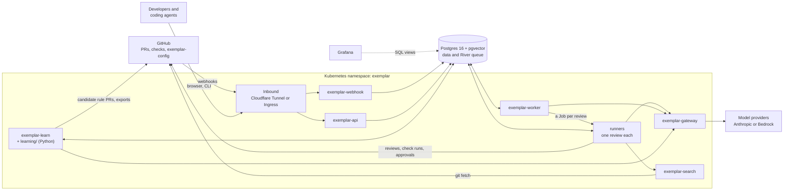
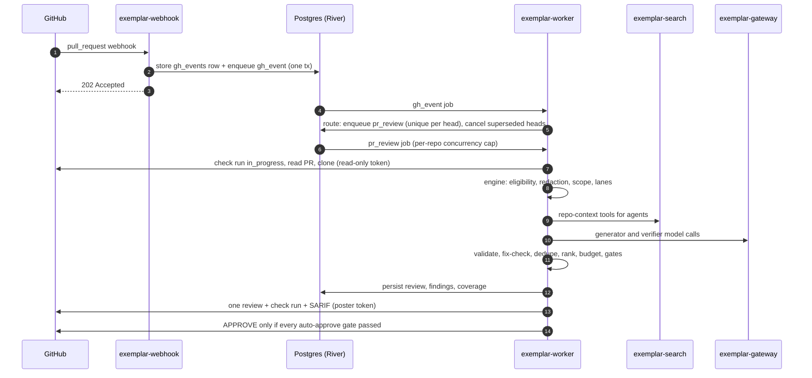
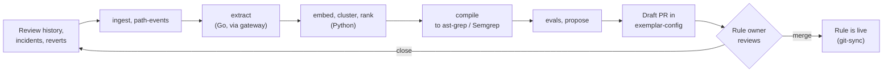
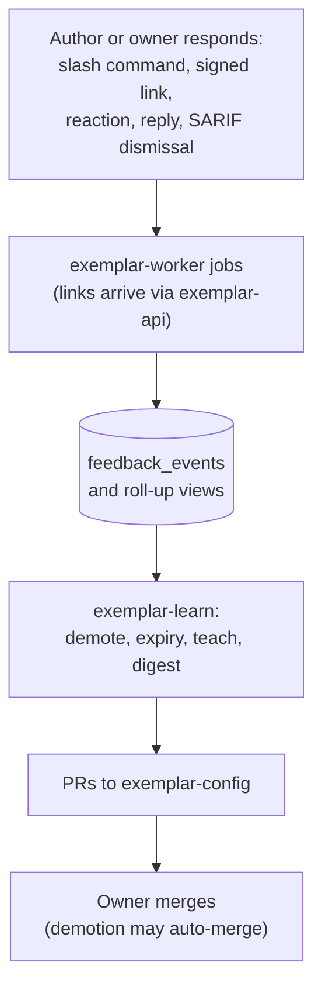
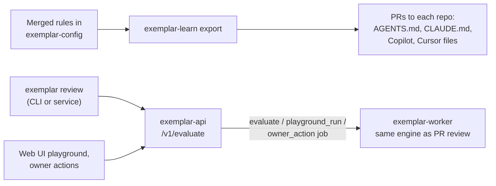

# Architecture

How Exemplar is put together **as built in this repository**: the processes, how they talk, and the paths work takes through them. The target design, with its reasoning, is in the [technical specification](https://github.com/koblas/exemplar/blob/main/docs/spec/technical-spec.md) in the repository; what is built and what is not is tracked in the [plans index](https://github.com/koblas/exemplar/blob/main/docs/plans/README.md).

## System context

Exemplar is a GitHub App. It reviews pull requests against rules that teams own in a git repository, `exemplar-config`. It learns candidate rules from review history and demotes rules that people say are wrong.

Every service is a Go binary from one module (`cmd/*`), shipped in one image. The Python learning jobs ship in a second image. All state lives in one Postgres database, and all asynchronous work is a [River](https://riverqueue.com) job in that same database: there is no separate message broker or workflow engine.

## Components

| Binary | Kubernetes kind | Role | Talks to |
|---|---|---|---|
| [`exemplar-webhook`](https://github.com/koblas/exemplar/tree/main/cmd/exemplar-webhook) | Deployment | Verifies `X-Hub-Signature-256`, stores the raw delivery in `gh_events` keyed by `X-GitHub-Delivery`, and enqueues a `gh_event` job in the same transaction. No business logic. | Postgres only |
| [`exemplar-worker`](https://github.com/koblas/exemplar/tree/main/cmd/exemplar-worker) `serve` | Deployment | Control: runs River. Routes events, records feedback, runs owner-action jobs and the periodic jobs, and dispatches each review, `/v1/evaluate` run and playground run to a runner. | Postgres, GitHub, gateway, Kubernetes API |
| [`exemplar-worker`](https://github.com/koblas/exemplar/tree/main/cmd/exemplar-worker) `run-job` | A Job per review, or inside control | One review: checkout, lanes, verification, gates, and the post. Exits when done. With control, the only component that writes to PRs. | Postgres, GitHub, gateway, search |
| [`exemplar-gateway`](https://github.com/koblas/exemplar/tree/main/cmd/exemplar-gateway) | Deployment | The only holder of model-provider credentials. Routes each stage through an ordered provider list with failover, scans requests for secrets, enforces spend and rate limits, and records every call in `model_calls`. | Providers, Postgres; accepts traffic from worker and learn only |
| [`exemplar-search`](https://github.com/koblas/exemplar/tree/main/cmd/exemplar-search) | StatefulSet | Holds the git mirror and a zoekt index with ctags symbols, and answers `search_text`, `find_definition`, `find_references`, `dependents` and `read_file` over an internal API. | GitHub (fetch); accepts traffic from worker only |
| [`exemplar-api`](https://github.com/koblas/exemplar/tree/main/cmd/exemplar-api) | Deployment | Sign-in (GitHub OAuth and/or OIDC), signed feedback links, the `/ui/` web UI, and `/v1/evaluate` for the CLI and services. Enqueues work for the worker instead of running the engine itself. | Postgres, GitHub (OAuth) |
| [`exemplar-learn`](https://github.com/koblas/exemplar/tree/main/cmd/exemplar-learn) | CronJobs | The learning plane: `ingest`, `path-events`, `extract`, `evals`, `compile`, `propose`, `demote`, `expiry`, `teach`, `digest`, `export`. | Postgres, GitHub, gateway |
| [`learning/`](https://github.com/koblas/exemplar/tree/main/learning) (Python) | CronJobs | `embed`, `cluster` and `rank` over tables in Postgres. No API surface. | Postgres, gateway |
| [`exemplar`](https://github.com/koblas/exemplar/tree/main/cmd/exemplar) | CLI | Config validation, evals, replay, mutations, calibration, `try`, and `login`/`review` against `/v1/evaluate`. | `exemplar-api` |
| `exemplar-cloudflared` | Deployment | The default way in: a Cloudflare Tunnel connector, so the cluster needs no public ingress. Replaced or joined by an Ingress in [`deploy/k8s/direct`](https://github.com/koblas/exemplar/tree/main/deploy/k8s/direct). | Cloudflare edge, webhook, api |

The worker, gateway, search and learn pods read `exemplar-config` through a git-sync sidecar that clones it as the GitHub App. Runners don't: the worker stores every config version it loads in Postgres, and each review runs with the version it was dispatched with, so a config change mid-review never splits one review across two versions.

Reviews are isolated from each other and from control. In production each one is a Kubernetes Job of its own, made from a pod template, so capacity follows the queue rather than the number of worker pods, up to a runner quota shared by every worker pod, and a review's checkout, memory and model-facing code end with its pod. The quickstart runs the same runner inside the worker pod instead; it is one flag. The worker alone may call the Kubernetes API, and only to make, read and delete those Jobs. Until the App exists, `exemplar-api` runs in setup mode: a page reached with `kubectl port-forward` registers the App from a manifest ([`internal/setup`](https://github.com/koblas/exemplar/blob/main/internal/setup/setup.go)). Manifests are in [`deploy/k8s`](https://github.com/koblas/exemplar/tree/main/deploy/k8s) and described in [Workloads, ports and probes](../reference/workloads.md).

!!! note "Design vs. as built"
    The design describes separate `exemplar-orchestrator`, `exemplar-poster` and `exemplar-feedback` services. Today those roles run as River jobs inside `exemplar-worker` and its runners (see the package docs in [`internal/worker/worker.go`](https://github.com/koblas/exemplar/blob/main/internal/worker/worker.go) and [`internal/worker/runner.go`](https://github.com/koblas/exemplar/blob/main/internal/worker/runner.go)). Write access is still separated: the worker mints a distinct GitHub token flavor for reading, for gate lookups, and for posting, and gives a runner only the tokens of its own job, for its own repository. Runners never hold the App key.

## Reviewing a pull request (online path)

The webhook answers inside GitHub's 10-second window because it only stores and enqueues. A review is idempotent on its PR head and config version, so a retried or re-delivered job skips work already done. Two reviews of the same head never run at once, on any replica: the second waits until the first ends, then finds what it posted. A run that cannot complete (both providers down for a stage, or a diff that cannot be redacted) posts no comments and no approval; its check run says why and offers a re-run.

Besides `pr_review`, the event router turns webhooks into `feedback_signal`, `feedback_command` (slash commands), `linter_check` (late CI results), `merge_policy` and `alert_dismissal` jobs ([`internal/worker/events.go`](https://github.com/koblas/exemplar/blob/main/internal/worker/events.go)). What happens inside one review is on [How a review works](how-a-review-works.md).

## Learning rules (offline path)

Each step is a CronJob that reads and writes Postgres tables, so steps are resumable and independent. Nothing reaches the online path until a rule owner merges a PR in `exemplar-config`; evals, volume estimates and linter-overlap checks run as GitHub Actions on that PR. The steps are described on [Rule lifecycle](rule-lifecycle.md).

## Feedback loop

The loop only *proposes* changes as config PRs. Demotion reduces behavior, so it can merge automatically; promotion and new exceptions always need an owner.

## Shift left (authoring time)

What a coding agent is told, what it can check locally, and what the PR bot enforces all come from the same merged rules and the same engine.

## Trust boundaries

- **Inbound:** only the webhook and api are reachable from outside, through the tunnel or an Ingress. NetworkPolicies default-deny everything else ([`deploy/k8s/core/networkpolicies.yaml`](https://github.com/koblas/exemplar/blob/main/deploy/k8s/core/networkpolicies.yaml)).
- **Model access:** only the gateway holds provider keys, and only the worker, its runners and learn may call it. It runs a second secret scan on every request.
- **Repository context:** only the worker and its runners may call `exemplar-search`.
- **GitHub write:** only the worker and its runners post, using a poster token separate from its read-only clone and read tokens. The webhook has no GitHub access at all.
- **Data handling:** what the code does with repository data is on [Trust and data handling](trust-and-data.md).

## Code map

| Path | What lives there |
|---|---|
| [`cmd/`](https://github.com/koblas/exemplar/tree/main/cmd) | One `main` per binary above. |
| [`internal/engine`](https://github.com/koblas/exemplar/tree/main/internal/engine), [`internal/pipeline`](https://github.com/koblas/exemplar/tree/main/internal/pipeline) | The review engine and its stages. |
| [`internal/scope`](https://github.com/koblas/exemplar/tree/main/internal/scope), [`internal/compiled`](https://github.com/koblas/exemplar/tree/main/internal/compiled), [`internal/buglane`](https://github.com/koblas/exemplar/tree/main/internal/buglane) | Scope and lane selection, Lane 1 engines, Lane 3. |
| [`internal/gates`](https://github.com/koblas/exemplar/tree/main/internal/gates), [`internal/mergesafety`](https://github.com/koblas/exemplar/tree/main/internal/mergesafety), [`internal/codeowners`](https://github.com/koblas/exemplar/tree/main/internal/codeowners) | Auto-approve gates and their inputs. |
| [`internal/syntax`](https://github.com/koblas/exemplar/tree/main/internal/syntax) | Fix validation (go/parser, gofmt, tree-sitter). |
| [`internal/worker`](https://github.com/koblas/exemplar/tree/main/internal/worker), [`internal/webhook`](https://github.com/koblas/exemplar/tree/main/internal/webhook) | River jobs and event routing; webhook verification. |
| [`internal/llm`](https://github.com/koblas/exemplar/tree/main/internal/llm), [`internal/redact`](https://github.com/koblas/exemplar/tree/main/internal/redact) | Model clients via the gateway; secret scanning. |
| [`internal/search`](https://github.com/koblas/exemplar/tree/main/internal/search) | `exemplar-search` mirror, index and tools. |
| [`internal/learn`](https://github.com/koblas/exemplar/tree/main/internal/learn) | Learning-plane jobs behind `exemplar-learn`. |
| [`internal/api`](https://github.com/koblas/exemplar/tree/main/internal/api), [`internal/web`](https://github.com/koblas/exemplar/tree/main/internal/web) | HTTP API, sign-in, and the web UI. |
| [`internal/store`](https://github.com/koblas/exemplar/tree/main/internal/store), [`db/`](https://github.com/koblas/exemplar/tree/main/db) | Postgres access (sqlc), job args, migrations. |
| [`internal/config`](https://github.com/koblas/exemplar/tree/main/internal/config), [`schema/`](https://github.com/koblas/exemplar/tree/main/schema) | `exemplar-config` loading; JSON Schema contracts shared with Python. |
| [`learning/`](https://github.com/koblas/exemplar/tree/main/learning) | Python `embed`, `cluster` and `rank` jobs (uv project). |
| [`deploy/`](https://github.com/koblas/exemplar/tree/main/deploy), [`dashboards/`](https://github.com/koblas/exemplar/tree/main/dashboards) | Images, Kustomize manifests, Grafana boards and alerts. |
