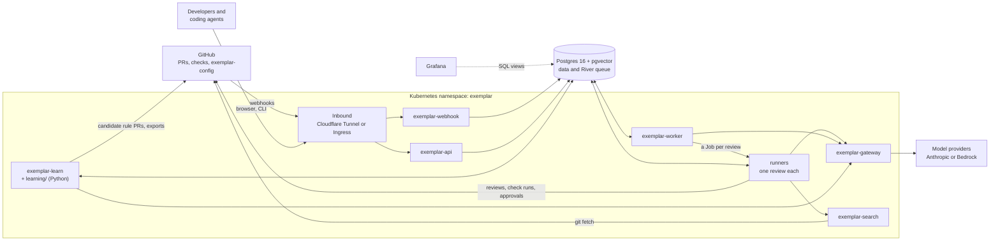
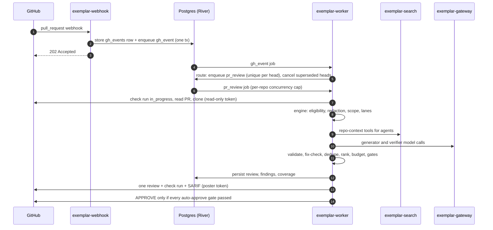
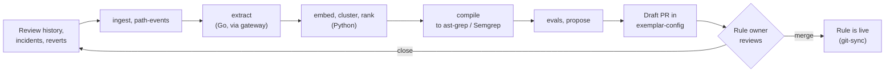
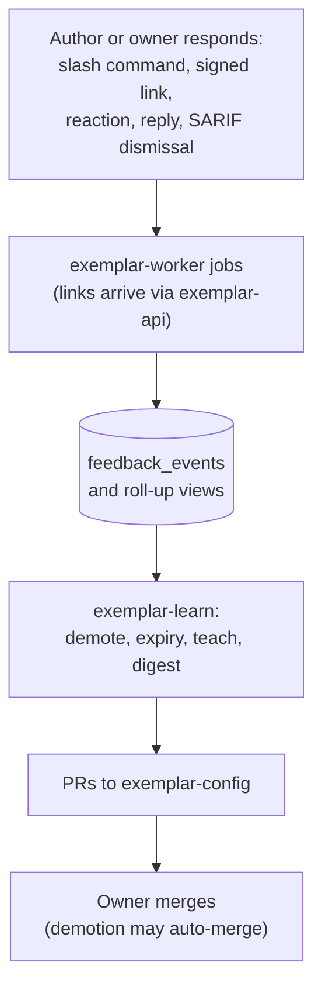
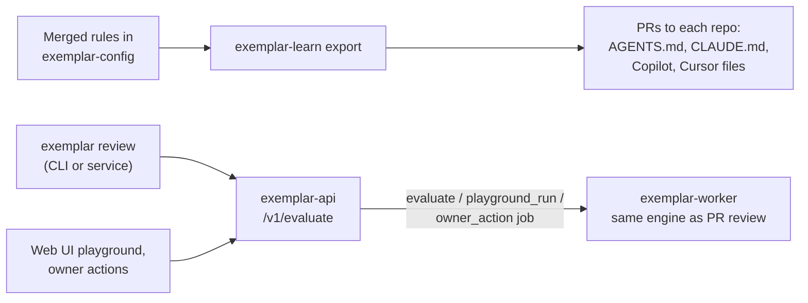

# Architecture

This page shows how Exemplar is put together **as built in this repository**: the processes, how they talk to each other, and the paths work takes through them. The target design, with the reasoning behind it, is in the [technical specification](https://github.com/koblas/exemplar/blob/main/docs/spec/technical-spec.md). What is built and what is not is tracked in the [plans index](https://github.com/koblas/exemplar/blob/main/docs/plans/README.md).

## The big picture

Exemplar is a GitHub App. It reviews pull requests against rules that your teams own in a git repository called `exemplar-config`. It learns candidate rules from your review history, and it demotes rules that people say are wrong.

A few things to know before reading the table:

- **Every service is a Go program** built from one code module (`cmd/*`) and shipped in one container image. The Python learning jobs ship in a second image.
- **All state lives in one Postgres database.** Every piece of background work is a job in [River](https://riverqueue.com), a job queue that stores its queue in that same database. There is no separate message broker and no workflow engine to run.
- **Model providers** are the companies that host the AI models (Anthropic, or Amazon Bedrock). Only one process, the gateway, ever talks to them.

## Components

| Binary | Kubernetes kind | Role | Talks to |
|---|---|---|---|
| [`exemplar-webhook`](https://github.com/koblas/exemplar/tree/main/cmd/exemplar-webhook) | Deployment | Receives GitHub's webhook calls. Checks the signature GitHub sends (`X-Hub-Signature-256`) to confirm the call is real, stores the raw delivery in the `gh_events` table keyed by `X-GitHub-Delivery`, and queues a `gh_event` job in the same database transaction. It has no business logic. | Postgres only |
| [`exemplar-worker`](https://github.com/koblas/exemplar/tree/main/cmd/exemplar-worker) `serve` | Deployment | The control process. Runs the River job queue, routes events, records feedback, runs owner-action jobs and the scheduled jobs, and hands each review, `/v1/evaluate` run and playground run to a runner. | Postgres, GitHub, gateway, Kubernetes API |
| [`exemplar-worker`](https://github.com/koblas/exemplar/tree/main/cmd/exemplar-worker) `run-job` | A Kubernetes Job per review, or inside the control process | One review from start to finish: check out the code, run the lanes, verify, apply the gates, post. Exits when done. Together with the control process, this is the only component that writes to PRs. | Postgres, GitHub, gateway, search |
| [`exemplar-gateway`](https://github.com/koblas/exemplar/tree/main/cmd/exemplar-gateway) | Deployment | The only holder of model-provider credentials. Sends each stage's model call through an ordered list of providers, failing over to the next when one is down. Scans requests for secrets, enforces spend and rate limits, and records every call in the `model_calls` table. | Providers, Postgres; accepts traffic from worker and learn only |
| [`exemplar-search`](https://github.com/koblas/exemplar/tree/main/cmd/exemplar-search) | StatefulSet | Keeps a mirror of your git repositories and a code-search index ([zoekt](https://github.com/sourcegraph/zoekt), with symbols from ctags). Answers `search_text`, `find_definition`, `find_references`, `dependents` and `read_file` over an internal API. | GitHub (fetch); accepts traffic from worker only |
| [`exemplar-api`](https://github.com/koblas/exemplar/tree/main/cmd/exemplar-api) | Deployment | Sign-in (GitHub OAuth and/or OIDC), signed feedback links, the `/ui/` web UI, and `/v1/evaluate` for the CLI and other services. It queues work for the worker instead of running the review engine itself. | Postgres, GitHub (OAuth) |
| [`exemplar-learn`](https://github.com/koblas/exemplar/tree/main/cmd/exemplar-learn) | CronJobs | The learning plane: `ingest`, `path-events`, `extract`, `evals`, `compile`, `propose`, `demote`, `expiry`, `teach`, `digest`, `export`. | Postgres, GitHub, gateway |
| [`learning/`](https://github.com/koblas/exemplar/tree/main/learning) (Python) | CronJobs | `embed`, `cluster` and `rank` over tables in Postgres. No API of its own. | Postgres, gateway |
| [`exemplar`](https://github.com/koblas/exemplar/tree/main/cmd/exemplar) | CLI | Config validation, evals, replay, mutations, calibration, `try`, and `login`/`review` against `/v1/evaluate`. | `exemplar-api` |
| `exemplar-cloudflared` | Deployment | The default way in from the internet: a Cloudflare Tunnel connector, so the cluster needs no public ingress. Replaced or joined by a Kubernetes Ingress in [`deploy/k8s/direct`](https://github.com/koblas/exemplar/tree/main/deploy/k8s/direct). | Cloudflare edge, webhook, api |

A *Deployment* is a long-running service. A *StatefulSet* is a long-running service with its own persistent disk. A *CronJob* runs on a schedule and exits. A *Job* runs once and exits.

**How config reaches the services.** The worker, gateway, search and learn pods read `exemplar-config` through a git-sync sidecar, a small helper container that keeps a clone of the repository up to date using the GitHub App's identity. Runners work differently: the worker stores every version of the config it loads in Postgres, and each review runs with the exact version it was started with. A config change in the middle of a review can never split one review across two versions.

**How reviews are isolated.** Reviews are kept apart from each other and from the control process. In production, each review is its own Kubernetes Job made from a pod template. That means capacity follows the length of the queue rather than the number of worker pods, up to a runner quota that all worker pods share. When the review ends, its pod ends too, taking its checkout, memory and model-facing code with it. The quickstart runs the same runner inside the worker pod instead; switching between the two is one flag. The worker is the only component allowed to call the Kubernetes API, and only to create, read and delete those Jobs.

**Before the GitHub App exists**, `exemplar-api` runs in setup mode: a page you reach with `kubectl port-forward` registers the App from a manifest ([`internal/setup`](https://github.com/koblas/exemplar/blob/main/internal/setup/setup.go)). The Kubernetes manifests are in [`deploy/k8s`](https://github.com/koblas/exemplar/tree/main/deploy/k8s) and described in [Workloads, ports and probes](../reference/workloads.md).

!!! note "Design vs. as built"
    The design describes separate `exemplar-orchestrator`, `exemplar-poster` and `exemplar-feedback` services. Today those roles run as River jobs inside `exemplar-worker` and its runners (see the package docs in [`internal/worker/worker.go`](https://github.com/koblas/exemplar/blob/main/internal/worker/worker.go) and [`internal/worker/runner.go`](https://github.com/koblas/exemplar/blob/main/internal/worker/runner.go)). Write access is still kept separate: the worker creates a different kind of GitHub token for reading, for gate lookups, and for posting, and gives a runner only the tokens for its own job and its own repository. Runners never hold the App's private key.

## Reviewing a pull request (the online path)

Some details worth knowing:

- **The webhook answers fast.** GitHub gives a webhook receiver 10 seconds to respond. The webhook only stores the delivery and queues a job, so it always makes it.
- **A review is idempotent.** It is keyed on the PR head (the exact commit being reviewed) and the config version. If a job is retried or GitHub re-delivers the webhook, the second run sees the work is already done and skips it.
- **One review per head at a time.** Two reviews of the same head never run at once, on any replica. The second waits until the first ends, then finds what it posted.
- **A run that cannot finish posts nothing.** If both providers are down for a stage, or the diff cannot have its secrets redacted, the review posts no comments and no approval. Its check run says why and offers a re-run.

The `pr_review` job is not the only one. The event router also turns webhooks into `feedback_signal`, `feedback_command` (slash commands), `linter_check` (late CI results), `merge_policy` and `alert_dismissal` jobs ([`internal/worker/events.go`](https://github.com/koblas/exemplar/blob/main/internal/worker/events.go)). What happens inside one review is on [How a review works](how-a-review-works.md).

## Learning rules (the offline path)

Each step is a CronJob that reads and writes Postgres tables. Because each step leaves its results in the database, steps can be resumed and run independently. Nothing reaches the online path until a rule owner merges a PR in `exemplar-config`. Evals, volume estimates and linter-overlap checks run as GitHub Actions on that PR. The steps are described on [Rule lifecycle](rule-lifecycle.md).

## The feedback loop

The loop only *proposes* changes, as config PRs. Demotion makes Exemplar do less, so it can merge automatically. Promotion and new exceptions always need an owner.

## Shift left (before the PR)

"Shift left" means catching problems earlier, while code is being written rather than after it is submitted.

What a coding agent is told, what a developer can check locally, and what the PR bot enforces all come from the same merged rules and the same engine.

## Trust boundaries

- **Inbound:** only the webhook and the api can be reached from outside, through the tunnel or an Ingress. Kubernetes NetworkPolicies deny everything else by default ([`deploy/k8s/core/networkpolicies.yaml`](https://github.com/koblas/exemplar/blob/main/deploy/k8s/core/networkpolicies.yaml)).
- **Model access:** only the gateway holds provider keys, and only the worker, its runners and learn may call it. It runs a second secret scan on every request.
- **Repository context:** only the worker and its runners may call `exemplar-search`.
- **GitHub write:** only the worker and its runners post to GitHub, using a poster token that is separate from its read-only clone and read tokens. The webhook has no GitHub access at all.
- **Data handling:** what the code does with repository data is on [Trust and data handling](trust-and-data.md).

## Code map

| Path | What lives there |
|---|---|
| [`cmd/`](https://github.com/koblas/exemplar/tree/main/cmd) | One `main` per binary above. |
| [`internal/engine`](https://github.com/koblas/exemplar/tree/main/internal/engine), [`internal/pipeline`](https://github.com/koblas/exemplar/tree/main/internal/pipeline) | The review engine and its stages. |
| [`internal/scope`](https://github.com/koblas/exemplar/tree/main/internal/scope), [`internal/compiled`](https://github.com/koblas/exemplar/tree/main/internal/compiled), [`internal/buglane`](https://github.com/koblas/exemplar/tree/main/internal/buglane) | Scope and lane selection, Lane 1 engines, Lane 3. |
| [`internal/gates`](https://github.com/koblas/exemplar/tree/main/internal/gates), [`internal/mergesafety`](https://github.com/koblas/exemplar/tree/main/internal/mergesafety), [`internal/codeowners`](https://github.com/koblas/exemplar/tree/main/internal/codeowners) | Auto-approve gates and their inputs. |
| [`internal/syntax`](https://github.com/koblas/exemplar/tree/main/internal/syntax) | Fix validation (go/parser, gofmt, tree-sitter). |
| [`internal/worker`](https://github.com/koblas/exemplar/tree/main/internal/worker), [`internal/webhook`](https://github.com/koblas/exemplar/tree/main/internal/webhook) | River jobs and event routing; webhook verification. |
| [`internal/llm`](https://github.com/koblas/exemplar/tree/main/internal/llm), [`internal/redact`](https://github.com/koblas/exemplar/tree/main/internal/redact) | Model clients via the gateway; secret scanning. |
| [`internal/search`](https://github.com/koblas/exemplar/tree/main/internal/search) | `exemplar-search` mirror, index and tools. |
| [`internal/learn`](https://github.com/koblas/exemplar/tree/main/internal/learn) | Learning-plane jobs behind `exemplar-learn`. |
| [`internal/api`](https://github.com/koblas/exemplar/tree/main/internal/api), [`internal/web`](https://github.com/koblas/exemplar/tree/main/internal/web) | HTTP API, sign-in, and the web UI. |
| [`internal/store`](https://github.com/koblas/exemplar/tree/main/internal/store), [`db/`](https://github.com/koblas/exemplar/tree/main/db) | Postgres access (sqlc), job args, migrations. |
| [`internal/config`](https://github.com/koblas/exemplar/tree/main/internal/config), [`schema/`](https://github.com/koblas/exemplar/tree/main/schema) | `exemplar-config` loading; JSON Schema contracts shared with Python. |
| [`learning/`](https://github.com/koblas/exemplar/tree/main/learning) | Python `embed`, `cluster` and `rank` jobs (uv project). |
| [`deploy/`](https://github.com/koblas/exemplar/tree/main/deploy), [`dashboards/`](https://github.com/koblas/exemplar/tree/main/dashboards) | Images, Kustomize manifests, Grafana boards and alerts. |
