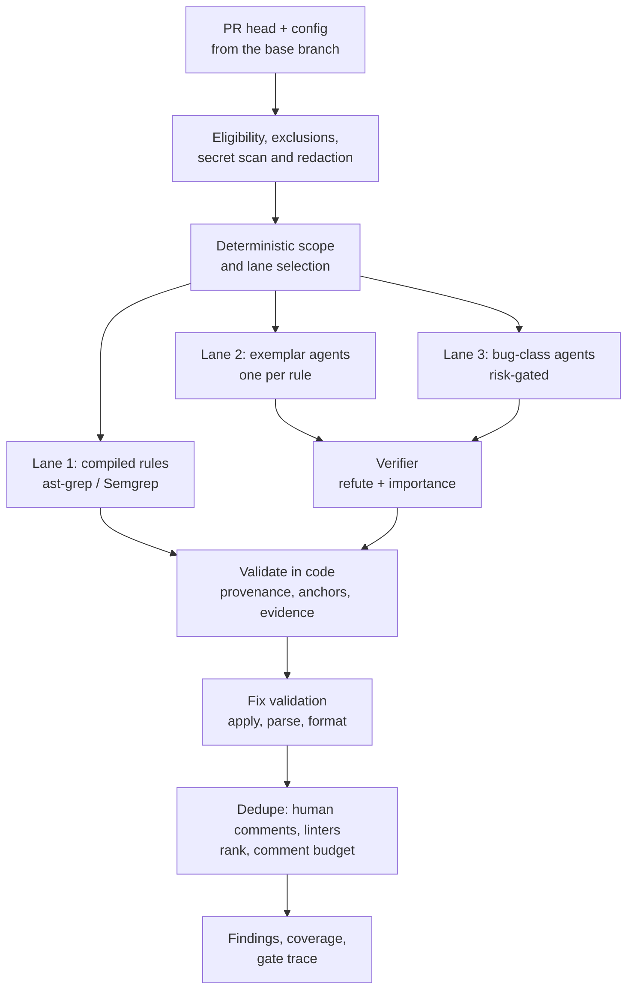

# How a review works

One review is one run of the engine in [`internal/engine`](https://github.com/koblas/exemplar/tree/main/internal/engine) over one pull request head and one version of `exemplar-config`. The same engine serves live PRs, `exemplar review` through `/v1/evaluate`, the playground, replay and evals, so what you see in any of them is what the PR bot would post.

## Who reviews this PR?

Every review ends in one of three outcomes, and the point of the pipeline below is to reach the right one with evidence code can check:

| Outcome | What the PR gets | When |
|---|---|---|
| **Approved, no human review needed** | A native `APPROVE` from the App (or a passing `exemplar/merge-policy` check), and a check run saying so | The repository opted in, every deterministic gate passed, the review ran to full coverage with zero candidate findings, and two models from different families both rated the change low-risk |
| **Routed to humans, with findings** | One review with inline comments, each verified, labelled and budgeted, with a fix where it validated | Any lane produced a finding that survived the verifier and validation |
| **Routed to humans, nothing to flag** | A neutral check run and no comments | The review found nothing, but the PR was not eligible for approval: the repo is not opted in, a path or author is outside the allow list, coverage was incomplete, the run was degraded, or a Stage 2 check failed |

The first outcome is what absorbs volume: it removes the PR from the human queue. The other two keep the standard: a human reads the PR, and where Exemplar had something to say, it has already been checked twice. Exemplar never requests changes and never blocks a merge. Each decision and the gate that made it is recorded in `approval_decisions` and shown on the audit page, so a reviewer, or an auditor, can see why a PR landed where it did. [Auto-approve](#auto-approve) below has the gates.

## Before any model sees anything

**Eligibility.** A repository on the Security-owned denylist in `platform/eligibility.yaml` is never reviewed, mined, indexed or sent to a provider. A repository with `enabled: false`, or `enabled: false` in `global.yaml`, is skipped. Draft PRs are reviewed only where `review_drafts` says so; PRs from forks only where `forks.review` says so.

**Exclusions.** Binary files, files over 1 MB, deleted files, and paths ignored by `.gitattributes` or `.exemplarignore` are left out of the diff. They are also what makes a PR ineligible for auto-approve: a change the bot didn't read can't be approved by it.

**Redaction.** The diff is scanned for secrets before it leaves the worker; the gateway scans every request a second time. A diff that cannot be redacted makes the run incomplete rather than sending it anyway.

**Scope.** Each rule's `file_patterns` are matched deterministically against the changed files, so a rule runs only where it applies and only the rules that apply cost anything. When more than `max_exemplar_rules` apply, the lowest-precision ones are skipped and listed in the check run as "not run on this review".

## Three lanes

**Lane 1, compiled rules.** A rule with `kind: compiled` carries an ast-grep or Semgrep rule and runs as a pattern, with no model. These are the cheapest and most precise findings, and the learning plane tries to compile every candidate it can.

**Lane 2, exemplar rules.** A rule with `kind: exemplar` gets its own agent: a model call that sees the rule's text, the hunks in scope and read-only tools over the repository through `exemplar-search` (`search_text`, `find_definition`, `find_references`, `dependents`, `read_file`). A rule's `context: text-only` denies those tools. The agent can only say a location, a message and an optional fix; rule ids, severities, citations and lanes are attached by code. Rules start on the `standard` model tier and move to `high` when their eval precision falls short; blocking and security rules start on `high`.

**Lane 3, the bug lane.** Agents look for common bug classes (nil dereference, error handling, concurrency, resource leaks, off-by-one, contract) independent of any rule. They run on risky PRs: critical paths, at least `bug_lane.min_changed_lines` changed non-test lines, a low merge-safety score, or an incident or revert in the last 90 days, and always on a PR being considered for auto-approve. Findings are posted only for classes with `post_on_critical_paths` and only inside a repo's `bug_lane.critical_paths`; otherwise they stay in shadow.

`concurrency.agents_per_review` bounds how many lane 2 and 3 agents run at once.

## The verifier

Every lane 2 and lane 3 finding goes to a second model whose job is to refute it and to score how much it matters here. The verifier is meant to be a different model family from the generator; when it isn't (the example config routes both to Claude), each finding is flagged `same_family`, which blocks auto-approve but not posting. A finding the verifier refutes is dropped; one it confirms below `verifier.importance_min` (or `bug_lane.importance_min` for lane 3) is stored but not posted. Up to `verifier.max_candidates_per_call` findings share one verifier call.

The verifier is calibrated against labelled findings in `evals/_verifier` and must refute at least 90% of known-wrong findings and at most 10% of known-true ones; config CI runs that calibration whenever a config PR changes what the verifier depends on.

## Validation in code

Model output is untrusted. Code checks that every finding anchors to lines that are actually in the diff (an anchor GitHub would reject is dropped), that its evidence resolves, and that its provenance (which rule, which lane, which citation) came from config, not from the model. A model cannot fabricate a citation, claim coverage it didn't have, or suppress another finding; the adversarial set in `evals/_adversarial` runs on every config change to keep that true.

**Fix validation.** A suggested fix is applied to the file, parsed (go/parser for Go, tree-sitter for the other languages) and formatted. Only a fix that applies cleanly, parses and replaces exactly the anchored lines is posted as a GitHub suggestion; otherwise the finding is posted with a description of the fix (`fix_policy: describe`) or without one.

## Dedupe, rank, budget

- A finding that overlaps a human reviewer's earlier comment is recorded as agreement, not posted again.
- A finding that overlaps an annotation from one of the repo's configured `linters` (and the rule's `linter_map`) is a linter duplicate and dropped. The review waits up to `linter_wait_seconds` for those check runs; late linter results close the finding afterwards.
- Findings are ranked by severity and importance and cut to `comment_budget.per_pr` and `comment_budget.per_file`. Security and blocking findings are always posted; if they alone exceed the budget they are grouped into one comment per file.

## What gets posted

One review per PR head, as `COMMENT`, never `REQUEST_CHANGES`. Each inline comment is a Conventional Comments label and the message, a `suggestion` block when the fix validated, the feedback-link footer, and a line naming the rule and its citation. The `exemplar` check run summarises the run, lists rules that did not complete, and shows the cost. Security findings are also uploaded as SARIF so they appear as code-scanning alerts.

A run that cannot complete (every provider for a stage down, a diff that cannot be redacted) posts nothing: the check run is neutral with "Review did not complete" and a **Re-run** action. A newer push supersedes a running review; its check run says so and nothing is posted for the old head. In `shadow: true` repos every lane runs and everything is stored, but nothing is written to the PR.

## Auto-approve

Auto-approval is the decision that produces the first outcome above. It is a separate decision after the review, and off unless both `global.yaml` and the repo opt in. Models never make it: Stage 1 consults no model output at all, and Stage 2's categorisation can only withhold an approval, never grant one on its own. **Stage 1** is strictly deterministic: full coverage, zero findings (including shadow ones), every changed file reviewed, paths inside the repo's allow list and outside the hard-coded and `extra_denylist` paths, an allowed author, file and line limits, no same-family verification, and branch rules that can carry the approval. **Stage 2** asks two models from different families to categorise the PR as safe or risky and requires both to agree above `min_review_confidence`, plus a deterministic merge-safety score above `min_merge_safety_score`. Every decision, with each gate's reason, is recorded in `approval_decisions` and shown on the audit page. An approval never carries forward: a new push dismisses it.

The design that this page summarises, with its reasoning, is in the [technical specification](https://github.com/koblas/exemplar/blob/main/docs/spec/technical-spec.md).
