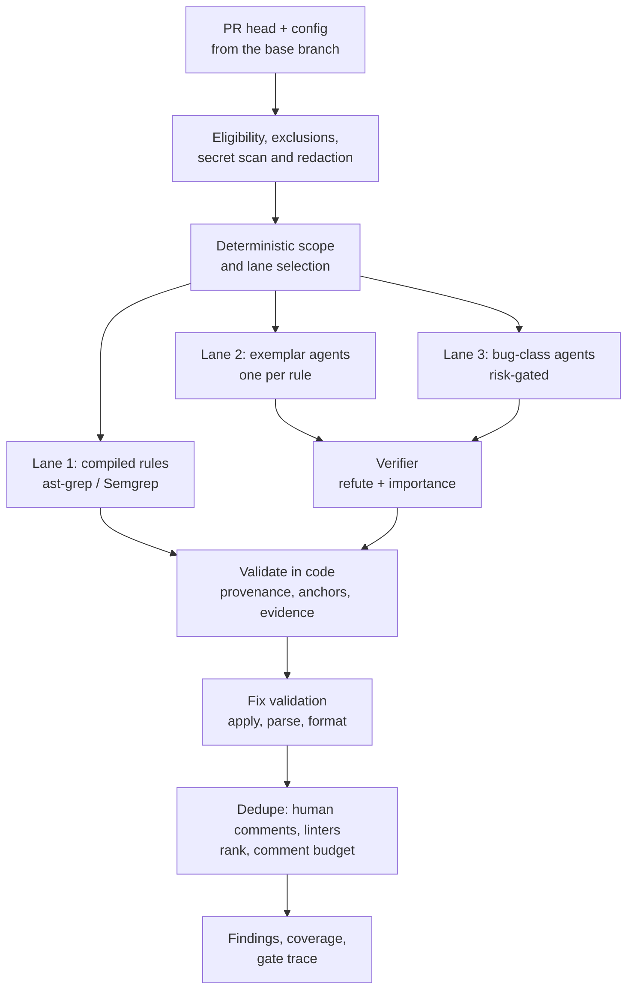

# How a review works

One review is one run of the review engine ([`internal/engine`](https://github.com/koblas/exemplar/tree/main/internal/engine)) over one pull request head (the exact commit being reviewed) and one version of `exemplar-config`. The same engine runs live PRs, the `exemplar review` command through `/v1/evaluate`, the playground, replays and evals. Whatever you see in any of them is what the PR bot would post.

Read the diagram top to bottom. First the engine decides what it is allowed to look at. Then it decides which rules apply. Three "lanes" produce candidate findings. A second model tries to knock those findings down. Code checks what is left, tries out any suggested fixes, removes duplicates, and trims the list to a budget. The result is a set of findings, a coverage number, and a record of every gate's decision.

## Who reviews this PR?

Every review ends in one of three outcomes. The whole pipeline exists to reach the right one, with evidence that code can check:

| Outcome | What the PR gets | When |
|---|---|---|
| **Approved, no human review needed** | A native `APPROVE` from the App (or a passing `exemplar/merge-policy` check), and a check run saying so | The repository opted in, every deterministic gate passed, the review covered everything with no blocking, important or Security candidate finding, and two models from different families both rated the change low-risk. Any suggestions the review raised are posted beside the approval |
| **Routed to humans, with findings** | One review with inline comments, each verified, labelled and within budget, with a fix where one validated | Some lane produced a finding that survived the verifier and validation, and the PR was not approved |
| **Routed to humans, nothing to flag** | A neutral check run whose first line says why, and no comments | The review found nothing, but the PR could not be approved: the repo is not opted in, a path or author is outside the allow list, coverage was incomplete, the run was degraded, or a Stage 2 check failed |

The first outcome is what absorbs volume: it takes the PR out of the human queue. The other two hold the standard: a human reads the PR, and where Exemplar had something to say, it has already been checked twice. Exemplar never requests changes and never blocks a merge.

The `exemplar` check run states the verdict in its title and first line. It says "No human review needed" with the approval, or "Human review needed" with up to three reasons in plain words, such as a denylisted path, a candidate finding, or a merge-safety score below the bar. When auto-approve is off for the repository, it says that and nothing else. Each decision, with every gate's reason, is recorded in the `approval_decisions` table and shown on the audit page, so a reviewer or an auditor can see why a PR landed where it did. [Auto-approve](#auto-approve) below lists the gates.

## Before any model sees anything

Several checks run before a single line of code is sent to a model.

**Eligibility.** A repository on the Security-owned denylist in `platform/eligibility.yaml` is never reviewed, mined, indexed or sent to a provider. A repository with `enabled: false`, or an installation with `enabled: false` in `global.yaml`, is skipped. Draft PRs are reviewed only where `review_drafts` says so. PRs from forks are reviewed only where `forks.review` says so.

**Exclusions.** Binary files, files over 1 MB, deleted files, and paths ignored by `.gitattributes` or `.exemplarignore` are left out of the diff. The agents' tools cannot open, list or search them either. These exclusions also make a PR ineligible for auto-approve: a change the bot didn't read can't be approved by it.

**Redaction.** The diff is scanned for secrets (passwords, API keys, tokens) before it leaves the worker. The gateway scans every request a second time. If a diff cannot be redacted, the run is marked incomplete rather than sending the secret anyway.

**Scope.** Each rule has `file_patterns` that say which files it applies to. These are matched against the changed files by code, not by a model, so a rule runs only where it applies and only the rules that apply cost anything. When more rules apply than `max_exemplar_rules` allows, the rules with the lowest precision are skipped and listed in the check run as "not run on this review".

## Three lanes

A *lane* is one way of producing a finding. There are three.

**Lane 1, compiled rules.** A rule with `kind: compiled` carries a pattern written for [ast-grep](https://ast-grep.github.io) or [Semgrep](https://semgrep.dev), two tools that match patterns in code the way regular expressions match patterns in text. It runs as a pattern, with no model. These are the cheapest and most precise findings, and the learning plane tries to compile every candidate it can.

**Lane 2, exemplar rules.** A rule with `kind: exemplar` gets its own AI agent: a model call that sees the rule's text, the changed code in scope, and a set of read-only tools. Four tools read the pull request's own checkout (`get_hunk`, `read_file`, `grep`, `list_dir`). Two more come from `exemplar-search` when it is set up: `find_references`, which finds uses of a name across all opted-in repositories, and `path_history`, which returns a file's incidents, reverts and recent commits. A rule with `context: text-only` gets none of those tools. The agent can only say three things: a location, a message and an optional fix. Rule ids, severities, citations and lanes are attached by code. Rules start on the `standard` model tier and move to the `high` tier when their eval precision falls short. Blocking and security rules start on `high`.

**Lane 3, the bug lane.** These agents look for common bug classes (nil dereference, error handling, concurrency, resource leaks, off-by-one, contract) without any rule telling them to. They run only on risky PRs: critical paths, at least `bug_lane.min_changed_lines` changed non-test lines, a low merge-safety score, or an incident or revert in the last 90 days. They always run on a PR being considered for auto-approve. Their findings are posted only for classes with `post_on_critical_paths` and only inside a repo's `bug_lane.critical_paths`. Otherwise they stay in shadow (stored but not posted).

The setting `concurrency.agents_per_review` limits how many lane 2 and lane 3 agents run at the same time.

### Without exemplar-search

An installation can run without the search service, and reviews are still complete without it. Every lane runs over the pull request's checkout, and the verifier, dedupe, budgets, posting and feedback work the same way. What the agents lose is knowledge of code outside this repository.

Without search, `find_references` and `path_history` answer from the checkout instead. References are found by looking for the name as a whole word anywhere in the head tree. Definitions are told apart from uses, and the results nearest the definition come first. The answer says that other repositories were not searched. History comes from the touched path's recent commits in the checkout, deepened once on the first request, plus the incidents and reverts Exemplar has recorded. For one repository, or a monorepo, that is nearly everything search would give. Across many repositories, what is missing is the cross-repository view.

The outcome depends on whether the repository names other repositories in `context.extra_repos`. Without them, every caller is in the checkout, so the bug lane's contract class runs on the local answers and the PR can be approved with no human review needed. With them, their callers were not searched: the contract class is skipped, the PR is routed to humans with "the bug lane did not run to full coverage" among the reasons, and findings are posted as usual. The check run also states the review's scope on every PR: "Cross-repository callers were not checked (search is not configured)", followed by the repository's `context.extra_repos`, when it has any, as the repositories not searched.

## The verifier

Every lane 2 and lane 3 finding goes to a second model, the *verifier*. Its job is to refute the finding and to score how much it matters here. The verifier is meant to be from a different model family than the model that generated the finding. When it isn't (the example config routes both to Claude), each finding is flagged `same_family`. That flag blocks auto-approve, but not posting, until the installation has shown that its verifier catches wrong findings. A finding the verifier refutes is dropped. A finding it confirms but scores below `verifier.importance_min` (or `bug_lane.importance_min` for lane 3) is stored but not posted. Up to `verifier.max_candidates_per_call` findings share one verifier call.

**Quorum.** A single verifier is not enough for the bug lane, whose findings are about runtime behaviour that no rule spells out. So every lane 3 finding, and every finding from a rule that sets `verify: quorum`, goes to a quorum instead: `verifier.quorum.n` verifiers (three by default), each a separate call in a fresh context, each starting at the next provider in `providers.verifier`. That spreads the quorum across every verifier model configured. The finding is confirmed only when at least `verifier.quorum.k` of them (two by default) confirm it with evidence that resolves in the code, and its importance is the median of their scores. A quorum finding counts as same-family only when every confirming verifier shared the generator's family. The share of verifiers that agreed is stored with the finding and ranks it above findings of the same severity with less agreement.

The quorum multiplies the verifier cost of each such finding by `n`. So when a review reaches its soft cost ceiling, the quorum's extra calls are the first work dropped. A finding whose quorum was cut short is held back (`quorum_shed`) rather than posted on one verifier's word, and the review counts as degraded. A finding that fails the quorum is held back as `quorum`.

**Calibration.** The verifier is tested against labelled findings in `evals/_verifier`, plus findings that authors marked wrong or fixed. It must refute at least 90% of known-wrong findings and at most 10% of known-true ones. Config CI runs that calibration whenever a config PR changes something the verifier depends on. The installation also runs it nightly through its own providers, and records the result alongside the verifier's inputs: its providers, settings, thresholds and seed labels. While the latest result for the deployed inputs passed, a same-family finding is still flagged but no longer blocks approval. Change any of those inputs and it blocks again until the next calibration passes.

## Validation in code

Model output is untrusted. Code checks that every finding points at lines that are actually in the diff (an anchor GitHub would reject is dropped), that its evidence resolves, and that its provenance (which rule, which lane, which citation) came from config, not from the model. A model cannot make up a citation, claim coverage it didn't have, or suppress another finding. The adversarial set in `evals/_adversarial` runs on every config change to keep that true.

**Fix validation.** A suggested fix is applied to the file, parsed (go/parser for Go, tree-sitter for the other languages) and formatted. Only a fix that applies cleanly, parses and replaces exactly the anchored lines is posted as a GitHub suggestion. Otherwise the finding is posted with a description of the fix (`fix_policy: describe`) or without one.

## Dedupe, rank, budget

A review that posts everything it finds buries the reader. These steps keep the posted list short and useful.

- **Human comments win.** A finding that overlaps a human reviewer's earlier comment is recorded as agreement, not posted again.
- **Linters win.** A finding that overlaps an annotation from one of the repo's configured `linters` (mapped through the rule's `linter_map`) is a linter duplicate and dropped. The review waits up to `linter_wait_seconds` for those check runs. Late linter results close the finding afterwards.
- **Repeats are grouped.** When one rule finds the same problem in many places, a dozen near-identical comments would drown the review. More than `posting.class_threshold` findings of one rule (three by default) post as one comment at the first place, with links to the others. The group shares one thread: a reply or command there is feedback on every place listed. Each place is still re-checked on its own on later pushes, and the thread is resolved once the last one is addressed.
- **There is a budget.** Findings are ranked by severity and importance and cut to `comment_budget.per_pr` and `comment_budget.per_file`. A grouped comment takes one slot. Security and blocking findings are always posted and take no slot.
- **Rounds are limited.** A *round* is a push whose review posted at least one new finding. After `rounds.max` rounds (three by default) with no review or review comment from a person, later pushes are still reviewed and still close the findings they settle, but new findings, except blocking and Security ones, are not posted inline. They go into one summary comment on the PR, kept up to date, that lists every finding still open and the new ones held back, and says the change may need a different approach or a reviewer. A person's review or review comment, or the PR leaving draft, starts the count again, and held-back findings post inline on the next push.

## What gets posted

One review per PR head, as a `COMMENT`, never a `REQUEST_CHANGES`. Each inline comment has a [Conventional Comments](https://conventionalcomments.org) label and the message, a `suggestion` block when the fix validated, a footer with feedback links, and a line naming the rule and its citation. The `exemplar` check run leads with the verdict ([above](#who-reviews-this-pr)), summarises the run, lists rules that did not complete, and shows the cost. Security findings are also uploaded as SARIF (a standard format for static-analysis results) so they appear as GitHub code-scanning alerts.

A run that cannot complete (every provider for a stage down, a diff that cannot be redacted) posts nothing. Its check run is neutral with "Review did not complete" and a **Re-run** action. A review whose runner fails on every retry ends the same way, keeping whatever it had already posted. A newer push supersedes a running review: its check run says so and nothing is posted for the old head. In repos with `shadow: true`, every lane runs and everything is stored, but nothing is written to the PR.

## Auto-approve

Auto-approval is the decision that produces the first outcome above. It is a separate decision made after the review, and it is off unless both `global.yaml` and the repo opt in. Models never make it. Stage 1 looks at no model output at all, and Stage 2's risk check can only withhold an approval, never grant one on its own.

**Stage 1** is strictly deterministic. Every one of these must hold:

- full coverage, with every changed file reviewed;
- no candidate finding of blocking or important severity, and no Security finding at any severity (counted before the verifier, shadow ones included; suggestions do not count);
- every changed path inside the repo's allow list and outside the hard-coded and `extra_denylist` paths;
- an allowed author;
- within the file and line limits;
- no same-family verification, unless the verifier passed calibration;
- branch rules that can carry the approval.

**Stage 2** asks two models from different families to categorise the PR as safe or risky. Both must agree, above `min_review_confidence`. A merge-safety score computed by code must also be above `min_merge_safety_score`.

Every decision, with each gate's reason, is recorded in `approval_decisions` and shown on the audit page. An approval never carries forward: a new push dismisses it.

The design this page summarises, with its reasoning, is in the [technical specification](https://github.com/koblas/exemplar/blob/main/docs/spec/technical-spec.md).
