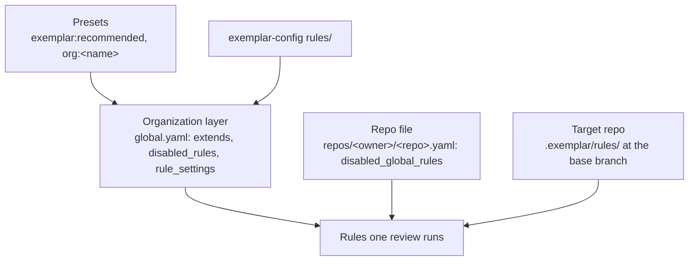

# Rule layering

Holding the review standard needs rules that someone owns and that change only through review. Exemplar keeps every rule in a file with an owner, and builds the set a review runs from layers. Each layer belongs to a different owner, so a change to one layer never needs an edit to another's files.

## Presets

A preset is a named set of rules that a config takes in by reference instead of copying the files. `exemplar:recommended` ships inside the Exemplar binary and carries the starter rules: propagating contexts, timeouts on external calls, wrapping errors, raw SQL concatenation, secrets in logs, untrusted input reaching a sink, tests for behavior changes, backward-compatible migrations and pinned container images. Its rule ids start with `exemplar.`, a prefix no other rule may use, so a preset rule never collides with an organization's own rule of the same name. A config that copied the starter rules before presets existed can extend the preset alongside its copies: the copies keep their unprefixed ids.

The rule text of a shipped preset changes with the Exemplar release. An organization that wants a set of its own writes it under `presets/<name>/` in exemplar-config and names it `org:<name>`. Its rule files load and validate with the rest of the config, and run only when `global.yaml` extends them.

## The organization layer

`global.yaml` decides which presets the organization runs (`extends`), which rules run nowhere (`disabled_rules`), and how a rule is narrowed without editing its file (`rule_settings`). A setting only narrows: it can move an active rule to shadow or exclude paths from its `file_patterns`, never raise a rule's status or widen its scope. Because a preset rule has no file in exemplar-config, these settings are the only way an organization changes one, and they go through the same config PR and CODEOWNERS review as any rule edit. The learning plane uses them too: when it demotes or narrows a preset rule, its config PR edits `rule_settings`. The shipped rule files name placeholder owner teams, so `preset_owner` names the team that gets those rules' feedback and digests, and a `rule_settings` `owner` gives one rule to another team.

Some rules are required. A preset rule in the `Security` category or with `blocking` severity is required unless `global.yaml` says otherwise, and the organization can mark any other rule required. A required rule is one a target repo cannot disable or narrow: the security floor stays with the people who own it.

## The repo layers

The repo file under `repos/` belongs to the platform team. Besides enrolment and the safety settings, its `disabled_global_rules` turns organization rules off for that one repo. A target repo can add its own rules in `.exemplar/rules/`, read from the PR's base branch so a PR cannot change the rules it is reviewed with. Its rule ids may not reuse an organization rule's id or the `exemplar.` prefix.

The field-by-field details are in the [`global.yaml` reference](../reference/config/global.md) and the [rule reference](../reference/config/rule.md). The design rationale is in the [technical spec](https://github.com/koblas/exemplar/blob/main/docs/spec/technical-spec.md#31-rule-layering-and-presets).
