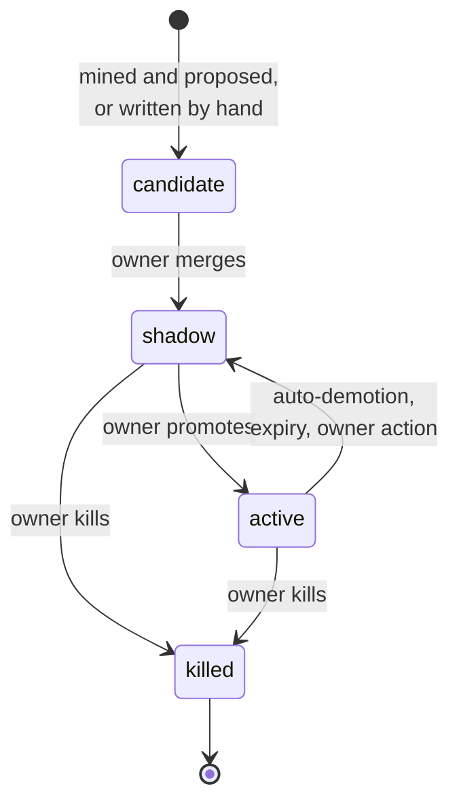

# Rule lifecycle

A rule is a YAML file in the `exemplar-config` repository. Every rule has an `owner`, a `status` and a `review_by` date. Everything that changes a rule is a pull request to that repository. That has two useful effects: git history is the audit log, and a human merging a PR is the only way enforcement ever changes. This page follows a rule from a review comment all the way to retirement.

## Where rules come from

Rules arrive by two routes: mined from your review history, or written by a person.

**Mined.** The learning plane is a set of scheduled jobs (Kubernetes CronJobs) that run one after another:

1. `ingest` reads the first comment of each review thread from the eligible repositories, keeping only comments written by the repository's owners, members and collaborators. It replaces each author's identity with a pseudonym. `path-events` records which paths were touched by reverts and by PRs linked to incidents.
2. `extract` asks a model which comments express a reusable constraint, as opposed to a one-off remark.
3. `embed` (Python) turns each extraction's title, description and preferred approach into a vector (a list of numbers that captures its meaning) through the gateway. `cluster` and `rank` (Python) group similar vectors together and score the groups.
4. `evals` generates test cases for each candidate: positive cases from the source comments, negative cases from PRs that CODEOWNERS approved, and injected violations that are checked in code.
5. `compile` asks the high-tier model for an ast-grep or Semgrep pattern, checks it in code and in a sandbox against the test cases, and marks the candidate `kind: compiled` when the pattern works.
6. `propose` opens a draft PR in `exemplar-config` for the top candidates, at most three open per owner team. Each PR cites the comments the rule came from.

**Written.** An owner who already knows a rule doesn't have to wait for mining to find it. One sentence from the people who own the code can be worth a hundred mined comments. Anyone can write a rule file, test it with `exemplar try` or the playground, and open a PR. A new rule saved from the playground (**save as draft PR**), or added by hand with `status: candidate` on a branch of `exemplar-config`, is called an *owner seed*. It becomes a candidate like a mined one, cited by the person who wrote it and by any document the rule links. From there it takes the mined path: `evals` generates its cases (negatives from CODEOWNER-approved PRs touching its `file_patterns`, and violations injected into them), and `propose` puts them on the seed's PR unless the PR already has its own. The PR passes the same checks before it merges. A seed skips the wait for a mining run, not the gate. It doesn't count against the owner team's three open mined proposals.

Either way, the candidate shows up on the web UI's candidates page with its citations. Its owner can kill it there with a reason, and that reason teaches the extractor. When a candidate's PR merges with the rule as `shadow` or `active`, `propose` marks the candidate promoted. A PR closed with the `killed` label kills its candidate, using the latest comment on the PR as the reason. If a PR is closed without that label, a seed is retired, but a mined candidate's PR is reopened to ask for a reason, because otherwise the next mining run would propose it again.

## The human gate

A rule PR merges only when two things are true. Its owner approves (through CODEOWNERS in `exemplar-config`), and config CI passes. Config CI runs schema validation, the adversarial set (prompt-injection tests), the eval job with precision and recall above `eval_thresholds`, and, where turned on, a volume estimate and a check for overlap with existing linters. A change to a rule's `export:` block also needs a platform approval, because that block reaches every coding agent in the organisation.

Nothing is enforced until that merge. The learning plane never edits a rule in place.

## Statuses

| Status | What happens |
|---|---|
| `candidate` | Proposed, not yet reviewed. Never runs. |
| `shadow` | Runs on every PR in scope. Findings are stored and visible in the web UI, but nothing is posted. Every new rule starts here. |
| `active` | Findings are posted. Feedback counts toward the rule's precision. |
| `killed` | Never runs. Kept in the file so the id is not reused and the history stays. |

A repository can switch off a global rule for itself with `disabled_global_rules`. An owner can move a rule to shadow or kill it with one click on its web UI page, which opens and merges a config PR in their name.

## Feedback and demotion

Every posted finding collects signals from the people who see it:

- slash commands and feedback links (fixed, wrong, not important here, already handled, disagree with rule);
- owner adjudications (uphold, overturn);
- 👎 reactions;
- replies, which a light model classifies as agree or disagree;
- later human comments on the same lines, which count as agreement;
- findings still posted with no signal when the PR merges, which count as ignored.

Each signal carries the actor's role on the PR (author, reviewer, owner, observer), and `feedback.role_weights` gives each role a weight.

From those signals, roll-up views compute each rule's acceptance and its weighted **effective false-positive rate** (eFP). Dismissals as wrong or not-important count toward eFP. A 👎 counts for acceptance only.

**Automatic demotion.** Nightly, the `demote` job looks at each rule's last 30 judged findings. A rule is set to `shadow` when all three hold: its eFP exceeds `feedback.efp_bar`, the lower bound of its precision (a Wilson score bound, a statistical estimate that accounts for small sample sizes) is under `feedback.demotion_wilson_floor`, and its negatives include either an owner adjudication or two people who are not the author. The job opens a config PR that names the owner and merges it on its own. Demotion makes Exemplar do less, so it may merge by itself. Promotion never does.

**Teach the bot.** When one kind of rejection keeps recurring for a rule (three times in 30 days, or once from its owner), the system acts on it. For "not important" dismissals, it opens a draft config PR excluding the paths those dismissals cluster under. For the other rejection classes, it opens an owner review issue. The owner merges or closes it.

## Expiry

Best practices expire. Every rule carries `review_by`. If a rule has none, `expiry.default_months` applies. Daily, the `expiry` job opens a PR for each active rule past its date. If the rule's last 90 days of feedback stayed under the eFP bar, the PR extends it, for the owner to merge. Otherwise the PR moves the rule to shadow, and merges by itself after `expiry.auto_demote_after_days` unless a person responds.

## Digest and exports

Weekly, the `digest` job opens one issue per rule owner in `exemplar-config` with the health of their rules, drawn from the same views as the dashboards. It also opens one issue for the platform team listing repositories whose exports are more than two config versions behind.

Daily, the `export` job renders every active rule with `export.agents: true` into the instruction files each opted-in repository chose (`AGENTS.md`, `CLAUDE.md`, Copilot, Cursor). The rules go between `BEGIN`/`END exemplar` markers, on one `exemplar/exports` branch and PR per repository. A block that someone edited by hand is left alone and reported. The result is that the rules a coding agent reads are exactly the rules the PR bot enforces, at most one config version behind.
