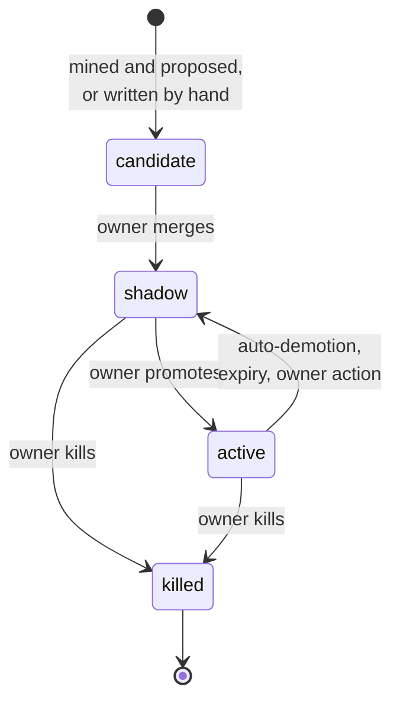

# Rule lifecycle

A rule is a YAML file in `exemplar-config` with an `owner`, a `status` and a `review_by` date. Everything that changes a rule is a pull request to that repository, so git history is the audit log and a human merge is the only way enforcement changes. This page follows a rule from a review comment to retirement.

## Where rules come from

**Mined.** The learning plane runs as CronJobs. `ingest` reads review-thread roots from the eligible repositories, written by the repository's owners, members and collaborators, pseudonymising authors; `path-events` records paths touched by reverts and by incident-linked PRs. `extract` asks a model which comments express a reusable constraint. `cluster` and `rank` (Python) group the extractions and score the clusters. `evals` generates eval cases for each candidate: positives from the source comments, negatives from CODEOWNER-approved PRs, and injected violations validated in code. `compile` asks the high-tier model for an ast-grep or Semgrep pattern, checks it in code and in a sandbox over the cases, and marks the candidate `kind: compiled` when it works. `propose` opens a draft PR in `exemplar-config` for the top candidates, at most three open per owner team, each citing the comments it came from.

**Written.** An owner who already knows a rule doesn't have to wait for the mining to find it: one sentence from the people who own the code can be worth a hundred mined comments. Anyone can write a rule file, test it with `exemplar try` or the playground, and open a PR. A new rule saved from the playground (**save as draft PR**), or added by hand with `status: candidate` on a branch of `exemplar-config`, is an *owner seed*: it becomes a candidate like a mined one, cited by the person who wrote it and any doc the rule links. From there it takes the mined path. `evals` generates its cases (negatives from CODEOWNER-approved PRs touching its `file_patterns`, and violations injected into them), and `propose` puts them on the seed's PR unless the PR has its own. The PR passes the same checks before it merges. A seed skips the wait for a mining run, not the gate. It doesn't count against the owner team's three open mined proposals.

Either way the candidate shows on the web UI's candidates page with its citations, and its owner can kill it there with a reason, which teaches the extractor. When a candidate's PR merges with the rule `shadow` or `active`, `propose` marks the candidate promoted. A PR closed with the `killed` label kills its candidate, with the latest comment on it as the reason. Closed without one, a seed is retired, and a mined candidate's PR is reopened to ask for a reason, since the mining would otherwise propose it again.

## The human gate

A rule PR merges only when its owner approves (CODEOWNERS in `exemplar-config`) and config CI passes: schema validation, the adversarial set, the eval job with precision and recall above `eval_thresholds`, and where turned on the volume estimate and the linter-overlap check. A change to a rule's `export:` block also needs a platform approval, because it reaches every coding agent in the organisation.

Nothing enforces until that merge. The learning plane never edits a rule in place.

## Statuses

| Status | What happens |
|---|---|
| `candidate` | Proposed, not yet reviewed. Never runs. |
| `shadow` | Runs on every PR in scope; findings are stored and visible in the web UI, nothing is posted. Where every new rule starts. |
| `active` | Findings are posted. Feedback counts toward the rule's precision. |
| `killed` | Never runs. Kept in the file so the id is not reused and the history stays. |

A repository can switch off a global rule for itself with `disabled_global_rules`, and an owner can move a rule to shadow or kill it with one click on its web UI page, which opens and merges a config PR in their name.

## Feedback and demotion

Every posted finding collects signals: slash commands and feedback links (fixed, wrong, not important here, already handled, disagree with rule), owner adjudications (uphold, overturn), 👎 reactions, replies a light model classifies as agree or disagree, later human comments on the same lines (agreement), and findings still posted with no signal when the PR merges (ignored). Each signal carries the actor's role on the PR (author, reviewer, owner, observer) and `feedback.role_weights` weights it.

From those the roll-up views compute each rule's acceptance and its weighted **effective false-positive rate** (eFP): wrong and not-important dismissals count, a 👎 counts for acceptance only. Nightly, `demote` looks at each rule's last 30 judged findings: a rule whose eFP exceeds `feedback.efp_bar`, whose precision lower bound (a Wilson bound) is under `feedback.demotion_wilson_floor`, and whose negatives include an owner adjudication or two non-author people, is set to `shadow` by a config PR the job opens and merges, naming the owner. Demotion reduces behaviour, so it may merge on its own; promotion never does.

**Teach the bot.** A rejection class that recurs for a rule (three times in 30 days, or once from its owner) becomes a draft config PR excluding the paths the "not important" dismissals cluster under, or an owner review issue for the other classes. The owner merges or closes it.

## Expiry

Best practices expire. Every rule carries `review_by`; without one, `expiry.default_months` applies. Daily, `expiry` opens a PR for each active rule past its date: one that extends it when its last 90 days of feedback stayed under the eFP bar, for the owner to merge; otherwise one that moves it to shadow, which merges by itself after `expiry.auto_demote_after_days` unless a person responds.

## Digest and exports

Weekly, `digest` opens one issue per rule owner in `exemplar-config` with their rules' health from the same views as the dashboards, and one for the platform team listing repositories whose exports are more than two config versions behind.

Daily, `export` renders every active rule with `export.agents: true` into the instruction files each opted-in repository chose (`AGENTS.md`, `CLAUDE.md`, Copilot, Cursor), between `BEGIN`/`END exemplar` markers, on one `exemplar/exports` branch and PR per repository. A block someone edited by hand is left alone and reported. So the rules a coding agent reads are exactly the rules the PR bot enforces, one config version behind at most.
