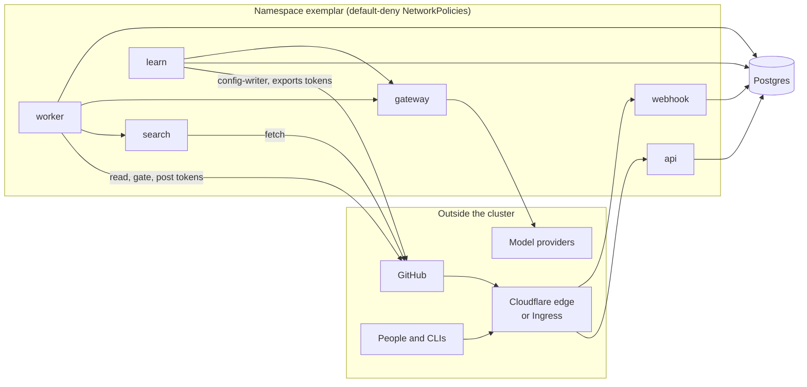

# Trust and data handling

Exemplar reads your source code and sends parts of it to a model provider. This page explains where the boundaries are, what the model is allowed to influence, and what leaves the cluster. The threat model and the decisions taken for Security's sign-off are in the repository: [`docs/security/phase-0-data-handling.md`](https://github.com/koblas/exemplar/blob/main/docs/security/phase-0-data-handling.md) and [`docs/security/known-non-issues.md`](https://github.com/koblas/exemplar/blob/main/docs/security/known-non-issues.md).

## Who can reach what

- **Inbound** reaches only the webhook (`/webhook`, HMAC-checked on every delivery) and the API. With the tunnel, Cloudflare's WAF limits `/webhook` to GitHub's hook ranges and an Access application puts your IdP in front of everything else; with an Ingress, the controller's namespace is the only admitted source and org SSO sits in front of the host.
- **Provider keys** exist in one process, the gateway. The worker and the learning jobs call it with a derived token; nothing else is admitted. Bedrock uses workload identity on the gateway's service account instead of keys.
- **GitHub credentials.** The App's private key is mounted in the worker, search and learn pods, which mint short-lived installation tokens per job in distinct flavors: read-only for cloning and reading, a gate flavor for branch-protection lookups, a poster flavor for reviews and check runs, and a config-writer flavor that can reach `exemplar-config` only. The exports app is a separate GitHub App installed only on repositories that opt in, never on `exemplar-config`. The webhook has no GitHub access at all. A worker holding the App key could in principle mint any flavor; this is a known, tracked risk.
- **Repository context** is served by `exemplar-search` to the worker only.
- **Internal keys** derive from one root key (link signing, sessions, the gateway and search tokens, pseudonyms). A pod that holds the root key can derive the others; this was a deliberate decision.

## What the model may say

Everything a model reads is untrusted: the diff, the PR description, code comments, file names, linked tickets, and search results. A model's output is a location, a message and an optional fix, nothing more. Rule ids, severities, categories, citations, lanes and coverage are attached by code from config. Code checks every anchor against the diff, every piece of evidence, and every suggested fix by applying and parsing it. Before posting, the message is made inert: it cannot open a code fence, mention a person or team, or carry HTML.

The verifier, a second model, tries to refute each finding before it is posted, and the auto-approve decision is made by deterministic gates that no model text can influence: any blocking, important or Security-category finding (counted before the verifier, so a refuted one still counts), any coverage below 1.0 and any same-family verification each force a PR ineligible. Severity and category come from the rule, never from the model, so a model cannot talk a finding down into a suggestion, the one kind that may post beside an approval. The adversarial set in `evals/_adversarial` exercises all of this on every config change, in two modes: `compromised`, where a script plays a fully injected model so the code-level defences are tested without model access, and `live`.

## What leaves the cluster, and to whom

| Data | Goes to | Controls |
|---|---|---|
| Diff hunks in scope, the files agents open, rule text, the PR title and body | The model provider routed in `global.yaml`, through the gateway | `platform/eligibility.yaml` denylists repositories outright. `.exemplarignore` and `.gitattributes` exclude paths, from the diff and from what agents can open, list or search. `context: text-only` on a rule denies it the repository tools. The gateway redacts secrets a second time and records each call's cost. |
| Review comments, check runs, approvals, SARIF logs | GitHub | Only the worker posts; only Security-category findings go to SARIF. |
| Mined review comments | The model provider, via `extract` | Authors are pseudonymised with a derived key before storage. Only eligible repositories are ingested, and only comments from the repository's owners, members and collaborators are kept. A repository that leaves eligibility has its pending comments held, not sent, until it is eligible again. |
| Traces and metrics | Wherever the OTel variables point, or nowhere | Metric and trace payloads carry ids, durations and statuses, not code. |
| Aggregates, rule ids, repo names and PR links | Grafana | The boards never select finding text, code, fixes or reasons; a test refuses a query that does. |

Nothing is sent to a third-party AI reviewer, and no model is trained or fine-tuned on your code.

## What is stored, and for how long

Postgres holds webhook deliveries, reviews, findings with their messages and fixes, feedback events, approval decisions with their gate traces, model-call records with cost, and the learning plane's extractions and candidates. Retention per kind is Security-owned, in `platform/retention.yaml`, and the worker's `retention` job deletes on schedule; a webhook delivery's row stays for idempotency after its payload is nulled.

The web UI shows a finding, a PR, a decision or a mined comment only to someone who can read that repository on GitHub (or whose OIDC groups map to it); rule health and spend are visible to every signed-in viewer. Feedback links are signed, bound to one finding and one reason, and need a GitHub identity to be recorded.

## Where the humans are

A human merges every rule, every promotion, every new exception and every export change. A human can turn auto-approve off per repository with one click on the audit page, and on only through a reviewed config PR. Rule owners adjudicate feedback; the PR author cannot adjudicate their own finding. Every owner action is recorded with its actor and runs as a config PR, so git shows who changed what.
