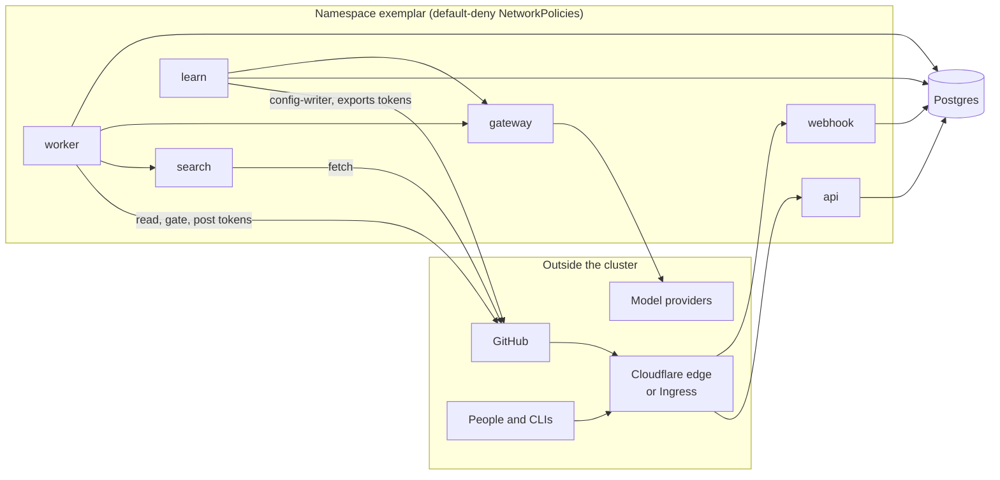

# Trust and data handling

Exemplar reads your source code and sends parts of it to a model provider. This page explains where the boundaries are, what the model is allowed to influence, and what leaves the cluster. The threat model and the decisions taken for Security's sign-off are in the repository: [`docs/security/phase-0-data-handling.md`](https://github.com/koblas/exemplar/blob/main/docs/security/phase-0-data-handling.md) and [`docs/security/known-non-issues.md`](https://github.com/koblas/exemplar/blob/main/docs/security/known-non-issues.md).

## Who can reach what

The namespace denies all network traffic by default. Each arrow in the diagram is a connection that was explicitly allowed. Here is what each boundary means:

- **Inbound traffic** from the internet reaches only two services: the webhook (`/webhook`, which checks GitHub's HMAC signature on every delivery) and the API. With the Cloudflare Tunnel, Cloudflare's web application firewall limits `/webhook` to GitHub's known IP ranges, and a Cloudflare Access application puts your identity provider (your company's sign-in system) in front of everything else. With a Kubernetes Ingress instead, the ingress controller's namespace is the only allowed source, and your organisation's single sign-on sits in front of the host.
- **Provider keys** (the credentials for Anthropic or Bedrock) exist in one process only, the gateway. The worker and the learning jobs call the gateway with a derived token. Nothing else is allowed in. On Bedrock, the gateway's service account uses workload identity instead of keys.
- **GitHub credentials.** The GitHub App's private key is mounted in the worker, search and learn pods. Each job uses it to create a short-lived installation token of a specific flavor: read-only for cloning and reading, a gate flavor for looking up branch protection, a poster flavor for reviews and check runs, and a config-writer flavor that can reach `exemplar-config` only. The exports app is a separate GitHub App installed only on repositories that opt in, never on `exemplar-config`. The webhook has no GitHub access at all. A worker holding the App key could in principle create any flavor of token; this is a known, tracked risk.
- **Repository context** (search results and file contents) is served by `exemplar-search` to the worker only.
- **Internal keys** are all derived from one root key: link signing, sessions, the gateway and search tokens, and pseudonyms. A pod that holds the root key can derive the others. This was a deliberate decision.

## What the model may say

Everything a model reads is untrusted. That includes the diff, the PR description, code comments, file names, linked tickets, and search results. Any of them could contain text that tries to steer the model (a *prompt injection*). So the model's output is limited to three things: a location, a message and an optional fix. Rule ids, severities, categories, citations, lanes and coverage are attached by code from config, never taken from the model. Code checks every location against the diff, checks every piece of evidence, and checks every suggested fix by applying and parsing it. Before posting, the message is made inert: it cannot open a code fence, mention a person or team, or carry HTML.

The verifier, a second model, tries to refute each finding before it is posted. The auto-approve decision is made by deterministic gates that no model text can influence. Any blocking, important or Security-category finding (counted before the verifier, so a refuted one still counts), any coverage below 1.0, and any same-family verification each make a PR ineligible on their own. Severity and category come from the rule, never from the model. That means a model cannot talk a finding down into a suggestion, which is the one kind of finding that may post beside an approval. The adversarial set in `evals/_adversarial` exercises all of this on every config change, in two modes: `compromised`, where a script plays a fully injected model so the code-level defences are tested without model access, and `live`.

## What leaves the cluster, and to whom

| Data | Goes to | Controls |
|---|---|---|
| Diff hunks in scope, the files agents open, rule text, the PR title and body | The model provider routed in `global.yaml`, through the gateway | `platform/eligibility.yaml` denylists repositories outright. `.exemplarignore` and `.gitattributes` exclude paths, both from the diff and from what agents can open, list or search. `context: text-only` on a rule denies it the repository tools. The gateway redacts secrets a second time and records each call's cost. |
| Review comments, check runs, approvals, SARIF logs | GitHub | Only the worker posts. Only Security-category findings go to SARIF. |
| Mined review comments | The model provider, via `extract` | Authors are pseudonymised with a derived key before storage. Only eligible repositories are ingested, and only comments from the repository's owners, members and collaborators are kept. A repository that leaves eligibility has its pending comments held, not sent, until it is eligible again. |
| The rule text extracted from mined comments (title, description and preferred approach) | The embedding provider routed as `providers.embed` (Voyage AI), through the gateway, via `embed` | The raw comment and its author are never embedded, only what extraction wrote from the comment. Without an embedding key nothing is sent and mining stops after extraction. |
| Traces and metrics | Wherever the OpenTelemetry (OTel) variables point, or nowhere | Metric and trace payloads carry ids, durations and statuses, not code. |
| Aggregates, rule ids, repo names and PR links | Grafana | The boards never select finding text, code, fixes or reasons. A test refuses a query that does. |

Nothing is sent to a third-party AI reviewer, and no model is trained or fine-tuned on your code.

## What is stored, and for how long

Postgres holds webhook deliveries, reviews, findings with their messages and fixes, feedback events, approval decisions with their gate traces, model-call records with cost, and the learning plane's extractions and candidates. How long each kind is kept is decided by Security, in `platform/retention.yaml`. The worker's `retention` job deletes on schedule. A webhook delivery's row stays after its payload is cleared, so that a re-delivered webhook can still be recognised as a duplicate.

The web UI shows a finding, a PR, a decision or a mined comment only to someone who can read that repository on GitHub (or whose OIDC groups map to it). Rule health and spend are visible to every signed-in viewer. Feedback links are signed, tied to one finding and one reason, and need a GitHub identity before the feedback is recorded.

## Where the humans are

A human merges every rule, every promotion, every new exception and every export change. A human can turn auto-approve off for a repository with one click on the audit page. Turning it back on takes a reviewed config PR. Rule owners adjudicate feedback, and a PR author cannot adjudicate their own finding. Every owner action is recorded with who did it and runs as a config PR, so git shows who changed what.
