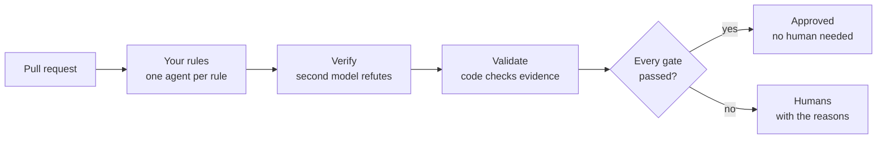

A self-correcting AI code reviewer for GitHub

# Give your reviewers their time back. {: .landing-title }

AI-assisted coding doubled the pull requests your team produces and did nothing for the people who review them. Exemplar reviews every PR with <strong>your organization's own judgment</strong>, approves the low-risk ones with <strong>no human review needed</strong>, and sends the rest to people <strong>with the reasons</strong>.

[Try it: a 20-minute trial install](guides/install/quickstart.md){ .md-button .md-button--primary }
[Why Exemplar](concepts/why.md){ .md-button }

Open source. Runs on your Kubernetes, in one namespace, against one Postgres, as a GitHub App. Code never leaves the paths you allow.

2×
the pull requests merged by teams with high AI adoption

2×
the time each of them spends in review

4 in 5
developers say review takes more of their day since AI tools arrived

Human review is the bottleneck now, and under that load it degrades: more approvals, less scrutiny. <a href="concepts/why/#the-problem-review-is-the-bottleneck-now">The numbers and their sources.</a>

## One verdict on every pull request {: .landing-h2 }

Exemplar does not add comments to a queue that is already too long. It decides who needs to read each PR, and shows its work.

-   :material-check-decagram: **Approved, no human review needed**

    ---

    The PR touched only allowed paths, came from an allowed author, was reviewed to full coverage with no blocking, important or Security finding (suggestions may post beside the approval), and passed a deterministic merge-safety score and a two-model risk check. It merges without waiting on a reviewer.

-   :material-account-arrow-right: **Routed to humans, with the reasons**

    ---

    Everything else goes to your reviewers. The check run says why in plain words: a finding, a denylisted path, a score below the bar. Reviewers open the PR already knowing what to look for.

## Built on five guarantees {: .landing-h2 }

-   **Your judgment, not the internet's**

    ---

    Rules are mined from your own review history, with citations, and live in a git repository your teams own. Nothing enforces until a rule owner merges it.

-   **Nothing reaches a human unverified**

    ---

    A second model, from a different family, tries to refute every finding. Code checks the anchors, the evidence and the provenance. What survives is budgeted and carries a one-click fix.

-   **Approval is never a model's say-so**

    ---

    Every gate that can approve a PR is deterministic and auditable. The two-model risk check can only withhold an approval, never grant one on its own.

-   **It never blocks**

    ---

    Exemplar approves or stays silent. It never requests changes, and a kill switch at every level is one config merge away.

-   **Violations stop arriving**

    ---

    The same rules export to coding-agent instruction files and a pre-PR check, so agents and IDEs conform before the PR exists.

## One pass per pull request {: .landing-h2 }

Deterministic first, models only where judgment is needed, a human gate on every rule change. <a href="concepts/how-a-review-works/">How a review works.</a>

## What it is built to hit {: .landing-h2 }

The targets in the product requirements, with counter-metrics that watch for auto-approve eroding shared ownership. Cost and latency are reported on every review and are not targets.

≥ 65%
of findings accepted by authors, at or above human reviewers

≤ 10%
effective false positives for every active rule

2×
the precision of a generic AI reviewer on the same PRs

5% →
of PRs merged with no human review at launch, then growing

## Put humans only where a human is needed. {: .landing-h2 }

[Quickstart](guides/install/quickstart.md){ .md-button .md-button--primary }
[Your first review](tutorials/first-review.md){ .md-button }
[Why Exemplar](concepts/why.md){ .md-button }

Then <a href="concepts/">Concepts</a> for how it thinks, <a href="guides/">Guides</a> for one task at a time, and the <a href="reference/">Reference</a> for every file, setting and command.

