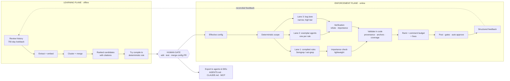

## 5. System Overview

**Invariants**

- On the same PR, learning never mutates the review in progress.
- Long-term, reconciled feedback becomes evidence for the next extraction — still behind the human gate.
- Every model call is constrained; every model output is checked by deterministic code before it reaches a human.
- Cheap and deterministic first; expensive only if needed. A rule that can be expressed deterministically is run deterministically.
- Nothing is posted that has not survived verification (model lanes), an importance check (all lanes) and validation (all lanes).
- A review that did not run to completion says so. Partial coverage, a provider outage or a budget stop is reported as "not reviewed", never as "no findings" (§8.10).
