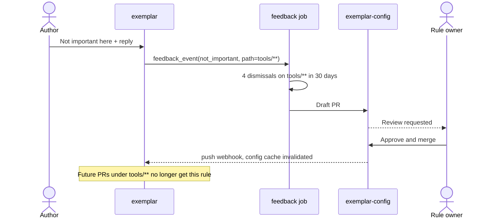

<a id="17-sample-interactions"></a>

## 17. Sample interactions

Eight walk-throughs showing what people and agents actually see. Each mockup is followed by what happened behind it and the requirements it exercises. Names, repos and numbers are illustrative.

<a id="s17-1"></a>

### 17.1 A rule finding with a one-click fix

Maya opens `acme/game-engine#5120`, “Prefetch avatar data in the render loop”. Four minutes later one inline comment appears.

> *Mockup of an inline review comment with a suggested change*
>
> **src/net/avatar_fetch.cpp · +4 −0**
>
> ```diff
>  for (auto& player : visiblePlayers) {
> +  auto task = scheduler.spawn([&] {
> +    auto data = FetchData(player.avatarUrl);
> +    player.avatar = decode(data);
> +  });
>  }
> ```
>
> **exemplar** · bot · on lines 140–141
>
> suggestion (performance): `FetchData` blocks inside an async task that is spawned for every visible player on every frame. Under load this ties up one worker thread per player and adds frame latency. Await the fetch instead.
>
> *Suggested change*
>
> ```diff
> -    auto data = FetchData(player.avatarUrl);
> +    auto data = co_await FetchDataAsync(player.avatarUrl);
> ```
>
> [Commit suggestion]
>
> Feedback options: Fixed · Wrong · Not important here · Already handled · Disagree with rule
>
> Rule [blocking-fetch-in-loop](#s17-1) at 3f2c1a · Owner @platform/runtime · Based on the async guidance and 2 past reviews · Checked by a second model

Behind the scenes

1. Deterministic scope: the file matched `**/*.cpp`, putting 6 of 212 active rules in scope. Two compiled rules ran first and found nothing.
2. The exemplar agent for `blocking-fetch-in-loop` flagged lines 140–141.
3. The verifier, on a different model, tried to refute it: is the task already awaited? It isn't. Code search showed the enclosing function is called once per frame, so importance scored high.
4. Code attached the rule id and citation, confirmed the anchor sits inside a visible hunk, and checked that the suggestion applies cleanly and parses.
5. Maya clicked *Commit suggestion*, recorded as an applied suggestion — the strongest acceptance signal.

Exercises FR-E2, FR-E3, FR-V1–V3, FR-T1–T2, FR-F1–F3, FR-P3–P4, FR-B1.

<a id="s17-2"></a>

### 17.2 An author pushes back, and the system learns — through the gate

On a different PR, a performance rule fires in an offline build tool where it doesn't matter.

> *Mockup of a comment thread where the author dismisses a finding and the bot opens a config PR*
>
> **tools/asset_packer/main.cpp · line 77**
>
> **exemplar** · bot
>
> suggestion (performance): A new `std::vector` is allocated for every asset in this loop. Use the frame arena (`ArenaVector`) to avoid allocator pressure.
>
> Options: Fixed · Wrong · Not important here · Already handled · Disagree with rule
>
> **maya-chen** · author
>
> @exemplar not important here — this is an offline packer that runs once per build, never in the game loop.
>
> **exemplar** · bot
>
> Recorded as *Not important here*. This rule has been dismissed for files under `tools/**` 4 times in the last 30 days, so I opened a proposal for the rule owner to exclude that path. Nothing changes until they merge it.
>
> **Draft · prefer-arena-alloc: exclude · `tools/**` · acme/exemplar-config#812**
>
> Requested review from @platform/runtime
>
> Eval on 22 cases: precision 0.81 → 0.88, recall unchanged



Behind the scenes

1. The structured dismissal routed to scope (not to prompt tuning, which is what “Wrong” would have done).
2. The reply-to-teach fast path produced a concrete, testable config change instead of a silent preference.
3. Enforcement only changed after a human merged the PR — the bot proposes, owners decide.

Exercises FR-B1, FR-B2, FR-L6.5, FR-L6.2, FR-X2.

<a id="s17-3"></a>

### 17.3 A bug-lane finding with its evidence

No rule covers this; the bug lane found it on a critical path in `acme/matchmaking`.

> *Mockup of a blocking bug finding with an expandable verification panel*
>
> **internal/party/service.go · +3 −1**
>
> ```diff
>  func (s *Service) Join(ctx context.Context, req *JoinRequest) error {
> +	party := s.parties.Get(req.PartyID)
> +	if party.Size() >= s.maxParty {
> +		return ErrPartyFull
> ```
>
> **exemplar** · bot · on lines 53–54
>
> issue (blocking): `parties.Get` returns `nil` for an unknown ID, and `Join` is reachable from the public API without validating `PartyID`. A request with an unknown party will panic here.
>
> *Suggested change*
>
> ```diff
> -	if party.Size() >= s.maxParty {
> +	if party == nil {
> +		return ErrPartyNotFound
> +	}
> +	if party.Size() >= s.maxParty {
> ```
>
> [Commit suggestion]
>
> **How this was checked**
>
> - `internal/party/store.go:88` — `Get` returns `nil, false` when the ID is missing; the bool is discarded by this caller.
> - `api/handler.go:41` — passes `req.PartyID` straight from the request body.
> - Searched 3 other callers of `Join`; none validate the ID first.
> - A second model tried to disprove this and could not. Confidence 0.93.
>
> Bug lane: nil dereference · Critical path: internal/party/**

Behind the scenes

1. The PR touched a path marked critical, so the bug lane ran its allowlisted classes (nil dereference, error handling, concurrency).
2. Code search found callers outside the PR's files; ticket context was absent, so none was supplied.
3. Every evidence line the verifier cited was resolved against the checkout before posting.

Exercises FR-E6, FR-E12, FR-V1–V3, FR-P3, FR-F1–F2.

<a id="s17-4"></a>

### 17.4 The check-run summary

Every review leaves one check on the PR. It never fails the build; it explains what ran, what was held back, and what it cost.

> *Mockup of a check run summary*
>
> ****Exemplar review**2 findings posted. All scoped files examined.**
>
> | Lane | Ran | Posted | Held back |
> |---|---|---|---|
> | Compiled rules | 4 rules | 0 | — |
> | Exemplar agents | 6 rules | 1 | 2 refuted by verifier, 1 duplicate of a linter warning |
> | Bug lane | 3 classes | 1 | 3 refuted, 1 below importance threshold |
>
> Coverage**100%** · Cost**$2.71** (informational) · Duration**3 min 48 s** · Config**exemplar-config@a91e07**

Why show what was held back

Seeing “3 refuted” builds trust that the bot filters itself, and gives rule owners a per-rule refutation rate to act on. Over-budget findings would also appear here rather than inline. Cost and duration are shown for transparency, not as a score (§13.2). On a degraded run (§8.10) this card is where the author learns which rules did not run.

Exercises FR-P1, FR-T3, FR-V4, FR-E7, FR-D4, G5.

<a id="s17-5"></a>

### 17.5 A rule owner promotes a mined candidate

The learning plane opened a draft PR in `exemplar-config` for the runtime team.

> *Mockup of a candidate rule pull request with citations, eval results and a playground comment*
>
> **Draft · New rule: avoid-sync-io-in-tick · #807**
>
> exemplar wants to add `rules/performance/avoid-sync-io-in-tick.yaml` and 18 eval cases
>
> Where this came from
>
> 14 review comments from 9 reviewers over 22 months, 3 linked to the I/O section of the engine performance guide.
>
> - “Don't hit disk in Tick — queue it to the loader thread.” acme/game-engine#4410
> - “This stalls the sim frame on slow disks; see the perf guide.” acme/game-engine#3977
> - +12 more
>
> Checks
>
> | Eval (18 cases) | precision 0.86, recall 0.62, F1 0.72 | passes |
> |---|---|---|
> | Expected volume | about 0.3 comments per PR in scope; 41 PRs in the last 30 days would have received one | under budget |
> | Deterministic version | ast-grep pattern: precision 0.91, recall 0.44 | kept as exemplar (recall too low) |
> | Overlap with linters | none found | ok |
>
> **dsingh** · @platform/runtime
>
> `/exemplar try acme/game-engine#5098`
>
> **exemplar** · bot
>
> Ran this draft on #5098 (nothing was posted there). 1 finding: `src/sim/tick.cpp:212` reads `config.json` synchronously inside `World::Tick`. Cost $0.38.

Behind the scenes

1. Doc-linked and multi-reviewer sources ranked this candidate near the top of the runtime team's queue.
2. The pipeline tried to compile it to a pattern first; recall was below 90% of the LLM rule's, so it stays an exemplar for now and will be retried later.
3. Dsingh tightens the description, sets `status: shadow` for a week of silent measurement, and merges.

Exercises FR-L1.6, FR-L4.1, FR-L5.1–L5.2, FR-L6.1–L6.4, FR-P2, FR-X2.

<a id="s17-6"></a>

### 17.6 A coding agent checks its own work before opening a PR

The same rule from 17.1, caught upstream. The agent receives path-scoped rules from the generated instruction file and calls the MCP server to check its diff.

> *Mockup of a coding agent terminal session calling the Exemplar MCP server*
>
> ```
> > Add avatar prefetch to the render loop
>
> ● exemplar.list_rules(path: "src/net/avatar_fetch.cpp")
>   └ 6 rules apply, including blocking-fetch-in-loop and net-timeout-required
> ● Edit src/net/avatar_fetch.cpp
> ● exemplar.check(diff)
>   └ 1 finding: blocking-fetch-in-loop at line 140 — FetchData blocks inside an async task
> ● Edit src/net/avatar_fetch.cpp  (use co_await FetchDataAsync)
> ● exemplar.check(diff)
>   └ No findings
> ● Opened acme/game-engine#5131
> ```

> *Generated AGENTS.md excerpt*
>
> **src/net/AGENTS.md · generated**
>
> ```
> <!-- BEGIN exemplar: generated from exemplar-config@a91e07, owner @platform/devex -->
> ## Rules for src/net/**
> - Don't call FetchData inside an async task before the task is awaited.
>   (blocking-fetch-in-loop)
> - Every outbound RPC sets an explicit timeout. (net-timeout-required)
> <!-- END exemplar -->
> ```

Behind the scenes

1. The export job wrote short summaries from each rule's `export.summary` into path-specific files, keeping them under tool size limits.
2. `check` ran the same engine as production with `caller=mcp`, so its cost and findings are tracked separately.
3. The resulting PR got no comment for this rule — the upstream-effectiveness metric counts that as a win.

Exercises FR-S1–S3, FR-S5, FR-E9.

<a id="s17-7"></a>

### 17.7 An auto-approval, with its full gate trace

> *Mockup of an approving review with gate details*
>
> **docs: update matchmaking on-call runbook · acme/matchmaking#2290**
>
> **exemplar** · bot · approved these changes
>
> Low-risk change: 2 Markdown files under `docs/**`, no findings from any lane, author on the allowlist. This counts as one approval. Owners of `docs/**` will see it in their weekly digest.
>
> **Gate details**
>
> | Check | Value | Needs |  |
> |---|---|---|---|
> | Repo opted in | yes | yes | pass |
> | Paths in approved scope | docs/** | docs/**, **/*.md | pass |
> | Findings (all lanes) | 0 | 0 | pass |
> | review_confidence | 0.97 | ≥ 0.8 | pass |
> | merge_safety_score | 0.91 | ≥ 0.7 | pass |
> | Size | 2 files, 38 lines | ≤ 10 files, ≤ 1,000 lines | pass |
> | CODEOWNERS | @acme/matchmaking-oncall | auto-approvable set | pass |
> | Branch rules | 1 approval required | not a compliance repo | pass |
> | Risk categorization | low (2 models agree) | low | pass |

Behind the scenes

Stage 1 ran entirely in code; Stage 2 made two lookups and one model call (cross-checked by a second model). The whole trace is stored in `approval_decisions` for audit. Setting `enabled: false` for this repo in `exemplar-config` would stop approvals within seconds of merge.

Exercises FR-A1–A5, FR-E10.

<a id="s17-8"></a>

### 17.8 A rule owner's weekly digest

> *Mockup of a weekly rule health digest issue*
>
> **Rule health for @platform/runtime, week of October 5**
>
> Opened by exemplar in acme/exemplar-config
>
> | Rule | Posted | Accepted | Effective FP | Status |
> |---|---|---|---|---|
> | blocking-fetch-in-loop | 23 | 74% | 4% | Healthy |
> | net-timeout-required | 11 | 64% | 9% | Close to the 10% bar |
> | prefer-arena-alloc | 17 | 41% | 18% | Over the bar. Respond by Oct 19 or it moves to shadow. Proposal #812 is open. |
> | legacy-tick-order | 2 | 50% | — | Review date passed. Confirm or retire. |
>
> Most common dismissal reasons
>
> prefer-arena-alloc: *Not important here* (9), mostly under `tools/**`. net-timeout-required: *Already handled* (2), timeouts set by a wrapper the agent didn't see.
>
> Auto-approved changes in your paths
>
> 3 PRs: #5102, #5117, #5124 (all `docs/runtime/**`).

Behind the scenes

The digest reads the same SQL views as the dashboards and the auto-demotion job, so the three can never disagree. The “Already handled” reason points at a context gap — the wrapper should be added to the rule's description or found via code search.

Exercises FR-B2, FR-B4, FR-B5, FR-A5, rule `review_by`.
