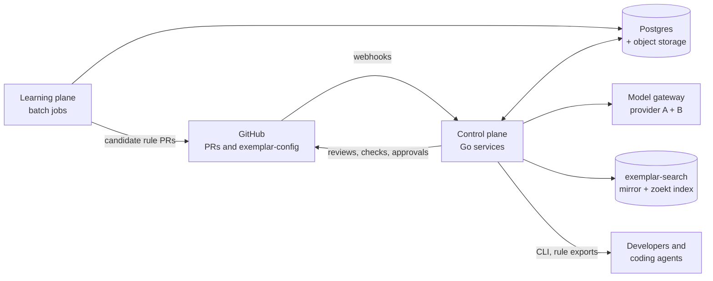
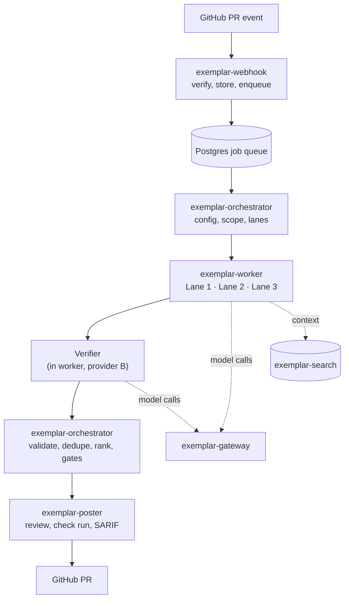
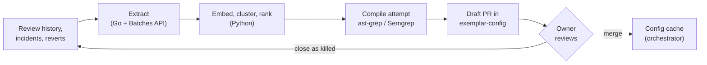
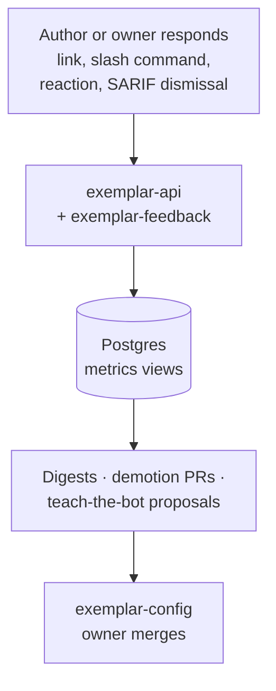
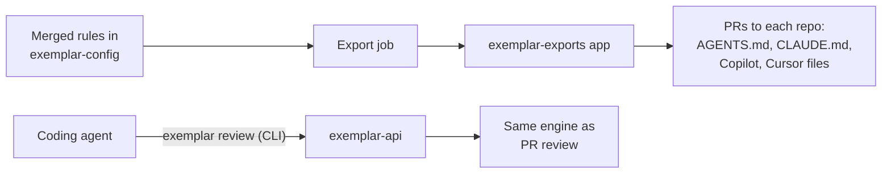
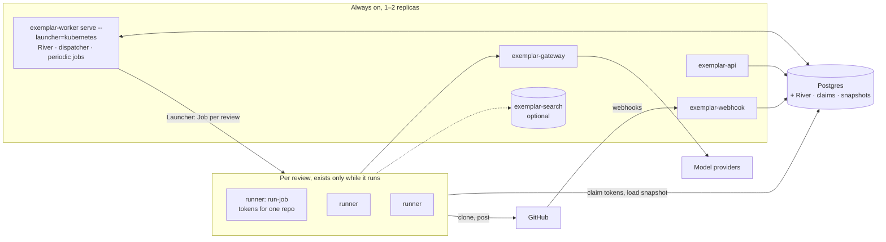

## 2. Architecture

### 2.1 Component map

An overview and one view per job.

**Overview**

**View 1 — Reviewing a PR (online path)**

Reading top to bottom is the order of work for one review. Only the poster role holds a write token; workers and the verifier hold read-only tokens and reach models only through the gateway. **As built,** the orchestrator, worker and poster boxes are three roles of one binary, `exemplar-worker`, separated by the token flavor each mints (§2.2, §5); the elastic design in §2.4 splits that binary into a control process and a per-review runner along the same line.

**View 2 — Learning rules and the human gate (offline path)**

Nothing reaches the online path until a rule owner merges a PR in `exemplar-config`. Evals, volume estimates and linter-overlap checks run as GitHub Actions on that PR.

**View 3 — Feedback loop**

The loop only *proposes* changes as config PRs. Demotion auto-merges because it reduces behavior; promotion and new exceptions always need an owner.

**View 4 — Shift left (authoring time)**

Both paths reuse the merged rules and the same engine, so what an agent is told, what it can check, and what the PR bot enforces never diverge.

For the network view — what can reach the cluster and what the cluster calls — see the boundary diagram at the top of §13.

### 2.2 Services

All services are Go binaries built from one module (`cmd/*`) and shipped in one image; each runs as its own Kubernetes workload so it scales and is permissioned independently. The table is the binaries as built. The orchestrator, poster and feedback roles of earlier drafts are River jobs inside `exemplar-worker`; what keeps them separate is the token each job mints (§5), not a process boundary. §2.4 adds the process boundary where it matters, between the control process and the per-review runner.

| Service (binary) | Responsibility | Scaling | Key Go pieces |
|---|---|---|---|
| `exemplar-webhook` | Verify `X-Hub-Signature-256` , persist raw event to `gh_events` with `X-GitHub-Delivery` as idempotency key, enqueue in the same transaction, return 202 within GitHub's 10 s window. No business logic, no GitHub credentials. | Stateless, 2+ replicas | `net/http` , `go-github` `ValidatePayload` / `ParseWebHook` , River `InsertTx` |
| `exemplar-worker` — **control** (`serve`) | Routes events into jobs; runs the cheap queues (linter checks, feedback, owner actions, merge policy), the periodic jobs (reconcile, sweep, retention, stats refresh) on its leader, and the **dispatcher** for `pr_review`, `evaluate` and `playground_run`: takes the per-repo slot, snapshots the config version, mints the review's tokens into a single-use claim, launches a runner through the `Launcher` interface and maps its exit back to River. Holds the App private key; never runs model-facing code with `--launcher=kubernetes`. | 2 replicas, always on | River, `internal/worker`, `internal/gh` |
| `exemplar-worker` — **runner** (`run-job`) | One review: checkout (blob-less depth-1 clone), eligibility and redaction, deterministic scope, **Lane 1** engines, **Lane 2** exemplar agents, **Lane 3** bug-class agents, the **verifier** and quorum, validation, fix checks, dedupe, ranking, gates, and the post (one review, check run, SARIF, APPROVE) with the poster token from its claim. Exits when done. | One process per review: in the control pod (`serve --launcher=in-process`, the quickstart) or a Kubernetes Job per review (production); other launchers in §2.4 | `errgroup`, `internal/engine`, `internal/pipeline`, `internal/gates`, `os/exec` ( `git` , `rg` , `ast-grep` , `semgrep` ), `anthropic-sdk-go` via the gateway, `go-tree-sitter` |
| `exemplar-api` | Sign-in (GitHub OAuth and/or OIDC), the **signed feedback-link endpoint** (§6.12), `/v1/evaluate` for the CLI, config CI and services (PRD §8.8), and the `/ui/` web UI (§12.8). Enqueues work for the worker; holds no installation credentials. Without `EXEMPLAR_GH_APP_ID` it runs setup mode: `/setup` on its public URL, behind a bootstrap token in the `exemplar-setup` Secret, registers the App from a manifest and writes the installation's Secrets through the Kubernetes API (a Role limited to `get` and `patch` on those Secrets, by name), keeping no state in the pod; once setup is complete every replica switches to App mode in place, without a restart. | Stateless, 2 replicas | `net/http` , `internal/oidc`, `internal/web` |
| `exemplar-gateway` | Holds keys for the approved providers (hardcoded list), routes each stage (generator, verifier, light, categorizer) through an ordered provider list with **failover** , runs a second secret-scan on every request, tracks per-run spend against the soft ceiling, rate-limits per provider/model and per caller, and writes every call to `model_calls` . | Stateless; horizontal on request rate | `httputil.ReverseProxy` , `x/time/rate` , gitleaks, pgx |
| `exemplar-learn` | CronJobs: `ingest` , `path-events` (incidents/reverts), `extract` (Message Batches driver), `evals` , `compile` (rule synthesis + sandbox eval), `propose` , `change-clusters` (§8.1), `priors` (§8.11), `demote` , `expiry` , `teach` , `digest` , `export` (via the exports app). | CronJobs, one run at a time (`Forbid` plus an advisory lock) | Shares `internal/gh` rate limiter and token minting |
| `learning/` (Python) | `cluster` , `rank` (and `embed` once a provider is approved) — reads/writes Postgres tables only, no API surface. | CronJobs | numpy, faiss/hnswlib, scikit-learn |
| `exemplar-search` | Holds the system's only git mirror of the opted-in repositories (the monorepo and `context.extra_repos` ), builds a **zoekt** index of the default branch with ctags symbols in the background after each fetch, and answers `search_text`, `find_definition`, `find_references`, `dependents`, `path_history` and `read_file` over an internal HTTP API (§6.4). **Optional** (§6.4.6). | StatefulSet, 2 independent replicas, local SSD; read replicas as load grows | zoekt (embedded Go library), `os/exec` ( `git` , `universal-ctags` ) |
| `exemplar-cloudflared` | The default way in: a Cloudflare Tunnel connector that dials out, so nothing in the cluster is public. Replaced or joined by an Ingress (`deploy/k8s/direct`). | 2 replicas | cloudflared, pinned by digest |
| `exemplar` (CLI) | Local pre-PR review (`login`, `review`), rule try, validate, eval, replay, mutations, calibration. | Laptops/CI | Cobra; native builds per platform (cgo for tree-sitter) |

### 2.3 Implementation languages

- **Go** for every service, the CLI, the gateway, `exemplar-search`, and every job that calls GitHub or a model API. One Go module, one container image per service family, one Kubernetes Deployment or StatefulSet per binary.
- **Python** only for the embedding, clustering and ranking jobs in the learning plane (`learning/`), which read and write Postgres tables and expose no API.
- **Contracts** shared by both are JSON Schema files in `schema/`. Go types are validated against them in tests; Python models are generated with `datamodel-code-generator`. CI fails on drift.
- **Git** operations shell out to the `git` binary (`exec.CommandContext` with timeouts) for partial clone and sparse checkout. Large GitHub GraphQL queries use `genqlient`-generated clients.

### 2.4 Deployment and elastic hosting

Exemplar is a self-hosted product: a customer's platform team runs it in its own GitHub org, and code never leaves that boundary except to the model provider through the gateway. This section fixes what any hosting of it must provide, how one installation scales from a laptop trial to many teams, and which platform to run it on. It condenses the hosting design of 2026-10-24 ("Exemplar Elastic Hosting"); the figures there were checked against vendor documentation on that date.

#### 2.4.1 What the code requires of a host

| # | Requirement | Must / should | Comes from |
|---|---|---|---|
| R1 | Postgres 16 with pgvector, reachable privately. It holds all state and the River queue; there is no other data store. | Must | every binary but search |
| R2 | Fast local disk that survives restarts for `exemplar-search` (mirror and zoekt index, 2 replicas on different hosts). Network file systems are too slow for it. **Waived when search is left out** (§6.4.6). | Must, when search runs | `cmd/exemplar-search`, `deploy/k8s/core/search.yaml` |
| R3 | Two public HTTPS endpoints: GitHub to the webhook, people to the API. GitHub's hook ranges only on the webhook; org SSO in front of the API. | Must | §13 IN-1, IN-2 |
| R4 | Per-workload network isolation: default deny, an explicit egress list per binary. Per-host egress (GitHub only, providers only) is the intent. | Must | §13 |
| R5 | Only the gateway holds model-provider keys; only the poster flavor writes to GitHub; secrets come from an external store, never the repo. | Must | §5, §13 |
| R6 | Code never leaves the installation except to the model provider through the gateway. | Must | §13.1 |
| R7 | Model-written and unmerged rule bodies run in a sandbox: no network, CPU and memory caps. Today `unshare --net` plus `prlimit`; the compile job is suspended until a platform allows it. | Must | `internal/compiled`, `exemplar-learn compile` |
| R8 | A review is one job: up to 30 minutes, at most 3 attempts, unique by its arguments, cancelled when the PR's head moves. Per-repo fairness (§6.15). | Must | `internal/worker`, `internal/store/jobs.go` |
| R9 | Graceful shutdown: readiness drops, running work finishes or returns to the queue, within a grace period longer than the shutdown (worker 80 s under 120 s). | Must | every `cmd/`, `go test ./deploy` |
| R10 | 13 scheduled learning jobs, none overlapping itself; the periodic maintenance jobs on exactly one process. | Must | `deploy/k8s/core/learn.yaml`, `internal/worker/maintain.go` |
| R11 | Small installs are cheap: a trial runs one replica of everything and an in-cluster Postgres; nothing idles expensively between PRs. | Should | quickstart, `components/postgres` |
| R12 | Enterprise installs scale on four axes: PRs per hour, repositories, monorepo size, and teams sharing one install (one `exemplar-config`, CODEOWNERS-owned rules, per-repo fairness). | Should | PRD personas, §6.15 |
| R13 | Non-root, read-only root filesystem, no capabilities, RuntimeDefault seccomp; images pinned by digest. | Should | `deploy/README.md`, `go test ./deploy` |
| R14 | The deploy is checkable without a cluster: rendered manifests are tested against the code. | Should | `deploy/manifests_test.go` |
| R15 | GitHub Enterprise Server works as well as GitHub.com. | Should | `EXEMPLAR_GH_API_URL`, `EXEMPLAR_GH_WEB_URL` |

R2 rules out any host without persistent local disk for the search tier; R7 with R12 asks for per-review isolation that scales with load.

#### 2.4.2 From fixed-size to elastic: the changes

Today the review path is fixed-size: 2 worker pods, 4 reviews each, always running. The changes below make capacity follow the queue and isolation per review, in build order. C1–C3 are the core and are useful on any platform; nothing in the pipeline itself changes (`Worker.Review` is reused as is), nor the webhook, the API, River, Postgres or the way in.

| # | Change | Why | Size |
|---|---|---|---|
| C1 | **Split the worker into control and runner.** `exemplar-worker serve` keeps River, the cheap queues and the periodic jobs. `exemplar-worker run-job --job <id>` does one `pr_review`, `evaluate` or `playground_run` and exits. The dispatcher is the River worker for those kinds: it takes the per-repo slot, launches a task through a small `Launcher` interface and waits, mapping the exit code to River (done, cancel, snooze on capacity, error for retry). River keeps timeouts, retries, uniqueness and supersede. **Launchers:** in-process (`--launcher=in-process`: the quickstart, where a review runs inside the control pod as today), Kubernetes Job (`--launcher=kubernetes`, production), and later ECS or Cloud Run tasks. One binary, one set of manifests, a flag between trial and production. | Capacity per review instead of per pod; a kernel- or VM-level boundary per review; control stays small and always on; the trial stays as light as today. | Medium |
| C2 | **Scoped tokens through a single-use claim.** The dispatcher mints the four tokens a review needs (worker, gate, poster, clone), scoped to one repository, into a `runner_claims` row with a one-time nonce. The runner claims the row, reads the tokens, and the row is cleared on exit. The App private key never enters a runner. | Closes the §13 risk that the review process could mint any token flavor, config-writer included. Lets untrusted rule bodies run in the same task as the review. | Small |
| C3 | **Config snapshot by version.** Control writes each validated `exemplar-config` version to `config_snapshots`; the runner loads the version the job was dispatched with. | Runners may not read the config repo (worker tokens exclude it on purpose) and must review with the config the dispatcher chose (FR-C6). | Small |
| C4 | **Advisory lock in every scheduled job entrypoint** (Go and Python). | Schedulers outside Kubernetes have no `concurrencyPolicy: Forbid`; even on Kubernetes a manual run can overlap a scheduled one (R10). | Small |
| C5 | **Queue-driven autoscaling.** The `reviews` queue's `MaxWorkers` becomes the number of runners in flight, bounded by a platform quota, not one pod's CPU. River queue depth and age are exported as metrics (FR-D6) with alerts. | Small installs run zero runners between PRs; a monorepo's rebase storm fans out to the quota. **As built:** `serve --runner-quota N` (kubernetes launcher; core 8): N advisory-lock slots shared by every control replica, taken by every runner launch, and the reviews queue's `MaxWorkers` is N per replica. `exemplar.queue.depth{queue,state}` and `exemplar.queue.oldest_age{queue}` are OTel gauges per queue, not per repo (the operations board has per-repo SQL panels); the stalled-queue alert is SQL. | Small |
| C6 | **Per-review disk as an ephemeral volume**, sized per job (today 32 GiB on the worker pod for 4 reviews). | A runner needs its own checkout; per-pod-billed platforms request disk per pod. **As built:** the runner template's `work` volume is a generic ephemeral volume (default StorageClass, 8Gi for an unknown repo); every review records `reviews.checkout_bytes`, and a review's Job requests 2 × the repo's largest of its last 20 checkouts + 1 GiB, rounded up and clamped by `serve --runner-disk-min/--runner-disk-max` (2Gi/50Gi). The PR's file count is not used: the blob-less checkout is the whole head tree either way. Evaluations and playground runs keep the template's size. | Small |
| C7 | **Connection pooling in front of Postgres** (PgBouncer or the cloud's pooler), transaction mode for runners. Control's slot locks need session mode and stay direct. | Hundreds of concurrent runners would exhaust Postgres connections. | Small |
| C8 | **Search scales by read replicas.** `exemplar-search` is read-only to reviews; add replicas behind the Service, each with its own mirror and index. Sharding by repository is the step after, for very large orgs only. | More reviews means more `find_references` calls; one StatefulSet of 2 is the current ceiling. | Medium |
| C9 | **Gateway scales horizontally** behind its Service with an HPA on request rate. Provider rate limits become the ceiling; failover and per-repo budgets stay. | Reviews fan out to many model calls at once. | Small |
| C10 | **Compile and playground run in the per-task boundary.** A `--sandbox=microvm` mode: `prlimit` for limits, the task's own network policy (Postgres and gateway only) for egress, scrubbed environment for engine children. Where the platform allows unprivileged user namespaces or a gVisor/Kata runtime, `unshare --net` stays. | Un-suspends the compile job without weakening `--require-sandbox` (R7). | Small |
| C11 | **The small-install overlay stays first-class:** one replica of everything, in-cluster Postgres, in-process launcher, a low quota. Same manifests, different numbers. | R11. | Done for replicas; the quota is new |

**Multi-team operation** needs no new tenancy model: one install per GitHub org, one `exemplar-config` with CODEOWNERS-owned rules, per-repo fairness so one team's burst cannot starve another, and the existing per-repo budgets and kill switches. Many teams change only capacity (C5, C7, C8, C9) and visibility (queue depth per repo on the operations board).

#### 2.4.3 Platform

Six ways to host were scored against R1–R15: Kubernetes on own nodes, GKE Autopilot, EKS Auto Mode, ECS Fargate with EC2 for search, Cloud Run with GCE for search, and Cloudflare (Workers, Containers, Sandboxes). Kubernetes in any form meets every must-row on one platform; the native services meet them only as two platforms, because neither Fargate nor Cloud Run can host `exemplar-search`, and each discards the manifests, the per-workload policies and `go test ./deploy`. Cloudflare cannot be the host (no Postgres with pgvector, 20 GB disk caps) and stays what it is today, the edge.

**Recommendation: build on Kubernetes, run it on GKE Autopilot, keep Cloudflare at the edge.**

- Kubernetes is the only option where one platform meets every must-row, search included; the deploy work exists and is tested against the code; the elastic model is a Kubernetes Job per review, the mechanism GitHub uses for its own runners; and the same manifests run on EKS, GKE, k3s or on-prem, so a GitHub Enterprise Server customer behind a firewall takes the same artifact.
- Autopilot bills per pod, not per node: a small install pays for one replica of each service and nothing between PRs, a busy org pays for the runners it ran (R11 and R12 with the same manifests). FQDN network policies give the per-host egress lists of §13 that plain NetworkPolicy cannot express. GKE Sandbox (gVisor) gives each runner and the compile job a separate kernel, which un-suspends compile without weakening `--require-sandbox`. Google runs the nodes and upgrades.
- What Autopilot costs: a cluster management fee, a 10 GiB cap on plain ephemeral storage (runners use a generic ephemeral volume, C6), and a compute class with local SSD for `exemplar-search`. None of it touches the code.

| Situation | Choose |
|---|---|
| Standardized on AWS, or routing models to Bedrock | **EKS Auto Mode.** Same manifests and Job-per-review model; Karpenter scales the review pool to zero; Bedrock through the task's IAM role. Add Cilium or Route 53 DNS Firewall for per-host egress and a gVisor or Kata node pool for the sandbox. Second choice overall. |
| No Kubernetes allowed at all | ECS Fargate for everything but search, EC2 for search. A new deploy target with its own checks; budget for it. |
| On-prem or air-gapped (GHES) | Kubernetes on own nodes (k3s or the distribution in use), NVMe for search, Cilium for egress. Same manifests. |
| Security wants rule bodies off the cluster entirely | Add Cloudflare Sandboxes (`enableInternet: false`) for compile and the playground only, after a data-handling review under R6. Not instead of Kubernetes. |

**Order of work:** C1–C3 with the Kubernetes Job launcher first, on the cluster that exists today; they give per-review isolation and take the App key out of the review process before any cloud decision is final. Then C4–C7, then the Autopilot overlay (compute class, ephemeral volumes, FQDN policies). C8–C10 follow load. The §6.4.6 local references and history ship with this work.

**Verify before committing** (each a half-day on a trial cluster): Autopilot runs `exemplar-search` on a local-SSD compute class at the sizes an installation needs, measured against a GKE Standard NVMe node; GKE Sandbox is available to Autopilot pods and the engines run under it within the memory figures CI checks; Autopilot allows a 120 s termination grace for runners, and `hostUsers: false` if gVisor is not used; FQDN policy expresses the four egress lists and `go test ./deploy` can check it; runner cold start with and without image streaming, compared on `QueueToPost` p50 and p95 against the always-on worker; cost per review at trial, team and monorepo load; Cloud SQL or AlloyDB connection limits with pooling at the target runner quota; and, if Cloudflare Sandboxes are wanted for compile, Security's answer on repository files leaving the cluster (R6). **As built:** the overlay is `examples/k8s/gke-autopilot` (FQDNNetworkPolicy for the four lists with each NetworkPolicy's broad rule removed, `runtimeClassName: gvisor` on runners and the suspended compile job, search on the `Performance` compute class with `premium-rwo` until local SSD is measured, runner grace still 60 s); `go test ./deploy` checks it against the base. The checks above are not yet run; they are tracked in #219.

#### 2.4.4 Trials and conversion

The trial is the 20-minute quickstart: one Kubernetes node, in-cluster Postgres, one replica of everything, in-process launcher, one repository in shadow, search optional. It needs a GitHub org, a model key and one public host name. The Cloudflare Tunnel makes a laptop a valid trial host: a k3d, kind or OrbStack cluster behind a tunnel receives GitHub's webhooks with no public IP, no ingress controller and no cloud account, and it should be the first path in the trial guide.

| The prospect has | Trial path | Cost to them |
|---|---|---|
| A laptop and a GitHub org | Quickstart on a local cluster behind a tunnel, in-process reviews | Model spend only |
| A Kubernetes cluster (any cloud, on-prem, GHES) | Quickstart overlay in a namespace; tunnel or their Ingress | One small node's worth plus model spend |
| GCP, no cluster | A GKE Autopilot cluster from the quickstart overlay | Cluster fee (the free tier covers one) plus a few small pods, plus model spend |
| AWS, no cluster | EKS Auto Mode, same overlay | Control-plane fee plus one small node, plus model spend |
| No infrastructure for a trial | A trial hosted by us (below) | None; we carry the model spend |

In every self-hosted row the production install is the same manifests with a different overlay: managed Postgres (dump and restore the trial's), two replicas, `--launcher=kubernetes`, Access and the WAF rule at the edge, FQDN egress policies. `exemplar-config` and the rules the trial tuned carry over unchanged.

**A hosted trial** (we run Exemplar; they install our GitHub App on their org) is not in the design and would need three things: tenancy (one namespace per trial tenant from the same manifests, with its own database and `exemplar-config`; on Autopilot an idle tenant costs almost nothing), data-handling terms of its own (their code is cloned into our cluster, which breaks R6 for the prospect: short retention, shadow mode enforced, one or two repositories), and our provider keys and budget (the per-repo budgets and kill switches cap exposure per tenant). Security-minded prospects will refuse it; it exists for the others. Whether to offer it is required input #22 (§17).

#### 2.4.5 Cost picture

Model spend dominates every approach by 5 to 20 times; infrastructure differences between the viable platforms are tens to a few hundred dollars a month. The platform is chosen on fit; cost is managed through the per-repo budgets. Approximate list prices, US regions, on-demand, as of 2026-10-24:

| Profile | Reviews / month | Model spend (about $0.60 a review: rule agents on the standard tier, verifier on high, light-model checks) | Infrastructure, GKE Autopilot | Infrastructure, other viable platforms |
|---|---|---|---|---|
| Trial (1–3 repos, search off or one small replica, in-cluster Postgres) | 150 | about $90 | $0–$60 | $0 on a laptop; $100–$350 on EKS, Fargate or Cloud Run |
| Team (10–30 repos, 2 search replicas, managed Postgres) | 1,500 | about $900 | $600–$800 | $150–$300 on own nodes; $600–$1,000 elsewhere |
| Enterprise (100–500 repos with a monorepo, 4 search replicas, Postgres with a replica) | 30,000 | about $18,000 | $2,500–$3,500 | $1,000–$2,000 on own nodes; $2,500–$4,500 elsewhere |

Runner compute is about one cent a review on per-pod billing and under 2% of the total at every profile; search replicas and the Postgres tier are the lines to size from the monorepo benchmark (T-0.4). Where the elastic design saves money is small in dollars (no idle node held for bursts; no 2 × 4 review slots paid for around the clock) and large in reach: the same install serves every profile. Committed-use discounts, Spot for runners (retries cover preemption), prompt caching on the shared rule prompts and model tiering (§6.5) move the figures; model choice moves them by an order of magnitude in either direction, so precision is measured before trading down.

---
