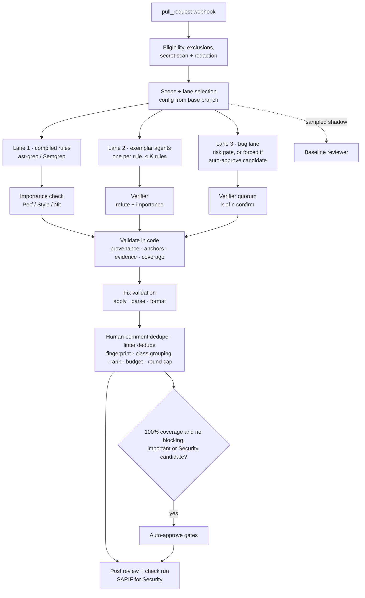
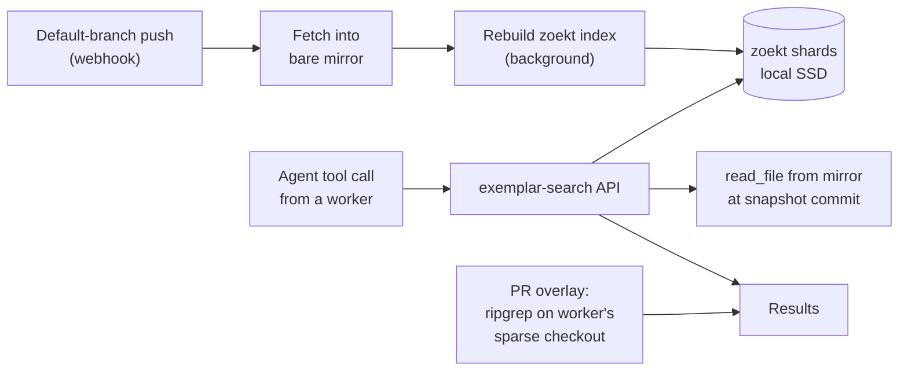

## 6. Review pipeline

### 6.1 Review lifecycle



```mermaid
sequenceDiagram
  participant GH as GitHub
  participant WH as exemplar-webhook
  participant CT as control (dispatcher)
  participant OR as runner: orchestrate
  participant W as runner: lanes
  participant V as runner: verifier
  participant GW as gateway
  participant PO as runner: post

  GH->>WH: pull_request.synchronize
  WH->>CT: River job (per-repo queue, unique by repo#pr)
  CT->>CT: supersede older heads, take the repo slot, snapshot config, mint claim
  CT->>OR: launch runner (in-process or Job) with job id
  OR->>OR: claim tokens; config (snapshot), eligibility, kill switches, dismiss prior approval
  OR->>PO: check run in_progress
  par Lane 1
    OR->>W: compiled rules on scoped files
  and Lane 2
    OR->>W: exemplar agents (≤3 concurrent, shared with Lane 3)
    W->>GW: generator stage (provider A, failover B)
  and Lane 3
    OR->>W: bug-class agents
    W->>GW: generator stage
  end
  W-->>OR: candidate findings
  OR->>V: verify candidates (grouped by file; n calls per Lane 3 finding)
  V->>GW: verifier stage (provider B, failover A)
  V-->>OR: confirmed / refuted / uncertain + evidence + importance (+ quorum share)
  OR->>OR: validate, fix-check, dedupe, group, rank, budget, round cap, coverage
  OR->>PO: findings + held-back counts + coverage + verdict
  PO->>GH: one review (COMMENT), check run complete, SARIF upload
  PO->>GH: APPROVE only if gates pass
  PO-->>CT: exit code → River (done · cancel · snooze · retry); claim cleared
  Note over OR,GH: Later CI results can still mark a posted finding as a linter duplicate (§6.10)
```

An **incomplete** run (both providers unavailable for a stage, or a diff that cannot be redacted) posts no comments and no approval; the check run reports "review did not complete" with the reason and a re-run button (§6.15).

### 6.2 PR lifecycle

A PR is a sequence of pushes, rebases and conversations. The orchestrator implements PRD §8.9 as follows.

| Event | Behavior | PRD |
|---|---|---|
| `opened` , `reopened` , `ready_for_review` | Full review of the PR against its **base ref** . For stacked PRs the base ref is the parent branch, so findings are never duplicated down a stack. | FR-C5 |
| Draft PR | Not reviewed unless the repo sets `review_drafts: true` . | FR-C5 |
| `synchronize` (new commits) | Any queued or running review for an older `head_sha` is `superseded` : the orchestrator calls River's `JobCancel` , which cancels the job's `context.Context` on whichever pod holds it and aborts in-flight model calls (no custom LISTEN/NOTIFY). Any prior Exemplar approval is **dismissed** via the review-dismissal API before the new review starts. | FR-A9 |
| Incremental re-review | `interdiff = diff(last_reviewed_head, new_head)` . Files re-reviewed = files with changed hunks in the interdiff ∪ files anchoring a still-open Exemplar finding. Rules re-run only where their scope intersects that set; all other rule results carry forward. | FR-C1 |
| Finding identity | `fingerprint = sha256(rule_id \| path \| normalized code at anchor ±2 lines \| k)` , where `k` is the ordinal of this anchor among anchors in the same file with identical normalized code (so two copies of the same loop are two findings, not one dropped as a duplicate). A fingerprint is posted at most once per PR: before posting, the orchestrator looks up open findings for `(repo, pr, fingerprint)` from earlier production reviews and treats a match as the same finding. Playground, baseline and eval runs are excluded from that lookup. | FR-C2 |
| Anchored lines changed | The finding is re-verified on the new head. If it no longer holds, the poster replies "Addressed in `<sha7>` " and resolves the thread (GraphQL `resolveReviewThread` ); state → `resolved` . If it still holds, the thread is left as is. | FR-C2 |
| Dismissed findings | Before posting, any fingerprint with a `fb_wrong` , `fb_not_important` , `fb_handled` or `fb_disagree` event, or a 👎, from the author or owner on this PR is dropped ( `suppressed_reason='dismissed'` ), even if found again. `fb_fixed` is not a dismissal: a finding marked Fixed is re-verified on the next push like any other, and re-posted if it still holds. | FR-C3 |
| Rebase / force-push | Detected when `before` is not an ancestor of `after` . Open findings are re-anchored by searching the new head for the fingerprint's normalized code; matches move, non-matches are marked `outdated` and their threads resolved with "No longer present after rebase". The review continues incrementally from the re-anchored state. | FR-C4 |
| Config changed mid-PR | Each review records `config_version` . On the next review, open findings from rules that are now `killed` or `shadow` are resolved with "Rule `<id>` was retired"; rules added since apply from this review on. | FR-C6 |
| Accounting | Cost and duration are recorded per run and summed per PR for reporting; there is no shared per-PR budget. The soft ceiling applies per run (§6.15). | FR-C7 |
| **Round cap** | A *round* is a production run that posts at least one new finding; `reviews.round` numbers them per PR. Once a PR has had `rounds.max` rounds (default 3, `global.yaml`, a repo may lower it), later runs still review (incremental, FR-C1) and still resolve addressed threads (FR-C2), but post no new inline findings except Security-category and `blocking` ones (FR-P6). Instead the run posts, or updates, **one summary comment** (hidden marker `exemplar:round-summary`) listing every still-open finding with its line link and the new ones held back (`state='summarized'`, `suppressed_reason='round_cap'`), and says that the change may need a different approach; the check run stays `neutral`. The counter resets when a human submits a review or a review comment on the PR, or the PR leaves draft; the reset is recorded in the trace. Rounds per PR feed §12.5. | FR-C8 |
| **Class-of-bug grouping** | When one rule or one bug class has more than `posting.class_threshold` (default 3) surviving occurrences in one run, they post as **one grouped comment** anchored at the first occurrence, naming the pattern and listing every occurrence with a line link, whatever the rule's `posting_mode`. The group has one `group_key` (`sha256(rule_id | review_id | sorted member fingerprints)`), one thread and one set of feedback controls; a signal on the thread applies to every member, and members are re-verified individually on later pushes, the group resolving when the last one is addressed. A grouped comment counts once against the comment budget and once as a round. | FR-C9 |
| Base moved after approval | See §6.13 "Base binding": an approval records its `base_sha`; drift beyond `base_drift_commits` or a base commit touching the PR's paths or imports turns `exemplar/merge-policy` pending and re-runs the gates on the new merge result. | FR-A9 |
| Kill switch or repo not eligible | No review; a neutral check run says why (none for a repo in shadow, §6.9). | FR-H1 |

### 6.3 Eligibility, scope and lane selection

1. **Repo eligibility** (PRD FR-H1): the repo must be opted in and must not appear on the platform denylist in `exemplar-config/platform/eligibility.yaml` (CODEOWNERS: Security). The same check gates mining (§8.1) and context (§6.4). Fork PRs are reviewed only when the repo sets `forks.review: true` (FR-H5).
2. **File list:** `GET /pulls/{n}/files`, paginated; for > 3,000 files, `git diff --name-status` in the worker checkout.
3. **Path exclusions** (FR-H2): drop removed files, binaries, files over 1 MB, minified assets, lockfiles, and paths marked `linguist-generated` or `linguist-vendored` in `.gitattributes`, plus patterns from the repo's `.exemplarignore` (read from the base branch). Excluded paths are listed in the check run as "not reviewed".
4. **Secret scan** (FR-H3): the diff is scanned with the embedded gitleaks detector before any model call. Matches are replaced in all model inputs with `‹redacted:secret›`, and a deterministic finding `possible-secret-in-diff` (lane `secrets`, Security, blocking) is created for each match — no model involved. Matches covered by the repo's `.gitleaksignore` or `.gitleaks.toml` allowlist (read from the base branch) are still redacted from model inputs but produce no finding, so test fixtures do not generate blocking Security comments. The same scan runs on every context snippet, ticket body and file read returned to an agent. If redaction fails for any input, the run is `incomplete` (§6.15).
5. **Rule scope:** match each active rule's `file_patterns` with `doublestar`. Rules with zero matches never run.
6. **Fan-out cap and overflow by expected value** (FR-D2, FR-E16): at most `max_exemplar_rules` (default 40) exemplar rules run. If more are in scope, each is scored `expected_value = precision_28d × severity_weight × hit_rate(paths)`, where `severity_weight` is 3/2/1 for blocking/important/suggestion and `hit_rate(paths)` is the rule's findings per run over the last 90 days on runs whose scoped files share a directory prefix with this diff (floored at a small prior so a new rule is not starved). The lowest expected values are deferred (`rule_runs.status='deferred'`), listed in the check run as "not run on this review", and the run's coverage is below 100%. The score and the cut are written to the trace.
7. **Rules per agent** (FR-E3): `concurrency.rules_per_agent` (default 1, at most 5) may pack in-scope rules of the same category whose `file_patterns` overlap into one agent, which reads the code once and reports per rule; provenance is still attached per rule by code, and coverage is measured per rule from the shared tool log. A value above 1 is adopted only after a golden-set run (FR-X5) with that value shows no loss of precision or recall against 1; config CI refuses the change without that run's artifact.
8. **Auto-approve pre-check:** the deterministic parts of Stage 1 that don't depend on findings (eligibility, scope, denylist, author policy, author experience, blast radius, fork, size) are evaluated now. A PR that passes is an **auto-approve candidate**.
9. **Bug lane:** runs if the risk gate passes (§6.7) **or** the PR is an auto-approve candidate (FR-A7).
10. **Baseline reviewer** (FR-X8): a stratified random 10% of production PRs (strata: repo × size bucket of ≤ 50 / ≤ 300 / > 300 changed lines) get a shadow run with `caller=baseline`. Its findings are stored, never posted.

### 6.4 Repository context — `exemplar-search`

Based on constraint 6 and FR-E12–E14, repository context is served by **one container, `exemplar-search`**: our Go binary embedding the **zoekt** code search library (Apache-2.0) with universal-ctags symbol extraction, plus the system's only git mirror. It never runs a build. `linked_ticket()` (GitHub Issues / Jira) and `path_history()` (`path_events` + `git log`) complete the context tools.



#### 6.4.1 Process layout

- **Deployment:** StatefulSet with 2 independent replicas, each with its own local SSD volume, mirror and index. No shared state. Workers call a Kubernetes Service.
- **Mirror:** one full-object bare mirror per repo in scope (the monorepo plus `context.extra_repos`). Fetched on default-branch `push` webhooks relayed by the orchestrator (debounced to once per 30 s per repo) and every 5 minutes as a backstop.
- **Index:** zoekt shards for the default branch at the latest fetched commit, with ctags symbols. Indexing is incremental: zoekt's git indexer re-indexes only files changed since the serving generation, so a fetch on a busy monorepo costs seconds, not a full rebuild; a full rebuild runs nightly and whenever the incremental chain exceeds 500 generations. A new generation serves only once complete and is swapped atomically. Every response carries the `snapshot_sha` it was answered from. T-0.4 records both incremental and full index times.
- **Snapshot pinning:** a review is pinned to one `snapshot_sha` at start (recorded in `reviews.search_snapshot`) and every tool call passes it. A replica whose index is at a different commit still answers `read_file` and evidence resolution from git at the pinned commit, and answers search from its index while flagging `snapshot_mismatch` on the result; the worker prefers the replica whose index matches (session affinity on `snapshot_sha`). Verifier evidence is always resolved at the pinned commit.
- **API:** internal HTTP/JSON implementing the tools in §6.4.4 and `read_file(commit, path, start, end)` via `git show`.
- **Image contents:** `exemplar-search`, git, universal-ctags.
- **Resources:** local SSD at 3–4× the repo's checked-out source size per replica, and RAM sufficient to keep hot shards in page cache; final sizing comes from the Phase 0 benchmark.

#### 6.4.2 Worker checkout

Workers clone only what a review needs. **As built,** the checkout is a blob-less depth-1 clone of the head (and a fetch of the base), without a sparse cone:

```
git clone --filter=blob:none --depth=1 --no-checkout <repo> wt
git -C wt fetch --depth=1 origin <head_sha> <base_sha>
git -C wt checkout <head_sha>
```

The whole head tree is listed, and a file's contents are fetched from GitHub the first time a tool opens it, so `read_file`, `grep` and `list_dir` see the repository under review in full, not only the diff, at the cost of a blob fetch per first read. The sparse cone of earlier drafts is kept as an option for monorepos where even the tree listing is large (`checkout.sparse: true` in the repo file), and then files outside the cone are read from `exemplar-search` `read_file` at the snapshot commit. Either way the checkout is the runner's own ephemeral volume (§2.4 C6) and is discarded with it.

#### 6.4.3 Package scoping by imports

`find_references` and `dependents` are scoped by imports discovered with search queries at request time:

1. **Package identity of a file:** Go import path (module root + directory); C/C++ header path relative to configured `include_roots`; TS/JS module path relative to workspace roots; Python dotted module; Java/Kotlin package declaration.
2. **Importers:** a per-language import pattern is instantiated with that identity and run as a zoekt regex query, for example:
   - Go `^\s*(import\s+)?(\w+\s+)?"acme/game-engine/src/net"`
   - C++ `#include\s+[<"]net/avatar_fetch\.h[>"]`
   - TS `from\s+['"].*/net/avatar['"]`
   - Python `^(from\s+src\.net(\.\w+)*\s+import|import\s+src\.net)`
3. **Transitive dependents:** step 2 repeated for importing packages, depth ≤ 2, capped at 200 packages.

Patterns live in `internal/ctxprov/langs/` with golden tests per language. Languages without patterns use directory proximity.

#### 6.4.4 Agent tools

| Tool | Answered by | Returns | Limits |
|---|---|---|---|
| `find_definition(name, near_path?)` | zoekt symbol query with language filter; ranked by qualified-name match, then path proximity | ≤ 10 definitions | Whole repo |
| `dependents(path, depth?)` | Import-pattern queries (§6.4.3) | Importing files and packages | depth 1 (max 2), 200 packages |
| `find_references(name, defined_in)` | Word-boundary search restricted to the defining package's directory plus `dependents(defined_in)` ; ranked by proximity | ≤ 50 sites with 2 lines of context | `defined_in` required for names with > 500 repo-wide hits |
| `search_text(pattern, path_filter?, lang?)` | zoekt regex query | Matching lines | Repo-wide; 100 results; 2 s timeout |
| `read_file(path, start, end)` | Worker checkout, else `exemplar-search` at the snapshot | Lines | ≤ 400 lines per call |
| `linked_ticket()` | GitHub Issues / Jira | Title + description | 4K chars |
| `path_history(path)` | `path_events` + `git log` from the mirror | Incidents, reverts, recent commits | 20 entries |

**PR overlay.** For every search tool, the worker runs the same query with ripgrep (or a Go regex for symbol lookups) over the PR's changed files, drops index hits for those paths, and merges in the PR's versions.

**Degraded mode.** When the index is missing or more than 1 hour behind the mirror, `search_text`, `find_references` and `dependents` are answered with `git grep` at the mirror commit with tighter caps, and `find_definition` with per-language definition regexes. Responses carry `degraded: true`, recorded on the rule run; `bug.contract` is skipped (`degraded_skip`), which blocks auto-approve.

**Visibility.** Context comes from the PR's own repo plus `context.extra_repos` in the same visibility tier (private/internal for private PRs, public for public PRs), enforced per request by `exemplar-search`.

All results are untrusted text. Context tools make no model calls.

**As built,** the engine offers `find_references` only when it holds a `References` implementation and `path_history` only when it holds a `PathHistory`; both are bound per review, and today both come from `exemplar-search` when `EXEMPLAR_SEARCH_URL` is set. §6.4.6 adds the checkout-backed implementations.

#### 6.4.5 v1 language support (PRD FR-H8)

| Language | Lane 1 engines | ctags symbols | Import patterns (§6.4.3) |
|---|---|---|---|
| Go | ast-grep, Semgrep | ✓ | ✓ |
| C / C++ | ast-grep, Semgrep | ✓ | ✓ ( `include_roots` ) |
| TypeScript / JavaScript | ast-grep, Semgrep | ✓ | ✓ |
| Python | ast-grep, Semgrep | ✓ | ✓ |
| Java / Kotlin | ast-grep, Semgrep | ✓ | ✓ (package declaration) |
| Other languages | — | where ctags supports them | directory proximity only |

Exemplar rules whose `file_patterns` target only languages outside the first five rows run with text-only context; the candidate PR and rule file carry `context: text-only`, and the check run labels their findings accordingly. The list is confirmed against the monorepo's actual language mix in T-0.4.

#### 6.4.6 Running without `exemplar-search`

Search is the one stateful service besides Postgres (local SSD, a mirror and an index per repository, R2 in §2.4), and a trial or a single-repository install can do without it. This section makes search-off an **install mode** with defined behavior rather than a degraded state: `EXEMPLAR_SEARCH_URL` empty, the StatefulSet and its Services left out of the overlay, no search Secret (the token derives from the root key and is read only when the URL is set). The worker logs one warning at start. Adding search later is the reverse: set the URL, give the StatefulSet storage, restart the worker; nothing else changes.

**What is the same.** The diff, hunks, exclusions and redaction, Lane 1, Lane 2 over the checkout, the verifier and quorum, dedupe against linters and human comments, the comment budget, the check run, feedback, exports and the learning plane (its ingest reads GitHub directly). Every agent has `get_hunk`, `read_file`, `grep` and `list_dir` over the whole head tree (§6.4.2). On a monorepo that is nearly all the context there is.

**What search adds, and how the checkout stands in for it.**

| Capability | With search | Without search, as built today | Without search, specified |
|---|---|---|---|
| `find_references(name, defined_in)` | Word-boundary search across the indexed repositories, scoped by imports (§6.4.3) | Tool not offered; a rule about callers finds them with `grep` inside the repository | **`LocalReferences`**: `rg -w` over the head tree (ripgrep is in the image), definitions told from uses with universal-ctags, ranked by path proximity to `defined_in`, capped like the remote answer (≤ 50 sites), and the result **says that other repositories were not searched**. Bound per review from the review's checkout. |
| `find_definition`, `dependents`, `search_text` across repositories | zoekt and import patterns | In-repo `grep` and `read_file` | Unchanged: in-repo only. Multi-repository orgs lose the cross-repository view; that is what search is for. |
| `path_history(path)` | `path_events` plus `git log` from the mirror | Tool not offered; the merge-safety score loses its recency term | **Local `PathHistory`**: deepen the checkout once for the touched paths (`git fetch --filter=blob:none --deepen=N` on base and head, N = 200 commits) and read `git log` over them through `pathhistory.Dir`; incidents and reverts still come from `path_events` in Postgres. |
| `bug.contract` (the bug lane's contract-change class) | Runs on `find_references` | Skipped as `degraded_skip`; the run is degraded and **never auto-approved** | On a repository with no `context.extra_repos`, every caller is in the checkout, so the class runs on the local answers and the run is not degraded: the review **may auto-approve**. With `extra_repos` set, the class stays `degraded_skip` with a detail naming the unsearched repositories, which keeps auto-approve blocked. |
| Snapshot pinning, index freshness, degraded-mode signalling | §6.4.1 | Nothing to report | Unchanged on the remote path; the local path has no snapshot (it is the head itself) and no degraded state. |

**What the reader is told.** The check-run summary already lists degraded runs; on a search-off install it says so in plain words: "Cross-repository callers were not checked (search is not configured)", and, where the contract class was skipped for `extra_repos`, names the repositories. An honest scope statement is worth more than a missing finding nobody notices.

**Auto-approve.** The gate is unchanged: a degraded run cannot approve (FR-D5). What this section changes is which runs are degraded: single-repository installs without search are not, once the local implementations exist. Until they do, the auto-approve guide lists search as a prerequisite. Shadow mode, the trial default, never approves anyway.

**The install ladder.** Shadow without search; posting with search once cross-repository context is worth a search volume; auto-approve once the Phase 5 criteria hold. Each step adds one component and one promise. Search is started small when it is added: one replica, a modest disk, only the opted-in repositories indexed; a few repositories fit in tens of gigabytes. The trial and the small-team tier are priced without it (§2.4.5).

**Status:** built. The mode is documented and the manifests support it; the check-run line names `context.extra_repos` as not searched whenever search is off; `LocalReferences` and the local `PathHistory` answer from the checkout (`internal/engine/localrefs.go`, `Workspace.Deepen` and `Log`), with `path_history` reading incidents and reverts from `path_events`. The "as built today" column above describes the code before them. PRD v0.10 makes the same statement in constraint 6 and FR-E12.

### 6.5 Agent harness (Go)

The harness is a thin tool loop over the Messages API using `github.com/anthropics/anthropic-sdk-go`, pointed at `exemplar-gateway` as its base URL. It owns prompt layout (for caching), the tool surface, turn limits, cancellation and cost accounting.

**Fan-out and failure isolation:**

```go
// internal/engine/review.go
func (e *Engine) Review(ctx context.Context, r *Review) (*Result, error) {
	g, ctx := errgroup.WithContext(ctx)
	g.SetLimit(e.cfg.AgentsPerReview) // ≤3, from global.yaml

	runs := make([]RuleRun, len(r.ScopedRules))
	for i, rule := range r.ScopedRules {
		g.Go(func() error {
			raw, err := e.runRule(ctx, r, rule)  // tool loop; honors ctx cancel + budget
			runs[i] = e.finalize(r, rule, raw, err) // attach id/citation, anchors, coverage
			return nil // one failed rule never fails the review; it is recorded as zero coverage
		})
	}
	_ = g.Wait()
	return e.assemble(r, runs), nil // dedupe, posting_mode, verdict ∈ {Approve, NoOp}
}
```

**Prompt layout (optimized for prompt caching).** Caching is a prefix match, so put what is shared across all rule agents of a review *first*:

```
[system]   harness instructions + output contract           ← cached org-wide
[user #1]  <untrusted_pr_context> title, body, file list,     ← cached per review,
           diff hunks </untrusted_pr_context>                    shared by every rule agent
[user #2]  <rule n="1"> description, preferred approach,
           what to flag; file subset in scope </rule>          ← per agent (no id/citation);
           <rule n="2"> … </rule>                                 one block per rule when rules_per_agent > 1
[tools]    read_file, grep, list_dir, get_hunk + repo-context tools (§6.4.4)
```

The diff block carries a `cache_control` breakpoint so agents 2..N of the same review read it from cache. The rule text deliberately contains no rule id or citation; code attaches those (FR-T1). When an agent carries more than one rule (§6.3 step 7), each rule is numbered in the prompt and each violation names the number; code maps the number back to the rule id and refuses a number outside the set, so a packed agent cannot attribute a finding to a rule it was not given. The errgroup fans out over agents, not rules; `AgentsPerReview` still bounds concurrency.

**Tools (Go functions, read-only, sandboxed to the worktree; the repo-context tools from §6.4.4 are added for Lanes 2–3 and the verifier, and `read_file` falls back to `exemplar-search` outside the sparse checkout):**

| Tool | Implementation | Guards |
|---|---|---|
| `read_file(path, start, end)` | `os.Open` on the head worktree | `filepath.EvalSymlinks` result must stay inside worktree; ≤ 400 lines; binary refused |
| `grep(pattern, glob)` | `exec.CommandContext("rg", ...)` | 5 s context timeout; ≤ 200 matches; pattern length cap; `--no-follow` |
| `list_dir(path)` | `os.ReadDir` | Depth 1; ≤ 500 entries |
| `get_hunk(path)` | From the in-memory hunk index | — |

No shell for the model, no network, no write, no code execution. Max 12 tool turns per agent; max tokens per agent derived from the remaining review budget.

**Output contract.** The violation struct is the single definition; its JSON Schema is generated with `invopop/jsonschema` and sent as the strict output schema via structured outputs. The response is unmarshalled and validated again in Go — schema conformance from the API is a convenience, not the trust boundary.

```go
type Violation struct {
	Rule         int    `json:"rule" jsonschema:"minimum=1,maximum=5"` // index into the agent's rules; code maps it to the id
	Path         string `json:"path"`
	Side         string `json:"side" jsonschema:"enum=RIGHT,enum=LEFT"`
	StartLine    int    `json:"start_line" jsonschema:"minimum=1"`
	EndLine      int    `json:"end_line" jsonschema:"minimum=1"`
	Explanation  string `json:"explanation" jsonschema:"maxLength=1500"`
	SuggestedFix string `json:"suggested_fix,omitempty" jsonschema:"maxLength=1500"`
}
type AgentOutput struct {
	Violations    []Violation `json:"violations" jsonschema:"maxItems=20"`
}
// Note: no RuleID, Citation or FilesExamined fields exist on the model-facing type.
// Coverage is computed by the harness from the tool-call log, never from the model.
```

**Coverage is measured, not reported** (FR-T3). The harness records every tool call. A scoped file counts as examined when the agent called `get_hunk` or `read_file` on it, or when its hunks were included in the cached PR-context block and the agent produced any output (the diff was in its context). If any scoped file was neither, the run is `zero_coverage` and reported as a failure, not as "clean." Nothing the model says can raise coverage; this is what lets coverage be an auto-approve input (§6.13).

**Model tiering** (set in `global.yaml`, overridable per rule). *Deliberate deviation from PRD FR-E5*, which says high-capability models by default: rule agents default to the standard tier and are promoted to `high` when eval precision on standard falls below the rule's threshold; Blocker and Security rules, the bug lane and Stage 2 start on `high`. The PRD should be updated to match once Phase 2 shadow data confirms standard-tier precision.

| Use | Default tier | Model |
|---|---|---|
| Rule agents (default) | standard | `claude-sonnet-5-5` |
| Blocker / Security rules, bug lane, Stage 2 low-risk categorization (provider A side), merge cohesion checks, rule compilation | high | `claude-opus-5-5` |
| Verifier, Stage 2 cross-check | verifier | Provider B model (configured in `global.yaml` ) |
| Reply and teach-the-bot classification, fix-detection judge, linter-dedupe judge, extraction pre-triage | light | `claude-haiku-5-5` |

A rule moves to a cheaper tier only when its eval precision holds on that tier.

The bug lane (§6.7) and the verifier (§6.8) reuse this harness with different system prompts and output types; nothing else changes.

### 6.6 Lane 1 — compiled rules

Rules with `kind: compiled` carry a `matcher` block (PRD §7). The worker runs the engine binaries directly on the head worktree, restricted to scoped files.

| Engine | Use for | Invocation | Notes |
|---|---|---|---|
| **ast-grep** (Rust binary, MIT) | Default: syntactic patterns in most languages via tree-sitter | `ast-grep scan --rule <file> --json=stream <paths>` | Fast, permissive license, the default target for compile attempts |
| **Semgrep** Community Edition (LGPL-2.1 engine) | Patterns needing Semgrep's taint/metavariable features | `semgrep scan --config <file> --json --metrics=off <paths>` | Ships Python in the worker image; registry rules have separate terms — we use only our own rules |

- Output is parsed in Go into the same `Finding` struct as other lanes, with `lane=compiled`. Provenance and citation are attached from the rule, exactly as in Lane 2.
- Compiled findings skip refutation (a pattern match is not a hallucination). **Importance check** (PRD FR-V6): findings from compiled rules in the Performance, Style and Nit categories, and from any compiled rule with `importance_check: true`, are scored by the light model for importance in context (same prompt and threshold semantics as the verifier's importance score, §6.8); below `importance_min` they are stored as `unimportant`. Security and Correctness compiled findings post without it.
- All compiled findings go through anchor validation, dedupe, ranking and the comment budget.
- Hard timeouts are per rule, not per engine: `10 s + 0.2 s × scoped files` for each compiled rule, capped at 120 s. A timeout records `zero_coverage` for that rule only, so one slow Semgrep rule cannot zero out every compiled rule on the PR. Rules are run as separate engine invocations grouped by language to keep this attribution exact.

### 6.7 Lane 3 — bug lane

**Eligibility** (computed in §6.3, all configurable per repo):

- any changed file matches the repo's `bug_lane.critical_paths`, **or**
- changed non-test lines ≥ `bug_lane.min_changed_lines` (default 80), **or**
- `merge_safety_score < 0.6`, **or**
- a touched path had an incident or revert in the last 90 days.

**Classes.** One agent per enabled class, drawn from an allowlist in `global.yaml`. Each class is effectively a built-in rule with its own prompt, eval set, metrics and kill switch:

| Class id | Looks for |
|---|---|
| `bug.nil-deref` | Dereference of values that can be nil/null/None on a reachable path |
| `bug.error-handling` | Swallowed errors, wrong error propagated, missing cleanup on error paths |
| `bug.concurrency` | Data races, lock ordering, unguarded shared state, goroutine/thread leaks |
| `bug.resource-leak` | Unclosed handles, connections, files; missing `defer` /RAII |
| `bug.off-by-one` | Boundary errors in loops, slices, pagination |
| `bug.contract` | Changed function behavior that breaks callers found via `find_references` (skipped when `exemplar-search` is in degraded mode, §6.4.4, or absent on a repository with `extra_repos`, §6.4.6) |

**Prompt restriction.** The bug-lane system prompt forbids style, naming, performance-preference and "consider" comments; the output schema requires `trigger` (concrete input or path that causes the bug) and `impact`. Findings without a concrete trigger fail schema validation.

**Verification.** Every Lane 3 candidate goes to the verifier **quorum** (§6.8), not a single verifier: `k` of `n` independent verifiers must confirm it, and the agreeing share travels with the finding into ranking.

**Posting.** The lane starts in shadow. A class with `post_on_critical_paths: true` in `global.yaml` posts its findings that fall in the repo's `bug_lane.critical_paths`, through the usual budget, dedupe and repo-shadow rules; its other findings stay in shadow (Phase 4: "in shadow, then commenting on critical paths").

**Shedding.** Bug-lane agents share the review's ≤3 concurrency slots with Lane 2 and are the first work shed when a run approaches its soft ceiling (§6.15); shed classes are recorded as `shed`, which lowers coverage and blocks auto-approve.

### 6.8 Verification stage

Every candidate from Lanes 2 and 3 is verified before validation.

- **Independence, then diversity** (FR-E10, v0.9). A verifier is *independent* when it runs in a fresh context with only the finding, the rule or class prompt and the code, never the generator's reasoning, and, for the bug lane, when the quorum below agrees. Independence is the requirement; a second model family is a preference that makes blind spots less correlated. The gateway routes verifier calls to **provider B** (a different family from the generator) when one is configured: `verifier.provider`, `verifier.model`, and a per-rule override. It records the family actually used for the generator call and for each verifier call; `verify_same_family` is set whenever the two match, whichever side failed over (generator to B while the verifier is on B is the common case). A same-family finding always posts. Whether it blocks auto-approve depends on calibration: **until the verifier calibration (below) has passed for the configured providers, any same-family verification makes the run ineligible; after it has, `same_family` is recorded on the finding and in the trace and no longer gates** (§6.13). A single-provider installation, which is every installation at the time of writing, therefore cannot auto-approve until its calibration run passes. If no provider is available the run is incomplete (§6.15).
- **Quorum for the bug lane** (FR-V7). A Lane 3 candidate is sent to `verifier.quorum.n` verifiers (default 3), each a separate call in a fresh context, spread across the configured providers and models in a fixed rotation so that no two of the three share a model where the configuration allows it; it is `confirmed` only when at least `verifier.quorum.k` (default 2) return `confirmed`, and its importance is the median of the confirming verdicts. `verify_quorum_n` and `verify_quorum_agreed` are stored; the agreeing share (`agreed / n`) is a ranking input after severity (§6.10). A Lane 2 rule keeps the single verifier unless it sets `verify: quorum`. Quorum calls count toward the soft ceiling and are the first thing shed (§6.15). A candidate that fails the quorum is stored with `suppressed_reason='quorum'`, and its share is kept so a class with many 1-of-3s shows up on the lanes board. **As built,** the rotation is a gateway request header, `X-Exemplar-Route-Offset: j`, valid on the verifier stage only: the gateway rotates `providers.verifier` by `j` and keeps the rest as failover, so with one provider every verifier gets the same model in a fresh context. The first verifier's call is the single verifier's (it batches every candidate); verifiers 2..n batch only the quorum candidates. A vote counts only when its evidence resolves. A quorum finding is `verify_same_family` only when every confirming verifier shared the generator's family. The verifier-only path behind `exemplar review`'s claim checks keeps one verifier. `verify_quorum_n` is the configured `n` even when the quorum was shed (`verify_quorum_agreed` then counts the votes made); a shed candidate whose votes already reach `k` is confirmed and posts. `verifier.quorum` is not part of the verifier calibration key, since calibration replays one verifier.
- **Grouping.** Candidates are grouped by file into one verifier call per file (max 8 candidates per call), which keeps cost proportional to findings rather than rules. Quorum calls are grouped the same way, per verifier.
- **Inputs:** the candidate(s), the rule text (Lane 2) or class prompt (Lane 3), the hunk plus ±60 lines, worktree tools and the repo-context tools (§6.4.4). The verifier never sees the generator's reasoning — only its claim — so it cannot be talked into agreement.
- **Instruction:** "Your job is to show this finding is wrong. Look for awaits, guards, validation, callers, tests, or configuration that make it incorrect. Then, separately, rate whether it matters in this code."
- **Output schema:**

```go
type Verdict struct {
	CandidateID string   `json:"candidate_id"`
	Verdict     string   `json:"verdict" jsonschema:"enum=confirmed,enum=refuted,enum=uncertain"`
	Evidence    []Cite   `json:"evidence" jsonschema:"maxItems=8"`
	Reason      string   `json:"reason" jsonschema:"maxLength=800"`
	Importance  float64  `json:"importance" jsonschema:"minimum=0,maximum=1"`
}
type Cite struct {
	Path string `json:"path"`
	Line int    `json:"line" jsonschema:"minimum=1"`
}
```

- **Decision in code:** post only if `verdict == "confirmed"`, every `Evidence` cite resolves to an existing line in the worker's checkout or via `exemplar-search` `read_file` at the cited commit, and `importance ≥ threshold` (rule `importance_min`, default 0.5; bug lane default 0.6). Otherwise the finding is stored with `suppressed_reason = refuted | uncertain | unimportant | bad_evidence`.
- **Auto-approve interaction:** Stage 2's low-risk categorization is produced independently by provider A and provider B (§6.13).
- **Calibration** (PRD FR-X9): a labeled set in `verifier_labels` is replayed nightly and on every change to the verifier prompt, model or provider; CI fails the change if fewer than 90% of known-wrong findings are refuted or more than 10% of known-true findings are refuted (`eval_thresholds.verifier` in `global.yaml`). The Stage 2 categorizer has the same gate on its labeled PR set. Dashboards show both trends. **Every run writes a `calibration_results` row** keyed by config SHA and the provider set it ran with; Stage 1 reads the latest row for the deployed config and providers to decide whether `same_family` gates (above, §6.13). A run `exemplar calibrate` makes from a laptop writes the same row through `/v1/evaluate`, so the nightly job and the CLI agree.

### 6.9 Validation in code

1. Parse against schema; on failure the run is `schema_error`. **Do not** ask another model to repair it (FR-T5).
2. Attach `rule_id`, `rule_version`, `citation`, `lane`, `severity` from the rule or bug class under evaluation.
3. Build a hunk index; drop any finding whose `[start_line, end_line]` on `side` is not inside a visible hunk (GitHub rejects such comments with a 422).
4. Clamp multi-line ranges to one hunk; GitHub multi-line comments cannot span hunks. A clamped finding drops its `suggested_fix`, because the replacement text was written for the original range (§6.11). Fixes are also dropped for `side = LEFT` anchors, which GitHub cannot apply suggestions to.
5. Resolve verifier evidence cites (§6.8).
6. Coverage check per rule/class; fingerprint; dedupe against existing findings on this PR.
7. Apply `posting_mode`: `grouped` collapses occurrences into one comment anchored at the first.
8. Rules in `shadow` store findings with `state='shadow'` and post nothing.
9. A **repo in shadow** (`shadow: true` in `repos/<org>/<repo>.yaml`, used for pilots in Phase 2) is reviewed in full: every lane runs, and every result is stored.
   - **Findings:** those that would have posted, secret-in-diff findings included, are stored as `state='shadow'` with `suppressed_reason='repo_shadow'`, after the comment budget. This keeps them distinguishable from shadow-rule findings, so shadow precision can be measured.
   - **Nothing is written to the PR:** no review, comments, check run (including the neutral "not reviewed" check), thread replies or approval.
   - **Stage 1** records `repo_in_shadow`, so the PR is never an auto-approve candidate.
   - **The one exception:** revoking an earlier Exemplar approval (FR-A9) still happens, so moving a repo into shadow cannot leave an approval standing.

### 6.10 Dedupe, ranking and the comment budget

**Human-comment dedupe** (PRD FR-E15). Before ranking, each finding is compared with existing human review comments whose range overlaps its anchor on the same file. For each overlap the light model answers "same concern?" on a fixed schema; a `yes` withholds the finding with `suppressed_reason='human_duplicate'`. Withheld duplicates count as agreement with the reviewer (a true positive for the rule, §9.2), never as a false positive. The bot does not reply to or grade human comments.
- **Whose comments count:** a human's (not a bot's), other than the PR author's, whose `author_association` is `OWNER`, `MEMBER` or `COLLABORATOR`. Anyone can comment on a public repo's PR, and an author could otherwise silence findings on their own lines.
- **Placement:** comments GitHub no longer places on the latest diff (outdated) are not compared. A comment must be on the same side as the finding.
- **Limits:** a finding both a reviewer and a linter raised is a `human_duplicate`. At most 20 pairs are judged per review, verdicts are cached per pair, and on any judge failure the finding posts.
- **Redaction:** both judges' inputs (reviewer comments, linter messages) are redacted like the diff (FR-H3, layer 1) before they are sent; an input that can't be redacted is not judged.

**Linter dedupe** (PRD FR-E7). Configured linter and static-analysis check runs on `head_sha` (names in repo config, e.g. `golangci-lint`, `clang-tidy`, `eslint`) and open code-scanning alerts are compared with findings. A finding is a `linter_duplicate` if an annotation overlaps its range in the same file and either shares a mapped id (`linter_map` in rule metadata) or the light model judges them the same issue (cached per pair).
- **Mapped ids:** `linter_map` maps a check run name to linter rule ids, e.g. `linter_map: { golangci-lint: [errcheck] }`. An annotation matches when its title is the id or its message ends with `(id)`, as golangci-lint prints it.
- **The model judge** sees the finding and the annotation as untrusted data. A PR author can shape what CI reports, so the judge never withholds a Security, blocking or secret finding; those are deduped only by a mapped id. At most 20 pairs are judged per review; past that, and on any judge failure, the finding posts.
- Only completed check runs are read; a linter still running is waited for (below), never read part-way.
- **Code-scanning alerts** count when their tool is named in `linters` (for example `CodeQL`): the PR's open alerts on `refs/pull/<n>/merge`, with the tool as the check name and the alert's rule id as its title, so `linter_map` keys on the tool name. Exemplar's own alerts never count. A repo without code scanning contributes none.

- **Timing:** once findings are ready, the orchestrator waits up to `linter_wait_seconds` (default 120) for the configured checks to complete, then posts. The wait is skipped when the repo configures no `linters`, when all configured checks have already reported, or when no finding could post. Config doesn't say which files a linter covers, so any finding that could post waits.
- **Late CI:** a `check_run.completed` webhook for a configured linter re-runs the comparison against Exemplar's posted findings on that head. Overlapping findings are minimized (GraphQL `minimizeComment`, classifier `OUTDATED`) with a one-line note naming the linter, and recorded as `linter_duplicate`.
  - **Which findings:** those still open that a production review of that head posted. The same matching applies, including the judge's limits.
  - **Recording:** the finding's state becomes `minimized`, with `suppressed_reason='linter_duplicate'`.
  - **Ordering:** minimize, record, then reply, so a retried job never replies twice.
  - **A review of the head still queued or running:** the check waits for it, so it sees what that review posts.
  - **A repo in shadow** posted nothing, so there is nothing to minimize.
- Linter duplicates count against neither the rule's precision nor the author's feedback.

**Importance priors** (PRD FR-B9). Before ranking, a finding's importance threshold is the rule's or lane's `importance_min` adjusted by any matching **path-level prior** in the effective config: `importance_priors` entries in the repo file (`{prefix, category, importance_min | suppress}`), proposed by `exemplar-learn priors` from clustered *Not important here* dismissals (§8.11) and merged by an owner. `suppress` stores the finding with `suppressed_reason='importance_prior'`; a raised threshold applies to the verifier's per-finding importance, which stays (FR-V2). Priors never lower a threshold for Security or `blocking` findings. The prior that applied is recorded on the finding for the owner digest.

**Class-of-bug grouping** (FR-C9) runs after dedupe and before ranking: occurrences of one rule or class above `posting.class_threshold` become one grouped finding (§6.2), scored once at the highest member's score. **As built,** the group is one rule's occurrences (a bug class's id is its rule id); the leader is the first in the ranked order (severity, then quorum share, then path and line), members take its budget, round-cap and shadow outcome, and the grouped comment has no suggestion block. Per-rule `posting_mode` (§6.9 step 7) and grouping exempt overflow into one comment per file are not built; Security and blocking findings post individually and take no budget slot.

**Ranking.** Each surviving finding is scored:

```
score = severity_weight            // blocking 100, important 30, suggestion 10
      + 20 · importance            // verifier or Lane 1 importance check; 0 when not scored
      + 10 · quorum_share          // Lane 3 (and quorum-opted rules): agreed / n; 0 for single-verifier findings
      + 15 · rule_precision_28d    // from finding_outcomes
      +  5 · has_valid_fix
```

**As built,** the score is not computed: findings are ordered by severity, then quorum share (highest first), then path, line and rule, and `rank_score` stays NULL.

**Budget** (PRD FR-P1, FR-P6).

- **Exempt:** Security-category and blocking-severity findings are never dropped by the budget. If exempt findings alone exceed `comment_budget.per_pr`, they are posted as **one grouped comment per file** listing every occurrence with line links, and the check run summary says so.
- **Competing:** important and suggestion findings fill the remaining slots, up to `comment_budget.per_pr` (default 7) in total and `comment_budget.per_file` (default 3).
- Findings that don't fit are stored with `suppressed_reason='budget'` and listed in the check run. Incremental reviews count previously posted, still-open findings against the budget. A grouped comment (FR-C9) counts once.
- **Round cap** (FR-C8) applies after the budget: on a PR past `rounds.max`, competing findings that would have posted go to the summary comment instead (§6.2); exempt findings still post inline.

**Pre-launch volume estimate** (PRD FR-P2) is a replay job: on any config PR that adds or activates a rule, run it over the last 30 days of PRs in scope (from the replay harness's stored `(repo, base, head)` tuples), and post expected comments per PR and the share of PRs affected to the config PR's check.

### 6.11 Fixes

- Rules with `fix_policy: suggest` (and all bug classes) may return a `suggested_fix` as replacement text for the anchored lines.
- **GitHub semantics:** a `` ```suggestion `` block replaces exactly the lines the comment is anchored to. So the fix must be expressed as a full replacement of `[start_line, end_line]`; the validator rejects fixes that imply edits outside that range.
- **Validation (code):** apply the replacement to a copy of the file in the worktree; parse with tree-sitter for the file's language (`go-tree-sitter` grammars) and reject on new parse errors; run a formatter check where cheap and available (`gofmt -l`, `clang-format --dry-run`, `prettier --check`); reject if the replacement is identical to the original or exceeds 30 lines. Failed fixes are dropped silently and the finding is posted without one.
  - **Also rejected:**
    - fixes on removed (LEFT) lines;
    - fixes that contain a code fence (it would end the block), the redaction placeholder or a detectable secret;
    - fixes whose first line repeats the line above the range, or whose last line repeats the line below. That means the model included context, and GitHub would duplicate it.
  - **Languages:**
    - Go uses `go/parser`, plus `gofmt` when the original file was formatted.
    - C, C++ (C headers parse as C++), C#, Java, JavaScript/JSX, TypeScript/TSX, Python, Ruby and Rust use tree-sitter (`github.com/tree-sitter/go-tree-sitter` v0.25.0 and those grammars, via cgo). The fix may not add ERROR or MISSING nodes, so errors already in the file aren't blamed on it.
    - Other languages' fixes are dropped.
    - **Formatters:** after the parse check, the file's formatter runs when installed, and the fix must not unformat a file the formatter considers clean.
      - clang-format (C and C++) uses the repo's `.clang-format`, which is YAML.
      - prettier (JavaScript, TypeScript, CSS, JSON, YAML) runs with `--no-config --no-editorconfig`, because its config may be JavaScript from the PR. A repo not on prettier's defaults is therefore not checked.
      - The services image ships clang-format; prettier is used only where installed.
  - **Shadow:** fixes of shadow findings are validated too, so fix quality can be measured before a rule posts.
  - **Prompting:** agents are told per rule whether fixes are allowed.
- **Acceptance tracking:** when the PR's next commit contains exactly the suggested text at the anchor (GitHub's "Commit suggestion" produces a commit authored by the PR author with that content), record `applied_suggestion`.
  - **Matching:** the suggested text must be exactly at the anchored start line. If other edits moved it, it must appear exactly once within 50 lines of the anchor, and its longest line must have at least 8 non-space characters, since a line such as `}` matches too much.
  - **Attribution:** the event is the PR author's (`via: inferred`).

### 6.12 Posting and structured feedback controls

- **One review per run:** `POST /repos/{o}/{r}/pulls/{n}/reviews` with `event: "COMMENT"`, `commit_id: head_sha`, and a `comments[]` array.
- **Comment body layout:**

````text
**suggestion (performance):** FetchData blocks inside an async task …

```suggestion
    auto data = co_await FetchDataAsync(player.avatarUrl);
```

[Fixed](…/f/8812/fixed?s=…) · [Wrong](…/f/8812/wrong?s=…) · [Not important here](…/f/8812/not_important?s=…) · [Already handled](…/f/8812/handled?s=…) · [Disagree with rule](…/f/8812/disagree?s=…)
<sub>Rule [blocking-fetch-in-loop](…/rules/…yaml) @3f2c1a · owner @platform/runtime · checked by a second model</sub>
<!-- exemplar:v1 finding=8812 rule=blocking-fetch-in-loop ver=3f2c1a lane=exemplar -->
````

- **Conventional Comments label** is derived in code from `severity` + `category`: `issue (blocking):`, `issue (security):`, `suggestion (performance):`, `suggestion (correctness):`, etc.
- **Feedback controls.** The feedback chips shown in PRD §17 are implemented as:
  1. **Signed links** to `exemplar-api` `/f/{finding}/{reason}?s=<HMAC(finding, reason)>`. The endpoint requires org SSO, then GitHub user OAuth to identify the actor, records the event, and shows a one-line confirmation with an optional free-text box. The HMAC prevents forged links; identity comes from login, not the link. The handler then derives the actor's role from PR participation (§9.1): the PR author, a human who reviewed or commented on the PR before the click, or a member of the rule's owning team. Anyone else with read access who clicks is recorded with role `observer` and weight 0 — the event is kept for audit but does not enter acceptance or eFP.
     - **As implemented:** identity is GitHub user OAuth with the review app's client. Org SSO is enforced at the ingress in front of `exemplar-api`, so no OIDC library is needed.
     - **Recording:** a GET only shows the confirmation form, because mail and chat previews fetch links. The POST must carry a token bound to the login, finding and reason. The user token is used once and never stored.
     - **Asynchronous:** `exemplar-api` holds no installation key. It enqueues `feedback_link`, and `exemplar-worker` derives the role (a click alone never makes a reviewer) and records the event with `via: link`.
     - **Keys:** links are signed with a key both share (`EXEMPLAR_LINK_KEY_FILE`). Comments carry them when the worker has `EXEMPLAR_API_URL`, and otherwise name the slash commands.
  2. **Slash commands** in a reply, handled from `pull_request_review_comment` webhooks: `/exemplar wrong <reason>`, `/exemplar not-important`, `/exemplar handled`, `/exemplar disagree`, `/exemplar fixed`. The free text after the command is stored and, for teach-the-bot, classified (§9). Commands are honored only from the PR author, a human who reviewed or commented on the PR, or a member of the rule's owning team; `/exemplar uphold` and `/exemplar overturn` additionally require membership in the owning team, checked live against the GitHub Teams API (Members: read). Commands from anyone else get a one-line reply and no event.
     - **Roles:** a PR author who is also on the owning team weighs as the author, and can't `uphold` or `overturn` findings on their own PR. "Reviewed or commented" means a submitted review, an inline comment or a conversation comment before the command.
     - **Responses:** a recorded command gets a 👍 reaction rather than a reply. A command in a thread that isn't Exemplar's is ignored silently. An unknown command gets a one-line list of the commands.
     - Until the signed links exist, each comment's footer names the commands.
  3. 👍/👎 reactions remain a secondary signal, polled as before.
- **Check run `Exemplar review`:** findings per lane; held-back counts by `suppressed_reason`; **coverage** with every shed, deferred and excluded item and its reason; the "no findings" wording rule of §6.15; the search-off scope line of §6.4.6 where it applies; the round number and, past the cap, a pointer to the summary comment; the human-review verdict (approved with no human needed, or routed to humans with the Stage 1 reasons) and, beside an approval, the `suggestion` findings posted with it (FR-A13); cost and duration labelled "(informational)"; config SHA and search snapshot (PRD §17.4). Conclusion `neutral` with findings or on degraded/incomplete runs, `success` only when clean at 100% coverage; never `failure`, never required. Incomplete runs carry a **Re-run** requested action.
- **SARIF.** Security-category findings are additionally uploaded via `POST /repos/{o}/{r}/code-scanning/sarifs` (gzip+base64 SARIF 2.1.0, built with `go-sarif`) with category `exemplar`, so they appear as code-scanning alerts. `code_scanning_alert` webhooks with `closed_by_user` map the dismissal reason (`false positive` → wrong, `won't fix` → not_important, `used in tests` → not_important) into `feedback_events` with role derived from the dismissing user's PR participation (§9.1); a security-team member who did not participate in the PR is recorded as `owner` only when their team owns the rule, otherwise `reviewer`. The inline comment and the alert share the finding id so feedback isn't double-counted.
  - **The upload:** SARIF 2.1.0, written with `encoding/json` (no go-sarif dependency for a few fields).
    - It is uploaded on `refs/pull/<n>/head` at the head commit, with category `exemplar/` (`runs[].automationDetails.id`).
    - The finding's fingerprint is sent as `partialFingerprints.exemplarFingerprint/v1`, so GitHub keeps one alert per finding across pushes.
    - Each upload holds every Security finding present on the head, including ones posted on earlier pushes that are still open.
    - An empty analysis is uploaded once a PR that had Security findings has none, which closes the alerts.
    - A repo without code scanning (or, if private, without Advanced Security) is skipped silently.
  - **Dismissals:**
    - An alert is mapped to its finding by PR, rule and file: the one at the alert's line, or, if the code moved, the only candidate. `sarif_alert_number` is then recorded.
    - The dismisser is the author, an owner, or otherwise a reviewer, since dismissing needs security permissions.
    - `reopened_by_user` is not handled yet.
- **Verdict type:** `type Verdict uint8` with exactly `VerdictApprove` and `VerdictNoOp`; the poster has no code path that produces `REQUEST_CHANGES`.

### 6.13 Auto-approve

**Stage 1 — strictly deterministic; no model output is consulted.** Every input is computed by code from GitHub data, config, the harness tool log or the *count* of candidate findings (the presence of a model-produced candidate blocks; its content is never read). All must hold:

| Check | Source |
|---|---|
| Repo opted in with `auto_approve.enabled: true` and eligible | FR-H1 |
| Every changed path matches `auto_approve.paths` and **no** path matches the path denylist | FR-A8 |
| Author is a human on the repo's `allowed_authors` , or an explicitly allowlisted bot/agent identity within its narrower `paths` | FR-A6 |
| **Author experience:** the author has at least `auto_approve.min_author_merges` (default 10; config may raise it, never below 1) merged PRs in **each** ownership area the change touches, counted from stored merged-PR history (`pr_merges`, two-year lookback), human-authored PRs only, by GitHub login. An author on `allowed_authors` is exempt; a bot identity is governed by FR-A6 alone. The count per area goes in the trace. | FR-A10 |
| **Blast radius:** the change touches at most `auto_approve.max_owner_areas` ownership areas (default 1; config may lower it, never raise it above 3), an area being one CODEOWNERS entry's path set on the base branch, and nothing under `auto_approve.shared_paths` (libraries and utilities many areas import; a repo file may extend the list, never narrow it). Paths matching no CODEOWNERS entry count as one area each and refuse approval unless the repo sets `unowned_paths: allow`. | FR-A11 |
| Not a fork PR | FR-H5 |
| ≤ 10 files and ≤ 1,000 changed lines | — |
| Every lane ran to **100% harness-measured coverage, including the bug lane** (forced, §6.3), and the run is **clean: zero candidate findings of `blocking` or `important` severity, and zero Security-category candidates of any severity.** Candidates are counted *before* verification, dedupe and budget: a finding the verifier refuted or scored unimportant, a linter duplicate, a human duplicate and a budget-suppressed finding all still count. Verification exists to spare humans noise, not to clear PRs for approval; otherwise a verifier talked into `refuted` is an approval path. `suggestion` candidates do not block: their posted survivors go out beside the approval and are listed in the trace and the check run. Severity and category come from the rule or class, never from the model (§1.2 rule 4), so this is still a count of model-independent facts. The trace keeps both counts (`candidates_blocking_important_security`, `candidates_all`). | FR-A7, FR-A13, FR-D4, PRD §2.1 constraint 3 |
| The run was not degraded or incomplete (§6.15); and, **until the verifier calibration has passed for the configured providers** (`calibration_results`, §6.8), no finding on it was verified by a same-family model. Once it has passed, `same_family` is recorded and does not gate. | FR-D5, FR-E10 |

`title_pattern` is evaluated and recorded as informational only; the title is author-controlled and never gates. Carried-forward runs on an incremental review (§6.2) contribute their candidates with the same severity split, which is why `rule_runs` keep a per-severity candidate count.

**Stage 2 — only if Stage 1 passes:**

1. CODEOWNERS lookup: every touched path's owners are in the repo's auto-approvable set.
2. Branch-rules lookup: required approvals and whether the repo is in compliance mode.
3. `merge_safety_score ≥ 0.7` (deterministic, below).
4. Low-risk categorization: provider A and provider B independently return `{risk: low|medium|high, p_low: 0..1, reasons[]}`. `review_confidence = min(p_low_A, p_low_B)` when both return `low`, else 0. Requires `review_confidence ≥ 0.8`. The two-model scores are calibrated on a labeled set of past PRs, as for the verifier (§6.8).
5. The poster submits `APPROVE`.

**Path denylist** (FR-A8). `internal/gates/denylist.go` hardcodes: `.github/**`, other CI/workflow definitions (`.gitlab-ci.yml`, `Jenkinsfile`, `.buildkite/**`, `.circleci/**`), `CODEOWNERS` in any location, ruleset/branch-protection config, build definitions (`BUILD`, `BUILD.bazel`, `*.bzl`, `WORKSPACE`, `MODULE.bazel`, `Makefile`, `CMakeLists.txt`), dependency manifests and lockfiles (`go.mod`, `go.sum`, `package.json`, `*lock*`, `requirements*.txt`, `pyproject.toml`, `Cargo.*`, `pom.xml`, `build.gradle*`), anything in `exemplar-config`, and generated instruction files (`AGENTS.md`, `CLAUDE.md`, `.cursor/rules/**`, `.github/instructions/**`, `.github/copilot-instructions.md`). Config may **add** patterns (`auto_approve.extra_denylist`) but cannot remove any.

**Author policy** (FR-A6). Bot and agent authorship is detected from the GitHub account type (`Bot`), App identity, and commit trailers (`Co-authored-by` lines naming known agents). Such PRs are auto-approvable only if the repo lists that identity under `auto_approve.bot_authors` with its own, narrower `paths`.

**`merge_safety_score`** (deterministic). Starts at 1.0 and subtracts, per touched path (taking the worst path):

| Term | Penalty |
|---|---|
| Incident linked to the path in the last 180 days ( `path_events` ) | 0.30 |
| Revert touching the path in the last 180 days | 0.20 |
| Churn: path changed in > 10 merged PRs in the last 30 days | 0.10 |
| Non-test code changed with no test file changed in the PR | 0.15 |
| Migration, infra or auth path (repo `sensitive_paths` ) | 0.25 |
| Author's first 30 days in the repo | 0.10 |
| Force-push on this PR | 0.05 |

Floored at 0. Each term is logged in `approval_decisions.stage1`. Weights live in `global.yaml` (`merge_safety.weights`), owned by the platform team with Security as required reviewer.

**Approval mechanism.** The review app submits a native `APPROVE` review counted as one approval by opted-in repos' rulesets; Phase 0 acceptance test **T-0.3** verifies this per ruleset. Repos configured for `merge_policy_check` mode instead require status check `exemplar/merge-policy`, which the app sets to `success` when a CODEOWNER has approved or the gates pass, with a break-glass bypass actor.

- **As implemented:**
  - Each review of a `merge_policy_check` repo creates an `exemplar/merge-policy` check run, and so does every `pull_request_review` event: submitted, edited or dismissed.
  - The check passes when a production review of that head passed every gate.
  - Otherwise it passes when people approved the head itself. An approver is anyone other than the author whose latest non-comment review is an approval of that commit. Every touched path that CODEOWNERS owns needs an approver among its owners (a user, or a member of a team). Email owners cannot be matched. A PR with no owned paths needs one approver.
  - While it waits, the check stays in progress and names the owner sets it waits for, so the required check holds the merge.
  - A push needs a new approval, because statuses are per commit.
  - Such repos never get Exemplar's `APPROVE`.
  - The break-glass bypass actor is set on the repo's ruleset, outside Exemplar.

**Revocation** (FR-A9). On any new push the orchestrator dismisses Exemplar's approval before re-running the gates; an approval never carries forward.

**Base binding** (FR-A9, v0.9). An approval records the base branch SHA it was judged against (`approval_decisions.base_sha`). The control process watches `push` events on the base branch of every repo with an open Exemplar approval. When the base has moved by more than `auto_approve.base_drift_commits` (default 20) since that SHA, or any base commit since it touched a path the PR touches or a path the PR's changed files import (`dependents` at depth 1, or the local references in §6.4.6), the approval is **revoked** with `revoked_reason = base_drift | base_touched_paths`: on a `native_approve` repo the review is dismissed; on a `merge_policy_check` repo the `exemplar/merge-policy` check turns `pending` with the reason. The gates then re-run against the new merge result (`refs/pull/<n>/merge`), as an incremental review whose interdiff is the base's movement, and a fresh approval is issued only if they pass. Two PRs each approved against an old main cannot merge into a broken one. The merge-policy check also re-evaluates binding at check time, so a stale approval never satisfies a required check.

**System accountability** (FR-A12). An incident, revert or confirmed bug on a PR that Exemplar auto-approved is a defect in the gates, the reviewer or verification, never a finding against the author. The path-events job and the incident feed write such cases to `approval_failures` against the approval's gate trace; triage sets `should_have_caught` (a gate, a lane, a rule, a class, the verifier) and `fix_ref` (the config PR, eval case or code change that closes it). The audit board lists them, the counter-metric alerts fire on them (§12.5), and the owner digest shows the ones in the owner's paths. Nothing about them is written to the PR or to the author.

**Compliance.** `internal/gates/compliance.go` holds `complianceRepos` and `const maxBotApprovals = 1`; `internal/llm/providers.go` holds the approved provider list (FR-H4). Both are CODEOWNERS-protected by Security and change only by code review and deploy. Compliance repos keep native two-approval rules; the bot counts as at most one.

**Kill switches.** `repos/<org>/<repo>.yaml: { enabled: false }` or `auto_approve.enabled: false`; `global.yaml: { auto_approve: false }`. A push to `exemplar-config` invalidates the config cache immediately; the 15-minute TTL is the backstop.

### 6.14 Cost and latency accounting

Cost and latency are **informational** (PRD G5, §13.2): recorded on every run, shown in the check run, summed per PR, and charted — never targeted and never an exit criterion.

- **Recording:** every model call writes a `model_calls` row (provider, model, stage, repo, data classes, tokens, cost). Per-run totals and per-stage durations are written to `reviews`; per-PR lifetime totals are a view.
- **Check run:** shows cost and duration labelled "(informational)".
- **Soft ceiling:** `budgets.soft_ceiling_usd` per run (default $10). It exists only to stop runaway reviews. The gateway tracks spend per run and signals the orchestrator at 80% and 100%; the orchestrator sheds work in the order of §6.15. Hitting the ceiling is a degraded run, not an error.
- **Per-caller attribution:** production, CLI, agents, eval and baseline are recorded separately (PRD FR-S7).
- **Cost drivers** (for sizing and provider negotiation): exemplar agents, the bug lane when it runs, verification, and light-model checks (importance, dedupe, reply classification). Compiled rules cost only CPU; repository context makes no model calls.

### 6.15 Degraded and incomplete runs

Implements PRD §8.10.

**Shedding order** (FR-D1, FR-V7). When the gateway signals 80% of the soft ceiling, or a stage's p95 latency exceeds `degrade.stage_timeout_seconds` (default 300), the orchestrator sheds in this fixed order and records each step on the review:

0. Extra quorum verifier calls not yet made. A Lane 3 candidate whose quorum was cut short is **not posted** (`suppressed_reason='quorum_shed'`): a bug-lane finding without its quorum is below the lane's bar, and holding it is the precision-preserving choice. The run is degraded. **As built,** the signal is any lane or verifier call reporting the soft ceiling; it is checked before each extra verifier round, and a candidate whose votes so far already fail the quorum is stored as `quorum` instead.
1. Bug lane classes not yet started.
2. Exemplar rules not yet started, lowest 28-day precision first.
3. Verifier importance scoring (findings that passed refutation default to posting; Lane 1 importance checks are skipped and Performance/Style/Nit compiled findings post unscored).

Refutation and deterministic validation are **never** shed for anything that is posted.

**Fan-out cap** (FR-D2): rules deferred by `max_exemplar_rules` are recorded as `deferred` and reported the same way as shed rules.

**Provider failover** (FR-D3). Each gateway stage (generator, verifier, light, Stage 2 categorizer) has an ordered provider list; on timeouts, 5xx or rate-limit exhaustion beyond retry, the call moves to the next provider and the call record is flagged `failover`. A verifier answered by the same family as the generator is flagged `same_family` on the finding. If every provider for a stage is unavailable, the review is `incomplete`.

**Incomplete runs** post **no comments and no approval**. The check run (conclusion `neutral`) reads "Review did not complete" with the reason and a **Re-run** action (`check_run.requested_action`), which re-enqueues the review.

**Coverage reporting** (FR-D4). `reviews.coverage` = completed in-scope rules and classes ÷ in-scope rules and classes. The check run lists shed, deferred and excluded items with reasons. "No findings" is written only at 100% coverage; otherwise "No findings from the rules that ran (coverage NN%)".

**Approval** (FR-D5): any shedding, deferral, failover to a same-family verifier, or incomplete stage disqualifies the run from auto-approve.

**Backpressure** (FR-D6). Reviews are enqueued on a per-repo River queue key. Concurrency is limited per *PR* (one running review per PR, enforced by supersession) and per repo (`queues.per_repo_concurrency`), but the per-repo default of 4 is a fairness limit for small repos, not a capacity limit: repos listed in `queues.large_repos` (the monorepo) get `per_repo_concurrency` of 32 by default, sized from §6.16 so the monorepo's peak hour drains without queueing. Bursts drain in order, and incremental review keeps repeat work small. Queue depth and wait time per repo are exported as metrics. No latency SLO in v1.

**Capacity** (§2.4 C5). Total concurrency is the dispatcher's `reviews` queue `MaxWorkers`, which is the number of runners in flight, bounded by `launcher.max_runners` (a platform quota) rather than by a pod's CPU. With the Kubernetes Job launcher, zero runners exist between PRs and a burst fans out to the quota; when the quota is full the dispatcher snoozes the job, which keeps the per-repo order. With the in-process launcher (the quickstart) the bound is the control pod's own slots, as today. Runners in flight, queue depth and age per repo are on the operations board and alert on age.

### 6.16 Capacity (planning example)

| Input | Example |
|---|---|
| PRs/day | 2,000 (peak hour 300) |
| Reviews per PR (pushes, incremental) | 2.5 |
| Avg exemplar rules in scope per review | 5 (after ~20% of rules compile to Lane 1) |
| Bug-lane eligible reviews | 25%, 4 classes each |
| Peak agent runs/hour | 300 × 2.5 × (5 + 0.25 × 4) = 4,500 |
| Verifier calls/hour (≈ 1.2 files with candidates per review) | 300 × 2.5 × 1.2 = 900 |
| Peak tokens/minute | ~3M TPM provider A, ~0.4M TPM provider B |

Model rate limits are the binding constraint. The gateway keeps separate token buckets per provider and model.

---
