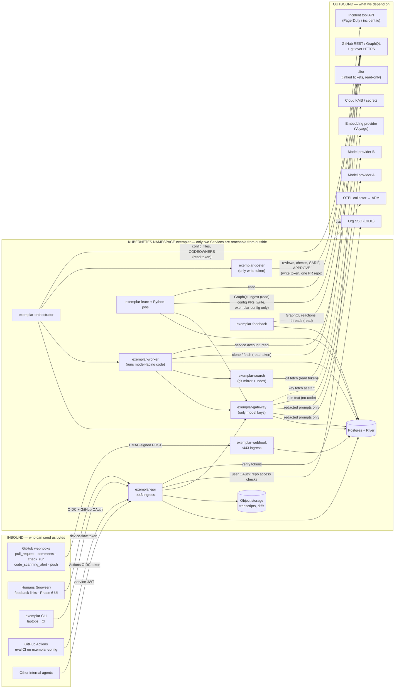

## 13. Security model

### Network boundary — inputs and dependencies

One picture of the deployed service's attack surface: everything that can send Exemplar bytes (left), the two ingress points that accept them, and everything Exemplar calls out to (right). The threat table that follows is organized around these edges. Two facts shape the model: **GitHub is both an input and a dependency** (humans reach the bot through GitHub comments, which arrive as webhooks), and **only two binaries ever talk to the outside in a way that matters** — the gateway holds the model keys, the poster holds the write token. Everything else is read-only or internal.

**Default-deny NetworkPolicy.** Each Deployment has an explicit egress list and nothing else: `exemplar-webhook` → Postgres only; `exemplar-worker` → gateway, exemplar-search, GitHub, Jira, Postgres; `exemplar-gateway` → providers A/B, embedding provider, KMS, Postgres; `exemplar-search` → GitHub, nothing inbound except from workers and the API; `exemplar-poster` → GitHub, Postgres; `exemplar-api` → Postgres, object storage, gateway, GitHub, SSO; `exemplar-feedback` and `exemplar-learn` → GitHub, incident tool, gateway, Postgres. With the control/runner split, the **runner** Job's policy is Postgres (through the pooler), gateway, `exemplar-search` and GitHub, and the **control** process drops GitHub clone and the gateway, keeping Postgres and the GitHub API for event handling and token minting. Only `exemplar-webhook` and `exemplar-api` have an Ingress. **As implemented:** they're reached through a Cloudflare Tunnel by default (`exemplar-cloudflared` dials out, so nothing in the cluster is public), through an Ingress, or both (`deploy/README.md`, *Inbound*). With the tunnel, IN-1's CIDR restriction is a Cloudflare WAF rule on the webhook host, and IN-2's SSO is Cloudflare Access on the API host. The model's tools (§6.5) make no network calls at all; the worker process does, only to the hosts listed.

| Edge | From → to | Protocol and authentication | Data that crosses | Enforcement |
|---|---|---|---|---|
| **IN-1** | GitHub → `exemplar-webhook` | HTTPS POST; `X-Hub-Signature-256` HMAC verified before parsing; `X-GitHub-Delivery` idempotency key | PR events, comment and review events (slash commands arrive here), check-run and code-scanning events, pushes. Payloads contain PR bodies and comment text | Ingress allows only GitHub's published webhook CIDRs; invalid signature → 401 and no row written; body size cap 25 MB |
| **IN-2** | Humans → `exemplar-api` | HTTPS; org SSO (OIDC) for identity, GitHub user OAuth for repo-level authorization; feedback links additionally HMAC-signed | Feedback events, playground requests, transcript views (Phase 6) | Ingress restricted to corporate IdP-authenticated sessions; per-identity rate limit; role derived server-side (§9.1) |
| **IN-3** | CLI (laptops, CI) → `exemplar-api` | HTTPS; SSO device-flow token; per-user daily budget | Working-tree diffs for `exemplar review` ; rule files for `try` / `validate` | Treated as untrusted input; same eligibility, exclusion and redaction path as a PR; results scoped to repos the user can read |
| **IN-4** | GitHub Actions (eval CI) → `exemplar-api` | HTTPS; GitHub Actions OIDC token bound to `exemplar-config` and the workflow | `mode: eval` requests naming rule ids and case refs | Token audience and repo claim checked; eval mode never posts to GitHub |
| **IN-5** | Other internal agents → `exemplar-api` | HTTPS; signed service JWT per calling system | Diffs and refs to evaluate | Per-caller rate limit and budget; `caller=agent` attribution |
| **OUT-1** | Workers, orchestrator, poster, feedback, learn, search → GitHub | HTTPS REST/GraphQL and git; short-lived installation tokens down-scoped per holder (§5) | Read: diffs, files, threads, CODEOWNERS, check-run annotations. Write (poster only): reviews, check runs, SARIF, APPROVE. Write (config writer only): PRs to `exemplar-config` | Each binary gets its own token flavor; workers and the verifier never hold a write token; egress to `api.github.com` / `github.com` only |
| **OUT-2** | Workers → Jira | HTTPS; read-only service account (§14) | Linked ticket title and description (≤ 4K chars), returned to agents as untrusted text | Egress allowlist entry for the Jira host only; responses secret-scanned before reaching the gateway |
| **OUT-3** | `exemplar-learn` → incident tool | HTTPS; read-only API key | Incident ↔ PR/commit links for `path_events` | Learn namespace only; never reachable from workers |
| **OUT-4** | `exemplar-gateway` → model providers A and B | HTTPS; provider API keys held only in the gateway (KMS-backed) | Redacted prompts: diff hunks, context snippets, rule text, ticket text; classes logged per call (§13.1) | Second secret scan at the gateway; provider allowlist hardcoded; per-repo provider restrictions; no other binary may reach a provider host (NetworkPolicy) |
| **OUT-5** | `exemplar-gateway` → embedding provider | HTTPS; API key in the gateway | Extracted rule text (title, description, preferred approach) — never raw code or comments | Same gateway controls; learning plane cannot call it directly |
| **OUT-6** | `exemplar-api` → org SSO | HTTPS; OIDC discovery and token verification | Identity tokens | Standard |
| **OUT-7** | All services → Postgres, object storage, KMS, OTEL collector | In-cluster / cloud-private endpoints; IAM or workload identity; TLS | Everything the system stores; transcripts; secrets at start-up; telemetry (no code in traces) | Private endpoints only; no public exposure |

The threat table below maps each row to one or more of these edges.

| Threat | Control |
|---|---|
| Prompt injection in diff / PR body / repo files makes the agent claim "no violations" | Coverage requirement; zero findings alone never approves (needs Stage 1 metrics + Stage 2 Opus categorization on a constrained schema); size and path limits on auto-approve |
| Injection makes the agent emit a fake rule id or citation | Model output schema has no such fields; code attaches them |
| Injection makes the agent read secrets or exfiltrate | Read-only tools in the worktree only; no network tools for the model; no shell; worker NetworkPolicy egress allowlist is exactly: `exemplar-gateway` , `exemplar-search` , GitHub (clone/fetch over HTTPS), the Jira host for `linked_ticket` , and Postgres — nothing else. The model's tools never make network calls; the worker process does, only to those hosts |
| Author edits `.exemplar/` in their PR to weaken rules | Config always read from base branch |
| Author edits `exemplar-config` | CODEOWNERS + ruleset on that repo; separate approvers; eval CI required |
| Stolen write token | Agent workers never hold one; poster accepts only validated findings from Postgres; tokens are short-lived installation tokens |
| Model key leakage | Keys only in the gateway (KMS-backed secret); per-review credentials scoped and short-lived |
| Prompt injection makes the verifier refute a real finding, clearing the way to approval | Auto-approve counts candidate findings before verification (§6.13); refuted findings still block; the verifier only decides what humans see |
| Prompt injection makes the agent claim it examined every file | Coverage is computed by the harness from tool calls; the model-facing schema has no coverage field (§6.5) |
| Any commenter runs `/exemplar try` against a repo they cannot read, or issues feedback commands on PRs they did not participate in | Read-access check on the target repo before any playground run and no code excerpts in the reply (§8.7); slash commands, links and dismissals honored only from PR participants and owning-team members, others recorded as weight-0 observers (§6.12, §9.1) |
| A rule owner ships instructions to every coding agent through `export.summary` | Platform approval on `export:` changes, summary lint, native auto-merge under branch protection instead of a repo-wide bypass actor (§10.2) |
| Bot approval abused for high-risk code | Compliance constants in code; CODEOWNERS lookup; branch-rule lookup; kill switches; audit of every gate trace |
| Fork PRs | Opt-in per repo; fork refs fetched through the base repo with the read-only token; nothing executed; never auto-approved (§13.1) |
| Repo context leaks private code into a public PR comment | Context is limited to the PR's own repo by default; `context.extra_repos` must be in the same visibility tier; evidence cites are resolved only against those mirrors |
| `exemplar-search` volumes hold full source | Dedicated, encrypted local volumes; read-only GitHub token; internal-only Service reachable from workers and the API, nothing else (NetworkPolicy) |
| Poisoned context (ticket text, code-search hits, README in another repo) | Treated as untrusted like the diff; can only influence candidate findings, which still need verifier confirmation, resolved evidence and anchor validation; cannot influence provenance or gates |
| Second provider data handling | Contracted zero-retention / no-training terms before any code is sent; gateway enforces provider allowlist per repo. Compliance repos may be restricted to one provider; because Stage 2 requires two independent providers, such repos cannot auto-approve at all — this is intended, and the gate records `decision=blocked_compliance` |
| Forged feedback links | HMAC-signed links; actor identity from SSO + GitHub OAuth at click time, never from the link; one event per actor per finding per reason |
| Rule exports used to inject instructions into coding agents | Export content is rendered only from merged rules' `export.summary` ; delivered as PRs that each repo reviews; exports app has no other capability |
| Lane 1 engines executing untrusted rule content | Rules come only from merged config; engines run with no network, CPU/memory limits and timeouts; compile attempts run in a separate sandbox |
| Authors game feedback to demote rules they dislike | Role-weighted eFP; author signals flag but never demote alone; demotion needs an owner adjudication or two distinct non-author actors (§9.4) |
| Secrets or sensitive code sent to a model provider | Repo denylist, path exclusions, two-layer secret redaction (worker and gateway), hardcoded provider list, per-call data-class logging (§13.1) |
| Partial review mistaken for a clean review | Explicit coverage; "no findings" only at 100%; degraded runs cannot approve; incomplete runs post nothing (§6.15); a search-off install says in the check run what was not checked (§6.4.6) |
| Auto-approve reaching control files through a broad scope | Hardcoded path denylist that config can only extend; bot/agent author policy; forced bug lane; approval dismissed on every push and on base drift (§6.13) |
| Auto-approve of a trivially clean change by an author new to the area, or across many areas at once | Author experience per ownership area and blast radius as deterministic Stage 1 inputs from stored history and CODEOWNERS; config can only tighten them (§6.13) |
| A model downgrades a finding's severity so it falls in the non-blocking class | Severity and category come from the rule or class and are attached by code; the model-facing schema has no severity field (§1.2 rule 4, §6.13) |
| The review process mints a token it should not have (config-writer, exports) | With the control/runner split the App private key lives only in the control process; a runner receives four repository-scoped tokens through a single-use claim and can mint nothing (§2.4 C2). Until the split ships, the worker holds the key and the risk is open, as `deploy/README.md` records |
| A runner is reused or reaches another review's data | One runner per review, its own ephemeral volume, exits on completion; claims are single-use with a nonce and expire; the runner's network policy is Postgres, gateway, search and GitHub only (§2.4) |
| Model-written rule bodies escape the sandbox | `--require-sandbox` is never turned off; `unshare --net` plus `prlimit` where user namespaces exist, a gVisor or Kata runtime or the per-task microVM boundary where they do not (§2.4 C10, R7); the compile job stays suspended on a platform that offers neither |
| A hosted trial exposes a prospect's code | A hosted trial is outside the design until it has its own tenancy, data-handling terms, short retention and enforced shadow mode (§2.4.4); the self-hosted paths keep R6 |

The adversarial eval set (§8.8) runs in CI from Phase 0; the Phase 5 red team extends it.

### 13.1 Data handling, privacy and repo eligibility

Implements PRD §8.11.

| Requirement | Implementation |
|---|---|
| **Repo eligibility** (FR-H1) | Repos are opted in individually in `repos/<org>/<repo>.yaml` . `exemplar-config/platform/eligibility.yaml` (CODEOWNERS: Security) lists denylisted repos; the orchestrator, learning-plane ingest and `exemplar-search` all refuse denylisted repos. Nothing in a target repo can override it. |
| **Path exclusions** (FR-H2) | Default exclusions (§6.3 step 3) plus `.exemplarignore` read from the base branch; applied identically to review, mining (§8.1) and indexing ( `exemplar-search` skips excluded paths). Excluded paths are reported as "not reviewed". |
| **Secrets never leave** (FR-H3) | gitleaks detector (embedded Go library) runs in the worker on the diff, every context snippet, ticket body and file read before it reaches the gateway; the gateway runs the same scan as a second check and rejects any request with an unredacted match. The learning plane scans comment bodies and diff hunks before extraction. Matches produce the deterministic `possible-secret-in-diff` finding (§6.3). |
| **What leaves, to whom** (FR-H4) | Every model call writes `model_calls(provider, model, stage, repo, data_classes[], tokens, cost)` , where `data_classes ⊆ {diff, file_context, search_context, ticket, review_comments, pr_text}` . `internal/llm/providers.go` hardcodes the approved providers; the gateway refuses others. Providers are used only under enterprise agreements with no training on inputs and defined retention. |
| **Fork PRs** (FR-H5) | Reviewed only with `forks.review: true` . The worker fetches fork refs through the base repo ( `refs/pull/<n>/head` ) with the read-only token; no fork code is executed; the poster comments on the base-repo PR only; forks are never auto-approved. |
| **Identity in mined data** (FR-H6) | `mined_comments.reviewer_pid` and `author_pid` are HMAC-SHA256 pseudonyms keyed by a KMS-held secret; citations store comment URLs. Ranking counts distinct pseudonyms. A daily job nulls `body` and `diff_hunk` for comments not cited by any candidate or rule 30 days after extraction completes; a later `extractor_version` therefore re-ingests bodies from GitHub for the comments it needs (the ingest job is resumable and idempotent, §8.1), which is a cost of the purge and accepted. |
| **Retention** (FR-H7) | `exemplar-config/platform/retention.yaml` (CODEOWNERS: Security) sets periods; defaults: `approval_decisions` 7 years, `findings` and `feedback_events` 2 years, `model_calls` and transcripts 90 days, `gh_events.payload` 30 days (the row stays for idempotency, the payload — which contains PR bodies — is nulled). A daily retention job enforces them. |
| **Language scope** (FR-H8) | §6.4.5. |

---
