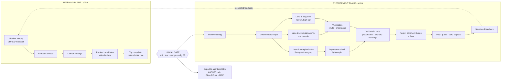
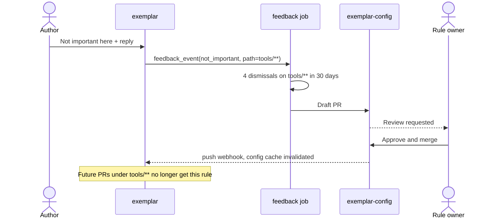

<!--
This file is the canonical PRD; edit it here. It was imported on
2026-10-13 from the claude.ai artifact "PRD: Exemplar — Self-Correcting
AI Code Review (v0.6)" (https://claude.ai/artifact/EZgtgLKk7v47FJatTTdcyp,
version 1791798313-8eef), which is no longer maintained, and converted
from its rendered HTML to Markdown with the text unchanged. The §17
mockups are rendered as quoted Markdown (diffs as diff blocks, without
their line numbers), and heading anchors keep the page's ids. Requirement
ids such as FR-D6 in code, commits and docs refer to this document;
docs/plans/README.md maps each family to its PRD and spec sections. The
PRD's "Companion: Implementation Plan & Architecture" is
docs/spec/technical-spec.md.
-->

<a id="prd-exemplar-self-correcting-ai-code-review"></a>

# PRD: Exemplar — Self-Correcting AI Code Review

**Status:** Draft v0.8 · October 2026 · **Build-only** (no third-party AI reviewer will be purchased) **Source:** Redpoint Alchemy talk "AI broke code review" (Andrew Swerdlow, Roblox, Sep 10 2026) and session notes, extended with patterns borrowed from mature industry systems (Appendix B) **Working name:** Exemplar (placeholder) **Companion:** Implementation Plan & Architecture (Go services, Postgres, GitHub App)

Contents

- [PRD: Exemplar — Self-Correcting AI Code Review](#prd-exemplar-self-correcting-ai-code-review)
  - [1. Summary](#1-summary)
  - [2. Problem Statement](#2-problem-statement)
  - [3. Goals and Non-Goals](#3-goals-and-non-goals)
  - [4. Users and Personas](#4-users-and-personas)
  - [5. System Overview](#5-system-overview)
  - [6. Functional Requirements — Learning Plane (offline)](#6-functional-requirements-learning-plane-offline)
  - [7. Data Model — Rules](#7-data-model-rules)
  - [8. Functional Requirements — Enforcement Plane (online)](#8-functional-requirements-enforcement-plane-online)
  - [9. Feedback — structured, Tricorder-style — revised](#9-feedback-structured-tricorder-style-revised)
  - [10. Authoring-time delivery (shift left) — new](#10-authoring-time-delivery-shift-left-new)
  - [11. Evaluation — revised](#11-evaluation-revised)
  - [12. Auto-Approve Gates](#12-auto-approve-gates)
  - [13. Success Metrics](#13-success-metrics)
  - [14. Rollout Plan](#14-rollout-plan)
  - [15. Risks and Mitigations](#15-risks-and-mitigations)
  - [16. Open Questions](#16-open-questions)
  - [17. Sample interactions](#17-sample-interactions)
  - [Appendix A — Design Principles](#appendix-a-design-principles)
  - [Appendix B — Prior art borrowed, and what we deliberately did not take](#appendix-b-prior-art-borrowed-and-what-we-deliberately-did-not-take)

<a id="what-changed-in-v02v04"></a>

### What changed in v0.2–v0.8

- **v0.8 (after Will Larson's "Speeding up code review with `small-change`", October 2026):** two deterministic Stage 1 gates, author experience in the touched paths (FR-A10) and blast radius as a count of ownership areas with shared paths excluded (FR-A11); the accountability norm that an auto-approved failure is a system failure (FR-A12); a caution on domain-heavy code in §12. The post's `review-pr-cluster` idea is in [`docs/plans/backlog.md`](../plans/backlog.md).
- **v0.7 (after Anthropic's "How the Claude Code team does code review", claude.dev, October 2026):** verifier quorum for the bug lane (FR-V7); convergence controls across pushes: a round cap and class-of-bug findings (FR-C8, FR-C9); a clean-PR false-alarm rate (FR-X12); review rounds, human approvals and time waiting on a person as informational metrics (§13.2); two open questions on unanswered findings and an automatic auto-approve circuit breaker (§16). The further ideas from that post are in [`docs/plans/backlog.md`](../plans/backlog.md), not here, until one is adopted. Where the post disagrees with this PRD (its reviewer blocks merges on open findings and never approves; Exemplar never blocks and may approve within FR-A2) the PRD stands.
- **v0.6 (gap review):** PR lifecycle (§8.9), degraded operation (§8.10), data handling and repo eligibility (§8.11); importance check extended to compiled rules (FR-V6); auto-approve Stage 1 made strictly deterministic with path denylist, bot-author rules and a "bug lane actually ran" gate (§12); role-weighted feedback and human-comment dedupe (§9, FR-E15); CI-timing rule for linter dedupe (FR-E7); budget exemption for security and must-fix findings (FR-P6); adversarial evals and baseline sampling (§11); export operations and MCP access control (§10); cross-language clustering (FR-L3.1). **Cost and latency moved to informational metrics (§13.2)** — they are tracked and reported but are not goals or exit criteria.
- **v0.5:** repository context is fully self-contained and never builds code: one in-cluster search container embedding the open-source zoekt engine, with import-based scoping instead of a build graph (constraint 6, FR-E12).
- **v0.4:** no external code search tool will be available; repository context is built in-house.
- **v0.3:** added §17, eight sample interactions with mockups of what authors, rule owners, coding agents and approvers see.
- **Build-only constraint** made explicit. Every capability a commercial reviewer would provide must be built; mature systems are treated as design references, not options.
- **Three review lanes** instead of one: exemplar rules (the original design), compiled deterministic rules, and a narrow general-bug lane.
- **Verification stage** that tries to refute every finding and filters "valid but unimportant" ones before anything is posted.
- **Structured feedback** (Tricorder-style dismissal reasons) replaces 👍/👎 as the primary signal.
- **Fixes** delivered as one-click GitHub suggestions where the change is local.
- **Authoring-time delivery**: rules exported to coding-agent instruction files and served over MCP, so AI-written code conforms before it becomes a PR.
- **Comment budgets, rule expiry, deeper context, an in-house baseline reviewer, and counter-metrics** for what auto-approve takes away.

---

<a id="1-summary"></a>

## 1. Summary

AI code generation has multiplied the volume of code engineers produce, but time-to-production has barely moved. The bottleneck migrated from writing code to reviewing it. Senior engineers now spend their time reading rather than designing, review load scales linearly with headcount while generation scales with tokens, and every codegen tool is capped at the throughput of the humans supervising it.

Generic AI reviewers do not fix this. They know the public internet, not the company: repo conventions, security patterns, infra assumptions, migration scars, incident (SEV) lessons, and ownership graphs. They produce correct-but-irrelevant comments, engineers learn to ignore them within a week, and that trust is expensive to win back.

Exemplar **mines the organization's own review history into a curated, version-controlled set of review rules ("exemplars")**, then **enforces them on every pull request with one focused agent per rule**, alongside deterministic checks and a narrow bug-hunting lane. Every candidate finding passes a **verification stage** and **deterministic validation in code** before it reaches a human. A single human gate sits between offline learning and online enforcement, and the same rules are pushed **upstream to the coding agents and IDEs** that write the code.

The core insight from the source: this is **not a prompt problem, it is a systems problem**, and the durable asset is the encoded organizational judgment, not the model that reads it. The core insight from the industry: **precision is the product** — every mature system that survived (Google Tricorder and AutoCommenter, Meta's diff-time analysis, Uber uReview, Anthropic Code Review) is organized around keeping false positives low and measured.

<a id="2-problem-statement"></a>

## 2. Problem Statement

| Symptom | Consequence |
|---|---|
| Code generated per engineer up ~10x | Review queues grow; lead time flat |
| "Human in the loop" applied to every PR | Senior engineers become full-time reviewers |
| Generic AI reviewer | ~21% finding acceptance — worse than no bot, because it trains engineers to ignore it |
| Review judgment lives only in past comments | Not in any style guide; style guides go stale within weeks |
| AI agents write code without org context | The same violations are generated, reviewed and fixed over and over |

<a id="21-constraints-that-rule-out-easy-answers"></a>

### 2.1 Constraints that rule out easy answers

1. **Judgment isn't written down.** It lives in millions of review comments that are mostly praise, typo fixes, and shorthand. *Rules out:* hand-writing the rulebook.
2. **Trust is asymmetric.** Engineers stop reading a noisy bot within a week. *Rules out:* ship first, tune later.
3. **Everything the model reads is untrusted.** Diffs, PR descriptions, repo files, and historical comments are all natural language and all injectable. *Rules out:* letting the model vouch for its own output.
4. **Scale is thousands of engineers and hundreds of rules.** One giant prompt loses attention; unbounded fan-out blows the budget. *Rules out:* both naive architectures.
5. **Build-only.** No commercial reviewer as a fallback or baseline. *Rules out:* outsourcing general bug detection; requires an in-house baseline to measure against.
6. **Self-contained, no builds.** No external code search service or vendor, reviews never run a build tool or depend on build artifacts, and the main codebase is a large monorepo. Open-source components may be embedded if they run inside our own containers. *Rules out:* hosted search, Bazel/compiler-based code navigation at review time, and naive full-checkout-plus-grep per review.

<a id="22-two-kinds-of-false-positive-borrowed-from-uber-ureview"></a>

### 2.2 Two kinds of false positive (borrowed from Uber uReview)

| Class | Example | Primary defense |
|---|---|---|
| **Wrong** — hallucinated or factually incorrect | Claims a call blocks when it is already awaited | Verification stage (§8.4) with adversarial refutation and code evidence |
| **Right but unimportant here** | Valid performance note in code that is not performance-sensitive | Importance check in verification, rule scoping, path-level suppression, comment budget |

Every design choice below should be traceable to reducing one of these two classes or to measuring them.

<a id="3-goals-and-non-goals"></a>

## 3. Goals and Non-Goals

<a id="31-goals"></a>

### 3.1 Goals

- **G1 — High-signal findings.** Raise accepted-finding rate from a generic-bot baseline (~21%) to **≥ 65%**, at or above the human reviewer acceptance rate, with an **effective false-positive rate ≤ 10%** per rule (Tricorder's bar; see §9).
- **G2 — Encode organizational judgment.** Convert historical review comments into a curated, owned, testable rule corpus with citations back to source comments.
- **G3 — Safe autonomy.** Auto-approve a defined class of low-risk PRs without a human reviewer, with deterministic guardrails and an instant kill switch.
- **G4 — One evaluator, many callers.** A single alignment engine serves PR review, a rule-authoring playground, a local pre-PR CLI, IDEs and coding agents (via MCP), and other agents (branch validation, test generation).
- **G5 — Cost and latency are visible, not optimized for.** Every review reports what it cost and how long it took (§13.2, §17.4). These are informational: precision and encoded judgment come first, and no phase exits on a cost or latency number. A soft per-run ceiling (default $10, configurable) exists only to stop runaway reviews, and exceeding it triggers graceful degradation (§8.10) rather than a goal miss.
- **G6 — Shift left.** The same rules reach coding agents and IDEs before a PR exists, so the review bot's findings per PR fall over time for reasons other than noise suppression.
- **G7 — Fix, don't just flag.** A meaningful share of findings ship with a one-click fix.

<a id="32-non-goals"></a>

### 3.2 Non-Goals

- Purchasing or depending on a third-party AI code reviewer. (Open-source *libraries and engines* are allowed, subject to license review — see §15.)
- Training or fine-tuning a custom model. Models are swappable components behind a gateway.
- Nits and trivia (naming bikesheds, formatting). Linters and formatters own these, and Exemplar suppresses findings that duplicate them.
- Ever blocking a PR. The bot never posts `REQUEST_CHANGES`.
- Self-modifying behavior. Learning never changes enforcement without a merged, human-approved config change. (Unlike some commercial tools that auto-create rules from reactions, this is a deliberate choice: optimizing directly for acceptance invites the bot to learn to say what people like to hear.)
- Broad "review everything" commentary (PR walkthroughs, style opinions). Out of scope for v1; considered in Phase 5.

<a id="4-users-and-personas"></a>

## 4. Users and Personas

| Persona | Needs |
|---|---|
| **PR author** | Relevant, cited, actionable findings with fixes; fast low-risk merges; the same checks locally and in their coding agent before pushing |
| **Human reviewer** | Less time on mechanical and repeat-pattern review; focus on design |
| **Rule owner / domain expert** | Review mined candidates, edit and test them, promote or kill rules, see per-rule metrics and dismissal reasons |
| **Platform team** | Operate the system, control cost, manage global config, run evals, flip kill switches |
| **Security / compliance** | Enforce approval policies, audit provenance, confirm the bot cannot be prompt-injected into approving; know exactly which data leaves the org to which model provider, and exclude repos and paths that must never be sent (§8.11) |
| **Coding agents (Claude Code, Copilot, Cursor, internal agents)** | Machine-readable, path-scoped rules and a pre-PR check they can call |
| **Agent developers** | Call the alignment engine to judge output from other agents |

<a id="5-system-overview"></a>

## 5. System Overview



**Invariants**

- On the same PR, learning never mutates the review in progress.
- Long-term, reconciled feedback becomes evidence for the next extraction — still behind the human gate.
- Every model call is constrained; every model output is checked by deterministic code before it reaches a human.
- Cheap and deterministic first; expensive only if needed. A rule that can be expressed deterministically is run deterministically.
- Nothing is posted that has not survived verification (model lanes), an importance check (all lanes) and validation (all lanes).
- A review that did not run to completion says so. Partial coverage, a provider outage or a budget stop is reported as "not reviewed", never as "no findings" (§8.10).

<a id="6-functional-requirements-learning-plane-offline"></a>

## 6. Functional Requirements — Learning Plane (offline)

<a id="61-mine-fr-l1"></a>

### 6.1 Mine (FR-L1)

| ID | Requirement |
|---|---|
| FR-L1.1 | Ingest top-level human review comments over a configurable lookback (default **750 days** ). |
| FR-L1.2 | Also ingest the system's own findings that authors **accepted** , down-weighted relative to human comments. |
| FR-L1.3 | Store each comment with repo, path, extension, diff hunk, author, reviewer, timestamp, thread resolution, reactions, and **any URLs it cites** (style guides, docs, incident reports). |
| FR-L1.4 | Exclude the system's own seeded reactions from all feedback signals. |
| FR-L1.5 | Support backfill at the scale of ~700K PRs / ~1.7M comments over 3 years. |
| FR-L1.6 | **Doc-linked comments are high-value seeds.** Comments that link to internal documentation are ranked higher and the link becomes the rule's primary citation. *(Borrowed: Google AutoCommenter trained on comments containing best-practice URLs.)* |
| FR-L1.7 | Also mine **incident postmortems and revert commits** : PRs later reverted or linked to a SEV are a source of candidate Blocker rules even when no review comment caught them. |

<a id="62-extract-and-embed-fr-l2"></a>

### 6.2 Extract and embed (FR-L2)

| ID | Requirement |
|---|---|
| FR-L2.1 | An LLM processes comments in **batches of three** , deciding whether each expresses a reusable review constraint versus praise, typos, or one-off remarks. |
| FR-L2.2 | Tune the extractor to accept roughly **10–15%** of comments. |
| FR-L2.3 | For each accepted comment, emit a draft `{id, description, body}` and embed it. |
| FR-L2.4 | Extraction is **idempotent** : results are cached by content hash so re-running over the same comments does not re-call the model or produce duplicate candidates. (LLM output is not deterministic; the pipeline is.) A failed batch is retried and never silently drops a candidate. |

<a id="63-cluster-and-merge-fr-l3"></a>

### 6.3 Cluster and merge (FR-L3)

| ID | Requirement |
|---|---|
| FR-L3.1 | Compare candidates sharing the same file extension by default. The extractor tags candidates that are **language-agnostic** (e.g. "every outbound RPC sets a timeout", logging, secrets handling); those cluster across extensions so one org-wide rule is not fragmented into one rule per language. |
| FR-L3.2 | Cosine similarity is a cheap prefilter (≥ 0.65 for clustering, ≥ 0.35 to propose merges; both configurable). |
| FR-L3.3 | An LLM cohesion check makes the final merge decision. |
| FR-L3.4 | Merged candidates retain citations to every contributing source comment. |

<a id="64-rank-and-route-fr-l4"></a>

### 6.4 Rank and route (FR-L4)

| ID | Requirement |
|---|---|
| FR-L4.1 | Rank by cluster size, then **distinct reviewers** , with boosts for doc-linked, incident-linked, and resolved-thread sources. |
| FR-L4.2 | Route candidates to the likely owner using CODEOWNERS of the source files. |
| FR-L4.3 | **Suppress candidates already covered** by an existing linter, formatter or static-analysis rule (match by description and a trial run on the source PRs). |

<a id="65-compile-to-deterministic-where-possible-fr-l5-new"></a>

### 6.5 Compile to deterministic where possible (FR-L5) — *new*

*(Borrowed: Google found ~two thirds of learned best practices were beyond traditional static analysis — which means roughly a third were within reach of it.)*

| ID | Requirement |
|---|---|
| FR-L5.1 | For every candidate, attempt to synthesize a deterministic rule (Semgrep or ast-grep pattern; CodeQL query for security dataflow cases) with an LLM, then evaluate it on the candidate's eval set. |
| FR-L5.2 | If the compiled rule meets the LLM rule's precision and ≥ 90% of its recall on the eval set, the candidate is proposed as a **compiled rule** (Lane 1). Otherwise it remains an exemplar (Lane 2). |
| FR-L5.3 | Compiled rules carry the same metadata, citations, ownership, feedback and demotion lifecycle as exemplars. |
| FR-L5.4 | Active exemplars are periodically re-attempted for compilation as patterns stabilize. |

<a id="66-human-gate-fr-l6"></a>

### 6.6 Human gate (FR-L6)

| ID | Requirement |
|---|---|
| FR-L6.1 | Owners review ranked candidates and can **edit, test in the playground, promote, or kill** . |
| FR-L6.2 | Promotion opens a **config PR** . Nothing enforces until it merges. |
| FR-L6.3 | A kill is recorded with a reason and becomes negative signal for future extraction. |
| FR-L6.4 | Every rule ships with eval cases (§11) before merge; CI blocks merges without them. |
| FR-L6.5 | **"Teach the bot" fast path.** When an engineer replies to a finding with a correction ("@exemplar that's wrong for us because…"), the system immediately opens either a suppression proposal or a rule-edit PR for the owner, rather than waiting for the next mining run. *(Borrowed from the reply-to-learn interaction in commercial reviewers, kept behind our human gate.)* |

<a id="7-data-model-rules"></a>

## 7. Data Model — Rules

Rules are stored **as code in git**, one versioned file per rule, and materialized at review time.

| Field | Type | Notes |
|---|---|---|
| `id` | string | Stable; the citation key. Never generated by a model at review time. |
| `kind` | enum | `exemplar` (LLM agent) or `compiled` (deterministic) — *new* |
| `category` | enum | `Blocker` , `Security` , `Performance` , `Correctness` , `Style` , `Nit` |
| `severity` | enum | `blocking` , `important` , `suggestion` — drives ranking, the comment budget, and the Conventional Comments label. `blocking` describes the *finding* (a human reviewer would block on it), not the bot's behavior: the bot still never requests changes (§3.2), and `blocking` and Security findings are exempt from the comment budget (FR-P6) — *new* |
| `description` | markdown | Exemplars: the detection prompt. Compiled rules: human explanation shown in the comment. |
| `matcher` | object | Compiled rules only: `{engine: semgrep\\|ast-grep\\|codeql, rule: ...}` — *new* |
| `file_patterns` | glob[] | Include and negated globs; deterministic scope before any model call. |
| `citation` | object | Config-as-code source, source comments, and doc URL if any. |
| `posting_mode` | enum | `per_occurrence` or `grouped` . |
| `fix_policy` | enum | `none` , `suggest` (emit suggestion block when local), `describe` — *new* |
| `owner` | string | Team or CODEOWNERS entry. |
| `status` | enum | `candidate` , `shadow` , `active` , `killed` . |
| `review_by` | date | **Expiry / re-validation date** (default 12 months after promotion). Past this date the rule drops to `shadow` unless the owner re-confirms or eval still passes on recent PRs — *new* (borrowed: AutoCommenter's suppression of outdated best practices) |
| `export` | object | Whether and how the rule is exported to coding-agent instructions (§10) — *new* |
| `eval_cases` | path | Positive and negative cases from real PRs, plus injected cases (§11). |

```yaml
# rules/performance/blocking-fetch-in-loop.yaml
id: blocking-fetch-in-loop
kind: exemplar
category: Performance
severity: important
owner: "@platform/runtime"
status: active
review_by: 2027-09-01
file_patterns: ["**/*.cpp", "!**/test/**"]
posting_mode: per_occurrence
fix_policy: suggest
description: |
  Blocking inside a high-frequency loop increases latency and causes thread
  exhaustion. When a FetchData call is made inside an async task, warn about
  latency and thread exhaustion. FetchData is acceptable as long as the task
  has already been awaited.
citation:
  doc: https://docs.internal/guidance/async
  comments: [{pr: 48213, comment_id: 991204}, {pr: 51877, comment_id: 1033412}]
export:
  agents: true          # include in AGENTS.md / CLAUDE.md / Copilot / Cursor exports
  summary: "Don't call FetchData inside an async task before the task is awaited."
eval_cases: evals/blocking-fetch-in-loop/
```

**Config layering:** effective config = global rules + repository rules (read from the base branch only). Cached with a 15-minute TTL and invalidated on config pushes.

<a id="8-functional-requirements-enforcement-plane-online"></a>

## 8. Functional Requirements — Enforcement Plane (online)

<a id="81-lanes"></a>

### 8.1 Lanes

| Lane | What it catches | How it runs | Cost |
|---|---|---|---|
| **1. Compiled rules** | Org rules expressible as patterns | Semgrep / ast-grep on changed files | ~$0 |
| **2. Exemplar agents** | Org rules needing judgment | One agent per in-scope rule, ≤ 3 concurrent | Most of the budget |
| **3. Bug lane** — *new* | Novel logic errors no rule describes: null/undefined paths, off-by-one, broken error handling, race conditions, resource leaks, contract mismatches with callers | A small set of specialized agents (e.g. correctness, concurrency, error handling), restricted to *bugs* , never style or preference | Bounded share of budget, scaled by PR risk and size |

*(Borrowed: Anthropic's Code Review keeps false positives low by restricting itself to logic errors and actual bugs — things an engineer would almost always fix. The bug lane adopts the same restriction so it cannot erode trust in the exemplar lane.)*

| ID | Requirement |
|---|---|
| FR-E1 | **Inputs:** diff, a checkout of the commit, existing review threads, effective rules, and **context providers** (§8.3). |
| FR-E2 | **Deterministic scope** by `file_patterns` before any model call; zero-match rules never run. |
| FR-E3 | **One agent per exemplar.** |
| FR-E4 | ≤ 3 concurrent agents per review (configurable). |
| FR-E5 | Purpose-built harness, read-only tools, high-capability models by default. |
| FR-E6 | **Bug lane** runs only on PRs above a risk/size threshold or on paths flagged critical, and only emits findings in an allowlisted set of bug classes. It has its own per-class precision tracking and kill switch. |
| FR-E7 | **Linter dedupe:** findings that overlap a finding from the repo's existing linters or CI static analysis on the same lines are dropped. **Timing:** CI results usually arrive after the bot's findings are ready. The bot waits for linter/static-analysis check runs up to a configurable window (default 2 minutes after findings are ready); if they have not reported, it posts, and when CI later reports an overlapping finding the bot minimizes its own comment as outdated and records it as a linter duplicate. Overlap counts against neither the rule's precision nor the author's feedback. |
| FR-E15 | **Human-comment dedupe** — *new* : existing review threads (FR-E1) are used to avoid repeating a human. If a human reviewer has already commented on the same lines and a light-model check judges the intent equivalent, the finding is not posted; it is recorded as `human_duplicate` and counts as agreement with the reviewer, not as a false positive. The bot never replies to or grades human comments outside the Phase 5 Fixer (FR-F4). |
| FR-E8 | Verdict is only ever `APPROVE` or no-op. **Never `REQUEST_CHANGES`.** |
| FR-E9 | Identical behavior across callers (production, playground, CLI, MCP, agents). |

<a id="82-model-diversity-new"></a>

### 8.2 Model diversity — *new*

*(Borrowed: Uber found the best configuration paired a generator from one model family with a grader from another.)*

| ID | Requirement |
|---|---|
| FR-E10 | The gateway supports **at least two model providers** . The verification stage defaults to a different model (ideally a different family) than the generator for the same finding, so their blind spots are less correlated. |
| FR-E11 | Model assignment per stage and per rule is configuration, evaluated on the golden set before change. |

<a id="83-context-providers-new"></a>

### 8.3 Context providers — *new*

*(Borrowed: full-codebase indexing and ticket context in commercial reviewers; Meta and Google review tools rely on monorepo-wide code search — which we must build ourselves.)*

| ID | Requirement |
|---|---|
| FR-E12 | **Self-contained repository context:** agents can find definitions, find references, find the packages that depend on a changed file, and search text across the whole monorepo — at the default-branch snapshot, overlaid with the PR's own changes — without running any build. Served by one in-cluster container embedding an open-source code search engine (zoekt) with symbol extraction; references are scoped to the defining package and its importers, discovered by searching import statements. Read-only, rate-limited, results capped; degrades to plain git search if the index is unavailable. See implementation plan §5.5. |
| FR-E13 | **Ticket context:** when a PR links an issue (GitHub issue or Jira key in title/body/branch), its title and description are fetched and supplied as untrusted context. |
| FR-E14 | **Ownership and history context:** CODEOWNERS, recent incidents touching the paths, and recent reverts are available to the bug lane and to gates. |

<a id="84-verification-stage-new"></a>

### 8.4 Verification stage — *new*

*(Borrowed: Anthropic Code Review's verification step that attempts to disprove each finding; Uber uReview's separate grader; Google Tricorder's insistence that analyzers prove usefulness.)*

Every candidate finding from Lanes 2 and 3 is sent to a verifier before validation; Lane 1 findings receive the importance check only (FR-V6):

| ID | Requirement |
|---|---|
| FR-V1 | **Refutation.** The verifier receives the finding, the rule (for Lane 2), the relevant code, and read-only tools, and is instructed to **find evidence that the finding is wrong** . Output: `{verdict: confirmed\\|refuted\\|uncertain, evidence: [path:line…], reason}` . Only `confirmed` passes. |
| FR-V2 | **Importance.** The verifier also scores whether the issue matters *in this context* (e.g., is this path hot, user-facing, security-relevant). Findings below the rule's or lane's importance threshold are dropped (class 2 false positives, §2.2). |
| FR-V3 | **Evidence is checked in code.** Cited evidence lines must exist in the checkout; a verdict whose evidence doesn't resolve is treated as `uncertain` . |
| FR-V4 | Verifier outcomes are stored per finding, so per-rule refutation rate is a first-class metric (a rule refuted > 50% of the time is a bad prompt). |
| FR-V5 | Verification runs only on candidate findings, which are few. Its cost is reported with the review (§13.2) and is subject to the same soft ceiling and degradation order as the lanes (§8.10). |
| FR-V6 | **Importance check for compiled rules** — *new* . Lane 1 findings skip refutation (a pattern match is not a hallucination) but *not* the importance check: a lightweight model scores importance in context (FR-V2) for compiled rules in the Performance, Style and Nit categories, and for any compiled rule that opts in. Security and Correctness compiled findings post without it. This closes the gap where a Semgrep performance pattern in an offline tool would post exactly the class-2 false positive §2.2 promises to defend against. |
| FR-V7 | **Verifier quorum for the bug lane** — *v0.7*. A Lane 3 finding is sent to `verifier.quorum.n` verifiers (default 3, each a separate call; different models or families when more than one provider is configured) and posts only when at least `verifier.quorum.k` (default 2) return `confirmed`. Lane 2 findings keep the single verifier of FR-V1 by default; a rule may opt into the quorum with `verify: quorum`. The agreeing share is stored with the finding and is a ranking input for the comment budget (FR-P1), after severity. Quorum calls count toward the soft ceiling and are shed before the lanes in §8.10. *(Borrowed: Anthropic's reviewer posts a bug-hunting finding only when enough separate verifiers vote that it is real.)* |

<a id="85-deterministic-validation-in-code"></a>

### 8.5 Deterministic validation (in code)

| ID | Requirement |
|---|---|
| FR-T1 | **Attach provenance:** rule id and citation come from the rule, never from model output. |
| FR-T2 | **Validate anchors** against visible diff hunks; drop the rest. |
| FR-T3 | **Zero coverage = failure** , never "zero violations." |
| FR-T4 | **Exclude own reactions** from feedback. |
| FR-T5 | Schema-invalid output is discarded and logged, never repaired by another model call. |
| FR-T6 | The model has no write tools; the orchestrator posts. |

<a id="86-ranking-comment-budget-and-presentation-new"></a>

### 8.6 Ranking, comment budget and presentation — *new*

*(Borrowed: AutoCommenter calibrated thresholds by replaying full historical reviews to estimate comment volume before launch; Conventional Comments for legible severity.)*

| ID | Requirement |
|---|---|
| FR-P1 | **Comment budget:** at most N findings posted per PR (default 7) and M per file (default 3), ordered by severity, then verifier confidence, then rule precision. Overflow is summarized in the check run, not posted inline. |
| FR-P2 | **Pre-launch volume estimate:** before a rule goes `active` , replay it over the last 30 days of PRs in its scope and report expected comments per PR; owners see this in the config PR. |
| FR-P3 | **Conventional Comments labels:** every comment starts with a label derived from severity and category, e.g. `issue (blocking):` , `suggestion (performance):` , `question:` . |
| FR-P4 | Every comment links to the rule file at its SHA and the rule's doc citation, and carries the structured feedback controls (§9). |
| FR-P5 | **Security-category findings are also emitted as SARIF** to GitHub code scanning, so security teams triage them in the tool they already use and its dismissal reasons feed our feedback loop. |
| FR-P6 | **Budget exemptions** — *new* : Security-category and `blocking` -severity findings are never dropped by the comment budget. If they alone exceed N, they are posted as one grouped comment per file listing every occurrence, and the check run is marked `neutral` with a visible summary. Only `important` and `suggestion` findings compete for the remaining budget. |

<a id="87-fixes-new"></a>

### 8.7 Fixes — *new*

*(Borrowed: Google's ML-suggested edits for resolving review comments; Uber's Fixer; GitHub suggested changes.)*

| ID | Requirement |
|---|---|
| FR-F1 | For rules with `fix_policy: suggest` , when the fix is local to the anchored hunk, the finding includes a GitHub `suggestion` block the author can apply in one click. |
| FR-F2 | Suggested fixes are validated in code: the patch must apply cleanly, stay within the anchored range, and (where a fast check exists, e.g. `gofmt` , a parser) must parse. Fixes failing validation are dropped; the finding is posted without a fix. |
| FR-F3 | Applying a suggestion is the strongest acceptance signal and is tracked separately. |
| FR-F4 | **Phase 5:** a Fixer that proposes edits in response to *human* review comments (reviewer leaves a comment → bot offers a suggestion), reusing the same harness and validation. |

<a id="88-public-api-sketch"></a>

### 8.8 Public API (sketch)

```
POST /v1/evaluate
{
  "repo": "org/game-engine", "commit": "a1b2c3d", "base": "f9e8d7c",
  "caller": "production | playground | cli | mcp | agent | eval",
  "lanes": ["compiled", "exemplar", "bug"],
  "rules": ["*"] | ["blocking-fetch-in-loop"],
  "rule_overrides": [ ...rule... ],          // playground only
  "mode": "review | eval"
}

200 OK
{
  "findings": [{
    "rule_id": "blocking-fetch-in-loop",     // attached by code
    "lane": "exemplar", "severity": "important",
    "path": "src/net/fetch.cpp", "line_start": 142, "line_end": 147,
    "message": "...", "suggestion": "...",   // optional, validated
    "verification": {"verdict": "confirmed", "importance": 0.82, "model": "..."}
  }],
  "suppressed": {"budget": 3, "refuted": 5, "linter_duplicate": 2},
  "verdict": "APPROVE | NO_OP",
  "metrics": { ... }, "eval": null
}
```

<a id="89-pr-lifecycle-new"></a>

### 8.9 PR lifecycle — *new*

Everything above describes one review of one commit. A PR is a sequence of pushes, rebases and conversations, and the bot's behavior across that sequence is what authors actually experience.

| ID | Requirement |
|---|---|
| FR-C1 | **Incremental re-review on push.** A new push re-reviews only the files whose hunks changed since the last reviewed commit, plus any file a previously posted finding anchors to. Unchanged files keep their prior results. Rules run again only where their scope intersects the changed set. |
| FR-C2 | **Finding identity across pushes.** Each finding has a stable key (rule id + file + normalized anchor content). A finding with the same key is never posted twice. A finding whose anchored lines were changed is re-verified: if it no longer holds, the bot resolves its own thread with a one-line note ("Addressed in `abc123` "); if it still holds, the existing thread is left in place, not re-posted. |
| FR-C3 | **Dismissed stays dismissed.** A finding the author dismissed with a structured reason (§9) is not re-posted on later pushes to the same PR, even if the model would find it again. |
| FR-C4 | **Rebase and force-push.** When the base changes or history is rewritten, prior comments are re-anchored by content; findings that no longer anchor to a visible hunk are resolved as outdated (FR-T2), not re-posted at a guessed location. The review is reconciled, not restarted. |
| FR-C5 | **Draft PRs** are not reviewed until marked ready, unless the repo opts in to draft review. **Stacked PRs** are reviewed against their declared stack base (the parent branch), not the trunk, so findings are not duplicated down the stack. |
| FR-C6 | **Config drift within a PR.** Each review records the config SHA it ran under (§17.4). If config changes mid-PR, findings from rules that were killed or demoted are resolved as outdated with a note; new rules apply only to the next push. |
| FR-C7 | **Lifetime accounting is informational.** Cost and time are recorded per run and summed per PR for §13.2, but repeat pushes do not consume a shared budget. The soft ceiling (§8.10) applies per run; incremental review (FR-C1) is what keeps lifetime cost proportionate. |
| FR-C8 | **Round cap** — *v0.7*. A review round is one run that posts at least one new finding. After `rounds.max` rounds on one PR (default 3), the bot posts no further inline findings; it posts one summary comment listing what is still open, says that the change may need a different approach, and leaves the check run `neutral`. Later pushes are still reviewed (FR-C1) and still resolve addressed threads (FR-C2), and Security and `blocking` findings are still posted (FR-P6). The cap resets when a human reviewer posts or the PR is marked ready after being a draft. Rounds per PR are recorded for §13.2. *(Borrowed: one of Anthropic's PRs went through more than fifty review rounds overnight before they added a cap and diff-only re-review.)* |
| FR-C9 | **Class-of-bug findings** — *v0.7*. When one rule or one bug class matches more than `posting.class_threshold` places in one review (default 3), the review posts one grouped comment that names the pattern and lists every occurrence, instead of one anchor now and the rest on later rounds. `posting_mode: grouped` already does this per rule; this applies it per review for `per_occurrence` rules and for the bug lane. The group has one finding key (FR-C2) and one feedback thread. |

<a id="810-degraded-operation-new"></a>

### 8.10 Degraded operation — *new*

Latency and cost are not goals (§3.1, §13.2), but a review that quietly does less than it claims is a precision failure. This section defines what the bot does when it cannot do everything, and how it says so.

| ID | Requirement |
|---|---|
| FR-D1 | **Degradation order.** When a run approaches its soft ceiling or a dependency is slow, work is shed in a fixed order: (1) bug lane, (2) exemplar rules with the lowest recent precision, (3) verification importance scoring (findings default to posting), never (4) refutation or deterministic validation, which always run for anything posted. |
| FR-D2 | **Bounded fan-out.** At most K exemplar rules run per review (default 40, configurable). On a PR where more are in scope, the lowest-precision rules are deferred and listed in the check run as "not run on this review"; this is reported as partial coverage, not as a clean pass. |
| FR-D3 | **Provider failover.** The gateway (FR-E10) fails over to the second provider for any stage. If both are unavailable, the run is marked `incomplete` ; the check run says "review did not complete" with the reason and a retry link. No comments and no approval are posted from an incomplete run. |
| FR-D4 | **Coverage is explicit.** The check run (§17.4) reports coverage as the share of in-scope rules that actually ran to completion, and lists what was shed and why. "Zero findings" is only claimed at 100% coverage (FR-T3); otherwise the summary reads "no findings from the rules that ran". |
| FR-D5 | **Degraded runs cannot auto-approve.** Any shedding under FR-D1/D2 or any incomplete stage disqualifies the PR from auto-approve for that run (§12). |
| FR-D6 | **Backpressure.** Reviews are queued per repo; a burst (mass rebase, release branch cut) is served in order with incremental review (FR-C1), and the queue depth is visible to the platform team. Latency is reported (§13.2) but has no SLO in v1. |

<a id="811-data-handling-privacy-and-repo-eligibility-new"></a>

### 8.11 Data handling, privacy and repo eligibility — *new*

The system sends diffs, repository context, ticket text and three years of review comments to external model providers, and stores identity-bearing records about who said what in review. That needs rules.

| ID | Requirement |
|---|---|
| FR-H1 | **Repo eligibility is explicit.** Repos are opted in individually. A platform-level denylist excludes repos that must never be sent to a model provider (secrets, compliance-scoped, legal hold); no config in the repo itself can override it. Eligibility applies to review, mining and context providers alike. |
| FR-H2 | **Path exclusions.** Vendored and generated code ( `.gitattributes` `linguist-generated` / `linguist-vendored` ), lockfiles, binaries, minified assets and files above a size threshold are excluded from review, mining and context by default. Repos can extend this with `.exemplarignore` . Excluded paths are reported as "not reviewed", not as clean. |
| FR-H3 | **Secrets never leave.** Diffs and context snippets are secret-scanned before any model call; matches are redacted in place and the finding "possible secret in diff" is posted deterministically (no model involved). A PR whose diff cannot be redacted is marked incomplete (FR-D3). |
| FR-H4 | **What leaves, to whom, is documented and logged.** Each model call records provider, model, stage, repo and the classes of data sent (diff, context, ticket, comments). Providers are used under enterprise agreements with no training on inputs and defined retention; the approved provider list is a hardcoded constant alongside FR-A2. |
| FR-H5 | **Fork PRs.** PRs from forks are reviewed read-only with no repository secrets available to the harness, never auto-approved, and only if the repo opts in to fork review. The GitHub App's write token is never used in a fork context. |
| FR-H6 | **Identity in mined data.** The learning plane stores reviewer and author identity pseudonymized; rule citations point at comment URLs, not names. Rankings use distinct-reviewer counts, not reviewer identity. Raw comment text is retained only as long as the rule corpus cites it. |
| FR-H7 | **Retention and audit.** `approval_decisions` and full gate traces (FR-A4) are retained for the period Security/Compliance sets (default 7 years); review findings and feedback events for 2 years; model call logs for 90 days. Retention periods are configuration owned by Security, not the platform team. |
| FR-H8 | **v1 language scope.** Lane 1 engines and the symbol extraction / import patterns in the search container (FR-E12) are language-specific; the languages supported in v1 are listed in the implementation plan, and exemplar rules for other languages run with text-only context and are labelled as such in the config PR. |

<a id="9-feedback-structured-tricorder-style-revised"></a>

## 9. Feedback — structured, Tricorder-style — *revised*

*(Borrowed: Google Tricorder's "Not useful" feedback with reasons, the ≤ 10% effective false-positive bar, and analyzer-owner accountability.)*

**Effective false positive** = a finding the author did not act on and/or marked not useful. It is measured from the developer's point of view, not by whether the finding was technically correct.

| ID | Requirement |
|---|---|
| FR-B1 | Every comment offers structured responses (links or slash commands in-thread): **Fixed / applied suggestion** , **Wrong** , **Not important here** , **Already handled elsewhere** , **Disagree with the rule** . 👍/👎 remain as low-effort secondary signals. |
| FR-B2 | Each dismissal reason routes differently: *Wrong* → verifier and prompt tuning; *Not important here* → scope/importance thresholds and path suppressions; *Already handled* → context providers; *Disagree with the rule* → owner review of the rule itself. |
| FR-B3 | Implicit signals are also captured: anchored lines changed in a later commit (with a light-model check that the change addresses the finding), suggestion applied, thread resolved, reply sentiment, ignored at merge. |
| FR-B4 | **Per-rule effective FP rate** is computed weekly. Any rule above **10%** over its last 30 findings is flagged to its owner; above the demotion threshold it is auto-demoted to `shadow` via an auto-merged config PR. Promotion always needs a human. |
| FR-B5 | **Owner accountability:** each rule owner gets a weekly digest; rules whose owners do not respond to a flag within two weeks are demoted. |
| FR-B6 | The same feedback model applies to compiled rules and to each bug-lane class. |
| FR-B7 | **Role-weighted feedback** — *new* . Dismissals are weighted by who gave them: PR author < another reviewer on the PR < the rule's owner. An author's *Wrong* or *Disagree with the rule* alone flags a rule for owner review but never drives auto-demotion (FR-B4); demotion requires the weighted effective-FP rate, which an author cannot reach by themselves. Owners can adjudicate any dismissal, and an adjudicated dismissal replaces the original weight. |
| FR-B8 | **Human agreement counts.** A finding that was withheld as a `human_duplicate` (FR-E15), or that a human reviewer independently also raised, is recorded as a true positive for the rule even though the bot did not post it. This keeps the dedupe from silently starving good rules of evidence. |

<a id="10-authoring-time-delivery-shift-left-new"></a>

## 10. Authoring-time delivery (shift left) — *new*

*(Borrowed: AutoCommenter runs in both the IDE and code review; Meta's lesson that feedback is acted on far more at diff/authoring time than in batch reports; commercial reviewers exposing MCP servers to coding agents; path-scoped instruction files for Copilot, Cursor and Claude Code.)*

| ID | Requirement |
|---|---|
| FR-S1 | **Rule exports:** a job generates path-scoped instruction files from active rules with `export.agents: true` — `AGENTS.md` (and nested per-directory files), `CLAUDE.md` , `.github/copilot-instructions.md` plus path-specific `.github/instructions/*.instructions.md` , and `.cursor/rules/*` . Exports are opened as PRs to each repo, owned by the platform team. |
| FR-S2 | Exports respect tool limits (e.g. Copilot code review reads only the first 4,000 characters of an instruction file), so rules are distributed into path-specific files and summarized via `export.summary` . |
| FR-S3 | **MCP server** exposing `list_rules(path)` , `check(diff)` and `explain(rule_id)` so coding agents can retrieve applicable rules and run the engine on their own changes before opening a PR. |
| FR-S4 | **CLI and editor integration:** `exemplar review` on the working tree; an LSP wrapper or editor extension in Phase 5. |
| FR-S5 | Track **upstream effectiveness** : per rule, the rate of violations in PRs authored with agents that received the export versus those that did not. A rule that is exported but still frequently violated needs a better summary. |
| FR-S6 | **Export operations** — *new* . Exports run on a weekly cadence and on any promotion or kill. For opted-in repos, export PRs that touch only the delimited generated sections auto-merge after CI passes; any PR touching hand-written text requires the repo's owners. A dashboard shows, per repo, the config SHA its exports reflect versus the current config SHA, and repos more than two config versions behind are listed in the platform team's digest. Exported files are themselves never auto-approvable (FR-A8). |
| FR-S7 | **MCP and API access control** — *new* . The MCP server and `/v1/evaluate` authenticate callers with org SSO (OIDC) tokens; each caller is identified and rate-limited, and its usage is attributed separately in §13.2. `check(diff)` accepts an explicit base ref so working-tree diffs can be evaluated against a real snapshot; without one it falls back to the default branch head and says so in the result. Callers see only rules for repos they can read. |

<a id="11-evaluation-revised"></a>

## 11. Evaluation — *revised*

| ID | Requirement |
|---|---|
| FR-X1 | Every rule ships with positive and negative cases from real PRs. |
| FR-X2 | CI on the config repo runs `eval` mode and reports precision, recall and F1 per rule; merge requires thresholds. |
| FR-X3 | **Golden set** of historical PRs measures LGTM recall against the human baseline. |
| FR-X4 | Staged rollout: `shadow` → limited repos → general. |
| FR-X5 | Model or harness upgrades re-run the full golden set before switching. |
| FR-X6 | **Injected-violation evals** — *new* : mutate known-clean code to introduce a rule's violation (or a bug class for Lane 3) and measure detection. Recall is otherwise hard to measure because historical reviewers missed things too. |
| FR-X7 | **Replay harness:** run the full pipeline over historical PRs and compare with what human reviewers actually said, for shadow evaluation and pre-launch volume estimates. |
| FR-X8 | **In-house baseline reviewer** — *new* : since there is no vendor to compare against, build and maintain a deliberately simple baseline (one prompt, whole diff, same model) and run it in shadow on a random sample of PRs (default 10%, stratified by repo and size) rather than every PR. Exemplar must beat it on precision and on accepted findings per PR; if it doesn't, the extra machinery isn't earning its keep. |
| FR-X9 | **Verifier calibration:** a labeled set of findings (true / wrong / unimportant) measures the verifier's refutation accuracy; target ≥ 90% of known-wrong findings refuted with ≤ 10% of known-true findings refuted. |
| FR-X10 | **Adversarial eval set** — *new* : from Phase 0, a maintained set of PRs containing prompt injection in diffs, comments, PR descriptions, file names and linked tickets, each with the outcome an attacker wants (a false approval, a suppressed finding, a fabricated citation). The set runs in CI on every config, prompt or model change; any success fails the build. The Phase 5 red team extends this set rather than replacing it. |
| FR-X11 | **Eval cases for incident-derived rules.** Rules mined from postmortems and reverts (FR-L1.7) often have no review comment and no clean positive case. For these, FR-X1 is satisfied by the reverted or incident-linked diff as the positive case plus injected-violation cases (FR-X6); the config PR labels the rule `eval: synthetic` until a real PR provides a positive. |
| FR-X12 | **Clean-PR false-alarm rate** — *v0.7*. A maintained set of PRs known to be clean (merged, never reverted, no incident within 90 days, and confirmed by an engineer who knows the code) is reviewed on a schedule with the current config, prompts and models. Every finding on it is a false alarm; a finding whose suggested fix would change behavior is a *harmful* false alarm and is reported separately. The rate is tracked per rule and per bug class, and a prompt, tool or model change is kept only if neither the incident-set score (FR-X11) falls nor this rate rises. *(Borrowed: Anthropic runs its reviewer on known-clean PRs and counts findings that would lead to a harmful change.)* |

<a id="12-auto-approve-gates"></a>

## 12. Auto-Approve Gates

**Deterministic first. Expensive only if it all passes.**

**Stage 1 — cheap, strictly deterministic (all must pass, no model output consulted):** repository opted in and eligible (FR-H1); every changed path within the approved scope *and* outside the denylist (FR-A8); **all lanes ran to 100% coverage, including the bug lane (FR-A7), with zero findings**; author in the repo's allowlist (FR-A6); **author has merged enough PRs in the touched paths (FR-A10)**; **the change stays within one ownership area and off the shared paths (FR-A11)**; not a fork PR; not a degraded or incomplete run (FR-D5); ≤ 10 files and ≤ 1,000 lines changed.

**Stage 2 — only if Stage 1 passes:** CODEOWNERS lookup; branch-protection lookup; `merge_safety_score ≥ 0.7` (deterministic, computed from history: churn, incident and revert proximity of the touched paths — definition in §16); LLM low-risk categorization verified by a second model per §8.2, yielding `review_confidence ≥ 0.8` → `APPROVE`.

*Changed in v0.6:* `review_confidence` and `merge_safety_score` were listed in Stage 1 but one is model-derived and the other was undefined; both move to Stage 2. "Title matches policy" is removed as a gate because the title is author-controlled input; it remains an informational check.

*Changed in v0.8:* author experience (FR-A10) and blast radius (FR-A11) join Stage 1, both computed from history and CODEOWNERS already stored, so the gate scopes trust to where it was earned without a hand-maintained list. *(Borrowed: Will Larson's `small-change` qualifies a PR only when its author has ten or more merged PRs in the affected service and the change touches fewer than N services, with shared libraries excluded; about 10% of changes qualified at the start.)* A caution from the same source: these gates work best for high-scale, low-domain-complexity software, where incremental rollout catches what review misses. For domain-heavy code (billing, policy, anything whose correctness depends on configuration a rollout doesn't exercise) keep `paths` narrow and `max_owner_areas` at 1, and let the counter-metrics (§13.1), not the qualifying share, decide when to widen.

| ID | Requirement |
|---|---|
| FR-A1 | Never `REQUEST_CHANGES` . |
| FR-A2 | **Compliance:** where two approvals are required the bot counts as at most one; exemptions are a hardcoded constant, not config. |
| FR-A3 | **Kill switch is a YAML edit** , effective within the 15-minute cache TTL (seconds with push invalidation). |
| FR-A4 | Every auto-approval records the full gate trace. |
| FR-A5 | **Ownership visibility** — *new* : auto-approved PRs touching a CODEOWNER's paths appear in that owner's weekly digest, preserving awareness even when no human reviewed. |
| FR-A6 | **Author policy** — *new* . The allowlist is per repo and names humans. PRs authored by bots or coding agents (Dependabot, Renovate, Copilot, Claude Code, internal agents — detected by account type, App identity or commit trailer) are not auto-approvable unless the repo explicitly allowlists that identity, and then only within a narrower scope (e.g. dependency manifests for Renovate). |
| FR-A7 | **The bug lane must have run.** On any PR that passes the rest of Stage 1, the bug lane is forced to run regardless of FR-E6's risk threshold. "Zero findings" only counts when every lane that could have found something actually ran. |
| FR-A8 | **Path denylist** — *new* . Regardless of approved scope, a PR touching any of these is never auto-approvable: `.github/**` and other CI/workflow definitions, `CODEOWNERS` , branch or ruleset configuration, build definitions, dependency manifests and lockfiles, the exemplar config repo, and the generated instruction files from §10 ( `AGENTS.md` , `CLAUDE.md` , `.cursor/rules/*` , `.github/instructions/*` ). The denylist is a hardcoded constant extended by config, never narrowed by it. A `**/*.md` scope therefore does not admit `AGENTS.md` . |
| FR-A9 | **Approval revocation.** If a new push arrives after approval, the approval is dismissed (GitHub review dismissal) and the gates re-run on the new commit. An approval never carries forward. |
| FR-A10 | **Author experience** — *v0.8*. A PR is auto-approvable only if its author has at least `auto_approve.min_author_merges` prior merged PRs (default 10) in each ownership area the change touches, counted from merged PR history over the last two years (FR-L1.1's lookback), human-authored PRs only, by the author's GitHub login. Experience is per area, not per repo: a long-time owner of one directory is new to another. The allowlist (FR-A6) stays for exceptions in both directions: an allowlisted author is exempt from the count, and a bot identity is governed by FR-A6 alone. The threshold is a floor config may raise and never lower below 1. The gate trace (FR-A4) records the count per area. |
| FR-A11 | **Blast radius** — *v0.8*. A PR is auto-approvable only if it touches at most `auto_approve.max_owner_areas` ownership areas (default 1), where an area is one CODEOWNERS entry's path set on the base branch, and touches nothing under `auto_approve.shared_paths`: libraries, utilities and other code many areas import, listed per repo. Paths matching no CODEOWNERS entry count as one area each and are never auto-approvable unless the repo sets `auto_approve.unowned_paths: allow`. The ceiling is a constant config may lower and never raise above 3; `shared_paths` may be extended and never narrowed by a repo file. |
| FR-A12 | **System accountability** — *v0.8*. An incident, revert or confirmed bug on a PR that Exemplar auto-approved is a defect in the gates, the reviewer or verification, never a finding against the author. Each is recorded against the approval's gate trace (FR-A4) with what should have caught it, appears in the audit board and the owner digest, and feeds §13.1. The triage question is "which gate, lane, rule or check should have refused this", and the fix lands in config, a rule, an eval case or the code. *(Borrowed: Larson's norm that any error caused by a `small-change` is a failure of the system, fixed at the system level.)* |

<a id="13-success-metrics"></a>

## 13. Success Metrics

| Metric | Baseline | Target |
|---|---|---|
| Accepted findings (weekly) | ~21% (generic bot, from the source talk — not yet measured in this org; re-measure in Phase 2) | **≥ 65%** |
| Effective false-positive rate per rule | — | **≤ 10%** for every active rule |
| Accepted findings vs. in-house baseline reviewer (FR-X8) | baseline | ≥ 2× precision |
| LGTM recall on core constraints | human baseline | > human baseline |
| Share of findings with an applied suggestion | 0% | ≥ 25% of accepted findings |
| Share of PRs merged fully AI-reviewed | 0% | 5% at launch, then grow |
| Violations per PR for exported rules (G6) | measure at export | falling quarter over quarter |
| Median time-to-merge, auto-approve-eligible PRs | measure | material reduction |

**Definitions.** A finding is *accepted* if the author applied the suggestion, marked it Fixed, or changed the anchored lines in a way the light-model check (FR-B3) judges to address it. It is *rejected* if dismissed with a reason or 👎. It is *ignored* if the PR merged with it untouched. Acceptance rate = accepted ÷ (accepted + rejected + ignored); ignored findings are in the denominator. Findings withheld as human duplicates (FR-E15, FR-B8) count toward rule precision but not toward the acceptance rate, since no one saw them.

<a id="131-counter-metrics-new"></a>

### 13.1 Counter-metrics — *new*

Borrowed from code-review research (Bacchelli & Bird; Sadowski et al. on code review at Google): review's biggest benefits are knowledge transfer and shared ownership, not only defect finding. Auto-approve and fewer human comments can quietly erode both.

| Counter-metric | Alarm |
|---|---|
| Change-failure rate and revert rate of auto-approved PRs vs. human-approved PRs | Any statistically significant increase |
| Incidents linked to PRs where Exemplar posted no findings and a human approved quickly | Trend up |
| Share of a CODEOWNER's paths changed with no human from that team seeing the PR (per quarter) | > agreed threshold per team |
| Human reviewer comment volume on substantive (design) topics | Falls with acceptance flat — reviewers may be over-trusting the bot |

<a id="132-informational-metrics-new"></a>

### 13.2 Informational metrics (tracked, not targeted) — *new*

These are reported on every review (§17.4) and in dashboards so the platform team can see trends and catch regressions, but they are not goals, have no targets, and are not exit criteria for any phase. A phase that hits its precision bar at a higher cost than expected still exits.

| Metric | Why we track it |
|---|---|
| Cost per run, and per PR lifetime (FR-C7), by lane and stage | Sizing, provider negotiation, spotting a rule or PR shape that is unexpectedly expensive |
| Time to first comment, and run duration | Authors notice slowness; a sudden change usually means a dependency (context service, provider, CI wait in FR-E7) regressed |
| Coverage per run, and share of runs degraded or incomplete (§8.10) | Degradation that becomes routine is a precision problem in disguise |
| Queue depth and wait time per repo (FR-D6) | Capacity planning |
| Usage and cost by caller (production, CLI, MCP, agents — FR-S7) | Attribution; a runaway agent loop shows up here first |
| Review rounds to merge per PR (FR-C8): mean, and the share needing five or more — *v0.7* | Whether the bot converges. Anthropic reports 2.08 → 1.32 mean rounds and 8.9% → 1.5% needing five or more after adding convergence controls; a rising figure here means findings are not being fixed in one pass |
| Human approvals per PR (median and p95), and time waiting on a person — *v0.7* | What auto-approve and fewer human comments actually buy. Paired with the §13.1 counter-metrics: time saved that reappears as fixing time was not saved |

<a id="14-rollout-plan"></a>

## 14. Rollout Plan

| Phase | Scope | Exit criteria |
|---|---|---|
| **0 — Foundations** | GitHub App, gateway (two providers, failover), tracing, config repo + schema + CI, engine with scope and validation, replay harness, in-house baseline reviewer, adversarial eval set (FR-X10), data-handling review and repo eligibility list with Security (§8.11) | Engine and baseline run end-to-end on the golden set; adversarial set in CI; eligibility and retention signed off |
| **1 — Mine + curate** | Learning plane on pilot repos, compile-to-deterministic attempts, playground, owner workflow, injected-violation evals | ≥ 30 active rules (any kind) with passing evals |
| **2 — Shadow** | Lanes 1–2 + verification in shadow on pilot repos; comment budget; volume estimates; PR lifecycle (§8.9) and degraded-mode behavior (§8.10) exercised in shadow; acceptance baselines re-measured (§13, §16) | Shadow precision ≥ 0.7 vs. human comments; beats baseline |
| **3 — Comment** | Posting with Conventional Comments labels, suggestions, structured feedback, digests, auto-demotion, CLI, SARIF for security | ≥ 50% acceptance for 4 weeks; every active rule ≤ 10% effective FP |
| **4 — Shift left + bug lane** | Rule exports, MCP server, bug lane in shadow → comment on critical paths | Exported-rule violations falling; bug lane ≤ 10% effective FP per class |
| **5 — Auto-approve** | Gates on opted-in repos; path denylist and author policy (FR-A6–A9); red-team exercise extending FR-X10; counter-metric dashboards | Zero red-team approvals; zero approvals from degraded runs in shadow; no counter-metric alarms over 4 weeks; ≥ 65% acceptance |
| **6 — Platform** | Engine as judge for other agents; Fixer for human comments; editor integration; web UI | Second internal caller in production |

(Auto-approve moves after shift-left and the bug lane relative to v0.1: approving on "zero findings" is only safe once the lanes that would find problems are proven.)

<a id="15-risks-and-mitigations"></a>

## 15. Risks and Mitigations

| Risk | Mitigation |
|---|---|
| Prompt injection leads to a false approval | No write tools for models; deterministic Stage 1; verification by a second model; provenance in code; hardcoded compliance |
| Noisy rules erode trust | Verification, comment budget, effective-FP bar, shadow mode, auto-demotion |
| Generator and verifier share blind spots | Different model families per stage (§8.2); verifier calibration set |
| Bug lane drifts into opinion | Allowlisted bug classes only; separate per-class kill switch and metrics |
| Rules go stale after migrations | `review_by` expiry; re-validation on recent PRs; owner digests |
| Exports conflict with teams' hand-written agent instructions | Generated sections delimited and owned by platform; teams keep their own sections |
| Bot learns to please rather than to be right | Human gate on promotion; acceptance is a metric, not an objective the system optimizes directly |
| Erosion of knowledge transfer and ownership | Counter-metrics (§13.1); owner visibility of auto-approved changes |
| No external baseline means self-graded success | In-house baseline reviewer; replay against human comments; injected-violation evals |
| Repository context is imprecise in the monorepo (name-based, no type resolution) | Scope references by imports; treat results as candidates the verifier must confirm with resolved evidence; benchmark index size, freshness and ctags coverage in Phase 0 |
| Open-source engine licenses (e.g. Semgrep, CodeQL terms) | Legal review before Phase 1; ast-grep as a permissively licensed fallback for Lane 1 |
| Authors game feedback to demote rules they dislike | Role-weighted dismissals (FR-B7); author feedback flags but never demotes alone; owner adjudication |
| Sensitive code or secrets sent to a model provider | Repo denylist and path exclusions (FR-H1–H2); pre-call secret redaction (FR-H3); per-call data logging and hardcoded provider list (FR-H4); fork isolation (FR-H5) |
| Partial review mistaken for a clean review | Explicit coverage (FR-D4); fixed degradation order (FR-D1); degraded runs cannot approve (FR-D5); incomplete runs post nothing (FR-D3) |
| Auto-approve reaches control files through a broad scope | Hardcoded path denylist (FR-A8); bot-author policy (FR-A6); bug lane forced on eligible PRs (FR-A7); approval dismissed on push (FR-A9) |
| Repeat pushes make the bot repetitive or stale | Incremental review and stable finding identity (FR-C1–C2); dismissed stays dismissed (FR-C3); self-resolving threads on rebase (FR-C4) |
| Exports drift from config across hundreds of repos | Weekly cadence, auto-merge for generated-only PRs, drift dashboard (FR-S6) |

<a id="16-open-questions"></a>

## 16. Open Questions

1. Human acceptance baseline: the slide shows ~55%, session notes say ~40%. Adopt the §9 definitions and re-measure.
2. Clustering thresholds 0.65 vs 0.35 — validate empirically.
3. Rule ownership: platform-owned global rules plus team-owned repo rules (recommended), or one central corpus?
4. What must be true to merge without a human reviewer, and is security the gate on agent autonomy?
5. Definition of `merge_safety_score` (now a deterministic Stage 2 input, §12): which history signals, what weights, and who owns the threshold. `review_confidence` is the two-model agreement score from Stage 2 and needs a calibration set like FR-X9.
6. Which second model provider is approved for the verifier (§8.2)?
7. Which bug classes enter the bug lane first, and on which paths?
8. Which coding-agent tools are in use across the org, so exports target the right instruction formats?
9. Semgrep vs. ast-grep vs. CodeQL for Lane 1, subject to license review.
10. Monorepo size, main languages and include/module roots, to size the search container and write import patterns for the most important languages first.
11. Which repos go on the eligibility denylist (FR-H1), and what retention periods Security wants for traces, findings and model logs (FR-H7 defaults are placeholders).
12. Which bot and agent authors, if any, should ever be auto-approvable and within what scope (FR-A6).
13. Languages in scope for v1 Lane 1 and the symbol index (FR-H8).
14. G4's "other agent" callers (branch validation, test generation) have no requirements until Phase 6 — should one be specified now to shape the API, or deferred?
15. Whether GitHub Enterprise Server is in scope alongside GitHub.com; several features (SARIF, rulesets, suggestion blocks) differ by version.
16. *(v0.7)* Should every finding have to be answered? Anthropic requires each finding to be fixed or resolved with a reason, and blocks the merge until then; that is what makes their noise measurement trustworthy. Exemplar never blocks (§3.2) and counts an untouched finding as *ignored* (§13). The middle ground is to make "unanswered at merge" a first-class feedback state surfaced in the owner digest and the check-run summary, without gating. Decide whether that is enough signal, or whether a repo may opt into requiring an answer.
17. *(v0.7)* An automatic circuit breaker for auto-approve: when a §13.1 counter-metric alarms (revert rate of auto-approved PRs, incidents on PRs the bot was silent on), should auto-approve suspend itself for that repo until an owner re-enables it, rather than waiting for the YAML kill switch (FR-A3)? Anthropic lists this as wanted but not built. The alarms exist; the question is whether the system may act on them alone.

<a id="17-sample-interactions"></a>

## 17. Sample interactions

Eight walk-throughs showing what people and agents actually see. Each mockup is followed by what happened behind it and the requirements it exercises. Names, repos and numbers are illustrative.

<a id="s17-1"></a>

### 17.1 A rule finding with a one-click fix

Maya opens `acme/game-engine#5120`, “Prefetch avatar data in the render loop”. Four minutes later one inline comment appears.

> *Mockup of an inline review comment with a suggested change*
>
> **src/net/avatar_fetch.cpp · +4 −0**
>
> ```diff
>  for (auto& player : visiblePlayers) {
> +  auto task = scheduler.spawn([&] {
> +    auto data = FetchData(player.avatarUrl);
> +    player.avatar = decode(data);
> +  });
>  }
> ```
>
> **exemplar** · bot · on lines 140–141
>
> suggestion (performance): `FetchData` blocks inside an async task that is spawned for every visible player on every frame. Under load this ties up one worker thread per player and adds frame latency. Await the fetch instead.
>
> *Suggested change*
>
> ```diff
> -    auto data = FetchData(player.avatarUrl);
> +    auto data = co_await FetchDataAsync(player.avatarUrl);
> ```
>
> [Commit suggestion]
>
> Feedback options: Fixed · Wrong · Not important here · Already handled · Disagree with rule
>
> Rule [blocking-fetch-in-loop](#s17-1) at 3f2c1a · Owner @platform/runtime · Based on the async guidance and 2 past reviews · Checked by a second model

Behind the scenes

1. Deterministic scope: the file matched `**/*.cpp`, putting 6 of 212 active rules in scope. Two compiled rules ran first and found nothing.
2. The exemplar agent for `blocking-fetch-in-loop` flagged lines 140–141.
3. The verifier, on a different model, tried to refute it: is the task already awaited? It isn't. Code search showed the enclosing function is called once per frame, so importance scored high.
4. Code attached the rule id and citation, confirmed the anchor sits inside a visible hunk, and checked that the suggestion applies cleanly and parses.
5. Maya clicked *Commit suggestion*, recorded as an applied suggestion — the strongest acceptance signal.

Exercises FR-E2, FR-E3, FR-V1–V3, FR-T1–T2, FR-F1–F3, FR-P3–P4, FR-B1.

<a id="s17-2"></a>

### 17.2 An author pushes back, and the system learns — through the gate

On a different PR, a performance rule fires in an offline build tool where it doesn't matter.

> *Mockup of a comment thread where the author dismisses a finding and the bot opens a config PR*
>
> **tools/asset_packer/main.cpp · line 77**
>
> **exemplar** · bot
>
> suggestion (performance): A new `std::vector` is allocated for every asset in this loop. Use the frame arena (`ArenaVector`) to avoid allocator pressure.
>
> Options: Fixed · Wrong · Not important here · Already handled · Disagree with rule
>
> **maya-chen** · author
>
> @exemplar not important here — this is an offline packer that runs once per build, never in the game loop.
>
> **exemplar** · bot
>
> Recorded as *Not important here*. This rule has been dismissed for files under `tools/**` 4 times in the last 30 days, so I opened a proposal for the rule owner to exclude that path. Nothing changes until they merge it.
>
> **Draft · prefer-arena-alloc: exclude · `tools/**` · acme/exemplar-config#812**
>
> Requested review from @platform/runtime
>
> Eval on 22 cases: precision 0.81 → 0.88, recall unchanged



Behind the scenes

1. The structured dismissal routed to scope (not to prompt tuning, which is what “Wrong” would have done).
2. The reply-to-teach fast path produced a concrete, testable config change instead of a silent preference.
3. Enforcement only changed after a human merged the PR — the bot proposes, owners decide.

Exercises FR-B1, FR-B2, FR-L6.5, FR-L6.2, FR-X2.

<a id="s17-3"></a>

### 17.3 A bug-lane finding with its evidence

No rule covers this; the bug lane found it on a critical path in `acme/matchmaking`.

> *Mockup of a blocking bug finding with an expandable verification panel*
>
> **internal/party/service.go · +3 −1**
>
> ```diff
>  func (s *Service) Join(ctx context.Context, req *JoinRequest) error {
> +	party := s.parties.Get(req.PartyID)
> +	if party.Size() >= s.maxParty {
> +		return ErrPartyFull
> ```
>
> **exemplar** · bot · on lines 53–54
>
> issue (blocking): `parties.Get` returns `nil` for an unknown ID, and `Join` is reachable from the public API without validating `PartyID`. A request with an unknown party will panic here.
>
> *Suggested change*
>
> ```diff
> -	if party.Size() >= s.maxParty {
> +	if party == nil {
> +		return ErrPartyNotFound
> +	}
> +	if party.Size() >= s.maxParty {
> ```
>
> [Commit suggestion]
>
> **How this was checked**
>
> - `internal/party/store.go:88` — `Get` returns `nil, false` when the ID is missing; the bool is discarded by this caller.
> - `api/handler.go:41` — passes `req.PartyID` straight from the request body.
> - Searched 3 other callers of `Join`; none validate the ID first.
> - A second model tried to disprove this and could not. Confidence 0.93.
>
> Bug lane: nil dereference · Critical path: internal/party/**

Behind the scenes

1. The PR touched a path marked critical, so the bug lane ran its allowlisted classes (nil dereference, error handling, concurrency).
2. Code search found callers outside the PR's files; ticket context was absent, so none was supplied.
3. Every evidence line the verifier cited was resolved against the checkout before posting.

Exercises FR-E6, FR-E12, FR-V1–V3, FR-P3, FR-F1–F2.

<a id="s17-4"></a>

### 17.4 The check-run summary

Every review leaves one check on the PR. It never fails the build; it explains what ran, what was held back, and what it cost.

> *Mockup of a check run summary*
>
> ****Exemplar review**2 findings posted. All scoped files examined.**
>
> | Lane | Ran | Posted | Held back |
> |---|---|---|---|
> | Compiled rules | 4 rules | 0 | — |
> | Exemplar agents | 6 rules | 1 | 2 refuted by verifier, 1 duplicate of a linter warning |
> | Bug lane | 3 classes | 1 | 3 refuted, 1 below importance threshold |
>
> Coverage**100%** · Cost**$2.71** (informational) · Duration**3 min 48 s** · Config**exemplar-config@a91e07**

Why show what was held back

Seeing “3 refuted” builds trust that the bot filters itself, and gives rule owners a per-rule refutation rate to act on. Over-budget findings would also appear here rather than inline. Cost and duration are shown for transparency, not as a score (§13.2). On a degraded run (§8.10) this card is where the author learns which rules did not run.

Exercises FR-P1, FR-T3, FR-V4, FR-E7, FR-D4, G5.

<a id="s17-5"></a>

### 17.5 A rule owner promotes a mined candidate

The learning plane opened a draft PR in `exemplar-config` for the runtime team.

> *Mockup of a candidate rule pull request with citations, eval results and a playground comment*
>
> **Draft · New rule: avoid-sync-io-in-tick · #807**
>
> exemplar wants to add `rules/performance/avoid-sync-io-in-tick.yaml` and 18 eval cases
>
> Where this came from
>
> 14 review comments from 9 reviewers over 22 months, 3 linked to the I/O section of the engine performance guide.
>
> - “Don't hit disk in Tick — queue it to the loader thread.” acme/game-engine#4410
> - “This stalls the sim frame on slow disks; see the perf guide.” acme/game-engine#3977
> - +12 more
>
> Checks
>
> | Eval (18 cases) | precision 0.86, recall 0.62, F1 0.72 | passes |
> |---|---|---|
> | Expected volume | about 0.3 comments per PR in scope; 41 PRs in the last 30 days would have received one | under budget |
> | Deterministic version | ast-grep pattern: precision 0.91, recall 0.44 | kept as exemplar (recall too low) |
> | Overlap with linters | none found | ok |
>
> **dsingh** · @platform/runtime
>
> `/exemplar try acme/game-engine#5098`
>
> **exemplar** · bot
>
> Ran this draft on #5098 (nothing was posted there). 1 finding: `src/sim/tick.cpp:212` reads `config.json` synchronously inside `World::Tick`. Cost $0.38.

Behind the scenes

1. Doc-linked and multi-reviewer sources ranked this candidate near the top of the runtime team's queue.
2. The pipeline tried to compile it to a pattern first; recall was below 90% of the LLM rule's, so it stays an exemplar for now and will be retried later.
3. Dsingh tightens the description, sets `status: shadow` for a week of silent measurement, and merges.

Exercises FR-L1.6, FR-L4.1, FR-L5.1–L5.2, FR-L6.1–L6.4, FR-P2, FR-X2.

<a id="s17-6"></a>

### 17.6 A coding agent checks its own work before opening a PR

The same rule from 17.1, caught upstream. The agent receives path-scoped rules from the generated instruction file and calls the MCP server to check its diff.

> *Mockup of a coding agent terminal session calling the Exemplar MCP server*
>
> ```
> > Add avatar prefetch to the render loop
>
> ● exemplar.list_rules(path: "src/net/avatar_fetch.cpp")
>   └ 6 rules apply, including blocking-fetch-in-loop and net-timeout-required
> ● Edit src/net/avatar_fetch.cpp
> ● exemplar.check(diff)
>   └ 1 finding: blocking-fetch-in-loop at line 140 — FetchData blocks inside an async task
> ● Edit src/net/avatar_fetch.cpp  (use co_await FetchDataAsync)
> ● exemplar.check(diff)
>   └ No findings
> ● Opened acme/game-engine#5131
> ```

> *Generated AGENTS.md excerpt*
>
> **src/net/AGENTS.md · generated**
>
> ```
> <!-- BEGIN exemplar: generated from exemplar-config@a91e07, owner @platform/devex -->
> ## Rules for src/net/**
> - Don't call FetchData inside an async task before the task is awaited.
>   (blocking-fetch-in-loop)
> - Every outbound RPC sets an explicit timeout. (net-timeout-required)
> <!-- END exemplar -->
> ```

Behind the scenes

1. The export job wrote short summaries from each rule's `export.summary` into path-specific files, keeping them under tool size limits.
2. `check` ran the same engine as production with `caller=mcp`, so its cost and findings are tracked separately.
3. The resulting PR got no comment for this rule — the upstream-effectiveness metric counts that as a win.

Exercises FR-S1–S3, FR-S5, FR-E9.

<a id="s17-7"></a>

### 17.7 An auto-approval, with its full gate trace

> *Mockup of an approving review with gate details*
>
> **docs: update matchmaking on-call runbook · acme/matchmaking#2290**
>
> **exemplar** · bot · approved these changes
>
> Low-risk change: 2 Markdown files under `docs/**`, no findings from any lane, author on the allowlist. This counts as one approval. Owners of `docs/**` will see it in their weekly digest.
>
> **Gate details**
>
> | Check | Value | Needs |  |
> |---|---|---|---|
> | Repo opted in | yes | yes | pass |
> | Paths in approved scope | docs/** | docs/**, **/*.md | pass |
> | Findings (all lanes) | 0 | 0 | pass |
> | review_confidence | 0.97 | ≥ 0.8 | pass |
> | merge_safety_score | 0.91 | ≥ 0.7 | pass |
> | Size | 2 files, 38 lines | ≤ 10 files, ≤ 1,000 lines | pass |
> | CODEOWNERS | @acme/matchmaking-oncall | auto-approvable set | pass |
> | Branch rules | 1 approval required | not a compliance repo | pass |
> | Risk categorization | low (2 models agree) | low | pass |

Behind the scenes

Stage 1 ran entirely in code; Stage 2 made two lookups and one model call (cross-checked by a second model). The whole trace is stored in `approval_decisions` for audit. Setting `enabled: false` for this repo in `exemplar-config` would stop approvals within seconds of merge.

Exercises FR-A1–A5, FR-E10.

<a id="s17-8"></a>

### 17.8 A rule owner's weekly digest

> *Mockup of a weekly rule health digest issue*
>
> **Rule health for @platform/runtime, week of October 5**
>
> Opened by exemplar in acme/exemplar-config
>
> | Rule | Posted | Accepted | Effective FP | Status |
> |---|---|---|---|---|
> | blocking-fetch-in-loop | 23 | 74% | 4% | Healthy |
> | net-timeout-required | 11 | 64% | 9% | Close to the 10% bar |
> | prefer-arena-alloc | 17 | 41% | 18% | Over the bar. Respond by Oct 19 or it moves to shadow. Proposal #812 is open. |
> | legacy-tick-order | 2 | 50% | — | Review date passed. Confirm or retire. |
>
> Most common dismissal reasons
>
> prefer-arena-alloc: *Not important here* (9), mostly under `tools/**`. net-timeout-required: *Already handled* (2), timeouts set by a wrapper the agent didn't see.
>
> Auto-approved changes in your paths
>
> 3 PRs: #5102, #5117, #5124 (all `docs/runtime/**`).

Behind the scenes

The digest reads the same SQL views as the dashboards and the auto-demotion job, so the three can never disagree. The “Already handled” reason points at a context gap — the wrapper should be added to the rule's description or found via code search.

Exercises FR-B2, FR-B4, FR-B5, FR-A5, rule `review_by`.

<a id="appendix-a-design-principles"></a>

## Appendix A — Design Principles

From the source talk: - Not a model as the output — best practices plus infrastructure. - Learn offline. Enforce online. One human gate between them. - Cheap vectors prefilter. The LLM decides. A human merges. - One rule per agent. - Deterministic first. Expensive only if it all passes. - The model never vouches for itself. - A noisy rule is worse than no rule. - The asset is the encoded judgment, not the model that reads it.

Borrowed from the industry: - Precision is the product; measure false positives from the developer's point of view (Tricorder). - Try to disprove every finding before showing it (Anthropic Code Review, Uber uReview). - Don't let the same model grade its own work (Uber uReview). - If a check can be deterministic, make it deterministic (static-analysis practice; AutoCommenter's own findings). - Deliver feedback where the code is written, as early as possible (AutoCommenter, Meta diff-time analysis). - A fix is worth more than a comment (Google ML-suggested edits, Uber Fixer). - Best practices expire (AutoCommenter). - Review is also knowledge transfer; protect it (code-review research).

<a id="appendix-b-prior-art-borrowed-and-what-we-deliberately-did-not-take"></a>

## Appendix B — Prior art borrowed, and what we deliberately did not take

| Source | What we borrow | Where | What we don't take |
|---|---|---|---|
| **Google Tricorder** (static-analysis platform) | Effective-FP ≤ 10% bar; "not useful" with reasons; analyzer-owner accountability; findings shown at review time | §9, §13 | — |
| **Google AutoCommenter** (LLM best-practice enforcement) | Doc-linked comments as seeds and citations; IDE + review delivery; volume calibration by replaying history; suppression of outdated practices | §6.1, §8.6, §10, §7 `review_by` | Fine-tuned in-house model (we use general models + rules) |
| **Google ML-suggested edits** (resolving review comments) | Fixes alongside comments; Fixer for human comments | §8.7 | — |
| **Meta Infer / diff-time analysis** | Diff-time and authoring-time beat batch reports | §10 | — |
| **Uber uReview** | Two false-positive classes; separate grader from a different model family; file eligibility filtering; Fixer | §2.2, §8.2, §8.4 | — |
| **Anthropic Code Review** | Parallel specialized agents; verification that attempts to disprove findings; bug-only focus for low FP. *v0.7, from their October 2026 post:* verifier quorum (FR-V7), round cap and class-of-bug findings (FR-C8, FR-C9), clean-PR false-alarm rate (FR-X12), rounds-to-merge and human-wait metrics (§13.2) | §8.1, §8.4, §8.9, §11 | ~20-minute, $15–25 deep reviews as the default path (our default is cheaper, deeper review reserved for risky PRs). Blocking the merge on open findings, and a reviewer that never approves: Exemplar never blocks (§3.2) and approves within deterministic gates (§12, FR-A2). Nightly agents over existing code, and `CLAUDE.md` as review context (rules flow the other way, §10). The rest of that post's ideas are in [`docs/plans/backlog.md`](../plans/backlog.md). |
| **Will Larson, `small-change`** (Irrational Exuberance, October 2026) | Eligibility as a CI check humans can't edit; author experience in the touched directories as a gate (FR-A10); service count as blast radius with shared libraries excluded (FR-A11); "an error from a fast-tracked change is a system failure" (FR-A12); review's four purposes (knowledge, errors, malice, compliance) each with a better mechanism than reading every diff; the "meat proxy" argument for a centralized reviewer over ad-hoc harness comments | §12, §3.2 | A reviewer that only approves or ignores and never comments: Exemplar posts findings, with verification, budgets and owned rules as the answer to meat-proxy noise. `review-pr-cluster` is in [`docs/plans/backlog.md`](../plans/backlog.md). |
| **Greptile** | Learning from team comments and reactions; reply-to-teach; codebase-wide context; MCP for coding agents | §6.6, §8.3, §10 | Automatic rule creation without a human gate |
| **CodeRabbit / declarative config tools** | Config-as-code reviewed like code; precision/recall trade-off made explicit per rule | §7, §11 | — |
| **GitHub Copilot code review** | Path-specific instruction files; approval semantics in rulesets | §10, §12 | — |
| **Semgrep / ast-grep / CodeQL** | Deterministic matchers for compiled rules; SARIF | §6.5, §8.6 | Their hosted AI products |
| **GitHub code scanning** | SARIF ingestion and dismissal reasons for security findings | §8.6 | — |
| **Conventional Comments** | Comment labels that make severity legible | §8.6 | — |
| **Palantir policy-bot** | Merge policy as a status check (fallback approval mechanism) | Implementation plan §5.14 | — |
| **Code-review research** (Bacchelli & Bird 2013; Sadowski et al. 2018) | Knowledge transfer and ownership as outcomes to protect | §13.1 | — |

**Reference links:** Uber Engineering blog, *uReview: Scalable, Trustworthy GenAI for Code Review at Uber*; Google Research, *AI-Assisted Assessment of Coding Practices in Modern Code Review* (AutoCommenter, AIware 2024) and *Resolving Code Review Comments with Machine Learning*; Sadowski et al., *Tricorder: Building a Program Analysis Ecosystem* (ICSE 2015); Anthropic, Code Review for Claude Code (March 2026) and *How the Claude Code team does code review* (claude.dev, October 2026); Will Larson, *Speeding up code review with `small-change`* (lethain.com, October 2026); Greptile documentation, *Memory and learning*; GitHub Docs, Copilot custom instructions and code scanning SARIF upload.
