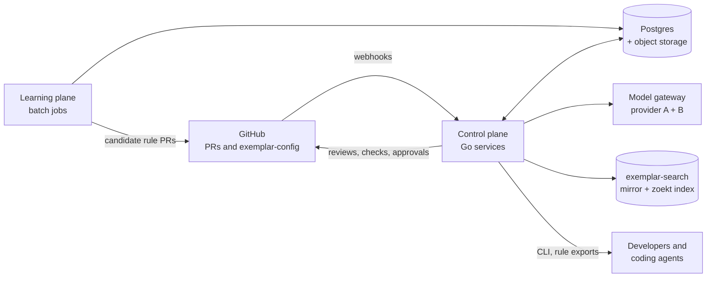
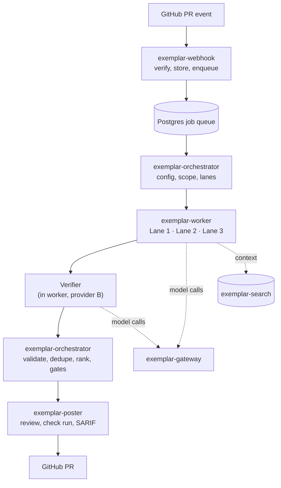
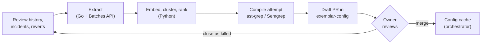
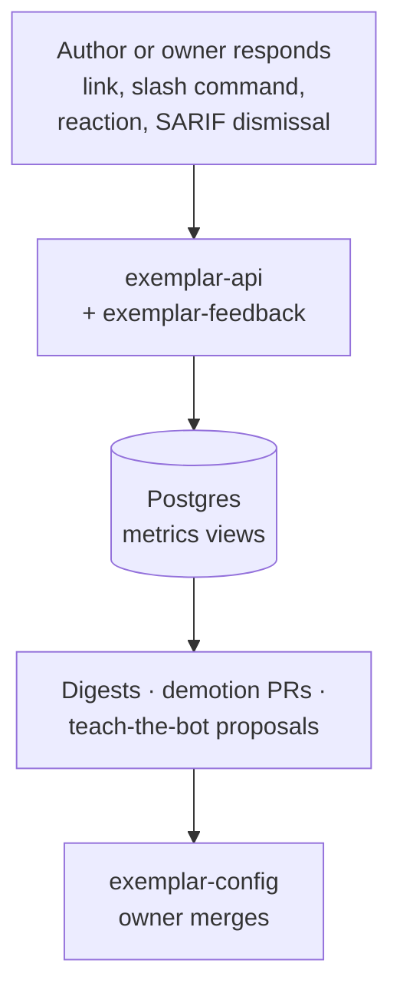
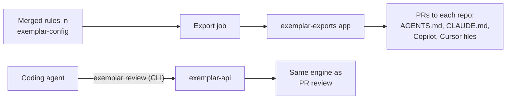
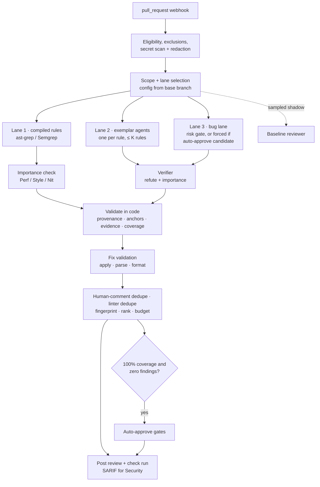
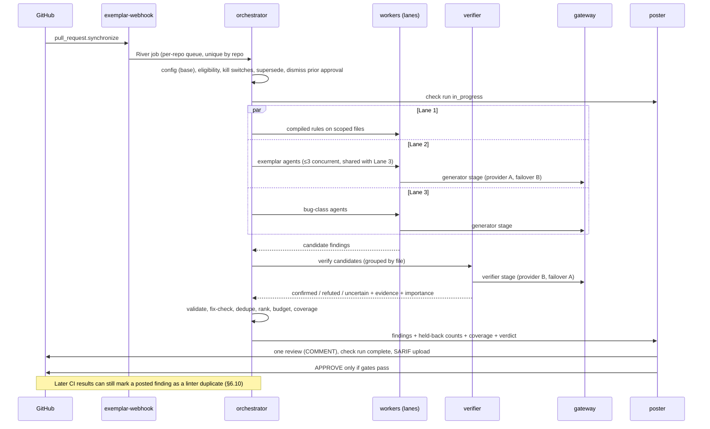
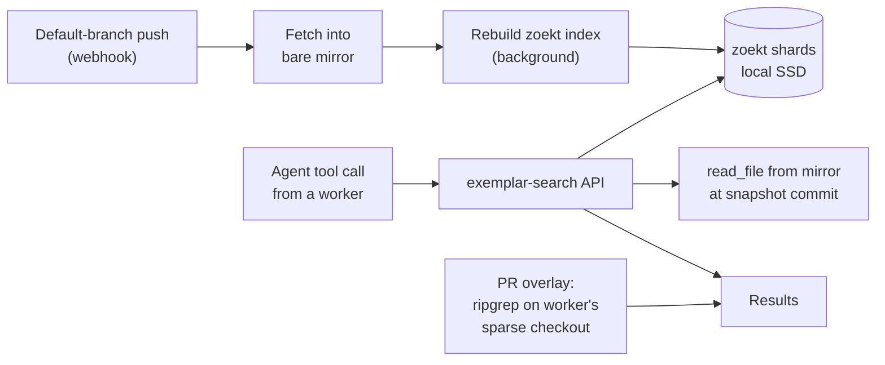
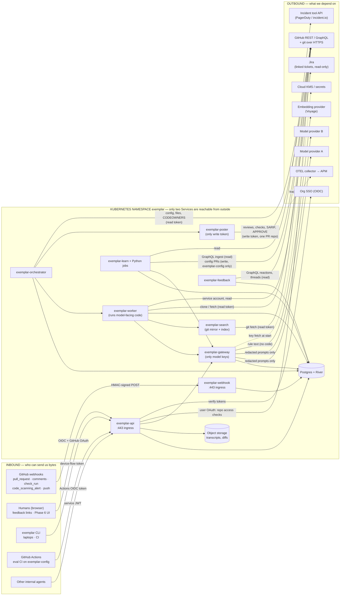

<!--
This file is the canonical specification; edit it here. It was imported
on 2026-10-13 from the claude.ai artifact "Exemplar — Technical
Specification" (https://claude.ai/artifact/CoxFmpRouQvgeAXNY8C8jt, version
1791800349-fc89), which is no longer maintained. Section numbers (§) in
code comments, commits and docs/plans refer to this document. Bracketed ids such as [FR-D6] refer to
the PRD ("Exemplar — Self-Correcting AI Code Review" v0.6), in
docs/spec/prd.md; docs/plans/README.md maps each id family to its
sections in both.
-->

# Exemplar — Technical Specification

**Status:** Draft 1.3 · October 2026 **Implements:** PRD "Exemplar — Self-Correcting AI Code Review" v0.6. Requirement IDs in brackets (e.g. [FR-V1]) refer to the PRD. **Audience:** the engineers building and operating Exemplar, security, and platform leadership.

### What changed in Draft 1.3

- **Network boundary diagram and edge table** added at the top of §13: every inbound channel and every outbound dependency, with protocol, authentication, data crossing and NetworkPolicy enforcement.
- **MCP server moved out of the initial scope** to Appendix C (deferred). Coding agents use exported instruction files and the CLI for pre-PR checks (§10.3); Phase 4 no longer includes MCP; the stack, layout, security table, dashboards and config lose their MCP entries, with the `mcp` caller value kept reserved.

### What changed in Draft 1.2 (review against PRD v0.6)

- **Coverage is computed by the harness from tool calls, never from model output** (§6.5); `files_examined` removed from the model-facing schema.
- **Auto-approve requires zero *candidate* findings**, before verification, from every lane (§6.13); the same-family check compares the actual families used on both sides of each finding (§6.8).
- Authorization added for `/exemplar try`, slash commands, feedback links and code-scanning dismissals (§6.12, §8.7, §9.1).
- Exports: `export:` blocks need platform approval; the exports app uses native auto-merge, not a ruleset bypass (§10.2).
- Fingerprints carry an occurrence index; findings are unique per review, not per PR (§4.3, §6.2); re-run attempts counted on `reviews`.
- Monorepo concurrency, snapshot-pinned `exemplar-search`, incremental indexing, per-rule Lane 1 timeouts, clamped-range fix handling, GraphQL for sweeper and reaction polls (§5, §6.4, §6.6, §6.9, §6.15).
- Feedback: 👎 is a secondary signal with weight 0.5 and no eFP role; event precedence defined; demotion uses unweighted counts for the Wilson bound; roles derived from PR participation (§9).
- Learning: community detection instead of connected components; doc- and incident-link boosts restored in ranking (§8.4, §8.5).
- Verifier and Stage 2 calibration gate CI (§6.8, §8.9); worker egress allowlist corrected (§13); `gh_events` retention; secrets allowlist; terminology aligned (§13.1, §15).

---

## 1. Basis

### 1.1 What the PRD requires of the system

Based on the PRD's goals (G1–G7), constraints (PRD §2.1) and functional requirements, Exemplar is built as follows.

| PRD requirement | Specification |
|---|---|
| Review every PR on GitHub with org-specific rules; never block [FR-E8] | A GitHub App backed by an in-cluster Go control plane (§2, §5). Reviews post as `COMMENT` ; the verdict type has no `REQUEST_CHANGES` value (§6.12). |
| Learn offline, enforce online, one human gate [PRD §5 invariants] | Learning plane writes candidate rules as draft PRs to `exemplar-config` ; only merged config is enforced (§8). |
| One agent per rule, ≤ 3 concurrent [FR-E3, FR-E4] | Orchestrator fans out with a bounded `errgroup` (§6.5). |
| Three lanes: compiled, exemplar, bug [PRD §8.1] | ast-grep/Semgrep runners, exemplar agents, gated bug-class agents (§6.6–6.7). |
| Verification with model diversity [FR-V1–V6, FR-E10–E11] | Verifier on a second model provider; evidence resolved in code; importance check for Lane 1 Performance/Style/Nit (§6.6, §6.8). |
| Model output is untrusted and checked by code [FR-T1–T6] | Validation in code; provenance attached by code; read-only tools; no write tokens in model-facing processes (§6.9, §13). |
| Self-contained repository context, no builds [constraint 6, FR-E12–E14] | `exemplar-search` : one container embedding zoekt with ctags symbols and the only git mirror; import-based scoping (§6.4). |
| Comment budget, labels, SARIF, dedupe [FR-P1–P6, FR-E7, FR-E15] | Ranking and budget with Security/blocking exemptions; human-comment and late-CI linter dedupe; Conventional Comments labels; SARIF for Security (§6.10, §6.12). |
| Validated one-click fixes [FR-F1–F3] | Suggestion blocks validated by apply + parse + format checks (§6.11). |
| Structured, Tricorder-style feedback [FR-B1–B8] | Signed links and slash commands; role-weighted eFP; owner adjudication; human agreement as evidence; automated demotion (§9). |
| Auto-approve behind deterministic gates [FR-A1–A9] | Strictly deterministic Stage 1 over harness-measured coverage and the pre-verification candidate count, path denylist and author policy in code, forced bug lane, two-model Stage 2, revocation on push (§6.13). |
| PR lifecycle [FR-C1–C7] | Incremental re-review, stable finding identity, self-resolving threads, dismissed-stays-dismissed, rebase re-anchoring, stacked-PR bases (§6.2). |
| Degraded operation [FR-D1–D6] | Fixed shedding order, fan-out cap, provider failover, explicit coverage, incomplete runs post nothing (§6.15). |
| Data handling and eligibility [FR-H1–H8] | Platform denylist, path exclusions, pre-call secret redaction, per-call data logging, pseudonymized mining, Security-owned retention (§13.1). |
| Shift left [FR-S1–S7] | Rule exports (weekly and on promotion/kill, auto-merge for generated-only PRs, drift tracking) via a separate least-privilege GitHub App; pre-PR checks through the CLI (§10.1, §10.3). MCP server deferred (Appendix C). |
| Evaluation before rollout [FR-X1–X11] | Eval CI, replay harness, injected and mutation cases, adversarial set on every change, verifier calibration, sampled baseline reviewer (§8.8–8.9). |
| Cost and latency visible, not optimized for [G5, PRD §13.2] | Recorded per call, run and PR; shown as informational; soft per-run ceiling triggers degradation (§6.14). |
| Per-rule visibility and audit | Grafana on a Postgres replica backed by SQL views; Go web UI in Phase 6 (§12). |

### 1.2 System-wide rules

These hold for every component and are tested in CI where possible.

1. **Config from base.** Rules and repo config are read from the default branch of `exemplar-config` and of the target repo, never from a PR head.
2. **Learning never expands enforcement without a merged PR.** Automation may only *reduce* behavior on its own (demotion, expiry to shadow).
3. **Models never hold write access.** Only `exemplar-poster` and the config writer hold write tokens, and neither sees model input.
4. **Provenance is attached by code.** Rule ids, citations, lanes and severities never come from model output.
5. **Zero coverage is a failure,** never a clean result. Coverage is measured by the harness from the files an agent actually opened, never from anything the model says. "No findings" is claimed only at 100% coverage; degraded runs cannot approve and incomplete runs post nothing.
6. **Verification filters what humans see; it never widens what the bot may approve.** Auto-approve looks at candidate findings before the verifier, so a refuted finding still blocks approval.
7. **Nothing reaches a model provider before eligibility, exclusion and secret-redaction checks pass.**
8. **No builds.** No component runs a build tool or depends on build artifacts.
9. **Everything is idempotent on a natural key** so any job can be retried (§7).

---

## 2. Architecture

### 2.1 Component map

An overview and one view per job.

**Overview**



**View 1 — Reviewing a PR (online path)**



Reading top to bottom is the order of work for one review. Only `exemplar-poster` holds a write token; workers and the verifier hold read-only tokens and reach models only through the gateway.

**View 2 — Learning rules and the human gate (offline path)**



Nothing reaches the online path until a rule owner merges a PR in `exemplar-config`. Evals, volume estimates and linter-overlap checks run as GitHub Actions on that PR.

**View 3 — Feedback loop**



The loop only *proposes* changes as config PRs. Demotion auto-merges because it reduces behavior; promotion and new exceptions always need an owner.

**View 4 — Shift left (authoring time)**



Both paths reuse the merged rules and the same engine, so what an agent is told, what it can check, and what the PR bot enforces never diverge.

For the network view — what can reach the cluster and what the cluster calls — see the boundary diagram at the top of §13.

### 2.2 Services

All services are Go binaries built from one module (`cmd/*`) and shipped in one image; each runs as its own Kubernetes Deployment so it scales and is permissioned independently.

| Service (binary) | Responsibility | Scaling | Key Go pieces |
|---|---|---|---|
| `exemplar-webhook` | Verify `X-Hub-Signature-256` , persist raw event to `gh_events` with `X-GitHub-Delivery` as idempotency key, enqueue in the same transaction, return 202 within GitHub's 10 s window. No business logic. | Stateless, 2+ replicas | `net/http` , `go-github` `ValidatePayload` / `ParseWebHook` , River `InsertTx` |
| `exemplar-orchestrator` | Turn events into reviews: load effective config, compute deterministic scope, create `rule_runs` , schedule agents (≤3 per PR), validate, compute gates, hand results to poster. Cancels superseded reviews. | River workers | River, `errgroup` , `internal/scope` , `internal/gates` |
| `exemplar-worker` | Prepare git worktree (partial clone); run **Lane 1** engines (ast-grep, Semgrep), **Lane 2** exemplar agents, **Lane 3** bug-class agents, and the **verifier** ; validate fixes. Read-only token only. | Horizontal; goroutine per agent, bounded by semaphore | `os/exec` ( `git` , `rg` , `ast-grep` , `semgrep` ), `anthropic-sdk-go` + provider-B SDK via gateway, `go-tree-sitter` |
| `exemplar-poster` | Submit the GitHub review (one call, many comments), create/update check runs, submit APPROVE when gates pass. Only component with write scopes. | Small | `go-github` , scoped installation tokens |
| `exemplar-api` | Public engine API (PRD §8.8) for playground, CLI, other agents and eval; **signed feedback-link endpoint** (§6.12); later the Phase 6 web UI. AuthN via OIDC for humans, signed JWT for services. | Stateless | `net/http` , `go-oidc` |
| `exemplar-gateway` | Holds keys for the approved providers (hardcoded list), routes each stage (generator, verifier, light, categorizer) through an ordered provider list with **failover** , runs a second secret-scan on every request, tracks per-run spend against the soft ceiling, rate-limits per provider/model and per caller, and writes every call to `model_calls` . | Stateless | `httputil.ReverseProxy` , `x/time/rate` , gitleaks, pgx |
| `exemplar-feedback` | Poll reactions and thread state, classify replies, detect fixes, write `feedback_events` ; nightly rule metrics and auto-demotion PRs. | River periodic jobs | `githubv4` , River |
| `exemplar-learn` | Subcommands: `ingest` , `path-events` (incidents/reverts), `extract` (Message Batches driver), `compile` (rule synthesis + sandbox eval), `candidates` , `evalgen` (history, injected, mutation), `export` (rule exports via the exports app), `expiry` . | Kubernetes Jobs/CronJobs | Shares `internal/gh` rate limiter and token minting |
| `learning/` (Python) | `embed` , `cluster` , `rank` — reads/writes Postgres tables only, no API surface. | CronJob | numpy, faiss/hnswlib, scikit-learn |
| `exemplar-search` | Holds the system's only git mirror of the monorepo (and `context.extra_repos` ), builds a **zoekt** index of the default branch with ctags symbols in the background after each fetch, and answers the repo-context tools and `read_file` over an internal HTTP API (§6.4). | StatefulSet, 2 independent replicas, local SSD | zoekt (embedded Go library), `os/exec` ( `git` , `universal-ctags` ) |
| `exemplar` (CLI) | Local pre-PR review, rule try, eval. | Laptops/CI | Cobra; single static binary via GoReleaser |

### 2.3 Implementation languages

- **Go** for every service, the CLI, the gateway, `exemplar-search`, and every job that calls GitHub or a model API. One Go module, one container image per service family, one Kubernetes Deployment or StatefulSet per binary.
- **Python** only for the embedding, clustering and ranking jobs in the learning plane (`learning/`), which read and write Postgres tables and expose no API.
- **Contracts** shared by both are JSON Schema files in `schema/`. Go types are validated against them in tests; Python models are generated with `datamodel-code-generator`. CI fails on drift.
- **Git** operations shell out to the `git` binary (`exec.CommandContext` with timeouts) for partial clone and sparse checkout. Large GitHub GraphQL queries use `genqlient`-generated clients.

---

## 3. Repositories and code layout

```
exemplar/                          # one Go module: github.com/acme/exemplar
  cmd/
    exemplar-webhook/  exemplar-orchestrator/  exemplar-worker/  exemplar-poster/
    exemplar-api/      exemplar-gateway/       exemplar-feedback/ exemplar-learn/
    exemplar-search/
    exemplar/                      # CLI (cobra)
  internal/
    schema/      # CodeReviewRule, Finding, RepoConfig types + validation against schema/
    config/      # layering global/repo config; base-branch resolution; cache + invalidation
    scope/       # doublestar globs, diff parsing, hunk index, anchor validation
    engine/      # agent harness, tools, prompt assembly, output parsing, validation
    compiled/    # Lane 1: ast-grep / Semgrep runners and output parsers
    buglane/     # Lane 3: class prompts, eligibility gate
    verify/      # verifier stage, evidence resolution, calibration replay
    rank/        # linter dedupe, scoring, comment budget
    fix/         # suggestion validation (apply, tree-sitter parse, formatter checks)
    ctxprov/     # worker-side context tools + PR overlay; langs/ holds per-language package and import patterns
    search/      # exemplar-search: mirror management, zoekt index generations, query API, degraded mode
    export/      # AGENTS.md / CLAUDE.md / Copilot / Cursor renderers
    llm/         # gateway client, budgets, pricing table, cost calc
    gh/          # App JWT, scoped installation tokens, throttled clients, GraphQL, posting
    gates/       # stage 1/2, compliance constants
    feedback/    # signal detection, acceptance math, Wilson bound, demotion
    store/       # sqlc-generated queries; River job args + workers
    telemetry/   # OTEL + slog setup
    web/         # Phase 6 UI (templ components, handlers)
  schema/        # JSON Schema: source of truth for Go + Python contracts
  db/
    migrations/  # goose (or Atlas) SQL migrations
    queries/     # sqlc .sql files
  learning/      # Python (uv project): embed/ cluster/ rank/
  dashboards/    # Grafana dashboards as JSON (provisioned, version-controlled)
  deploy/        # Helm / Terraform
  .goreleaser.yaml

exemplar-config/                   # the human gate (separate repo, CODEOWNERS-protected)
  global.yaml                      # global defaults, model tiers, budgets
  repos/<org>/<repo>.yaml          # opt-in, auto-approve settings, KILL SWITCH
  rules/<category>/<rule-id>.yaml  # global exemplars
  evals/<rule-id>/cases.yaml       # eval cases referencing real PRs by sha
  .github/workflows/eval.yml       # Actions CI: schema check + evals on every PR
  CODEOWNERS
```

**Repo-specific rules** live in the *target* repo at `.exemplar/rules/*.yaml`, owned by that repo's CODEOWNERS.

> **Critical security rule:** repo-level config and rules are **always read from the PR's base branch (default branch), never from the PR head.** Otherwise any author can disable rules or inject a rule description by editing `.exemplar/` in their own PR. Changes to `.exemplar/` in a PR take effect only after merge, exactly like the PRD's "human gate." The kill switch and opt-in live **only** in `exemplar-config`, never in target repos.

---

## 4. Data layer

### 4.1 Stores

| Data | Store |
|---|---|
| Rules, eval cases, repo enablement, kill switches | **Git** : `exemplar-config` and target repos' `.exemplar/` (source of truth) |
| Mirror of active rules by git SHA | Postgres `rules` |
| Webhook events, reviews, rule runs, findings, feedback, gate traces | Postgres |
| Mined comments, extractions, embeddings ( `pgvector` ), clusters, candidates | Postgres |
| Job queue | Postgres (River) |
| Cost ledger | Postgres |
| Model transcripts, raw diffs, eval artifacts | Object storage (S3/GCS); Postgres stores keys |
| Git mirror and code-search index | `exemplar-search` local SSD volumes (rebuildable from GitHub) |
| Traces and telemetry | OTEL collector → the organization's APM backend |

### 4.2 Sizing

- **Embeddings:** assume 1.7M comments × 10–15% extraction rate ≈ 170K–255K extractions. At 1024 dims as `halfvec` (2 bytes/dim) that is ~0.5 GB; even embedding all 1.7M raw comments at float32 is ~7 GB. Comfortably inside one Postgres with an HNSW index.
- **Findings:** at 2,000 PRs/day, ~3 findings per PR, ~2.2M rows/year. Trivial; partition `findings` and `rule_runs` by month only when they pass ~50M rows.
- **Instance:** start with a managed Postgres (RDS / Cloud SQL / Azure Flexible) at 4 vCPU / 16 GB, 200 GB storage, one read replica for analytics and the playground.

### 4.3 Schema

```sql
CREATE EXTENSION IF NOT EXISTS vector;

-- ---------- Intake ----------
CREATE TABLE gh_events (
  delivery_id     uuid PRIMARY KEY,                 -- X-GitHub-Delivery
  event           text NOT NULL,
  action          text,
  installation_id bigint NOT NULL,
  repo_full_name  text,
  payload         jsonb NOT NULL,
  received_at     timestamptz NOT NULL DEFAULT now(),
  processed_at    timestamptz                       -- payload nulled by the retention job (§13.1, default 30 days)
);

-- ---------- Rules (mirror of git) ----------
CREATE TABLE rules (
  rule_id      text NOT NULL,
  version_sha  text NOT NULL,                       -- git SHA of the rule file
  scope        text NOT NULL,                       -- 'global' | '<org>/<repo>'
  kind         text NOT NULL,                       -- exemplar | compiled | bug_class
  category     text NOT NULL,
  severity     text NOT NULL,                       -- blocking | important | suggestion
  status       text NOT NULL,                       -- candidate | shadow | active | killed
  owner        text NOT NULL,
  fix_policy   text NOT NULL DEFAULT 'none',
  review_by    date,
  exported     boolean NOT NULL DEFAULT false,
  model_tier   text NOT NULL DEFAULT 'standard',
  spec         jsonb NOT NULL,                      -- full rule
  PRIMARY KEY (rule_id, version_sha)
);

-- ---------- Reviews ----------
CREATE TABLE reviews (
  id             bigserial PRIMARY KEY,
  repo           text NOT NULL,
  pr_number      int  NOT NULL,
  head_sha       text NOT NULL,
  base_sha       text NOT NULL,
  prev_review_id bigint REFERENCES reviews(id),
  config_version text NOT NULL,                     -- exemplar-config commit
  search_snapshot text,                             -- exemplar-search snapshot SHA used
  caller         text NOT NULL,                     -- production|playground|cli|agent|eval|baseline (mcp reserved, Appendix C)
  status         text NOT NULL,                     -- queued|running|done|incomplete|failed|superseded
  coverage       real,                              -- completed in-scope rules ÷ in-scope rules
  degraded       boolean NOT NULL DEFAULT false,
  shed           jsonb,                             -- what was shed/deferred/excluded and why
  incomplete_reason text,
  verdict        text,                              -- APPROVE | NO_OP
  bug_lane       boolean NOT NULL DEFAULT false,
  cost_usd       numeric(10,4) NOT NULL DEFAULT 0,
  started_at     timestamptz,
  finished_at    timestamptz,
  attempt        int NOT NULL DEFAULT 1,            -- incremented by Re-run of an incomplete review
  UNIQUE (repo, pr_number, head_sha, config_version, caller, attempt)
);

CREATE TABLE rule_runs (
  id             bigserial PRIMARY KEY,
  review_id      bigint NOT NULL REFERENCES reviews(id),
  rule_id        text NOT NULL,                     -- rule or bug class id
  rule_version   text NOT NULL,
  lane           text NOT NULL,                     -- compiled | exemplar | bug | baseline
  scoped_files   text[] NOT NULL,
  status         text NOT NULL,                     -- ok|zero_coverage|schema_error|timeout|shed|deferred|degraded_skip
  coverage       real,
  context_degraded boolean NOT NULL DEFAULT false,
  model text, input_tokens int, cached_tokens int, output_tokens int,
  cost_usd       numeric(10,4),
  latency_ms     int,
  transcript_key text,
  UNIQUE (review_id, rule_id, rule_version)
);

CREATE TABLE findings (
  id                bigserial PRIMARY KEY,
  rule_run_id       bigint NOT NULL REFERENCES rule_runs(id),
  repo              text NOT NULL,
  pr_number         int  NOT NULL,
  rule_id           text NOT NULL,
  lane              text NOT NULL,
  severity          text NOT NULL,
  cc_label          text NOT NULL,                  -- e.g. 'suggestion (performance)'
  path              text NOT NULL,
  side              text NOT NULL,                  -- RIGHT | LEFT
  start_line        int  NOT NULL,
  end_line          int  NOT NULL,
  fingerprint       text NOT NULL,
  message           text NOT NULL,
  verify_verdict    text,                           -- confirmed | refuted | uncertain | NULL (compiled)
  verify_importance real,
  verify_model      text,
  verify_same_family boolean NOT NULL DEFAULT false,
  verify_evidence   jsonb,
  suggested_fix     text,
  fix_valid         boolean,
  rank_score        real,
  state             text NOT NULL,                  -- posted | shadow | dropped | outdated | resolved | minimized
  suppressed_reason text,                           -- refuted|uncertain|unimportant|bad_evidence|linter_duplicate|human_duplicate|dismissed|budget|duplicate
  gh_comment_id     bigint,
  gh_thread_id      text,
  sarif_alert_number int,
  created_at        timestamptz NOT NULL DEFAULT now(),
  -- fingerprint includes an occurrence index (§6.2), so identical code at two anchors yields two findings.
  -- Uniqueness is per review: playground, baseline and eval runs on the same PR never collide with production.
  UNIQUE (rule_run_id, fingerprint)
);
CREATE INDEX ON findings (repo, pr_number, fingerprint);  -- cross-push identity lookups (§6.2)

CREATE TABLE feedback_events (
  id          bigserial PRIMARY KEY,
  finding_id  bigint NOT NULL REFERENCES findings(id),
  kind        text NOT NULL,   -- fb_fixed|fb_wrong|fb_not_important|fb_handled|fb_disagree|applied_suggestion|fixed|
                               -- reply_agree|reply_disagree|reply_question|react_up|react_down|resolved|ignored|
                               -- human_agreed|adjudicated_uphold|adjudicated_overturn
  actor       text NOT NULL,
  role        text NOT NULL,   -- author | reviewer | owner | observer (§9.1)
  weight      real NOT NULL,   -- 1 | 2 | 4 | 0 by role; 0.5 for reactions (§9.2)
  via         text NOT NULL,   -- link|slash|reaction|webhook|code_scanning|inferred
  reason_text text,
  teach_class text,            -- scope|exception|rule_wrong|noise
  evidence    jsonb,
  observed_at timestamptz NOT NULL DEFAULT now(),
  UNIQUE (finding_id, kind, actor)
);

CREATE TABLE approval_decisions (
  review_id    bigint PRIMARY KEY REFERENCES reviews(id),
  stage1       jsonb NOT NULL,
  stage2       jsonb,
  decision     text NOT NULL,  -- approved|ineligible|blocked_compliance|killed
  gh_review_id bigint
);

CREATE TABLE path_events (     -- incidents and reverts
  repo text NOT NULL, path text NOT NULL, kind text NOT NULL,   -- incident | revert
  ref  text NOT NULL, at timestamptz NOT NULL,
  PRIMARY KEY (repo, path, kind, ref)
);

-- ---------- Learning plane ----------
CREATE TABLE mined_comments (
  id              bigint PRIMARY KEY,               -- GitHub comment id
  repo text, pr_number int, path text, ext text,
  reviewer_pid text, author_pid text, created_at timestamptz,   -- HMAC pseudonyms (§13.1)
  comment_url text,
  body text, diff_hunk text, doc_urls text[],                     -- body/diff_hunk purged when uncited (§13.1)
  input_hash text,                                                -- extraction cache key (§8.2)
  is_thread_root  boolean, thread_resolved boolean,
  source          text NOT NULL,                    -- human | accepted_bot_finding | revert_seed
  extract_status  text NOT NULL DEFAULT 'pending'   -- pending|in_batch|accepted|rejected|error
);

CREATE TABLE extractions (
  comment_id        bigint PRIMARY KEY REFERENCES mined_comments(id),
  title text, description text, body text, category text,
  language_agnostic boolean NOT NULL DEFAULT false,
  extractor_model   text, extractor_version text,
  embedding         halfvec(1024)
);
CREATE INDEX ON extractions USING hnsw (embedding halfvec_cosine_ops);

CREATE TABLE candidates (
  id bigserial PRIMARY KEY,
  ext text NOT NULL, title text, description text,
  cluster_size int, distinct_reviewers int, score real,
  owner text, status text NOT NULL,                 -- new|pr_open|promoted|killed
  config_pr_url text, kill_reason text
);
CREATE TABLE candidate_sources (
  candidate_id bigint, comment_id bigint, PRIMARY KEY (candidate_id, comment_id)
);

CREATE TABLE compile_attempts (
  id bigserial PRIMARY KEY, candidate_id bigint, rule_id text,
  engine text, rule_body text, precision real, recall real,
  accepted boolean, attempted_at timestamptz NOT NULL DEFAULT now()
);

CREATE TABLE eval_cases (
  rule_id text, case_id text, synthetic boolean NOT NULL DEFAULT false,
  adversarial boolean NOT NULL DEFAULT false,
  ref text NOT NULL, patch text, expect jsonb NOT NULL,
  PRIMARY KEY (rule_id, case_id)
);

CREATE TABLE verifier_labels (
  finding_id bigint PRIMARY KEY REFERENCES findings(id),
  label      text NOT NULL,                         -- true | wrong | unimportant
  source     text NOT NULL,                         -- author_signal | human_review
  labeled_at timestamptz NOT NULL DEFAULT now()
);

CREATE TABLE teach_proposals (
  id bigserial PRIMARY KEY, rule_id text, teach_class text,
  evidence_findings bigint[], config_pr_url text, state text,
  created_at timestamptz NOT NULL DEFAULT now()
);

-- ---------- Shift left ----------
CREATE TABLE exports (
  repo text, path text, target text,                -- agents_md | claude_md | copilot | cursor
  content_hash text, config_sha text, pr_url text, state text, auto_merged boolean, updated_at timestamptz,
  PRIMARY KEY (repo, path)
);

-- ---------- Cost ----------
CREATE TABLE model_calls (           -- cost accounting and data-egress log (§6.14, §13.1); 90-day retention
  id bigserial PRIMARY KEY, at timestamptz NOT NULL DEFAULT now(),
  review_id bigint, rule_run_id bigint, repo text,
  caller text,        -- production|playground|cli|agent|eval|baseline|learning (mcp reserved)
  stage text,         -- generator|verifier|light|categorizer|extract|merge|compile|embed
  provider text, model text, failover boolean NOT NULL DEFAULT false,
  data_classes text[] NOT NULL,       -- diff|file_context|search_context|ticket|review_comments|pr_text
  input_tokens int, cached_tokens int, output_tokens int, cost_usd numeric(10,6), latency_ms int
);
```

`findings` and `rule_runs` are partitioned by month once they exceed ~50M rows. Repository context adds no tables; its data lives on `exemplar-search` volumes.

---

## 5. GitHub integration

Exemplar uses **two GitHub Apps** so that write access to repository contents (rule exports) is isolated from the app that reviews PRs.

**`exemplar` (review app) — permissions**

| Permission | Level | Used for |
|---|---|---|
| Metadata | read | Required |
| Contents | read | Clone, read CODEOWNERS and `.exemplar/` from base |
| Pull requests | read & write | Read diffs/threads; submit reviews, comments, approvals |
| Checks | read & write | Own check runs; **read other check runs' annotations for linter dedupe** (§6.10) |
| Code scanning alerts | read & write | Upload SARIF for Security-category findings; read dismissal reasons as feedback (§6.12) |
| Issues | read & write | PR conversation replies; **linked-issue context** (§6.4); write only in `exemplar-config`, for flag issues and owner digests (§9.4) |
| Members (org) | read | Team CODEOWNERS and allowed-author teams |
| Administration | read | Branch protection lookup for Stage 2 |

On `exemplar-config` only, the review app is installed with **Contents: write** so it can open candidate, suppression and demotion PRs; tokens for that repo are minted separately and never reach agent workers.

**`exemplar-exports` (export app)** — installed only on repos that opt into rule exports; permissions Contents: write, Pull requests: write, Metadata: read. It does nothing but open and update the generated-instructions PRs (§10.2). It never reads PR content and never runs model code.

**Token flavors from the review app** (down-scoped at mint time):

| Holder | Repos | Permissions |
|---|---|---|
| Agent workers (all lanes, verifier) | the one PR repo | `contents:read` , `pull_requests:read` |
| Context provider (code search, issues) | allowlisted repos per §6.4 policy | `contents:read` , `issues:read` |
| Poster | the one PR repo | `pull_requests:write` , `checks:write` , `security_events:write` |
| Config writer | `exemplar-config` only | `contents:write` , `pull_requests:write` , `issues:write` |

**Subscribed events:** `pull_request` (opened, synchronize, reopened, ready_for_review, edited, closed), `pull_request_review`, `pull_request_review_comment`, `pull_request_review_thread`, `issue_comment` (slash commands), `check_run` (completed — for late linter dedupe; rerequested; requested_action — Re-run), `code_scanning_alert` (closed_by_user, reopened_by_user — feedback), `push`, `installation`, `installation_repositories`.

**Rate limits:** an installation on a GitHub Enterprise Cloud org gets 15,000 REST requests/hour; outside Enterprise Cloud the floor is 5,000 and scales with users and repos. Wrap the `go-github` HTTP client with `gofri/go-github-ratelimit` (secondary limits) and a shared `x/time/rate` limiter per installation, prefer GraphQL for thread/reaction reads, and keep per-review API calls to roughly 15–25 (the extra over v0.2 is check-run annotation reads and one SARIF upload; see §6.12). Content-creation endpoints have stricter secondary limits — another reason to post one review with many comments rather than many single comments.

**Webhook reliability:** GitHub does not automatically retry failed deliveries. Run two safety nets: (a) a reconciler that lists the app's failed deliveries and requests redelivery; (b) a sweeper every 10 minutes that runs one GraphQL `search(type: ISSUE, query: "is:pr is:open updated:>…")` over opted-in repos (not a REST list per repo) and enqueues any `(repo, pr, head_sha)` without a review row.

---

## 6. Review pipeline

### 6.1 Review lifecycle





An **incomplete** run (both providers unavailable for a stage, or a diff that cannot be redacted) posts no comments and no approval; the check run reports "review did not complete" with the reason and a re-run button (§6.15).

### 6.2 PR lifecycle

A PR is a sequence of pushes, rebases and conversations. The orchestrator implements PRD §8.9 as follows.

| Event | Behavior | PRD |
|---|---|---|
| `opened` , `reopened` , `ready_for_review` | Full review of the PR against its **base ref** . For stacked PRs the base ref is the parent branch, so findings are never duplicated down a stack. | FR-C5 |
| Draft PR | Not reviewed unless the repo sets `review_drafts: true` . | FR-C5 |
| `synchronize` (new commits) | Any queued or running review for an older `head_sha` is `superseded` : the orchestrator calls River's `JobCancel` , which cancels the job's `context.Context` on whichever pod holds it and aborts in-flight model calls (no custom LISTEN/NOTIFY). Any prior Exemplar approval is **dismissed** via the review-dismissal API before the new review starts. | FR-A9 |
| Incremental re-review | `interdiff = diff(last_reviewed_head, new_head)` . Files re-reviewed = files with changed hunks in the interdiff ∪ files anchoring a still-open Exemplar finding. Rules re-run only where their scope intersects that set; all other rule results carry forward. | FR-C1 |
| Finding identity | `fingerprint = sha256(rule_id \| path \| normalized code at anchor ±2 lines \| k)` , where `k` is the ordinal of this anchor among anchors in the same file with identical normalized code (so two copies of the same loop are two findings, not one dropped as a duplicate). A fingerprint is posted at most once per PR: before posting, the orchestrator looks up open findings for `(repo, pr, fingerprint)` from earlier production reviews and treats a match as the same finding. Playground, baseline and eval runs are excluded from that lookup. | FR-C2 |
| Anchored lines changed | The finding is re-verified on the new head. If it no longer holds, the poster replies "Addressed in `<sha7>` " and resolves the thread (GraphQL `resolveReviewThread` ); state → `resolved` . If it still holds, the thread is left as is. | FR-C2 |
| Dismissed findings | Before posting, any fingerprint with a `fb_wrong` , `fb_not_important` , `fb_handled` or `fb_disagree` event, or a 👎, from the author or owner on this PR is dropped ( `suppressed_reason='dismissed'` ), even if found again. `fb_fixed` is not a dismissal: a finding marked Fixed is re-verified on the next push like any other, and re-posted if it still holds. | FR-C3 |
| Rebase / force-push | Detected when `before` is not an ancestor of `after` . Open findings are re-anchored by searching the new head for the fingerprint's normalized code; matches move, non-matches are marked `outdated` and their threads resolved with "No longer present after rebase". The review continues incrementally from the re-anchored state. | FR-C4 |
| Config changed mid-PR | Each review records `config_version` . On the next review, open findings from rules that are now `killed` or `shadow` are resolved with "Rule `<id>` was retired"; rules added since apply from this review on. | FR-C6 |
| Accounting | Cost and duration are recorded per run and summed per PR for reporting; there is no shared per-PR budget. The soft ceiling applies per run (§6.15). | FR-C7 |
| Kill switch or repo not eligible | No review; a neutral check run says why (none for a repo in shadow, §6.9). | FR-H1 |

### 6.3 Eligibility, scope and lane selection

1. **Repo eligibility** (PRD FR-H1): the repo must be opted in and must not appear on the platform denylist in `exemplar-config/platform/eligibility.yaml` (CODEOWNERS: Security). The same check gates mining (§8.1) and context (§6.4). Fork PRs are reviewed only when the repo sets `forks.review: true` (FR-H5).
2. **File list:** `GET /pulls/{n}/files`, paginated; for > 3,000 files, `git diff --name-status` in the worker checkout.
3. **Path exclusions** (FR-H2): drop removed files, binaries, files over 1 MB, minified assets, lockfiles, and paths marked `linguist-generated` or `linguist-vendored` in `.gitattributes`, plus patterns from the repo's `.exemplarignore` (read from the base branch). Excluded paths are listed in the check run as "not reviewed".
4. **Secret scan** (FR-H3): the diff is scanned with the embedded gitleaks detector before any model call. Matches are replaced in all model inputs with `‹redacted:secret›`, and a deterministic finding `possible-secret-in-diff` (lane `secrets`, Security, blocking) is created for each match — no model involved. Matches covered by the repo's `.gitleaksignore` or `.gitleaks.toml` allowlist (read from the base branch) are still redacted from model inputs but produce no finding, so test fixtures do not generate blocking Security comments. The same scan runs on every context snippet, ticket body and file read returned to an agent. If redaction fails for any input, the run is `incomplete` (§6.15).
5. **Rule scope:** match each active rule's `file_patterns` with `doublestar`. Rules with zero matches never run.
6. **Fan-out cap** (FR-D2): at most `max_exemplar_rules` (default 40) exemplar rules run. If more are in scope, the lowest-precision rules are deferred (`rule_runs.status='deferred'`), listed in the check run as "not run on this review", and the run's coverage is below 100%.
7. **Auto-approve pre-check:** the deterministic parts of Stage 1 that don't depend on findings (eligibility, scope, denylist, author policy, fork, size) are evaluated now. A PR that passes is an **auto-approve candidate**.
8. **Bug lane:** runs if the risk gate passes (§6.7) **or** the PR is an auto-approve candidate (FR-A7).
9. **Baseline reviewer** (FR-X8): a stratified random 10% of production PRs (strata: repo × size bucket of ≤ 50 / ≤ 300 / > 300 changed lines) get a shadow run with `caller=baseline`. Its findings are stored, never posted.

### 6.4 Repository context — `exemplar-search`

Based on constraint 6 and FR-E12–E14, repository context is served by **one container, `exemplar-search`**: our Go binary embedding the **zoekt** code search library (Apache-2.0) with universal-ctags symbol extraction, plus the system's only git mirror. It never runs a build. `linked_ticket()` (GitHub Issues / Jira) and `path_history()` (`path_events` + `git log`) complete the context tools.



#### 6.4.1 Process layout

- **Deployment:** StatefulSet with 2 independent replicas, each with its own local SSD volume, mirror and index. No shared state. Workers call a Kubernetes Service.
- **Mirror:** one full-object bare mirror per repo in scope (the monorepo plus `context.extra_repos`). Fetched on default-branch `push` webhooks relayed by the orchestrator (debounced to once per 30 s per repo) and every 5 minutes as a backstop.
- **Index:** zoekt shards for the default branch at the latest fetched commit, with ctags symbols. Indexing is incremental: zoekt's git indexer re-indexes only files changed since the serving generation, so a fetch on a busy monorepo costs seconds, not a full rebuild; a full rebuild runs nightly and whenever the incremental chain exceeds 500 generations. A new generation serves only once complete and is swapped atomically. Every response carries the `snapshot_sha` it was answered from. T-0.4 records both incremental and full index times.
- **Snapshot pinning:** a review is pinned to one `snapshot_sha` at start (recorded in `reviews.search_snapshot`) and every tool call passes it. A replica whose index is at a different commit still answers `read_file` and evidence resolution from git at the pinned commit, and answers search from its index while flagging `snapshot_mismatch` on the result; the worker prefers the replica whose index matches (session affinity on `snapshot_sha`). Verifier evidence is always resolved at the pinned commit.
- **API:** internal HTTP/JSON implementing the tools in §6.4.4 and `read_file(commit, path, start, end)` via `git show`.
- **Image contents:** `exemplar-search`, git, universal-ctags.
- **Resources:** local SSD at 3–4× the repo's checked-out source size per replica, and RAM sufficient to keep hot shards in page cache; final sizing comes from the Phase 0 benchmark.

#### 6.4.2 Worker checkout

Workers clone only what a review needs:

```
git clone --filter=blob:none --depth=1 --no-checkout --sparse <repo> wt
git -C wt fetch --depth=1 origin <head_sha> <base_sha>
git -C wt sparse-checkout set --cone <dirs of changed files> <rule context_paths>
git -C wt checkout <head_sha>
```

Files outside the sparse cone are read from `exemplar-search` `read_file` at the snapshot commit.

#### 6.4.3 Package scoping by imports

`find_references` and `dependents` are scoped by imports discovered with search queries at request time:

1. **Package identity of a file:** Go import path (module root + directory); C/C++ header path relative to configured `include_roots`; TS/JS module path relative to workspace roots; Python dotted module; Java/Kotlin package declaration.
2. **Importers:** a per-language import pattern is instantiated with that identity and run as a zoekt regex query, for example:
   - Go `^\s*(import\s+)?(\w+\s+)?"acme/game-engine/src/net"`
   - C++ `#include\s+[<"]net/avatar_fetch\.h[>"]`
   - TS `from\s+['"].*/net/avatar['"]`
   - Python `^(from\s+src\.net(\.\w+)*\s+import|import\s+src\.net)`
3. **Transitive dependents:** step 2 repeated for importing packages, depth ≤ 2, capped at 200 packages.

Patterns live in `internal/ctxprov/langs/` with golden tests per language. Languages without patterns use directory proximity.

#### 6.4.4 Agent tools

| Tool | Answered by | Returns | Limits |
|---|---|---|---|
| `find_definition(name, near_path?)` | zoekt symbol query with language filter; ranked by qualified-name match, then path proximity | ≤ 10 definitions | Whole repo |
| `dependents(path, depth?)` | Import-pattern queries (§6.4.3) | Importing files and packages | depth 1 (max 2), 200 packages |
| `find_references(name, defined_in)` | Word-boundary search restricted to the defining package's directory plus `dependents(defined_in)` ; ranked by proximity | ≤ 50 sites with 2 lines of context | `defined_in` required for names with > 500 repo-wide hits |
| `search_text(pattern, path_filter?, lang?)` | zoekt regex query | Matching lines | Repo-wide; 100 results; 2 s timeout |
| `read_file(path, start, end)` | Worker checkout, else `exemplar-search` at the snapshot | Lines | ≤ 400 lines per call |
| `linked_ticket()` | GitHub Issues / Jira | Title + description | 4K chars |
| `path_history(path)` | `path_events` + `git log` from the mirror | Incidents, reverts, recent commits | 20 entries |

**PR overlay.** For every search tool, the worker runs the same query with ripgrep (or a Go regex for symbol lookups) over the PR's changed files, drops index hits for those paths, and merges in the PR's versions.

**Degraded mode.** When the index is missing or more than 1 hour behind the mirror, `search_text`, `find_references` and `dependents` are answered with `git grep` at the mirror commit with tighter caps, and `find_definition` with per-language definition regexes. Responses carry `degraded: true`, recorded on the rule run; `bug.contract` is skipped (`degraded_skip`), which blocks auto-approve.

**Visibility.** Context comes from the PR's own repo plus `context.extra_repos` in the same visibility tier (private/internal for private PRs, public for public PRs), enforced per request by `exemplar-search`.

All results are untrusted text. Context tools make no model calls.

#### 6.4.5 v1 language support (PRD FR-H8)

| Language | Lane 1 engines | ctags symbols | Import patterns (§6.4.3) |
|---|---|---|---|
| Go | ast-grep, Semgrep | ✓ | ✓ |
| C / C++ | ast-grep, Semgrep | ✓ | ✓ ( `include_roots` ) |
| TypeScript / JavaScript | ast-grep, Semgrep | ✓ | ✓ |
| Python | ast-grep, Semgrep | ✓ | ✓ |
| Java / Kotlin | ast-grep, Semgrep | ✓ | ✓ (package declaration) |
| Other languages | — | where ctags supports them | directory proximity only |

Exemplar rules whose `file_patterns` target only languages outside the first five rows run with text-only context; the candidate PR and rule file carry `context: text-only`, and the check run labels their findings accordingly. The list is confirmed against the monorepo's actual language mix in T-0.4.

### 6.5 Agent harness (Go)

The harness is a thin tool loop over the Messages API using `github.com/anthropics/anthropic-sdk-go`, pointed at `exemplar-gateway` as its base URL. It owns prompt layout (for caching), the tool surface, turn limits, cancellation and cost accounting.

**Fan-out and failure isolation:**

```go
// internal/engine/review.go
func (e *Engine) Review(ctx context.Context, r *Review) (*Result, error) {
	g, ctx := errgroup.WithContext(ctx)
	g.SetLimit(e.cfg.AgentsPerReview) // ≤3, from global.yaml

	runs := make([]RuleRun, len(r.ScopedRules))
	for i, rule := range r.ScopedRules {
		g.Go(func() error {
			raw, err := e.runRule(ctx, r, rule)  // tool loop; honors ctx cancel + budget
			runs[i] = e.finalize(r, rule, raw, err) // attach id/citation, anchors, coverage
			return nil // one failed rule never fails the review; it is recorded as zero coverage
		})
	}
	_ = g.Wait()
	return e.assemble(r, runs), nil // dedupe, posting_mode, verdict ∈ {Approve, NoOp}
}
```

**Prompt layout (optimized for prompt caching).** Caching is a prefix match, so put what is shared across all rule agents of a review *first*:

```
[system]   harness instructions + output contract           ← cached org-wide
[user #1]  <untrusted_pr_context> title, body, file list,     ← cached per review,
           diff hunks </untrusted_pr_context>                    shared by every rule agent
[user #2]  <rule> description, preferred approach,
           what to flag; file subset in scope </rule>          ← per agent (no id/citation)
[tools]    read_file, grep, list_dir, get_hunk + repo-context tools (§6.4.4)
```

The diff block carries a `cache_control` breakpoint so agents 2..N of the same review read it from cache. The rule text deliberately contains no rule id or citation; code attaches those (FR-T1).

**Tools (Go functions, read-only, sandboxed to the worktree; the repo-context tools from §6.4.4 are added for Lanes 2–3 and the verifier, and `read_file` falls back to `exemplar-search` outside the sparse checkout):**

| Tool | Implementation | Guards |
|---|---|---|
| `read_file(path, start, end)` | `os.Open` on the head worktree | `filepath.EvalSymlinks` result must stay inside worktree; ≤ 400 lines; binary refused |
| `grep(pattern, glob)` | `exec.CommandContext("rg", ...)` | 5 s context timeout; ≤ 200 matches; pattern length cap; `--no-follow` |
| `list_dir(path)` | `os.ReadDir` | Depth 1; ≤ 500 entries |
| `get_hunk(path)` | From the in-memory hunk index | — |

No shell for the model, no network, no write, no code execution. Max 12 tool turns per agent; max tokens per agent derived from the remaining review budget.

**Output contract.** The violation struct is the single definition; its JSON Schema is generated with `invopop/jsonschema` and sent as the strict output schema via structured outputs. The response is unmarshalled and validated again in Go — schema conformance from the API is a convenience, not the trust boundary.

```go
type Violation struct {
	Path         string `json:"path"`
	Side         string `json:"side" jsonschema:"enum=RIGHT,enum=LEFT"`
	StartLine    int    `json:"start_line" jsonschema:"minimum=1"`
	EndLine      int    `json:"end_line" jsonschema:"minimum=1"`
	Explanation  string `json:"explanation" jsonschema:"maxLength=1500"`
	SuggestedFix string `json:"suggested_fix,omitempty" jsonschema:"maxLength=1500"`
}
type AgentOutput struct {
	Violations    []Violation `json:"violations" jsonschema:"maxItems=20"`
}
// Note: no RuleID, Citation or FilesExamined fields exist on the model-facing type.
// Coverage is computed by the harness from the tool-call log, never from the model.
```

**Coverage is measured, not reported** (FR-T3). The harness records every tool call. A scoped file counts as examined when the agent called `get_hunk` or `read_file` on it, or when its hunks were included in the cached PR-context block and the agent produced any output (the diff was in its context). If any scoped file was neither, the run is `zero_coverage` and reported as a failure, not as "clean." Nothing the model says can raise coverage; this is what lets coverage be an auto-approve input (§6.13).

**Model tiering** (set in `global.yaml`, overridable per rule). *Deliberate deviation from PRD FR-E5*, which says high-capability models by default: rule agents default to the standard tier and are promoted to `high` when eval precision on standard falls below the rule's threshold; Blocker and Security rules, the bug lane and Stage 2 start on `high`. The PRD should be updated to match once Phase 2 shadow data confirms standard-tier precision.

| Use | Default tier | Model |
|---|---|---|
| Rule agents (default) | standard | `claude-sonnet-5-5` |
| Blocker / Security rules, bug lane, Stage 2 low-risk categorization (provider A side), merge cohesion checks, rule compilation | high | `claude-opus-5-5` |
| Verifier, Stage 2 cross-check | verifier | Provider B model (configured in `global.yaml` ) |
| Reply and teach-the-bot classification, fix-detection judge, linter-dedupe judge, extraction pre-triage | light | `claude-haiku-5-5` |

A rule moves to a cheaper tier only when its eval precision holds on that tier.

The bug lane (§6.7) and the verifier (§6.8) reuse this harness with different system prompts and output types; nothing else changes.

### 6.6 Lane 1 — compiled rules

Rules with `kind: compiled` carry a `matcher` block (PRD §7). The worker runs the engine binaries directly on the head worktree, restricted to scoped files.

| Engine | Use for | Invocation | Notes |
|---|---|---|---|
| **ast-grep** (Rust binary, MIT) | Default: syntactic patterns in most languages via tree-sitter | `ast-grep scan --rule <file> --json=stream <paths>` | Fast, permissive license, the default target for compile attempts |
| **Semgrep** Community Edition (LGPL-2.1 engine) | Patterns needing Semgrep's taint/metavariable features | `semgrep scan --config <file> --json --metrics=off <paths>` | Ships Python in the worker image; registry rules have separate terms — we use only our own rules |

- Output is parsed in Go into the same `Finding` struct as other lanes, with `lane=compiled`. Provenance and citation are attached from the rule, exactly as in Lane 2.
- Compiled findings skip refutation (a pattern match is not a hallucination). **Importance check** (PRD FR-V6): findings from compiled rules in the Performance, Style and Nit categories, and from any compiled rule with `importance_check: true`, are scored by the light model for importance in context (same prompt and threshold semantics as the verifier's importance score, §6.8); below `importance_min` they are stored as `unimportant`. Security and Correctness compiled findings post without it.
- All compiled findings go through anchor validation, dedupe, ranking and the comment budget.
- Hard timeouts are per rule, not per engine: `10 s + 0.2 s × scoped files` for each compiled rule, capped at 120 s. A timeout records `zero_coverage` for that rule only, so one slow Semgrep rule cannot zero out every compiled rule on the PR. Rules are run as separate engine invocations grouped by language to keep this attribution exact.

### 6.7 Lane 3 — bug lane

**Eligibility** (computed in §6.3, all configurable per repo):

- any changed file matches the repo's `bug_lane.critical_paths`, **or**
- changed non-test lines ≥ `bug_lane.min_changed_lines` (default 80), **or**
- `merge_safety_score < 0.6`, **or**
- a touched path had an incident or revert in the last 90 days.

**Classes.** One agent per enabled class, drawn from an allowlist in `global.yaml`. Each class is effectively a built-in rule with its own prompt, eval set, metrics and kill switch:

| Class id | Looks for |
|---|---|
| `bug.nil-deref` | Dereference of values that can be nil/null/None on a reachable path |
| `bug.error-handling` | Swallowed errors, wrong error propagated, missing cleanup on error paths |
| `bug.concurrency` | Data races, lock ordering, unguarded shared state, goroutine/thread leaks |
| `bug.resource-leak` | Unclosed handles, connections, files; missing `defer` /RAII |
| `bug.off-by-one` | Boundary errors in loops, slices, pagination |
| `bug.contract` | Changed function behavior that breaks callers found via `find_references` (skipped when `exemplar-search` is in degraded mode, §6.4.4) |

**Prompt restriction.** The bug-lane system prompt forbids style, naming, performance-preference and "consider" comments; the output schema requires `trigger` (concrete input or path that causes the bug) and `impact`. Findings without a concrete trigger fail schema validation.

**Posting.** The lane starts in shadow. A class with `post_on_critical_paths: true` in `global.yaml` posts its findings that fall in the repo's `bug_lane.critical_paths`, through the usual budget, dedupe and repo-shadow rules; its other findings stay in shadow (Phase 4: "in shadow, then commenting on critical paths").

**Shedding.** Bug-lane agents share the review's ≤3 concurrency slots with Lane 2 and are the first work shed when a run approaches its soft ceiling (§6.15); shed classes are recorded as `shed`, which lowers coverage and blocks auto-approve.

### 6.8 Verification stage

Every candidate from Lanes 2 and 3 is verified before validation.

- **Provider diversity.** The gateway routes verifier calls to **provider B** (a different model family from the generator) by default. Configuration: `verifier.provider`, `verifier.model`, and a per-rule override. The gateway records the provider family actually used for the generator call and for the verifier call of each finding; `verify_same_family` is set whenever the two match, whichever side failed over (generator to B while the verifier is on B is the common case). A same-family finding still posts but blocks auto-approve (§6.13); if no provider is available the run is incomplete (§6.15).
- **Grouping.** Candidates are grouped by file into one verifier call per file (max 8 candidates per call), which keeps cost proportional to findings rather than rules.
- **Inputs:** the candidate(s), the rule text (Lane 2) or class prompt (Lane 3), the hunk plus ±60 lines, worktree tools and the repo-context tools (§6.4.4). The verifier never sees the generator's reasoning — only its claim — so it cannot be talked into agreement.
- **Instruction:** "Your job is to show this finding is wrong. Look for awaits, guards, validation, callers, tests, or configuration that make it incorrect. Then, separately, rate whether it matters in this code."
- **Output schema:**

```go
type Verdict struct {
	CandidateID string   `json:"candidate_id"`
	Verdict     string   `json:"verdict" jsonschema:"enum=confirmed,enum=refuted,enum=uncertain"`
	Evidence    []Cite   `json:"evidence" jsonschema:"maxItems=8"`
	Reason      string   `json:"reason" jsonschema:"maxLength=800"`
	Importance  float64  `json:"importance" jsonschema:"minimum=0,maximum=1"`
}
type Cite struct {
	Path string `json:"path"`
	Line int    `json:"line" jsonschema:"minimum=1"`
}
```

- **Decision in code:** post only if `verdict == "confirmed"`, every `Evidence` cite resolves to an existing line in the worker's checkout or via `exemplar-search` `read_file` at the cited commit, and `importance ≥ threshold` (rule `importance_min`, default 0.5; bug lane default 0.6). Otherwise the finding is stored with `suppressed_reason = refuted | uncertain | unimportant | bad_evidence`.
- **Auto-approve interaction:** Stage 2's low-risk categorization is produced independently by provider A and provider B (§6.13).
- **Calibration** (PRD FR-X9): a labeled set in `verifier_labels` is replayed nightly and on every change to the verifier prompt, model or provider; CI fails the change if fewer than 90% of known-wrong findings are refuted or more than 10% of known-true findings are refuted (`eval_thresholds.verifier` in `global.yaml`). The Stage 2 categorizer has the same gate on its labeled PR set. Dashboards show both trends.

### 6.9 Validation in code

1. Parse against schema; on failure the run is `schema_error`. **Do not** ask another model to repair it (FR-T5).
2. Attach `rule_id`, `rule_version`, `citation`, `lane`, `severity` from the rule or bug class under evaluation.
3. Build a hunk index; drop any finding whose `[start_line, end_line]` on `side` is not inside a visible hunk (GitHub rejects such comments with a 422).
4. Clamp multi-line ranges to one hunk; GitHub multi-line comments cannot span hunks. A clamped finding drops its `suggested_fix`, because the replacement text was written for the original range (§6.11). Fixes are also dropped for `side = LEFT` anchors, which GitHub cannot apply suggestions to.
5. Resolve verifier evidence cites (§6.8).
6. Coverage check per rule/class; fingerprint; dedupe against existing findings on this PR.
7. Apply `posting_mode`: `grouped` collapses occurrences into one comment anchored at the first.
8. Rules in `shadow` store findings with `state='shadow'` and post nothing.
9. A **repo in shadow** (`shadow: true` in `repos/<org>/<repo>.yaml`, used for pilots in Phase 2) is reviewed in full: every lane runs, and every result is stored.
   - **Findings:** those that would have posted, secret-in-diff findings included, are stored as `state='shadow'` with `suppressed_reason='repo_shadow'`, after the comment budget. This keeps them distinguishable from shadow-rule findings, so shadow precision can be measured.
   - **Nothing is written to the PR:** no review, comments, check run (including the neutral "not reviewed" check), thread replies or approval.
   - **Stage 1** records `repo_in_shadow`, so the PR is never an auto-approve candidate.
   - **The one exception:** revoking an earlier Exemplar approval (FR-A9) still happens, so moving a repo into shadow cannot leave an approval standing.

### 6.10 Dedupe, ranking and the comment budget

**Human-comment dedupe** (PRD FR-E15). Before ranking, each finding is compared with existing human review comments whose range overlaps its anchor on the same file. For each overlap the light model answers "same concern?" on a fixed schema; a `yes` withholds the finding with `suppressed_reason='human_duplicate'`. Withheld duplicates count as agreement with the reviewer (a true positive for the rule, §9.2), never as a false positive. The bot does not reply to or grade human comments.
- **Whose comments count:** a human's (not a bot's), other than the PR author's, whose `author_association` is `OWNER`, `MEMBER` or `COLLABORATOR`. Anyone can comment on a public repo's PR, and an author could otherwise silence findings on their own lines.
- **Placement:** comments GitHub no longer places on the latest diff (outdated) are not compared. A comment must be on the same side as the finding.
- **Limits:** a finding both a reviewer and a linter raised is a `human_duplicate`. At most 20 pairs are judged per review, verdicts are cached per pair, and on any judge failure the finding posts.
- **Redaction:** both judges' inputs (reviewer comments, linter messages) are redacted like the diff (FR-H3, layer 1) before they are sent; an input that can't be redacted is not judged.

**Linter dedupe** (PRD FR-E7). Configured linter and static-analysis check runs on `head_sha` (names in repo config, e.g. `golangci-lint`, `clang-tidy`, `eslint`) and open code-scanning alerts are compared with findings. A finding is a `linter_duplicate` if an annotation overlaps its range in the same file and either shares a mapped id (`linter_map` in rule metadata) or the light model judges them the same issue (cached per pair).
- **Mapped ids:** `linter_map` maps a check run name to linter rule ids, e.g. `linter_map: { golangci-lint: [errcheck] }`. An annotation matches when its title is the id or its message ends with `(id)`, as golangci-lint prints it.
- **The model judge** sees the finding and the annotation as untrusted data. A PR author can shape what CI reports, so the judge never withholds a Security, blocking or secret finding; those are deduped only by a mapped id. At most 20 pairs are judged per review; past that, and on any judge failure, the finding posts.
- Only completed check runs are read; a linter still running is waited for (below), never read part-way.
- **Code-scanning alerts** count when their tool is named in `linters` (for example `CodeQL`): the PR's open alerts on `refs/pull/<n>/merge`, with the tool as the check name and the alert's rule id as its title, so `linter_map` keys on the tool name. Exemplar's own alerts never count. A repo without code scanning contributes none.

- **Timing:** once findings are ready, the orchestrator waits up to `linter_wait_seconds` (default 120) for the configured checks to complete, then posts. The wait is skipped when the repo configures no `linters`, when all configured checks have already reported, or when no finding could post. Config doesn't say which files a linter covers, so any finding that could post waits.
- **Late CI:** a `check_run.completed` webhook for a configured linter re-runs the comparison against Exemplar's posted findings on that head. Overlapping findings are minimized (GraphQL `minimizeComment`, classifier `OUTDATED`) with a one-line note naming the linter, and recorded as `linter_duplicate`.
  - **Which findings:** those still open that a production review of that head posted. The same matching applies, including the judge's limits.
  - **Recording:** the finding's state becomes `minimized`, with `suppressed_reason='linter_duplicate'`.
  - **Ordering:** minimize, record, then reply, so a retried job never replies twice.
  - **A review of the head still queued or running:** the check waits for it, so it sees what that review posts.
  - **A repo in shadow** posted nothing, so there is nothing to minimize.
- Linter duplicates count against neither the rule's precision nor the author's feedback.

**Ranking.** Each surviving finding is scored:

```
score = severity_weight            // blocking 100, important 30, suggestion 10
      + 20 · importance            // verifier or Lane 1 importance check; 0 when not scored
      + 15 · rule_precision_28d    // from finding_outcomes
      +  5 · has_valid_fix
```

**Budget** (PRD FR-P1, FR-P6).

- **Exempt:** Security-category and blocking-severity findings are never dropped by the budget. If exempt findings alone exceed `comment_budget.per_pr`, they are posted as **one grouped comment per file** listing every occurrence with line links, and the check run summary says so.
- **Competing:** important and suggestion findings fill the remaining slots, up to `comment_budget.per_pr` (default 7) in total and `comment_budget.per_file` (default 3).
- Findings that don't fit are stored with `suppressed_reason='budget'` and listed in the check run. Incremental reviews count previously posted, still-open findings against the budget.

**Pre-launch volume estimate** (PRD FR-P2) is a replay job: on any config PR that adds or activates a rule, run it over the last 30 days of PRs in scope (from the replay harness's stored `(repo, base, head)` tuples), and post expected comments per PR and the share of PRs affected to the config PR's check.

### 6.11 Fixes

- Rules with `fix_policy: suggest` (and all bug classes) may return a `suggested_fix` as replacement text for the anchored lines.
- **GitHub semantics:** a `` ```suggestion `` block replaces exactly the lines the comment is anchored to. So the fix must be expressed as a full replacement of `[start_line, end_line]`; the validator rejects fixes that imply edits outside that range.
- **Validation (code):** apply the replacement to a copy of the file in the worktree; parse with tree-sitter for the file's language (`go-tree-sitter` grammars) and reject on new parse errors; run a formatter check where cheap and available (`gofmt -l`, `clang-format --dry-run`, `prettier --check`); reject if the replacement is identical to the original or exceeds 30 lines. Failed fixes are dropped silently and the finding is posted without one.
  - **Also rejected:**
    - fixes on removed (LEFT) lines;
    - fixes that contain a code fence (it would end the block), the redaction placeholder or a detectable secret;
    - fixes whose first line repeats the line above the range, or whose last line repeats the line below. That means the model included context, and GitHub would duplicate it.
  - **Languages:**
    - Go uses `go/parser`, plus `gofmt` when the original file was formatted.
    - C, C++ (C headers parse as C++), C#, Java, JavaScript/JSX, TypeScript/TSX, Python, Ruby and Rust use tree-sitter (`github.com/tree-sitter/go-tree-sitter` v0.25.0 and those grammars, via cgo). The fix may not add ERROR or MISSING nodes, so errors already in the file aren't blamed on it.
    - Other languages' fixes are dropped.
    - **Formatters:** after the parse check, the file's formatter runs when installed, and the fix must not unformat a file the formatter considers clean.
      - clang-format (C and C++) uses the repo's `.clang-format`, which is YAML.
      - prettier (JavaScript, TypeScript, CSS, JSON, YAML) runs with `--no-config --no-editorconfig`, because its config may be JavaScript from the PR. A repo not on prettier's defaults is therefore not checked.
      - The services image ships clang-format; prettier is used only where installed.
  - **Shadow:** fixes of shadow findings are validated too, so fix quality can be measured before a rule posts.
  - **Prompting:** agents are told per rule whether fixes are allowed.
- **Acceptance tracking:** when the PR's next commit contains exactly the suggested text at the anchor (GitHub's "Commit suggestion" produces a commit authored by the PR author with that content), record `applied_suggestion`.
  - **Matching:** the suggested text must be exactly at the anchored start line. If other edits moved it, it must appear exactly once within 50 lines of the anchor, and its longest line must have at least 8 non-space characters, since a line such as `}` matches too much.
  - **Attribution:** the event is the PR author's (`via: inferred`).

### 6.12 Posting and structured feedback controls

- **One review per run:** `POST /repos/{o}/{r}/pulls/{n}/reviews` with `event: "COMMENT"`, `commit_id: head_sha`, and a `comments[]` array.
- **Comment body layout:**

````text
**suggestion (performance):** FetchData blocks inside an async task …

```suggestion
    auto data = co_await FetchDataAsync(player.avatarUrl);
```

[Fixed](…/f/8812/fixed?s=…) · [Wrong](…/f/8812/wrong?s=…) · [Not important here](…/f/8812/not_important?s=…) · [Already handled](…/f/8812/handled?s=…) · [Disagree with rule](…/f/8812/disagree?s=…)
<sub>Rule [blocking-fetch-in-loop](…/rules/…yaml) @3f2c1a · owner @platform/runtime · checked by a second model</sub>
<!-- exemplar:v1 finding=8812 rule=blocking-fetch-in-loop ver=3f2c1a lane=exemplar -->
````

- **Conventional Comments label** is derived in code from `severity` + `category`: `issue (blocking):`, `issue (security):`, `suggestion (performance):`, `suggestion (correctness):`, etc.
- **Feedback controls.** The feedback chips shown in PRD §17 are implemented as:
  1. **Signed links** to `exemplar-api` `/f/{finding}/{reason}?s=<HMAC(finding, reason)>`. The endpoint requires org SSO, then GitHub user OAuth to identify the actor, records the event, and shows a one-line confirmation with an optional free-text box. The HMAC prevents forged links; identity comes from login, not the link. The handler then derives the actor's role from PR participation (§9.1): the PR author, a human who reviewed or commented on the PR before the click, or a member of the rule's owning team. Anyone else with read access who clicks is recorded with role `observer` and weight 0 — the event is kept for audit but does not enter acceptance or eFP.
     - **As implemented:** identity is GitHub user OAuth with the review app's client. Org SSO is enforced at the ingress in front of `exemplar-api`, so no OIDC library is needed.
     - **Recording:** a GET only shows the confirmation form, because mail and chat previews fetch links. The POST must carry a token bound to the login, finding and reason. The user token is used once and never stored.
     - **Asynchronous:** `exemplar-api` holds no installation key. It enqueues `feedback_link`, and `exemplar-worker` derives the role (a click alone never makes a reviewer) and records the event with `via: link`.
     - **Keys:** links are signed with a key both share (`EXEMPLAR_LINK_KEY_FILE`). Comments carry them when the worker has `EXEMPLAR_API_URL`, and otherwise name the slash commands.
  2. **Slash commands** in a reply, handled from `pull_request_review_comment` webhooks: `/exemplar wrong <reason>`, `/exemplar not-important`, `/exemplar handled`, `/exemplar disagree`, `/exemplar fixed`. The free text after the command is stored and, for teach-the-bot, classified (§9). Commands are honored only from the PR author, a human who reviewed or commented on the PR, or a member of the rule's owning team; `/exemplar uphold` and `/exemplar overturn` additionally require membership in the owning team, checked live against the GitHub Teams API (Members: read). Commands from anyone else get a one-line reply and no event.
     - **Roles:** a PR author who is also on the owning team weighs as the author, and can't `uphold` or `overturn` findings on their own PR. "Reviewed or commented" means a submitted review, an inline comment or a conversation comment before the command.
     - **Responses:** a recorded command gets a 👍 reaction rather than a reply. A command in a thread that isn't Exemplar's is ignored silently. An unknown command gets a one-line list of the commands.
     - Until the signed links exist, each comment's footer names the commands.
  3. 👍/👎 reactions remain a secondary signal, polled as before.
- **Check run `Exemplar review`:** findings per lane; held-back counts by `suppressed_reason`; **coverage** with every shed, deferred and excluded item and its reason; the "no findings" wording rule of §6.15; cost and duration labelled "(informational)"; config SHA and search snapshot (PRD §17.4). Conclusion `neutral` with findings or on degraded/incomplete runs, `success` only when clean at 100% coverage; never `failure`, never required. Incomplete runs carry a **Re-run** requested action.
- **SARIF.** Security-category findings are additionally uploaded via `POST /repos/{o}/{r}/code-scanning/sarifs` (gzip+base64 SARIF 2.1.0, built with `go-sarif`) with category `exemplar`, so they appear as code-scanning alerts. `code_scanning_alert` webhooks with `closed_by_user` map the dismissal reason (`false positive` → wrong, `won't fix` → not_important, `used in tests` → not_important) into `feedback_events` with role derived from the dismissing user's PR participation (§9.1); a security-team member who did not participate in the PR is recorded as `owner` only when their team owns the rule, otherwise `reviewer`. The inline comment and the alert share the finding id so feedback isn't double-counted.
  - **The upload:** SARIF 2.1.0, written with `encoding/json` (no go-sarif dependency for a few fields).
    - It is uploaded on `refs/pull/<n>/head` at the head commit, with category `exemplar/` (`runs[].automationDetails.id`).
    - The finding's fingerprint is sent as `partialFingerprints.exemplarFingerprint/v1`, so GitHub keeps one alert per finding across pushes.
    - Each upload holds every Security finding present on the head, including ones posted on earlier pushes that are still open.
    - An empty analysis is uploaded once a PR that had Security findings has none, which closes the alerts.
    - A repo without code scanning (or, if private, without Advanced Security) is skipped silently.
  - **Dismissals:**
    - An alert is mapped to its finding by PR, rule and file: the one at the alert's line, or, if the code moved, the only candidate. `sarif_alert_number` is then recorded.
    - The dismisser is the author, an owner, or otherwise a reviewer, since dismissing needs security permissions.
    - `reopened_by_user` is not handled yet.
- **Verdict type:** `type Verdict uint8` with exactly `VerdictApprove` and `VerdictNoOp`; the poster has no code path that produces `REQUEST_CHANGES`.

### 6.13 Auto-approve

**Stage 1 — strictly deterministic; no model output is consulted.** Every input is computed by code from GitHub data, config, the harness tool log or the *count* of candidate findings (the presence of a model-produced candidate blocks; its content is never read). All must hold:

| Check | Source |
|---|---|
| Repo opted in with `auto_approve.enabled: true` and eligible | FR-H1 |
| Every changed path matches `auto_approve.paths` and **no** path matches the path denylist | FR-A8 |
| Author is a human on the repo's `allowed_authors` , or an explicitly allowlisted bot/agent identity within its narrower `paths` | FR-A6 |
| Not a fork PR | FR-H5 |
| ≤ 10 files and ≤ 1,000 changed lines | — |
| Every lane ran to **100% harness-measured coverage, including the bug lane** (forced, §6.3), and produced **zero candidate findings** . Candidates are counted *before* verification, dedupe and budget: a finding the verifier refuted or scored unimportant, a linter duplicate, a human duplicate and a budget-suppressed finding all still count. Verification exists to spare humans noise, not to clear PRs for approval; otherwise a verifier talked into `refuted` is an approval path. | FR-A7, FR-D4, PRD §2.1 constraint 3 |
| The run was not degraded or incomplete (§6.15), and no finding on it was verified by a same-family model (§6.8) | FR-D5 |

`title_pattern` is evaluated and recorded as informational only; the title is author-controlled and never gates.

**Stage 2 — only if Stage 1 passes:**

1. CODEOWNERS lookup: every touched path's owners are in the repo's auto-approvable set.
2. Branch-rules lookup: required approvals and whether the repo is in compliance mode.
3. `merge_safety_score ≥ 0.7` (deterministic, below).
4. Low-risk categorization: provider A and provider B independently return `{risk: low|medium|high, p_low: 0..1, reasons[]}`. `review_confidence = min(p_low_A, p_low_B)` when both return `low`, else 0. Requires `review_confidence ≥ 0.8`. The two-model scores are calibrated on a labeled set of past PRs, as for the verifier (§6.8).
5. The poster submits `APPROVE`.

**Path denylist** (FR-A8). `internal/gates/denylist.go` hardcodes: `.github/**`, other CI/workflow definitions (`.gitlab-ci.yml`, `Jenkinsfile`, `.buildkite/**`, `.circleci/**`), `CODEOWNERS` in any location, ruleset/branch-protection config, build definitions (`BUILD`, `BUILD.bazel`, `*.bzl`, `WORKSPACE`, `MODULE.bazel`, `Makefile`, `CMakeLists.txt`), dependency manifests and lockfiles (`go.mod`, `go.sum`, `package.json`, `*lock*`, `requirements*.txt`, `pyproject.toml`, `Cargo.*`, `pom.xml`, `build.gradle*`), anything in `exemplar-config`, and generated instruction files (`AGENTS.md`, `CLAUDE.md`, `.cursor/rules/**`, `.github/instructions/**`, `.github/copilot-instructions.md`). Config may **add** patterns (`auto_approve.extra_denylist`) but cannot remove any.

**Author policy** (FR-A6). Bot and agent authorship is detected from the GitHub account type (`Bot`), App identity, and commit trailers (`Co-authored-by` lines naming known agents). Such PRs are auto-approvable only if the repo lists that identity under `auto_approve.bot_authors` with its own, narrower `paths`.

**`merge_safety_score`** (deterministic). Starts at 1.0 and subtracts, per touched path (taking the worst path):

| Term | Penalty |
|---|---|
| Incident linked to the path in the last 180 days ( `path_events` ) | 0.30 |
| Revert touching the path in the last 180 days | 0.20 |
| Churn: path changed in > 10 merged PRs in the last 30 days | 0.10 |
| Non-test code changed with no test file changed in the PR | 0.15 |
| Migration, infra or auth path (repo `sensitive_paths` ) | 0.25 |
| Author's first 30 days in the repo | 0.10 |
| Force-push on this PR | 0.05 |

Floored at 0. Each term is logged in `approval_decisions.stage1`. Weights live in `global.yaml` (`merge_safety.weights`), owned by the platform team with Security as required reviewer.

**Approval mechanism.** The review app submits a native `APPROVE` review counted as one approval by opted-in repos' rulesets; Phase 0 acceptance test **T-0.3** verifies this per ruleset. Repos configured for `merge_policy_check` mode instead require status check `exemplar/merge-policy`, which the app sets to `success` when a CODEOWNER has approved or the gates pass, with a break-glass bypass actor.

- **As implemented:**
  - Each review of a `merge_policy_check` repo creates an `exemplar/merge-policy` check run, and so does every `pull_request_review` event: submitted, edited or dismissed.
  - The check passes when a production review of that head passed every gate.
  - Otherwise it passes when people approved the head itself. An approver is anyone other than the author whose latest non-comment review is an approval of that commit. Every touched path that CODEOWNERS owns needs an approver among its owners (a user, or a member of a team). Email owners cannot be matched. A PR with no owned paths needs one approver.
  - While it waits, the check stays in progress and names the owner sets it waits for, so the required check holds the merge.
  - A push needs a new approval, because statuses are per commit.
  - Such repos never get Exemplar's `APPROVE`.
  - The break-glass bypass actor is set on the repo's ruleset, outside Exemplar.

**Revocation** (FR-A9). On any new push the orchestrator dismisses Exemplar's approval before re-running the gates; an approval never carries forward.

**Compliance.** `internal/gates/compliance.go` holds `complianceRepos` and `const maxBotApprovals = 1`; `internal/llm/providers.go` holds the approved provider list (FR-H4). Both are CODEOWNERS-protected by Security and change only by code review and deploy. Compliance repos keep native two-approval rules; the bot counts as at most one.

**Kill switches.** `repos/<org>/<repo>.yaml: { enabled: false }` or `auto_approve.enabled: false`; `global.yaml: { auto_approve: false }`. A push to `exemplar-config` invalidates the config cache immediately; the 15-minute TTL is the backstop.

### 6.14 Cost and latency accounting

Cost and latency are **informational** (PRD G5, §13.2): recorded on every run, shown in the check run, summed per PR, and charted — never targeted and never an exit criterion.

- **Recording:** every model call writes a `model_calls` row (provider, model, stage, repo, data classes, tokens, cost). Per-run totals and per-stage durations are written to `reviews`; per-PR lifetime totals are a view.
- **Check run:** shows cost and duration labelled "(informational)".
- **Soft ceiling:** `budgets.soft_ceiling_usd` per run (default $10). It exists only to stop runaway reviews. The gateway tracks spend per run and signals the orchestrator at 80% and 100%; the orchestrator sheds work in the order of §6.15. Hitting the ceiling is a degraded run, not an error.
- **Per-caller attribution:** production, CLI, agents, eval and baseline are recorded separately (PRD FR-S7).
- **Cost drivers** (for sizing and provider negotiation): exemplar agents, the bug lane when it runs, verification, and light-model checks (importance, dedupe, reply classification). Compiled rules cost only CPU; repository context makes no model calls.

### 6.15 Degraded and incomplete runs

Implements PRD §8.10.

**Shedding order** (FR-D1). When the gateway signals 80% of the soft ceiling, or a stage's p95 latency exceeds `degrade.stage_timeout_seconds` (default 300), the orchestrator sheds in this fixed order and records each step on the review:

1. Bug lane classes not yet started.
2. Exemplar rules not yet started, lowest 28-day precision first.
3. Verifier importance scoring (findings that passed refutation default to posting; Lane 1 importance checks are skipped and Performance/Style/Nit compiled findings post unscored).

Refutation and deterministic validation are **never** shed for anything that is posted.

**Fan-out cap** (FR-D2): rules deferred by `max_exemplar_rules` are recorded as `deferred` and reported the same way as shed rules.

**Provider failover** (FR-D3). Each gateway stage (generator, verifier, light, Stage 2 categorizer) has an ordered provider list; on timeouts, 5xx or rate-limit exhaustion beyond retry, the call moves to the next provider and the call record is flagged `failover`. A verifier answered by the same family as the generator is flagged `same_family` on the finding. If every provider for a stage is unavailable, the review is `incomplete`.

**Incomplete runs** post **no comments and no approval**. The check run (conclusion `neutral`) reads "Review did not complete" with the reason and a **Re-run** action (`check_run.requested_action`), which re-enqueues the review.

**Coverage reporting** (FR-D4). `reviews.coverage` = completed in-scope rules and classes ÷ in-scope rules and classes. The check run lists shed, deferred and excluded items with reasons. "No findings" is written only at 100% coverage; otherwise "No findings from the rules that ran (coverage NN%)".

**Approval** (FR-D5): any shedding, deferral, failover to a same-family verifier, or incomplete stage disqualifies the run from auto-approve.

**Backpressure** (FR-D6). Reviews are enqueued on a per-repo River queue key. Concurrency is limited per *PR* (one running review per PR, enforced by supersession) and per repo (`queues.per_repo_concurrency`), but the per-repo default of 4 is a fairness limit for small repos, not a capacity limit: repos listed in `queues.large_repos` (the monorepo) get `per_repo_concurrency` of 32 by default, sized from §6.16 so the monorepo's peak hour drains without queueing. Bursts drain in order, and incremental review keeps repeat work small. Queue depth and wait time per repo are exported as metrics. No latency SLO in v1.

### 6.16 Capacity (planning example)

| Input | Example |
|---|---|
| PRs/day | 2,000 (peak hour 300) |
| Reviews per PR (pushes, incremental) | 2.5 |
| Avg exemplar rules in scope per review | 5 (after ~20% of rules compile to Lane 1) |
| Bug-lane eligible reviews | 25%, 4 classes each |
| Peak agent runs/hour | 300 × 2.5 × (5 + 0.25 × 4) = 4,500 |
| Verifier calls/hour (≈ 1.2 files with candidates per review) | 300 × 2.5 × 1.2 = 900 |
| Peak tokens/minute | ~3M TPM provider A, ~0.4M TPM provider B |

Model rate limits are the binding constraint. The gateway keeps separate token buckets per provider and model.

---

## 7. Execution and durability

Reviews are minutes long and cheap to redo, learning jobs are table-driven batches, and human waits are GitHub PRs. Based on that, Exemplar uses **River** (Postgres-backed job queue) and idempotent steps; no workflow engine is deployed.

| Mechanism | Implementation |
|---|---|
| Idempotent units | `reviews` unique on `(repo, pr, head_sha, config_version, caller)` ; `rule_runs` unique on `(review_id, rule_id, rule_version)` . A retried job skips completed rule runs and verified findings. |
| Transactional enqueue | Business writes and the next job's insert share one `pgx.Tx` (River `InsertTx` ). |
| Side-effect idempotency | Before posting, the poster looks for an existing review on `head_sha` carrying the review's hidden marker. Export PRs are idempotent on `content_hash` ; teach proposals on `(rule_id, teach_class, window)` . |
| Batch pipelines | Every mined comment carries `extract_status` ; Message Batches ids are recorded; drivers resume `pending` and `in_batch` rows. |
| Cancellation | Superseded reviews are cancelled with River's `JobCancel` , which propagates to the running job's `context.Context` on any pod. |
| Search index | New generations are built beside the serving one and swapped atomically; a crash leaves the previous generation serving. |
| Step structure | Each step is `func(ctx, Input) (Output, error)` with side effects behind injected interfaces. |

---

## 8. Learning plane

### 8.1 Ingest

- **API:** GraphQL, per repo, paging `pullRequests(states: [MERGED, CLOSED], orderBy: UPDATED_AT)` with nested `reviewThreads { isResolved comments(first: 1) { databaseId body path diffHunk author createdAt reactions } }` — `first: 1` yields the thread-root (top-level) comment per PRD FR-L1.1. Also include `reviews { body }` only if review-summary bodies prove useful.
- **Budget:** GraphQL has its own point budget separate from REST. For ~700K PRs, expect the backfill to take days; run it as a resumable per-repo job with `ingest_cursors(repo, cursor, updated_at)` and back off on `RATE_LIMITED`. After backfill, keep the corpus current from `pull_request_review_comment` webhooks.
- **Pre-filters (code, before any model):** drop bots (including Exemplar), PR-author self-comments, bodies < 25 chars, pure emoji/LGTM/"nit:" + < 6 words, and suggestion blocks with no prose. This typically removes a large share of comments for free.
- **Eligibility and data handling:** only eligible repos are mined; excluded paths are skipped; bodies and hunks are secret-scanned; identities are pseudonymized on ingest (§13.1).
- **Accepted bot findings** enter with `source='accepted_bot_finding'` and are down-weighted in ranking (PRD FR-L1.2).
- **Doc-linked comments** (PRD FR-L1.6): extract URLs from comment bodies with a regex, normalize them, and keep those matching the internal docs allowlist (`docs.internal`, wiki hosts, the style-guide repo). Store in `mined_comments.doc_urls`; they boost ranking and become the rule's `citation.doc`.
- **Incidents and reverts** (PRD FR-L1.7): a Go job populates `path_events(repo, path, kind, ref, at)` from (a) revert commits on default branches (`This reverts commit <sha>` trailer, or GitHub-generated "Revert "…"" PRs), and (b) the incident tool's API (PagerDuty, incident.io, or a postmortem repo) for incidents linking a PR or commit. Reverted PRs with no review comment on the reverted lines become **seed candidates** for Blocker rules: the extractor is given the diff and the revert reason instead of a comment. The same table backs `path_history` (§6.4) and `merge_safety_score`.

### 8.2 Extract

- **Message Batches API** (asynchronous, roughly half the cost of live calls) with **three comments per request**, model `claude-sonnet-5-5`, pinned model id, versioned prompt `extractor_version`.
- **Idempotent, not deterministic** (PRD FR-L2.4): each comment's `input_hash = sha256(extractor_version | model | body | diff_hunk)` keys a result cache; re-running over the same comments returns cached results without a model call and never creates duplicate candidates.
- Output schema per comment: `{is_reusable_constraint: bool, title, description, preferred_approach, applies_to_hint, category, language_agnostic: bool, confidence}`. `language_agnostic` marks constraints such as timeouts on outbound RPCs, logging and secrets handling.
- **Calibration loop:** sample 300 comments, have two engineers label them, tune the prompt until the extractor accepts **10–15%** and agrees with humans at ≥ 85%. Track acceptance per batch; alert if it drifts outside 8–20%.
- Retries: a request that errors returns its comments to `pending`; nothing is ever dropped silently (PRD FR-L2.4).

### 8.3 Embed

Embeddings are produced by Voyage AI's code embedding model through `exemplar-gateway`. Each extraction embeds `title + description + preferred_approach` (not the raw comment) and is stored as `halfvec(1024)`.

### 8.4 Cluster and merge

Two thresholds apply: **0.65** groups near-duplicate extractions into clusters; **0.35** is a deliberately loose bar for *proposing* merges between clusters, with an LLM making the call.

1. Partition by file extension (PRD FR-L3.1); extractions with `language_agnostic = true` form one additional cross-extension partition, so an org-wide rule is not fragmented per language.
2. Within each partition, build a kNN graph (faiss / hnswlib, k=20) and keep edges with cosine ≥ 0.65. Clusters are Leiden communities over that graph (networkx / igraph), not connected components: components chain through pairwise-similar extractions into giant clusters that no cohesion check can split. Any community larger than 200 extractions is re-partitioned at 0.75.
3. Compute each cluster's centroid; for cluster pairs with centroid cosine ≥ 0.35, ask `claude-opus-5-5` a cohesion question: "Do these describe the same enforceable constraint? Return {same: bool, merged_title, merged_description}."
4. Union-find over `same=true`. Cache decisions by `(cluster_a_hash, cluster_b_hash)` so reruns are deterministic and cheap.

### 8.5 Rank and route

`score = log(1 + cluster_size) · (1 + distinct_reviewers) · recency_weight · resolution_weight · doc_boost · incident_boost`, where resolution weight favors threads that were resolved (signal the comment was acted on), `doc_boost` is 1.5 when any source comment links internal documentation (PRD FR-L1.6) and `incident_boost` is 2.0 when any source is incident- or revert-linked (PRD FR-L1.7); both from PRD FR-L4.1. Owner = majority CODEOWNERS of the source files; ties go to the platform team.

### 8.6 Compile to deterministic

For every candidate (and quarterly for every active exemplar):

1. Ask the high-tier model to write an **ast-grep** rule (YAML) — or a Semgrep rule when the pattern needs taint or metavariable comparison — from the candidate's description and 3–5 positive examples with their hunks. Output is the rule file only, validated against the engine's schema with `ast-grep test` / `semgrep --validate`.
2. Run it in a sandbox (no network, CPU/memory limits) over the candidate's eval cases.
3. Accept as `kind: compiled` if precision ≥ the exemplar's precision and recall ≥ 90% of the exemplar's recall. Store every attempt in `compile_attempts` with metrics, whether or not it is accepted.
4. Accepted compiles are proposed in the same config PR as the candidate (or as a "convert to compiled" PR for an active exemplar), showing both scores side by side (PRD §17.5).

### 8.7 The human gate

- The pipeline opens a **draft PR in `exemplar-config`** per top candidate containing the drafted rule YAML (`status: shadow`), auto-generated eval cases, the compile attempt result, and a description listing every source comment, doc link and incident with links.
- **Checks on every candidate PR:** schema, eval (§8.9), pre-launch volume estimate (§6.10), linter overlap (trial run of the repo's linters on the positive cases; any overlap fails the check with the linter rule named).
- **Throttle:** at most 3 open candidate PRs per owner team; the rest queue in `candidates`.
- **Playground inside the PR:** `/exemplar try org/repo#1234` runs the draft rule via `exemplar-api` with `rule_overrides` and replies with findings and cost; `/exemplar eval` reruns the suite. **Authorization:** before running, `exemplar-api` checks that the commenting user has read access to `org/repo` (GitHub user OAuth, same check as the CLI and other callers, §10.1, §10.5) and that the repo is eligible (§13.1); otherwise it replies "no access to org/repo" and runs nothing. The reply contains file paths, line numbers and the finding message only — no code excerpts — because `exemplar-config` is readable by more people than most target repos. Full output is available through the CLI (`exemplar transcript`), which enforces repo access per viewer.
- **Promote** = owner edits, sets `status: active` (or keeps `shadow` for a staged rollout), CI passes, merge.
- **Kill** = close with a `killed` label and a reason (a small check reopens the PR if the reason is missing). The reason is written to `candidates.kill_reason` and fed to the extractor as a negative example.
- **Teach-the-bot fast path** (PRD FR-L6.5): when feedback with free text arrives (§9), the light model classifies it as `scope` (wrong paths), `exception` (a legitimate pattern the rule should allow), `rule_wrong`, or `noise`. When the same classification for the same rule recurs ≥ 3 times in 30 days (or once from the rule owner), the config writer opens a draft PR: a `file_patterns` exclusion for `scope`, a description amendment plus a new negative eval case for `exception`, or an owner review issue for `rule_wrong`. The PR includes before/after eval scores. Nothing changes until it is merged.
- **As implemented:**
  - **Classification:** the reason of a recorded rejection (slash command or code-scanning dismissal) is classified (`teach-classifier-v1`) and stored as `feedback_events.teach_class`.
  - **`exemplar-learn teach`** runs nightly over each person's latest rejection in 30 days, from people other than observers.
    - A reason's class wins. Without one, "not important here" is a scope signal and "disagree" a disagreement.
    - **Scope:** a draft PR adds the prefix most of that evidence shares (its first two path segments, at least 3 signals or one from the owner) to `file_patterns` as an exclusion.
    - **Exception, rule_wrong and 3 disagrees:** an owner review issue (label `exemplar-teach`).
    - The description amendment and negative eval case for exception are left to the owner. The eval CI on the draft PR shows the effect rather than a computed before/after.
  - **Contents:** proposals carry finding links and counts, never people's reasons.
  - **Repeats:** one per rule version and class (`teach_proposals`).

### 8.8 Eval generation

- **Positives from history:** for each source comment, the PR's `head_sha` at comment time plus the commented path and line range → "expect a finding overlapping these lines."
- **Negatives from history:** PRs touching files that match the rule's patterns, approved by a CODEOWNER, with no comment in the candidate's cluster → "expect no finding."
- **Injected violations** (PRD FR-X6): take negative cases and ask the model to make the **minimal** edit that introduces the violation, producing a patch. Validate in code: the patch applies, the file still parses (tree-sitter), and the diff is ≤ 15 lines. 10% are spot-checked by the owner in the candidate PR. Stored as `eval_cases(synthetic=true, base_ref, patch)`.
- **Bug-class mutations:** deterministic mutation operators implemented on tree-sitter ASTs (remove a nil/err check, flip `<`/`<=`, drop a `defer Close()`, remove a mutex lock/unlock pair) applied to clean code in critical paths, generating recall cases for Lane 3 without any model.
  - **As implemented:** `exemplar mutations`, for Go on `go/ast` and for C and C++ on tree-sitter (`internal/syntax`).
  - **Go operators:** drop an `if err != nil` after the assignment; `< len(x)` becomes `<= len(x)`; drop `defer x.Close()`, expecting the finding at x's acquisition; remove `mu.Lock()` and its unlock, expecting it at the unguarded statements; drop an `if x == nil { return }` guard.
  - **C/C++ operators:**
    - drop an `if (rc …)` that returns or jumps, right after rc is assigned from a call;
    - in a for loop's condition, `<` becomes `<=`;
    - drop `free`, `fclose`, `close` and the like on something acquired from a call earlier in the block, expecting the finding at the acquisition;
    - remove `pthread_mutex_lock(&m)` or `m.lock()` with its unlock, or a `std::lock_guard`, `unique_lock` or `scoped_lock`;
    - drop an `if (p == NULL)`, `== nullptr` or `!p` guard that only returns.
    - Statements are removed only when alone on their lines. Test files (`_test`, `_unittest`, `_tests`) and `vendor/` and `third_party/` are skipped.
  - **Validation:** a mutation must still parse (with no tree-sitter errors, for C/C++) and change at most 15 lines.
  - **Output:** cases are merged into `evals/<bug class>/cases.yaml` (synthetic, `repo@sha`, a patch each) for an owner to commit.
  - **Evaluation:** bug classes are evaluated like rules. Only that class runs, on every file.
- **Verifier labels** (PRD FR-X9): every finding where an author gave an explicit Wrong or Fixed signal is copied into `verifier_labels` as ground truth; a monthly sample of 100 is human-labeled for "unimportant".
- **Incident-derived rules** (PRD FR-X11): for rules seeded from reverts or incidents, the reverted or incident-linked diff is the positive case, supplemented by injected-violation cases; the rule file and candidate PR carry `eval: synthetic` until a real PR provides a positive.
- **Adversarial set** (PRD FR-X10): `exemplar-config/evals/_adversarial/` holds PRs with prompt injection in diffs, comments, PR descriptions, file names and linked tickets, each with the attacker's goal (false approval, suppressed finding, fabricated citation). Maintained from Phase 0; the Phase 5 red team adds to it.
- **Baseline comparison** (PRD FR-X8): the baseline reviewer's shadow findings (stratified 10% sample, §6.3) are matched to human comments and to Exemplar's findings on the same PRs; §12 shows precision and accepted-equivalent findings per PR side by side.

Cases reference code by `repo@sha:path#Lstart-Lend` (plus `patch` for synthetic cases); no code is copied into `exemplar-config`.

### 8.9 Eval CI (GitHub Actions)

`exemplar-config/.github/workflows/eval.yml` on `pull_request`:

1. Schema-validate every changed rule with the `exemplar` CLI (`exemplar validate`, JSON Schema from `schema/`) — a single binary downloaded in the workflow.
2. For changed rules, call `exemplar-api /v1/evaluate` with `mode: eval` (authenticated with an OIDC-issued token, so no long-lived secret in the repo). Compiled rules are evaluated by running the engine; exemplars by the full lane + verifier path.
3. Post precision / recall / F1 (historical and synthetic reported separately) as a check; block merge below thresholds in `global.yaml`.
4. Post the volume estimate and linter-overlap results as separate checks.
5. Run the **adversarial set** on every config, prompt or model change (config PRs here; prompt and model changes in the `exemplar` repo's CI). Any attacker success fails the build.
6. Run verifier and Stage 2 categorizer calibration on every change to their prompts, models or providers; fail below the FR-X9 thresholds (§6.8).
7. Config PRs that change a rule's `export:` block (summary or `agents` flag) require an approval from `@platform/devex` in addition to the rule owner, enforced by a CODEOWNERS-style check on the YAML path (§10.2).
8. Nightly: full golden set, verifier calibration, Stage 2 categorizer calibration, baseline comparison.

**As implemented** (step 2, `mode: eval`, migration 00025):
- **CI side.** `exemplar eval --remote --changed-since <base>` sends exemplar-config's merge-base and pushed HEAD (plus any `--rules`) to `/v1/evaluate`. It polls, writes the same JSON and summary table as a local `exemplar eval`, and fails below `eval_thresholds`.
- **Worker side.**
  - exemplar-worker accepts mode eval only for `EXEMPLAR_CONFIG_REPO`.
  - It checks out base and head with a read-only token, loads the config at the head, and picks the changed rules the way the CLI does (shared in `evalrun`).
  - It runs `evalrun.EvaluateRule` on each, with compiled rules on the engines and exemplar rules through the lane and verifier (`caller=eval`).
  - Case repos are read with installation tokens.
  - Eligibility comes from the deployed config, so a config PR cannot un-denylist a repo to evaluate on it.
- **Credentials.** Auth0 has no GitHub Actions OIDC federation, so the example workflow uses an Auth0 client-credentials grant for exemplar-api, with the single permission `evaluate:<config repo>`. That one narrow secret replaces the gateway token and the GitHub case-repo token the job used to hold.

### 8.10 Rule expiry

A daily job finds rules whose `review_by` date has passed. If the rule's eval still passes **on cases drawn from the last 90 days** and its effective FP is under the bar, it opens a PR extending `review_by` by 12 months for the owner to merge. Otherwise it opens a PR setting `status: shadow`, which **auto-merges after 14 days** if the owner hasn't responded (demotion is a safe direction). The digest lists both.

**As implemented** (`exemplar-learn expiry`, daily):
- **Evidence:** the rule's last 90 days of production outcomes (`finding_outcomes`) stand in for an eval on recent cases. It needs at least one judged finding and weighted eFP within `feedback.efp_bar` to extend.
- **Extension:** `review_by` moves `expiry.default_months` past today. The owner merges it; Exemplar never does.
- **Shadow PR:** it merges after `expiry.auto_demote_after_days` unless a person comments, reviews or closes it.
- **Repeats:** there is one branch per rule version and decision.

---

## 9. Feedback and rule lifecycle

### 9.1 Signals

| Signal | Detection | Event kind |
|---|---|---|
| Explicit reason (link or slash command) | `exemplar-api /f/...` or `/exemplar …` reply | `fb_fixed` , `fb_wrong` , `fb_not_important` , `fb_handled` , `fb_disagree` (+ free text) |
| Applied suggestion | Next commit contains the suggested text at the anchor | `applied_suggestion` |
| Fixed without suggestion | Anchored lines changed in a later commit; light model confirms the change addresses the finding | `fixed` |
| Reply sentiment | `pull_request_review_comment` in thread, classified agree/disagree/question | `reply_agree` , `reply_disagree` , `reply_question` |
| Reaction | One GraphQL query per poll (every 30 min) fetching reactions for all Exemplar comments on PRs updated in 24 h via node ids, plus on close | `react_up` , `react_down` (secondary: weight 0.5, outside eFP — §9.2) |
| Code-scanning dismissal | `code_scanning_alert.closed_by_user` | mapped to `fb_wrong` / `fb_not_important` |
| Thread resolved | `pull_request_review_thread.resolved` | `resolved` (ambiguous alone) |
| Ignored | PR merged with the finding untouched and no other signal | `ignored` |
| Human duplicate | Finding withheld as `human_duplicate` (§6.10) | `human_agreed` |
| Human independently raised | A human comment posted later on overlapping lines of a finding (posted, shadow or suppressed) is judged the same concern by the light model | `human_agreed` |
| Owner adjudication | Rule owner replies `/exemplar uphold` or `/exemplar overturn` on a thread, or uses the digest link | `adjudicated_uphold` , `adjudicated_overturn` |

**As implemented** (feedback signals):
- **Thread resolution:** a person resolving an Exemplar thread records `resolved` (author, owner, else reviewer). Exemplar's own resolutions are ignored.
- **Replies:** a reply that is not a command is classified by the light model (`reply-classifier-v1`): agree, disagree, question or other. Other records nothing.
- **Raised independently:** a later review comment counts only from an owner, member or collaborator who isn't the PR author. It is compared with the PR's production findings on overlapping lines (posted, shadow or suppressed; at most 5 judged), using the human-comment judge.
- **Ignored:** on merge, each finding still posted with no signal at all records the author's `ignored`. Reactions are polled first.
- **Fixed without suggestion:** when a push closes a finding as addressed and its suggestion was not applied, the light model (`fixed-judge-v1`) compares the stored anchored code with the code there now (±3 lines), at most 10 per review. A yes records the author's `fixed`.
- **Reactions:**
  - **When polled:** every 30 minutes for PRs with a production review finished in the last 24 hours. The installation comes from the repo's latest delivery.
  - **Weights:** `feedback.reaction_weight` (0.5) for the author, owner or a participant; 0 for an observer.
  - **Excluded:** bot reactors, and reactions other than 👍/👎.
  - **Removal:** a reaction removed later stays recorded.

The bot's own seeded reactions are excluded by actor id (FR-T4). Each event records the actor's **role** on that PR, derived by code from PR participation at the moment of the event: `author`, `reviewer` (any other human who submitted a review or comment on the PR before the event), `owner` (a member of the rule's owning team, checked against the GitHub Teams API), or `observer` (anyone else — weight 0, audit only). A link click or dismissal never grants `reviewer` on its own.

**Precedence.** When one actor leaves conflicting events on a finding (Wrong, then Fixed), the latest explicit event from that actor supersedes their earlier ones; an owner adjudication supersedes everything else on the finding. `finding_outcomes` applies this before the boolean roll-ups, so a finding is never both accepted and rejected.

### 9.2 Definitions

- **Accepted** = `applied_suggestion` OR `fb_fixed` OR `fixed`.
- **Rejected** = any `fb_wrong`, `fb_not_important`, `fb_handled`, `fb_disagree`, or `react_down`.
- **Ignored** = `ignored`.
- **Acceptance rate** = accepted ÷ (accepted + rejected + ignored), over posted findings. Findings withheld as human duplicates are not in this rate (no one saw them).
- **Effective false-positive rate (eFP), role-weighted** (FR-B7). Negatives are `fb_wrong`, `fb_not_important`, `fb_disagree`; positives are accepted findings and `human_agreed`. Reactions are secondary signals (PRD §9): `react_down` counts as a rejection for the acceptance rate at weight 0.5 but does not enter eFP, and `react_up` is reported but counts for nothing. Each event's weight is its actor's role weight — author 1, reviewer 2, owner 4. If an owner has adjudicated a finding, only the adjudication counts for it (owner weight; `uphold` = positive, `overturn` = negative). `eFP = Σ w·negative ÷ Σ w·(positive + negative)`
- **Rule precision** (used for ranking, shedding and demotion) = positives ÷ (positives + negatives), unweighted counts of findings, including `human_agreed` (FR-B8). Reactions are excluded.
- **Ignored rate** = ignored ÷ posted; reported alongside, since a rising ignored rate with flat eFP means the bot is being tuned out.
- `fb_handled` is a rejection for acceptance purposes and a context gap for routing (§9.3), not an eFP negative.

Human-comment baselines use the same definitions on human review comments.

### 9.3 Routing by reason

| Reason | Goes to | Automated action |
|---|---|---|
| Wrong | Verifier and rule prompt | Add to `verifier_labels` (an author's as `author_signal`, anyone else's as `human_review`; an owner's uphold/overturn is a `human_review` label `true`/`wrong` that replaces author signals); if per-rule wrong-rate > 15%, flag prompt for owner |
| Not important here | Scope and importance | Path clustering of dismissals → suppression proposal (§8.7) |
| Already handled | Context providers | Logged with free text; weekly review by the platform team for missing context (e.g. wrappers outside the default `dependents` scope) |
| Disagree with rule | Rule owner | Counted per rule; ≥ 3 in 30 days opens an owner review issue |

### 9.4 Demotion and owner accountability

- **Flagging.** Any author `fb_wrong` or `fb_disagree` adds the finding to the owner's adjudication queue (digest and web UI). Author signals alone **flag** a rule; they never demote it.
- **Demotion.** Nightly, per rule and per bug class, over the last 30 findings with a judgment: demote when **both** hold: the weighted eFP exceeds the bar (0.10), and the Wilson lower bound of unweighted rule precision over those 30 findings is below 0.80 (Wilson is defined on counts, so the bound uses counts and the role weighting is applied in the eFP test) **and** the negatives include either an owner adjudication or explicit signals from at least two distinct non-author actors. The bot opens **and auto-merges** a config PR setting `status: shadow` and notifies the owner.
  - **Counting:** a judged finding is a negative when its negative weight outweighs its positive weight (`finding_outcomes`). The Wilson bound is 95%.
  - **Minimum:** demotion needs the full 30 judged findings. Fewer only flag.
  - **Non-author signals:** they must be explicit (wrong, not important, disagree); reactions don't count.
  - **Where it runs:** `exemplar-learn demote`, nightly, with the config-writer token, which never reaches agent workers (§5).
  - **Scope:** only global rules in `exemplar-config` are demoted. A repo's own rules and bug classes are reported and skipped.
  - **Merging:** the PR mentions the owner. If branch protection refuses the merge, it stays open for a human.
  - **Repeats:** there is one demotion branch per rule version, so a re-promoted rule can be demoted again.
- **Owner response.** A flagged rule whose owner takes no action (merge, comment or close on the flag issue) within 14 days is demoted the same way.
  - **When a rule is flagged:** both bars are crossed but the negatives come from authors alone.
  - **The flag issue:** `exemplar-learn demote` opens one per rule version in `exemplar-config` (label `exemplar-flag`), naming the owner and the deadline.
  - **Response:** any comment by a person, or closing the issue, counts.
  - **No response:** after `feedback.owner_response_days` (14) the rule is demoted by the usual PR and the issue is closed with a link.
- Demotion only reduces behavior; **promotion always requires a human**.
- **Weekly digest** per owner team (PRD §17.8): opened as an issue in `exemplar-config` (or posted to Slack), generated from the same SQL views as the dashboards, including the adjudication queue.
  - **Implementation:** `exemplar-learn digest`, Mondays. It opens one issue per owner and week (label `exemplar-digest`).
  - **Contents:**
    - per rule over 28 days: posted, accepted and weighted eFP;
    - a health column: review date passed, being demoted, flagged, over the bar, close to it (within 5 points) or healthy;
    - the top dismissal reason per rule, and where it clusters;
    - the findings waiting for adjudication, linked to their threads;
    - the PRs auto-approved in the last week whose touched paths the owner holds in CODEOWNERS (FR-A5, from the Stage 2 trace, which now records every touched path's owners).

## 10. Authoring-time delivery and other callers

### 10.1 Local CLI

- Single static Go binary (GoReleaser: Homebrew tap, internal package mirror, GitHub release for CI use).
  - **As built:** the CLI embeds the tree-sitter grammars (cgo), so it's built natively per platform rather than cross-compiled by GoReleaser.
  - **Release:** `.github/workflows/release.yml` runs on a `v*` tag. It builds linux amd64/arm64 and darwin arm64/amd64 with `-X main.version`, and attaches the archives and `SHA256SUMS` to the tag's GitHub release.
  - **Not built yet:** the Homebrew tap and the internal mirror.
- `exemplar review` — diff of the working tree against the merge-base, sent to `exemplar-api` (all lanes, same verifier), printed in the terminal or as SARIF.
- `exemplar try <rule.yaml> <pr-url>`, `exemplar validate`, `exemplar eval`, `exemplar transcript <review-id>`.
- No model keys on laptops: SSO device flow to the gateway; per-user daily budget.
- **As implemented** (`exemplar login`, `exemplar review`, exemplar-api `/v1/evaluate`, migration 00023):
  - **Sign-in.** `exemplar login` uses GitHub's device flow with the review app's OAuth client, so the app must have device flow enabled. It saves the user token and the API URL, readable only by the user. `EXEMPLAR_TOKEN` and `EXEMPLAR_API_URL` override them in CI. Org SSO stays at the ingress, as for the feedback links, so no OIDC library is used.
  - **What is sent.** `exemplar review` diffs the working tree against its merge-base with `--base` (default origin's default branch). The diff covers tracked changes and untracked, non-ignored files, up to 1 MiB. It is posted with the repo and base SHA, plus an optional `--agent`.
  - **Checks in exemplar-api:**
    - the token is a user's;
    - that user can read the repo;
    - a per-caller rate limit, 6 new evaluations a minute by default (polls get ten times that);
    - a daily budget per caller, by default $5 and 50 runs per UTC day, set by flags until it moves to config.
    - It then stores the request and enqueues an `evaluate` job in one transaction.
  - **The worker:**
    - It refuses ineligible repos before fetching anything.
    - It finds the installation from the repo's webhook deliveries and checks out the base, which must be pushed.
    - It applies the diff with `git apply --index`, which refuses paths outside the tree, and commits it.
    - It runs the full review with `caller=cli`.
  - **The answer.**
    - It is what would have been posted: findings in the posted state, with validated suggestions, plus coverage and incompleteness.
    - Nothing is posted or stored as PR findings.
    - The diff is cleared when the job ends.
    - Only the requester can read the result.
    - Results follow the findings retention period. A diff whose job never ran is cleared after a day.
  - **Output.** Text, or SARIF with `--format sarif`. The command exits 1 when there are findings, unless `--exit-zero`.
  - **Service callers** (IN-5): the identity provider is Auth0.
    - With `EXEMPLAR_AUTH0_DOMAIN` and `EXEMPLAR_AUTH0_AUDIENCE` set, a bearer JWT is verified as an Auth0 access token for that API (`internal/auth0`, standard library only).
    - The checks: RS256 against the tenant's JWKS, refetched at most once a minute for an unknown key; issuer `https://<domain>/`; audience; and `exp`/`nbf` with a minute of leeway.
    - The repos a service may evaluate come from `evaluate:<owner>/<repo>`, `evaluate:<owner>/*` or `evaluate:*`, in its `permissions` (Auth0 RBAC) or `scope` (machine-to-machine grants).
    - It is recorded as `caller=agent` under `svc:<subject>`, with the same rate limit and budget as a person.
    - GitHub user tokens are not JWTs and still go to GitHub.
  - **Mode eval** (config CI, §8.9) is the same endpoint with `mode: eval`.
  - **Not built:**
    - budgets in config;
    - the shift-left board's per-user and per-agent CLI panel.

### 10.2 Rule exports to coding-agent instruction files

A River job in `exemplar-learn export` runs **weekly** and on every rule **promotion or kill** (PRD FR-S6). It renders active rules with `export.agents: true` into each opted-in repo, then opens or updates **one PR per repo** via the `exemplar-exports` app.

| Target | Files written | Scoping |
|---|---|---|
| Generic agents | `AGENTS.md` at repo root and nested per directory where rules are path-specific | Nearest-file semantics |
| Claude Code | `CLAUDE.md` containing the same generated block | Nested files |
| GitHub Copilot | `.github/copilot-instructions.md` (global rules only) and `.github/instructions/<area>.instructions.md` with `applyTo:` globs | Path-specific files keep each under the 4,000-character read limit for code review |
| Cursor | `.cursor/rules/exemplar-<area>.mdc` with `globs:` frontmatter | Per-area files |

- Content is the rule's `export.summary` (one line) plus the rule id, grouped by directory; never the full detection prompt.
- Generated content sits between `<!-- BEGIN exemplar … -->` / `<!-- END exemplar -->` markers; anything outside the markers is the team's and is never touched. If a team edits inside the markers, the next export PR shows the diff and the job stops updating that file until resolved.
- **Merging:** an export PR whose diff touches only text between the markers is set to **GitHub native auto-merge**, which still requires the repo's branch protection to be satisfied (status checks and, where configured, a review). Repos that want unattended merges add a ruleset exception scoped to the generated file paths only, never a repo-wide bypass actor: a bypass actor can push anything to the default branch, and the exports app must not be able to. Any diff touching hand-written text requires the repo's owners. Teams can opt out per file type.
- **Who can change what agents are told.** Export content is rendered only from `export.summary` in merged rules, and every config PR that adds or edits an `export:` block needs a `@platform/devex` approval in addition to the rule owner (§8.9). Summaries are also linted: ≤ 200 characters, one sentence, no URLs, no imperative instructions beyond the rule itself (a denylist of instruction verbs such as "ignore", "always run", "fetch"). Without this, any rule-owning team could ship instructions to every coding agent in the org through auto-merged exports.
- **Drift:** `exports.config_sha` records the config each repo's exports reflect; the shift-left board shows it against the current config SHA, and repos more than two config versions behind appear in the platform team's digest.
- Exported files are on the auto-approve path denylist (§6.13).
- Size budget per file (default 3,000 characters for Copilot files, 8,000 elsewhere); rules are ordered by severity and acceptance, and the overflow is dropped with a note.

**As implemented** (`exemplar-learn export`, `internal/exports`):
- **Schedule.** A daily CronJob stands in for "weekly and on every promotion or kill". It opens a PR only when a repo's rendering changed, so a promotion or kill reaches repos within a day, and a quiet week writes nothing.
- **Scope.**
  - It runs for repos with `exports.targets` that pass the eligibility check; denylisted or disabled repos are skipped.
  - Only global rules are exported. A repo's own `.exemplar/rules` are not, because the job reads no target-repo rules.
- **Areas.**
  - A rule's area is the literal directory its include patterns share: `src/net/**` gives `src/net`.
  - Rules with no shared directory go to the root files.
  - Cursor root rules go to `.cursor/rules/exemplar.mdc` with `alwaysApply: true`.
- **Order.** Rules are ordered by severity, then id. Acceptance is not used yet.
- **Branch and PR.**
  - Each repo has one branch, `exemplar/exports`, rebuilt from the default branch on every change, and one PR.
  - An open PR that already carries the current rendering is left alone.
  - When `exports.auto_merge_generated` is set, native auto-merge (squash) is enabled. If GitHub refuses, the PR stays open for the owners.
  - The job writes only between the markers, or files it creates whole, so every export diff is generated text.
- **Hand edits.**
  - The `exports` table records each file's proposed block hash, the block it replaced, `config_sha`, the PR, and a state: proposed, current or edited.
  - A block on the default branch that matches neither hash was edited by hand. It is marked `edited` and left alone.
  - Such a file is listed in the next export PR's body, if one opens, and in the job's output.
- **Credentials.**
  - The job writes with the separate exports app (`EXEMPLAR_EXPORTS_APP_ID`, `EXEMPLAR_EXPORTS_PRIVATE_KEY_FILE`).
  - Each token is scoped to contents and pull requests write on exactly one repo. Minting one for exemplar-config is refused.
- **Drift.**
  - `export_runs` records each config SHA the job first rendered. A file is 0 versions behind while it matches; otherwise it counts the versions exported since it last matched, or, if never merged, since it was first proposed (that version included).
  - Config commits between two daily runs count as one version.
  - The `export_drift` view gives each repo's furthest-behind file. It feeds the shift-left board (`dashboards/shift-left.json`).
  - Repos more than two versions behind go into a weekly "Export drift" issue for `exemplar-learn digest --platform-team` (default `@platform/devex`).
- **Not built:** a per-file opt-out beyond choosing targets.

### 10.3 Pre-PR checks for coding agents (initial scope)

In the initial specification, coding agents get Exemplar's rules through the exported instruction files (§10.2) and can run a pre-PR check through the CLI (`exemplar review`, §10.1), which most agents can invoke as a shell command. A dedicated MCP server is **deferred** to Appendix C; it adds no engine capability, only a protocol surface, and it brings its own auth, budget and client-identity work that the initial phases do not need. PRD FR-S3 and the MCP parts of FR-S7 are therefore satisfied in a later draft, not this one; the `/v1/evaluate` access-control requirements of FR-S7 still apply to the CLI and service callers now.

### 10.4 Upstream effectiveness (PRD FR-S5)

For each exported rule, compare violation rates (findings per in-scope PR) between PRs whose head commits carry agent co-author trailers or PR labels indicating an agent that received the export, and PRs that don't, plus the rate before vs. after the export landed in that repo. Rules with no measurable drop get their `export.summary` flagged for rewrite in the digest.

**As implemented** (`internal/upstream`, migration 00021):
- **Agent.** Each production review records the PR's coding agent: a bot author, a `Co-authored-by` trailer, or a label (`copilot`, `agent:cursor`). Only the agent's name is stored, never the commit messages or labels.
  - The agent's export targets are fixed in code:
    - Claude Code reads CLAUDE.md;
    - Copilot and Cursor read their own files and AGENTS.md;
    - Codex, Devin, Gemini and agents known only by a label read AGENTS.md.
  - A PR **received** a rule's export if its agent reads a target that had landed in that repo by its first review. Landed means the file first matched its rendering (`exports.landed_at`).
- **Counting.**
  - An in-scope PR is one with a production rule run that has scoped files.
  - Violations are its distinct findings, excluding those held back as refuted, uncertain, unimportant or badly anchored. Findings withheld only as duplicates count.
  - The `upstream_pr_rule` view gives one row per exported rule and PR. The shift-left board shows it.
- **Rewrite.** Over 90 days, a summary is flagged for rewrite when every measurable comparison shows less than a 20% drop. The comparisons are agent-received against the rest, and after landing against before in exporting repos. A comparison is measurable with at least 20 PRs on each side and some violations to drop. The flag goes into the owner's digest under "Exported summaries to rewrite".
- **Not built:** configurable agent markers and per-agent targets (schema fields); confidence intervals on the rates.

### 10.5 Other callers

Other agents call `exemplar-api` with a service JWT (`caller=agent`). The baseline reviewer is internal (`caller=baseline`).

---

## 11. Evaluation

Evaluation is specified with the learning plane: eval generation (§8.8), eval CI (§8.9), the replay harness and baseline comparison (§8.8, §16.1), and verifier calibration (§6.8).

---

## 12. Observability and dashboards

### 12.1 Telemetry

- **Tracing:** OpenTelemetry Go SDK (`otelhttp` on every client and server, River middleware for jobs). One trace per review with spans per rule run, model call (tokens and cost attributes), tool call and GitHub API call. Python jobs emit the same.
- **Backend:** the organization's existing APM via the OTEL collector.
- **Transcripts:** every agent transcript to object storage, retained per `platform/retention.yaml` (default 90 days, §13.1).
- **Alerts:** share of runs hitting the soft ceiling > 5% in a day; share of runs incomplete > 2% in a day; zero-coverage > 2% of rule runs; webhook backlog > 5 min; any GitHub posting failure; acceptance drop > 15 points week-over-week for any rule; `exemplar-search` index lag > 1 hour.

### 12.2 Dashboard surfaces

Per-rule visibility and an auto-approve audit trail are required by the PRD's feedback and approval requirements [FR-B4, FR-A4]. Phases 2–5 use **Grafana** on the Postgres read replica (backed by SQL views) plus the OTEL backend, **River UI** for the job queue, and **GitHub-native** surfaces (check-run summaries, weekly owner digests). A **Go web UI** follows in Phase 6 for permission-aware code views, candidate triage and owner actions.

### 12.3 Audiences and the questions they need answered

| Audience | Questions | Cadence |
|---|---|---|
| **Rule owners** | Is my rule helping? Acceptance trend, recent findings with outcomes, why was it rejected, eval scores, is it about to be demoted? | Weekly |
| **Platform on-call** | Is the system healthy? Webhook backlog, review latency, failures, zero-coverage rate, model errors, rate-limit headroom | Real time |
| **Platform / FinOps** | What does it cost? Per review, per rule, per repo, cache-hit ratio, wasted tokens | Weekly |
| **Security / compliance** | What did the bot approve, and why? Every gate value, the categorization, post-merge reverts/incidents on auto-approved PRs | On demand + monthly |
| **Eng leadership** | Is it working? Acceptance vs. human baseline, LGTM recall, share of PRs merged AI-reviewed, time-to-merge | Monthly |
| **PR authors** | What did it check on my PR? | Per PR (GitHub-native) |

### 12.4 Staging

| Phase | Surface | Effort |
|---|---|---|
| 2–3 | **Grafana** with the Postgres read replica as a data source (SQL views below) and the OTEL backend for latency/traces; dashboards stored as JSON in `dashboards/` and provisioned, so they're reviewed like code | 3–5 days |
| 2–3 | **River UI** (ships with River) for queue depth, failed and retrying jobs | Hours |
| 3 | **GitHub-native:** check-run summary on every PR (rules run, coverage, cost); a **weekly owner digest** opened as an issue in `exemplar-config` (or posted to Slack) per owner team: their rules' acceptance, top rejected findings, demotion warnings | 2–3 days |
| 2 | **Lane/verifier and baseline boards** | 2 days |
| 4 | **Shift-left board** (exports, CLI pre-PR usage, upstream effectiveness) | 1 day |
| 5 | **Auto-approve audit and counter-metric boards** in Grafana + alerting rules | 2–3 days |
| 6 | **Custom Go web UI** served by `exemplar-api` (§12.8) | 3–5 weeks |

### 12.5 Grafana boards (v1)

- **Rule health:** table of all active/shadow rules with posted findings (7d/28d), acceptance, rejection, Wilson lower bound, trend sparkline, eval precision/recall, days since last change; red rows are within 5 points of the demotion threshold. Drill-down variable by rule shows recent findings with a link to the GitHub comment.
- **Adjudication:** owner queue size per team, age of oldest unadjudicated author flag, uphold/overturn ratio per rule.
- **Operations:** webhook-to-first-comment latency p50/p95; review duration by stage; River queue depth and job failures; zero-coverage, schema-error and timeout rates by rule; model 429/5xx rates; GitHub rate-limit remaining per installation.
  - **As implemented (OTel):**
    - Destinations come only from the standard `OTEL_*` environment variables, over OTLP/HTTP.
    - The instruments are `exemplar.model.calls` (by provider, model, stage, caller and outcome), `exemplar.model.duration`, `exemplar.review.duration` (by outcome), `exemplar.review.queue_to_post`, `exemplar.github.rate_limit.remaining` (by installation and resource) and `exemplar.github.requests`.
    - "Webhook to first comment" is measured from the review job's enqueue, which the router does right after receipt.
    - `dashboards/telemetry.json` reads them from a Prometheus-compatible datasource.
    - Per-stage engine timing is not split out yet. Review duration is whole-job.
- **Informational metrics** (PRD §13.2): cost per run and per PR lifetime by lane and stage; time to first comment and run duration; coverage per run and share of degraded or incomplete runs, with shed reasons; queue depth and wait time per repo; usage and cost by caller; failover rate per provider. No targets are drawn on these panels.
- **Auto-approve audit:** approvals per day; table of every decision with each Stage 1 value against threshold, the Stage 2 categorization and reasons, links to PR and transcript key; reverts and incident-linked PRs among auto-approved merges; kill-switch state per repo.
- **Program:** weekly acceptance (bot vs. human baseline, same definitions per §9.2), LGTM recall from the nightly golden-set run, share of merged PRs that were fully AI-reviewed, median time-to-merge for auto-approve-eligible vs. other PRs.
- **Lanes and verifier:** findings and acceptance by lane; verifier refutation rate per rule (a rule refuted > 50% of the time needs a better prompt); verifier calibration accuracy on known-wrong vs. known-true findings; held-back counts by `suppressed_reason`; share of findings with a valid fix and suggestion-applied rate.
- **Baseline comparison:** Exemplar vs. the in-house baseline reviewer on the same PRs — precision against human comments, accepted-equivalent findings per PR, cost per accepted finding.
- **Shift left:** exports per repo, their PR state and config-SHA drift; CLI `exemplar review` calls by user and declared agent; per exported rule, violations per in-scope PR before vs. after export and agent-authored vs. other PRs.
- **Counter-metrics** (PRD §13.1): revert and change-failure rate of auto-approved vs. human-approved PRs; incidents linked to PRs with zero findings and quick approval; per team, share of owned paths changed with no team member viewing the PR; human substantive-comment volume over time.

**As implemented** (counter-metrics and the auto-approve audit, migration 00022):
- **Merges.** A merged PR's head and time go into `pr_merges` from the merge webhook.
- **Failures.** The path-events job records which PR a revert undid: GitHub's "Reverts owner/repo#N", or the PR of the commit a "This reverts commit" names. The incident feed's PR links go in as well. Both land in `pr_links`.
- **Outcomes.** `merge_outcomes` gives one row per merged PR: whether a production review of the merged head passed every gate, what Exemplar posted, and whether the PR was later reverted or named in an incident (change failure).
- **Boards.**
  - `counter-metrics.json` shows change failure of auto-approved against human-approved merges, weekly revert rates, incidents on quiet quick merges (nothing posted, and approved by the gates or merged within an hour of the first review), and every failed merge.
  - `auto-approve.json` adds failed auto-approved merges and each repo's kill switch, as its latest decision saw it.
- **Alerts** (`dashboards/provisioning/alerts.yaml`):
  - any failed auto-approved merge in 28 days;
  - auto-approved merges failing more often than human-approved ones, once there are 20;
  - any approval from a degraded or incomplete review.
- **Not built** (their inputs aren't recorded):
  - owned paths no team member viewed;
  - human substantive-comment volume;
  - the program board.

### 12.6 SQL views behind the boards

Keep dashboard queries on views so metric definitions live in one migration-controlled place, not scattered across panels.

```sql
-- Per-finding outcome, implementing the §9.1 precedence and §9.2 definitions.
-- The roll-ups below read from effective_events, a view that keeps only each actor's latest
-- explicit event per finding, drops role=observer, and ignores everything else once an
-- owner adjudication exists; so accepted and rejected are mutually exclusive per actor.
CREATE VIEW finding_outcomes AS
WITH adj AS (                              -- owner adjudication overrides other signals
  SELECT finding_id, bool_or(kind = 'adjudicated_uphold') AS upheld,
         bool_or(kind = 'adjudicated_overturn') AS overturned
  FROM feedback_events WHERE kind LIKE 'adjudicated_%' GROUP BY finding_id)
SELECT f.id, f.rule_id, f.lane, f.repo, f.created_at,
       (f.state IN ('posted','resolved','minimized'))                           AS seen,
       bool_or(e.kind IN ('applied_suggestion','fb_fixed','fixed'))             AS accepted,
       bool_or(e.kind IN ('fb_wrong','fb_not_important','fb_handled',
                          'fb_disagree','react_down'))                          AS rejected,   -- react_down: acceptance only, weight 0.5
       bool_or(e.kind = 'ignored')                                              AS ignored,
       bool_or(e.kind = 'fb_handled')                                           AS handled,
       bool_or(e.kind = 'human_agreed')                                         AS human_agreed,
       -- weighted eFP inputs (§9.2)
       CASE WHEN a.finding_id IS NOT NULL THEN CASE WHEN a.overturned THEN 4 ELSE 0 END
            ELSE coalesce(max(e.weight) FILTER (WHERE e.kind IN ('fb_wrong','fb_not_important','fb_disagree')), 0) END AS neg_w,  -- no react_down in eFP
       CASE WHEN a.finding_id IS NOT NULL THEN CASE WHEN a.upheld THEN 4 ELSE 0 END
            ELSE coalesce(max(e.weight) FILTER (WHERE e.kind IN ('applied_suggestion','fb_fixed','fixed','human_agreed')), 0) END AS pos_w,
       count(DISTINCT e.actor) FILTER (WHERE e.role <> 'author'
             AND e.kind IN ('fb_wrong','fb_not_important','fb_disagree','react_down')) AS non_author_negatives,
       bool_or(a.overturned)                                                    AS owner_overturned
FROM findings f
LEFT JOIN feedback_events e ON e.finding_id = f.id
LEFT JOIN adj a ON a.finding_id = f.id
WHERE f.state IN ('posted','resolved','minimized')
   OR f.suppressed_reason = 'human_duplicate'
GROUP BY f.id, a.finding_id, a.upheld, a.overturned;

CREATE MATERIALIZED VIEW rule_weekly_stats AS
SELECT rule_id, lane,
       date_trunc('week', created_at)                                 AS week,
       count(*) FILTER (WHERE seen)                                   AS posted,
       count(*) FILTER (WHERE seen AND accepted)                      AS accepted,
       count(*) FILTER (WHERE seen AND rejected)                      AS rejected,
       count(*) FILTER (WHERE seen AND ignored)                       AS ignored,
       count(*) FILTER (WHERE handled)                                AS handled,
       count(*) FILTER (WHERE human_agreed)                           AS human_agreed,
       round(count(*) FILTER (WHERE seen AND accepted)::numeric
             / nullif(count(*) FILTER (WHERE seen AND (accepted OR rejected OR ignored)), 0), 3) AS acceptance_rate,
       round(sum(neg_w)::numeric / nullif(sum(neg_w + pos_w), 0), 3) AS effective_fp_weighted,
       sum(non_author_negatives)                                      AS non_author_negatives,
       count(*) FILTER (WHERE owner_overturned)                       AS owner_overturns
FROM finding_outcomes
GROUP BY 1, 2, 3;
CREATE UNIQUE INDEX ON rule_weekly_stats (rule_id, lane, week);  -- enables REFRESH ... CONCURRENTLY

CREATE MATERIALIZED VIEW review_daily_stats AS
SELECT date_trunc('day', r.started_at) AS day, r.repo, r.caller,
       count(*)                                                     AS reviews,
       percentile_cont(0.5)  WITHIN GROUP (ORDER BY r.cost_usd)     AS cost_p50,
       percentile_cont(0.95) WITHIN GROUP (ORDER BY r.cost_usd)     AS cost_p95,
       percentile_cont(0.95) WITHIN GROUP (ORDER BY extract(epoch FROM r.finished_at - r.started_at)) AS dur_p95_s,
       count(*) FILTER (WHERE r.status = 'incomplete')              AS incomplete,
       count(*) FILTER (WHERE r.verdict = 'APPROVE')                AS approvals,
       count(*) FILTER (WHERE r.degraded)                           AS degraded,
       avg(r.coverage)                                              AS coverage_avg
FROM reviews r WHERE r.status IN ('done','incomplete')
GROUP BY 1, 2, 3;
CREATE UNIQUE INDEX ON review_daily_stats (day, repo, caller);
```

**As implemented** (migration 00017), the views refine the sketch above:
- **`effective_events` is defined:**
  - observers are dropped;
  - each actor's latest signal on a finding wins, whether they gave it or it was inferred for them, such as an applied suggestion or a reviewer's agreement;
  - `resolved` and `ignored` are always kept;
  - once an owner adjudicates, only the latest adjudication counts.
- **`finding_outcomes` reads `effective_events`:**
  - **Which findings:** production reviews only. `seen` includes `outdated`, since such a finding was posted. `minimized` findings are late linter duplicates, which count against neither precision nor feedback (§6.10), so they are left out.
  - **Adjudication:** an adjudicated finding is accepted on `uphold` and rejected on `overturn`. Its eFP weight is the adjudication's own (the owner weight).
  - **Casts:** boolean and weight columns are cast explicitly, and the eFP ratio is computed in `numeric`.

A River periodic job refreshes the materialized views every 15 minutes (`REFRESH MATERIALIZED VIEW CONCURRENTLY`). The same views feed the weekly owner digest and the auto-demotion job, so the dashboard, the digest and the automation can never disagree about a rule's acceptance.

### 12.7 Access control

Findings, explanations and especially transcripts contain source code. Grafana's permissions are per dashboard or folder, not per GitHub repository, so it cannot easily show each viewer only the repos they can read. The rule for v1:

- **Grafana shows aggregates, rule ids, repo names and links only** — no code, no finding text, no transcripts. Clicking through lands on GitHub, which enforces repo permissions.
- **Transcripts stay in object storage**, reachable only through `exemplar-api`, which checks the viewer's access to that repo with their GitHub user token (GitHub App user-to-server OAuth) before returning a short-lived signed URL. Until Phase 6, platform on-call retrieves transcripts through the CLI (`exemplar transcript <review-id>`), which uses the same check.

### 12.8 Phase 6 web UI (Go)

Scope: permission-aware code views, candidate triage at volume, and one-click owner actions.

| Page | Contents | Actions |
|---|---|---|
| Rules | All rules with health metrics, filters by owner/category/status | — |
| Rule detail | Acceptance trend, recent findings with outcome and author replies, eval results, source comments it was mined from | Shadow, kill, edit (each opens a config PR — git stays the source of truth) |
| Finding detail | Diff context, explanation, feedback timeline, transcript viewer | Mark false positive (writes a feedback event + eval-case suggestion) |
| Candidates | Ranked queue with cluster members and citations | Open config PR, kill with reason |
| Playground | Paste or pick a PR, edit a draft rule, run, see findings and cost | Save as candidate PR |
| Auto-approve audit | Decision list, gate traces, transcript links | Toggle a repo's kill switch (opens and auto-merges the config PR, with the actor recorded) |
| Cost explorer | Spend by any dimension, outliers | — |

**Stack:** server-rendered **`templ` + htmx** inside `exemplar-api`. **Auth:** org SSO (OIDC) for identity plus GitHub user OAuth for repo-level authorization checks, cached for 5 minutes.

**As implemented (sign-in sources).** exemplar-api follows Coder's model (coder.com/docs/admin/users/oidc-auth and github-auth): GitHub OAuth and OpenID Connect are alternative sign-in sources. Either or both can be on, and `/login` offers whichever are configured.
- **GitHub OAuth** (`EXEMPLAR_OAUTH2_GITHUB_*`): client id and secret, `ALLOWED_ORGS` or `ALLOW_EVERYONE` (one is required), and `ENTERPRISE_BASE_URL`.
  - Membership is checked with the person's own token at sign-in and on `/v1/evaluate`.
  - Repo access is their GitHub permission, cached for 5 minutes.
- **OpenID Connect** (`EXEMPLAR_OIDC_*`, `internal/oidc`):
  - Settings: issuer (discovered at startup), client, `EMAIL_DOMAIN`, `SCOPES`, `EMAIL_FIELD`, `USERNAME_FIELD`, `GROUP_FIELD`, `ALLOWED_GROUPS`, `IGNORE_EMAIL_VERIFIED`, `IGNORE_USERINFO`, `AUTH_URL_PARAMS`, `SIGN_IN_TEXT` and `ICON_URL`.
  - The code flow uses state, nonce and PKCE (S256). The ID token is verified against the provider's JWKS and merged with userinfo, which must have the same subject.
  - **OIDC replaces GitHub for authorization:** repo access comes only from the person's groups, through `EXEMPLAR_OIDC_GROUP_REPOS` (`{"group": ["owner/name", "owner/*", "*"]}`). GitHub permissions are not consulted.
  - **Connect GitHub.** With both sources configured, an OIDC sign-in is followed by connecting the person's GitHub account, once.
    - It uses GitHub OAuth with the same client and the allowed-orgs check.
    - The link is stored in `identity_links` (migration 00027) by issuer and subject. A GitHub account can belong to only one OIDC identity.
    - From then on the person *is* that GitHub login, on the web and for `/v1/evaluate`: feedback roles, rule-owner teams, owner actions, playground and budgets. Repo access stays with their groups.
    - `EXEMPLAR_OIDC_GITHUB_LINK` is `required` (the default), `optional` (offers "continue without", as the OIDC username) or `off`. With `off`, or for those who skip, the username stands in for a GitHub login, so map `USERNAME_FIELD` to a GitHub-username claim if one exists.
    - `EXEMPLAR_OAUTH2_GITHUB_SIGN_IN=false` keeps GitHub for connecting only.
    - `/ui/connect-github` connects a different account.
- **The CLI.** `exemplar login --oidc` uses the device flow against the provider's CLI client (`EXEMPLAR_OIDC_CLI_CLIENT_ID`), and refreshes the ID token with `offline_access`. `/v1/evaluate` verifies those ID tokens with the same group mapping, recorded as `caller=cli`.
- **GitHub off.** With GitHub sign-in off, GitHub user tokens are refused everywhere.
- **Sessions.** The session cookie holds the username. The `/ui/`-scoped sealed cookie holds the GitHub token or the OIDC repo patterns.

**As implemented** (first slice, `internal/web`, served at `/ui/` by exemplar-api):
- **Pages:**
  - Rules: filters by owner, status and search; 28-day posted counts, acceptance and weighted eFP.
  - Rule detail: weekly outcomes and recent findings with their outcome.
  - Finding detail: explanation, suggested fix, verifier verdict and the feedback timeline.
  - Candidates: open candidates by score.
  - Auto-approve audit: the latest 500 decisions with Stage 1 reasons and Stage 2.
  - Cost: spend by caller, and by day, caller, stage and provider.
- **Stack.** `html/template`, server-rendered, with no JavaScript and a CSP of `default-src 'none'`. These read-only pages need neither templ's code generator nor htmx, so both are left out.
- **Auth:**
  - Sign-in is the feedback links' GitHub OAuth, with org SSO at the ingress.
  - A sign-in that returns to `/ui/` also keeps the user token, sealed with AES-GCM under a key derived from the session key. It sits in an HttpOnly cookie sent only to `/ui/`, and is never stored server-side or logged.
  - Every repo-specific row is shown only if the token's user can read that repo: findings, PRs, decisions, repo-scoped rules, and candidates (whose text is drawn from their source comments). Checks go through `internal/ghuser`, cached by token hash for 5 minutes and shared with `/v1/evaluate`.
  - A finding in an unreadable repo gets the same 404 as a missing one.
  - When an access check fails, those rows are hidden and the page says so.
  - Aggregates without repos (rule health, spend) are shown to every signed-in viewer.
- **Owner actions** go through a worker job, so exemplar-api still holds no installation credentials (`internal/owneract`, migration 00024).
  - A form, signed for the viewer, the action and its target, records the action with its actor in `owner_actions` and enqueues `owner_action`.
  - exemplar-worker checks the actor with the gate token, then writes exemplar-config with the config-writer token, both scoped to the config repo. It opens a PR naming the actor and the reason, and merges it where branch protection allows:
    - move a global rule to shadow or kill it: its owning team or the platform team;
    - kill a candidate, with a required reason: its owner or the platform team. This is a database update.
    - turn a repo's auto-approve off: the platform team or the repo's `approvable_owners`. Turning it on stays a reviewed config PR.
  - "Mark false positive" enqueues the same `feedback_link` job a feedback link does, so the worker derives the role.
  - `/ui/actions` shows the viewer's actions and their outcome.
  - The platform team is the worker's `--platform-team` (default `@platform/devex`).
- **Playground** (`/ui/playground`, migration 00026):
  - Paste a rule file, or start from an existing rule (its latest version, rendered to YAML), and name a PR you can read.
  - exemplar-api checks the rule's schema, the viewer's read access with their token, and a daily per-viewer budget (`--playground-daily-usd`, `--playground-daily-runs`).
  - It records a `playground_runs` row and enqueues `playground_run`.
  - exemplar-worker loads the deployed config with the draft added and runs the rule alone on the PR (`playground.Runner`, `caller=playground`, the same path as `exemplar try`). Nothing is posted.
  - The run page shows the findings that would post and those dropped (with why), plus the cost. It offers "edit and run again".
  - **Save as candidate PR** is the owner action `propose_rule`, available only to the person who ran the try. A new rule id becomes `rules/<category>/<id>.yaml` with `status: candidate`. An existing global rule's file is replaced, for its owners or the platform team. Either way it opens a draft config PR that is never merged by Exemplar. This is also how a rule is edited from the UI.
  - Runs follow the findings retention period.
- **Not built:**
  - an eval-case suggestion from "mark false positive";
  - diff context and the transcript viewer (transcripts are not stored yet);
  - eval results and source comments on rule detail.

---

## 13. Security model

### Network boundary — inputs and dependencies

One picture of the deployed service's attack surface: everything that can send Exemplar bytes (left), the two ingress points that accept them, and everything Exemplar calls out to (right). The threat table that follows is organized around these edges. Two facts shape the model: **GitHub is both an input and a dependency** (humans reach the bot through GitHub comments, which arrive as webhooks), and **only two binaries ever talk to the outside in a way that matters** — the gateway holds the model keys, the poster holds the write token. Everything else is read-only or internal.



**Default-deny NetworkPolicy.** Each Deployment has an explicit egress list and nothing else: `exemplar-webhook` → Postgres only; `exemplar-worker` → gateway, exemplar-search, GitHub, Jira, Postgres; `exemplar-gateway` → providers A/B, embedding provider, KMS, Postgres; `exemplar-search` → GitHub, nothing inbound except from workers and the API; `exemplar-poster` → GitHub, Postgres; `exemplar-api` → Postgres, object storage, gateway, GitHub, SSO; `exemplar-feedback` and `exemplar-learn` → GitHub, incident tool, gateway, Postgres. Only `exemplar-webhook` and `exemplar-api` have an Ingress. The model's tools (§6.5) make no network calls at all; the worker process does, only to the hosts listed.

| Edge | From → to | Protocol and authentication | Data that crosses | Enforcement |
|---|---|---|---|---|
| **IN-1** | GitHub → `exemplar-webhook` | HTTPS POST; `X-Hub-Signature-256` HMAC verified before parsing; `X-GitHub-Delivery` idempotency key | PR events, comment and review events (slash commands arrive here), check-run and code-scanning events, pushes. Payloads contain PR bodies and comment text | Ingress allows only GitHub's published webhook CIDRs; invalid signature → 401 and no row written; body size cap 25 MB |
| **IN-2** | Humans → `exemplar-api` | HTTPS; org SSO (OIDC) for identity, GitHub user OAuth for repo-level authorization; feedback links additionally HMAC-signed | Feedback events, playground requests, transcript views (Phase 6) | Ingress restricted to corporate IdP-authenticated sessions; per-identity rate limit; role derived server-side (§9.1) |
| **IN-3** | CLI (laptops, CI) → `exemplar-api` | HTTPS; SSO device-flow token; per-user daily budget | Working-tree diffs for `exemplar review` ; rule files for `try` / `validate` | Treated as untrusted input; same eligibility, exclusion and redaction path as a PR; results scoped to repos the user can read |
| **IN-4** | GitHub Actions (eval CI) → `exemplar-api` | HTTPS; GitHub Actions OIDC token bound to `exemplar-config` and the workflow | `mode: eval` requests naming rule ids and case refs | Token audience and repo claim checked; eval mode never posts to GitHub |
| **IN-5** | Other internal agents → `exemplar-api` | HTTPS; signed service JWT per calling system | Diffs and refs to evaluate | Per-caller rate limit and budget; `caller=agent` attribution |
| **OUT-1** | Workers, orchestrator, poster, feedback, learn, search → GitHub | HTTPS REST/GraphQL and git; short-lived installation tokens down-scoped per holder (§5) | Read: diffs, files, threads, CODEOWNERS, check-run annotations. Write (poster only): reviews, check runs, SARIF, APPROVE. Write (config writer only): PRs to `exemplar-config` | Each binary gets its own token flavor; workers and the verifier never hold a write token; egress to `api.github.com` / `github.com` only |
| **OUT-2** | Workers → Jira | HTTPS; read-only service account (§14) | Linked ticket title and description (≤ 4K chars), returned to agents as untrusted text | Egress allowlist entry for the Jira host only; responses secret-scanned before reaching the gateway |
| **OUT-3** | `exemplar-learn` → incident tool | HTTPS; read-only API key | Incident ↔ PR/commit links for `path_events` | Learn namespace only; never reachable from workers |
| **OUT-4** | `exemplar-gateway` → model providers A and B | HTTPS; provider API keys held only in the gateway (KMS-backed) | Redacted prompts: diff hunks, context snippets, rule text, ticket text; classes logged per call (§13.1) | Second secret scan at the gateway; provider allowlist hardcoded; per-repo provider restrictions; no other binary may reach a provider host (NetworkPolicy) |
| **OUT-5** | `exemplar-gateway` → embedding provider | HTTPS; API key in the gateway | Extracted rule text (title, description, preferred approach) — never raw code or comments | Same gateway controls; learning plane cannot call it directly |
| **OUT-6** | `exemplar-api` → org SSO | HTTPS; OIDC discovery and token verification | Identity tokens | Standard |
| **OUT-7** | All services → Postgres, object storage, KMS, OTEL collector | In-cluster / cloud-private endpoints; IAM or workload identity; TLS | Everything the system stores; transcripts; secrets at start-up; telemetry (no code in traces) | Private endpoints only; no public exposure |

The threat table below maps each row to one or more of these edges.

| Threat | Control |
|---|---|
| Prompt injection in diff / PR body / repo files makes the agent claim "no violations" | Coverage requirement; zero findings alone never approves (needs Stage 1 metrics + Stage 2 Opus categorization on a constrained schema); size and path limits on auto-approve |
| Injection makes the agent emit a fake rule id or citation | Model output schema has no such fields; code attaches them |
| Injection makes the agent read secrets or exfiltrate | Read-only tools in the worktree only; no network tools for the model; no shell; worker NetworkPolicy egress allowlist is exactly: `exemplar-gateway` , `exemplar-search` , GitHub (clone/fetch over HTTPS), the Jira host for `linked_ticket` , and Postgres — nothing else. The model's tools never make network calls; the worker process does, only to those hosts |
| Author edits `.exemplar/` in their PR to weaken rules | Config always read from base branch |
| Author edits `exemplar-config` | CODEOWNERS + ruleset on that repo; separate approvers; eval CI required |
| Stolen write token | Agent workers never hold one; poster accepts only validated findings from Postgres; tokens are short-lived installation tokens |
| Model key leakage | Keys only in the gateway (KMS-backed secret); per-review credentials scoped and short-lived |
| Prompt injection makes the verifier refute a real finding, clearing the way to approval | Auto-approve counts candidate findings before verification (§6.13); refuted findings still block; the verifier only decides what humans see |
| Prompt injection makes the agent claim it examined every file | Coverage is computed by the harness from tool calls; the model-facing schema has no coverage field (§6.5) |
| Any commenter runs `/exemplar try` against a repo they cannot read, or issues feedback commands on PRs they did not participate in | Read-access check on the target repo before any playground run and no code excerpts in the reply (§8.7); slash commands, links and dismissals honored only from PR participants and owning-team members, others recorded as weight-0 observers (§6.12, §9.1) |
| A rule owner ships instructions to every coding agent through `export.summary` | Platform approval on `export:` changes, summary lint, native auto-merge under branch protection instead of a repo-wide bypass actor (§10.2) |
| Bot approval abused for high-risk code | Compliance constants in code; CODEOWNERS lookup; branch-rule lookup; kill switches; audit of every gate trace |
| Fork PRs | Opt-in per repo; fork refs fetched through the base repo with the read-only token; nothing executed; never auto-approved (§13.1) |
| Repo context leaks private code into a public PR comment | Context is limited to the PR's own repo by default; `context.extra_repos` must be in the same visibility tier; evidence cites are resolved only against those mirrors |
| `exemplar-search` volumes hold full source | Dedicated, encrypted local volumes; read-only GitHub token; internal-only Service reachable from workers and the API, nothing else (NetworkPolicy) |
| Poisoned context (ticket text, code-search hits, README in another repo) | Treated as untrusted like the diff; can only influence candidate findings, which still need verifier confirmation, resolved evidence and anchor validation; cannot influence provenance or gates |
| Second provider data handling | Contracted zero-retention / no-training terms before any code is sent; gateway enforces provider allowlist per repo. Compliance repos may be restricted to one provider; because Stage 2 requires two independent providers, such repos cannot auto-approve at all — this is intended, and the gate records `decision=blocked_compliance` |
| Forged feedback links | HMAC-signed links; actor identity from SSO + GitHub OAuth at click time, never from the link; one event per actor per finding per reason |
| Rule exports used to inject instructions into coding agents | Export content is rendered only from merged rules' `export.summary` ; delivered as PRs that each repo reviews; exports app has no other capability |
| Lane 1 engines executing untrusted rule content | Rules come only from merged config; engines run with no network, CPU/memory limits and timeouts; compile attempts run in a separate sandbox |
| Authors game feedback to demote rules they dislike | Role-weighted eFP; author signals flag but never demote alone; demotion needs an owner adjudication or two distinct non-author actors (§9.4) |
| Secrets or sensitive code sent to a model provider | Repo denylist, path exclusions, two-layer secret redaction (worker and gateway), hardcoded provider list, per-call data-class logging (§13.1) |
| Partial review mistaken for a clean review | Explicit coverage; "no findings" only at 100%; degraded runs cannot approve; incomplete runs post nothing (§6.15) |
| Auto-approve reaching control files through a broad scope | Hardcoded path denylist that config can only extend; bot/agent author policy; forced bug lane; approval dismissed on every push (§6.13) |

The adversarial eval set (§8.8) runs in CI from Phase 0; the Phase 5 red team extends it.

### 13.1 Data handling, privacy and repo eligibility

Implements PRD §8.11.

| Requirement | Implementation |
|---|---|
| **Repo eligibility** (FR-H1) | Repos are opted in individually in `repos/<org>/<repo>.yaml` . `exemplar-config/platform/eligibility.yaml` (CODEOWNERS: Security) lists denylisted repos; the orchestrator, learning-plane ingest and `exemplar-search` all refuse denylisted repos. Nothing in a target repo can override it. |
| **Path exclusions** (FR-H2) | Default exclusions (§6.3 step 3) plus `.exemplarignore` read from the base branch; applied identically to review, mining (§8.1) and indexing ( `exemplar-search` skips excluded paths). Excluded paths are reported as "not reviewed". |
| **Secrets never leave** (FR-H3) | gitleaks detector (embedded Go library) runs in the worker on the diff, every context snippet, ticket body and file read before it reaches the gateway; the gateway runs the same scan as a second check and rejects any request with an unredacted match. The learning plane scans comment bodies and diff hunks before extraction. Matches produce the deterministic `possible-secret-in-diff` finding (§6.3). |
| **What leaves, to whom** (FR-H4) | Every model call writes `model_calls(provider, model, stage, repo, data_classes[], tokens, cost)` , where `data_classes ⊆ {diff, file_context, search_context, ticket, review_comments, pr_text}` . `internal/llm/providers.go` hardcodes the approved providers; the gateway refuses others. Providers are used only under enterprise agreements with no training on inputs and defined retention. |
| **Fork PRs** (FR-H5) | Reviewed only with `forks.review: true` . The worker fetches fork refs through the base repo ( `refs/pull/<n>/head` ) with the read-only token; no fork code is executed; the poster comments on the base-repo PR only; forks are never auto-approved. |
| **Identity in mined data** (FR-H6) | `mined_comments.reviewer_pid` and `author_pid` are HMAC-SHA256 pseudonyms keyed by a KMS-held secret; citations store comment URLs. Ranking counts distinct pseudonyms. A daily job nulls `body` and `diff_hunk` for comments not cited by any candidate or rule 30 days after extraction completes; a later `extractor_version` therefore re-ingests bodies from GitHub for the comments it needs (the ingest job is resumable and idempotent, §8.1), which is a cost of the purge and accepted. |
| **Retention** (FR-H7) | `exemplar-config/platform/retention.yaml` (CODEOWNERS: Security) sets periods; defaults: `approval_decisions` 7 years, `findings` and `feedback_events` 2 years, `model_calls` and transcripts 90 days, `gh_events.payload` 30 days (the row stays for idempotency, the payload — which contains PR bodies — is nulled). A daily retention job enforces them. |
| **Language scope** (FR-H8) | §6.4.5. |

---

## 14. Technology stack

Pin exact versions at implementation time (Go modules via `go.mod`; Python via `uv.lock`).

**Go (services, CLI, GitHub-touching jobs)**

| Purpose | Package |
|---|---|
| Go toolchain | Current stable Go release (range-over-func, per-iteration loop variables, `net/http` pattern routing) |
| GitHub App JWT + installation tokens | `github.com/bradleyfalzon/ghinstallation/v2` ; down-scoped tokens (specific repo + permissions) minted via go-github's create-installation-token call |
| GitHub REST + webhook validation | `github.com/google/go-github` (latest major) — `ValidatePayload` , `ParseWebHook` , typed events |
| GitHub GraphQL | `github.com/shurcooL/githubv4` ; `github.com/Khan/genqlient` for large typed ingest queries |
| GitHub rate limits | `github.com/gofri/go-github-ratelimit` (secondary), `golang.org/x/time/rate` (shared per-installation limiter) |
| Anthropic API | `github.com/anthropics/anthropic-sdk-go` (Messages, tool use, streaming, Message Batches, prompt caching) |
| Postgres | `github.com/jackc/pgx/v5` (+ `pgxpool` ), `sqlc` for typed queries, `github.com/pgvector/pgvector-go` |
| Migrations | `github.com/pressly/goose/v3` |
| Job queue | `github.com/riverqueue/river` (+ `riverpgxv5` driver, River UI) |
| HTTP | stdlib `net/http` |
| Concurrency | `golang.org/x/sync/errgroup` , `golang.org/x/sync/semaphore` |
| JSON Schema | `github.com/invopop/jsonschema` (struct → schema for model output), `github.com/santhosh-tekuri/jsonschema/v6` (validate rule YAML and contracts) |
| YAML | `github.com/goccy/go-yaml` |
| Globs | `github.com/bmatcuk/doublestar/v4` |
| Unified diff parsing | `github.com/bluekeyes/go-gitdiff` |
| CODEOWNERS | `github.com/hmarr/codeowners` (GitHub semantics: last match wins) |
| Git operations | `git` binary via `os/exec` (shallow blobless sparse clones in workers; bare mirror in `exemplar-search` ) |
| Code search | `github.com/sourcegraph/zoekt` embedded in `exemplar-search` (Apache-2.0); `rg` for the PR overlay in workers; `git grep` for degraded mode |
| Symbols | `universal-ctags` binary in the `exemplar-search` image (used by zoekt at index time) |
| AuthN | `github.com/coreos/go-oidc/v3` , `github.com/golang-jwt/jwt/v5` |
| Telemetry | `go.opentelemetry.io/otel` , `otelhttp` , OTLP exporter; `log/slog` |
| CLI + release | `github.com/spf13/cobra` ; GoReleaser |
| Web UI (Phase 6) | `github.com/a-h/templ` + htmx |
| MCP server (deferred, Appendix C) | `github.com/modelcontextprotocol/go-sdk` — not in the initial build |
| Second provider SDK | The chosen provider's official Go SDK, behind the gateway's provider interface |
| SARIF | `github.com/owenrumney/go-sarif/v2` |
| Secret scanning | `github.com/zricethezav/gitleaks/v8` detect package, embedded in worker, gateway and learning ingest |
| Parse checks, mutation operators | `github.com/smacker/go-tree-sitter` (+ grammars per language in use) |
| Jira (linked tickets) | `github.com/andygrunwald/go-jira` (read-only service account) |
| Git | git ≥ 2.40 in worker and `exemplar-search` images (sparse-checkout cone mode, partial clone) |
| Tests | stdlib `testing` + native fuzzing (anchor validation, glob scope, diff parsing), `github.com/stretchr/testify` , `github.com/testcontainers/testcontainers-go` (real Postgres + pgvector), `gopkg.in/dnaeon/go-vcr.v4` (recorded GitHub and Anthropic traffic) |
| Lint | `golangci-lint` , `govulncheck` |

**Python (embedding, clustering, ranking only)**

| Purpose | Package |
|---|---|
| Embeddings | `voyageai` |
| Vectors / clustering | `numpy` , `faiss-cpu` , `scikit-learn` , `networkx` |
| Data | `polars` , `psycopg[binary]` , `pgvector` |
| Contracts | `pydantic` models generated from `schema/` via `datamodel-code-generator` |
| Telemetry | `opentelemetry-sdk` |

**Systems**

| System | Choice |
|---|---|
| Compute | Kubernetes; one image, one Deployment per binary; CronJobs for learning jobs |
| Database | Managed PostgreSQL 16+ with `pgvector` , plus one read replica (dashboards, playground) |
| Object storage | S3 / GCS |
| Secrets | Cloud KMS + External Secrets / Vault |
| Model access | Anthropic API (provider A) and provider B, both through `exemplar-gateway` |
| Gateway | `exemplar-gateway` (in-house Go reverse proxy, two providers) |
| Repo context | `exemplar-search` StatefulSet (our Go binary embedding zoekt), 2 replicas with local SSD — the only additional container for context |
| Lane 1 engines | `ast-grep` CLI (MIT) and Semgrep Community Edition (LGPL-2.1 engine) in the worker image |
| Observability | OTEL collector → existing APM; Grafana |
| CI for config | GitHub Actions (eval workflow), OIDC to `exemplar-api` |

---

## 15. Operations runbook

| Situation | Action |
|---|---|
| Bot is noisy in one repo | `repos/<org>/<repo>.yaml: enabled: false` → merge (takes effect in seconds, ≤ 15 min worst case) |
| One rule is noisy everywhere | Set rule `status: shadow` → merge |
| Bad auto-approval suspected | `global.yaml: auto_approve: false` → merge; pull `approval_decisions` trace and transcript |
| Model outage | Runs become `incomplete` (§6.15): no comments, no approvals; the check run shows "Review did not complete" with a Re-run action; PRs proceed with human review as normal (nothing blocks) |
| Webhook backlog | Scale `exemplar-orchestrator` ; sweeper catches up any missed PRs |
| Runs hitting the soft ceiling | Informational board shows which rules or PR shapes are expensive; narrow scope or lower the model tier for those rules; raise `soft_ceiling_usd` only if precision suffers from shedding |
| One model provider outage | Gateway fails over per stage; runs using a same-family verifier are flagged and cannot auto-approve; check failover rate on the informational board |
| All providers for a stage unavailable | Runs become incomplete: no comments, no approvals, check run shows "Review did not complete" with a Re-run action; re-run affected PRs when providers recover |
| A repo must stop being sent to providers immediately | Add it to `platform/eligibility.yaml` (Security) → merge; config cache invalidates on push; in-flight runs for that repo are cancelled |
| One bug class is noisy | `global.yaml: bug_lane.classes.<id>.enabled: false` → merge |
| Bad rule export landed in a repo | Revert the repo's export PR; set `export.agents: false` on the rule; next export run removes it everywhere |
| Feedback links failing | Slash commands and reactions continue to work; fix `exemplar-api` ; no data loss beyond the outage window |
| `exemplar-search` index behind or missing | Responses switch to degraded mode ( `git grep` , tighter caps); `bug.contract` skipped (no auto-approve); check fetch/index logs; delete the replica's volume to force a clean rebuild — the other replica keeps serving |
| Both `exemplar-search` replicas down | Context tools return errors the agents see; bug lane skipped; exemplar lane continues with the PR checkout only; reviews are not blocked |

---

## 16. Delivery plan

Assumes a core team of **5 engineers** (2 backend Go on the online path; 1 ML/data with Python and Go on the learning plane, evals and verifier calibration; 1 Go engineer on context providers, Lane 1 engines and the bug lane; 1 Go/DevEx owning CLI, exports, dashboards and later the web UI), plus a part-time security partner and 3–5 domain-expert rule owners in pilot teams. Phases follow the PRD rollout order (PRD §14): auto-approve follows shift-left and the bug lane.

| Phase | Weeks | Deliverables | Exit criteria |
|---|---|---|---|
| **0. Foundations** | 1–4 | **Monorepo benchmark** (shallow sparse clone time, zoekt full-index time and size, query latency, ctags coverage of the main languages); Go module and core packages; sqlc + goose; River; Postgres; both GitHub Apps in a sandbox org; `exemplar-config` with schema CI; **gateway with two providers, failover** , soft ceiling and OTEL; **replay harness** ; **baseline reviewer** ; **adversarial eval set in CI** ; secret scanning; data-handling review with Security (eligibility denylist, retention). | Engine and baseline review recorded PRs end-to-end; acceptance tests T-0.1–T-0.5 pass; eligibility list and retention signed off by Security |
| **1. Mine & curate** | 3–8 | Ingest (+ doc links, incidents, reverts); extractor calibration; embeddings; clustering; ranking; **compile-to-deterministic** ; candidate PRs with volume and linter-overlap checks; `/exemplar try` ; eval generation incl. **injected violations** ; eval CI | ≥ 30 active rules with passing evals; extractor in the 10–15% band; ≥ 15% of promoted rules compiled |
| **2. Shadow** | 7–11 | Webhook, orchestrator, workers and a first `exemplar-search` (mirror, index, `read_file` , `search_text` ) on pilot repos in **shadow** : Lanes 1–2 + **verifier** , validation, linter dedupe, ranking and comment budget; Grafana rule-health, ops, cost, lane/verifier and baseline boards | Shadow precision ≥ 0.7 vs. human comments; ≥ 2× baseline precision; PR lifecycle and degraded-mode behavior exercised in shadow; acceptance baselines re-measured |
| **3. Comment** | 11–15 | Poster with Conventional Comments labels, **suggestions + fix validation** , **signed feedback links and slash commands** , SARIF for Security; PR lifecycle (incremental review, self-resolving threads, rebase re-anchoring); human-comment and late-CI linter dedupe; role-weighted feedback and owner adjudication; feedback poller; teach-the-bot proposals; digests; auto-demotion; rule expiry; CLI release | ≥ 50% acceptance for 4 consecutive weeks; every active rule ≤ 10% eFP |
| **4. Shift left + bug lane** | 15–20 | **`exemplar-search`** completed: import-pattern scoping, `find_definition` / `find_references` / `dependents` , degraded mode (stood up in Phase 2 for `read_file` and `search_text` ); **bug lane** in shadow, then commenting on critical paths; mutation evals; **rule exports** with auto-merge and drift tracking; `exemplar review` documented as the pre-PR check for coding agents; upstream-effectiveness metrics. MCP server deferred (Appendix C) | Each bug class ≤ 10% eFP; exported-rule violations per PR falling in pilot repos |
| **5. Auto-approve** | 20–24 | Strictly deterministic Stage 1, path denylist, author policy, forced bug lane, approval revocation, two-provider Stage 2; compliance constants; kill switches tested; auto-approve audit and counter-metric boards; red-team exercise extending the adversarial set; enable on 1–2 repos with narrow path scope | Zero red-team approvals; zero approvals from degraded runs in shadow; no counter-metric alarms over 4 weeks; ≥ 65% acceptance |
| **6. Platform** | 24+ | Org-wide rollout by opt-in waves; engine as judge for other agents; Fixer for human comments; editor integration; Go web UI (§12.8) | Second internal caller in production |

**Phase 0 acceptance tests**

| Test | Passes when |
|---|---|
| T-0.1 | The engine reviews recorded PRs end-to-end (all lanes stubbed or live) and posts to a sandbox repo |
| T-0.2 | The baseline reviewer runs in shadow on the same PRs and its findings are stored |
| T-0.3 | In the sandbox org, a native `APPROVE` from the review app counts toward each target ruleset's required approvals; repos where it does not are configured for `merge_policy_check` mode (§6.13) |
| T-0.4 | The monorepo benchmark records shallow sparse clone time, zoekt full-index time and size, p95 query latency, and ctags symbol coverage for the main languages |
| T-0.5 | Every adversarial case in `_adversarial/` fails to achieve its goal against the Phase 0 engine |

### 16.1 Testing

- **Unit + fuzz:** scope matching, hunk index and anchor validation (Go native fuzzing: any anchor GitHub would reject must be dropped; no input may panic), suggestion-range validation, evidence resolution, ranking and budget, gates, fingerprints, signed-link HMAC.
- **Replay harness:** the most valuable test asset — rerun the full pipeline over historical PRs and compare with what humans said. Used for shadow evaluation, volume estimates, model and prompt changes, and baseline comparison.
- **Lane-specific:** golden tests for ast-grep/Semgrep output parsing; mutation suites for bug classes; verifier calibration set run on every verifier prompt or model change.
- **Contract tests** against recorded GitHub, Anthropic and provider-B traffic (`go-vcr`) and real Postgres via `testcontainers-go`.
- **Race detector** (`go test -race`) in CI for orchestrator and worker packages.
- **Chaos:** kill workers mid-review and during verification; confirm no double posts and correct resumption.
- **Gate invariants:** property tests over the Stage 1 evaluator asserting that no input derived from model text (verdicts, messages, importance, dedupe decisions) can change its result, and that any candidate finding, any coverage below 1.0 and any same-family verification each force `ineligible`.
- **Fingerprints:** two identical violations in one file produce two findings; a renamed file re-anchors by content; playground and production runs on the same PR never collide.
- **Adversarial (from Phase 0):** the `_adversarial/` set runs on every config, prompt and model change; the Phase 5 red team adds injected-instruction PRs, poisoned ticket text and poisoned search results to it. No case may produce an approval, a suppressed true finding, or a posted finding with forged provenance.

---

## 17. Required inputs

These inputs configure the system and are needed before the end of Phase 0.

| # | Input | Configures |
|---|---|---|
| 1 | GitHub plan (Enterprise Cloud or not) | Rate-limit budgets (§5) |
| 2 | Result of acceptance test T-0.3 per repo ruleset | Approval mechanism per repo (§6.13) |
| 3 | Whether any public/fork PRs are in scope | Fork handling, visibility tiers |
| 4 | Second model provider and its data-processing terms | Gateway provider B, verifier, Stage 2 cross-check |
| 5 | Model access path (direct API or a cloud marketplace) | Gateway endpoints |
| 6 | Compute platform | Helm charts and node pools |
| 7 | Rule ownership map (platform-owned global rules, team-owned `.exemplar/` rules) | CODEOWNERS of `exemplar-config` and target repos |
| 8 | Compliance repo list | `internal/gates/compliance.go` |
| 9 | Grafana instance and Postgres replica access | §12 |
| 10 | Repos where transcripts may not be stored | Transcript retention policy |
| 11 | Monorepo size, file count, main languages, include/module roots | `exemplar-search` sizing; import patterns; `context` config |
| 12 | Feedback-link domain and SSO integration | `exemplar-api` |
| 13 | Coding-agent tools in use | Export targets (§10.2); whether any agent in use cannot invoke the CLI, which would trigger Appendix C |
| 14 | Incident source (PagerDuty, incident.io, postmortem repo) | `path_events` ingestion |
| 15 | Embedding provider approval (default: Voyage AI via the gateway) | §8.3 |
| 16 | Eligibility denylist of repos never sent to a model provider (Security) | `platform/eligibility.yaml` (§13.1) |
| 17 | Retention periods for gate traces, findings/feedback and model logs (Security) | `platform/retention.yaml` (§13.1) |
| 18 | Bot/agent identities that may ever be auto-approved, and their scopes | `auto_approve.bot_authors` (§6.13) |
| 19 | Confirmation of the v1 language list against the monorepo | §6.4.5 |
| 20 | Whether GitHub Enterprise Server is in scope alongside GitHub.com | GitHub feature matrix (SARIF, rulesets, suggestions) |
| 21 | `merge_safety_score` weights and threshold owner | `merge_safety.weights` (§6.13) |

---

## Appendix A — Example config files

```yaml
# exemplar-config/global.yaml
enabled: true
auto_approve: true
cache_ttl_seconds: 900
budgets:
  soft_ceiling_usd: 10          # per run; triggers shedding (§6.15), not a goal
  # mcp_check_usd: 1             # Appendix C (deferred)
degrade:
  stage_timeout_seconds: 300
max_exemplar_rules: 40
queues:
  per_repo_concurrency: 4         # fairness limit for small repos
  large_repos: [acme/game-engine] # monorepo(s): per_repo_concurrency 32
concurrency:
  agents_per_review: 3          # shared by Lanes 2 and 3
providers:                      # ordered lists = failover order; providers must be in internal/llm/providers.go
  generator:   [{ provider: anthropic, standard: claude-sonnet-5-5, high: claude-opus-5-5 }, { provider: provider-b, model: "<approved model id>" }]
  verifier:    [{ provider: provider-b, model: "<approved model id>" }, { provider: anthropic, model: claude-opus-5-5 }]
  light:       [{ provider: anthropic, model: claude-haiku-5-5 }, { provider: provider-b, model: "<approved light model id>" }]
  categorizer: { a: { provider: anthropic, model: claude-opus-5-5 }, b: { provider: provider-b, model: "<approved model id>" } }
merge_safety:
  weights: { incident_180d: 0.30, revert_180d: 0.20, churn_30d: 0.10, no_tests: 0.15, sensitive_path: 0.25, new_author: 0.10, force_push: 0.05 }
verifier:
  importance_min: 0.5
  max_candidates_per_call: 8
comment_budget:
  per_pr: 7
  per_file: 3
linter_wait_seconds: 120
bug_lane:
  min_changed_lines: 80
  importance_min: 0.6
  classes:
    bug.nil-deref:      { enabled: true }
    bug.error-handling: { enabled: true }
    bug.concurrency:    { enabled: true }
    bug.resource-leak:  { enabled: false }
    bug.off-by-one:     { enabled: false }
    bug.contract:       { enabled: true }
baseline:
  sample_rate: 0.10
  strata: [repo, size_bucket]   # ≤50 / ≤300 / >300 changed lines
eval_thresholds:
  min_cases: 10
  precision: 0.80
  recall: 0.50
  verifier: { known_wrong_refuted_min: 0.90, known_true_refuted_max: 0.10 }   # FR-X9, gates prompt/model changes
feedback:
  efp_bar: 0.10
  role_weights: { author: 1, reviewer: 2, owner: 4, observer: 0 }
  reaction_weight: 0.5            # 👎 counts for acceptance only, never eFP
  demotion_wilson_floor: 0.80   # Wilson lower bound on unweighted precision, last 30 judged findings; weighted eFP must also exceed efp_bar
  demotion_requires: owner_adjudication_or_two_non_author_actors
  owner_response_days: 14
expiry:
  default_months: 12
  auto_demote_after_days: 14
```

```yaml
# exemplar-config/repos/acme/game-engine.yaml
enabled: true                 # kill switch for this repo
shadow: false                 # true for a pilot: review and store, post nothing (§6.9)
review_drafts: false
forks:
  review: false
sensitive_paths: ["src/auth/**", "migrations/**", "infra/**"]
disabled_global_rules: [legacy-logging-format]
linters: [clang-tidy, cpplint]           # check runs used for dedupe
bug_lane:
  critical_paths: ["src/net/**", "src/sim/**"]
exports:
  targets: [agents_md, claude_md, copilot]
  auto_merge_generated: true
context:
  extra_repos: [acme/engine-shared]       # mirrored + indexed in exemplar-search; same visibility tier only
  include_roots: ["src/"]                 # C/C++ package identity for import patterns
  dependents_depth: 1                     # max 2
auto_approve:
  enabled: true
  paths: ["docs/**", "**/*.md", "config/feature-flags/**"]
  allowed_authors: ["@acme/engine-team"]          # humans
  bot_authors:                                    # FR-A6: explicit, narrower scope
    - identity: "renovate[bot]"
      paths: ["config/feature-flags/**"]
  extra_denylist: ["config/feature-flags/prod/**"] # can only add to the hardcoded denylist
  title_pattern: "^(docs|chore|flags)(\\(.+\\))?: "  # informational only
  max_files: 10
  max_changed_lines: 1000
  min_review_confidence: 0.8     # Stage 2, two-model agreement
  min_merge_safety_score: 0.7    # Stage 2, deterministic
```

```yaml
# exemplar-config/rules/security/no-raw-sql-concat.yaml  (a compiled rule)
id: no-raw-sql-concat
kind: compiled
category: Security
severity: blocking
owner: "@security/appsec"
status: active
review_by: 2027-10-01
file_patterns: ["**/*.go", "!**/*_test.go"]
matcher:
  engine: ast-grep
  rule: |
    id: no-raw-sql-concat
    language: go
    rule:
      pattern: $DB.Query($A + $B, $$$)
description: |
  Build SQL with placeholders, not string concatenation, to avoid injection.
fix_policy: describe
linter_map: { gosec: [G202] }    # linter dedupe (§6.10)
citation:
  doc: https://docs.internal/security/sql
export:
  agents: true
  summary: "Never build SQL by string concatenation; use placeholders."
eval_cases: evals/no-raw-sql-concat/
```

```yaml
# exemplar-config/evals/blocking-fetch-in-loop/cases.yaml
rule: blocking-fetch-in-loop
cases:
  - name: fetch inside update loop (from PR 48213)
    ref: acme/game-engine@9b1e2f7
    expect:
      - path: src/net/fetch.cpp
        lines: [140, 150]
  - name: awaited task, should not flag
    ref: acme/game-engine@c44a0de
    expect: []
  - name: injected violation in loader loop
    synthetic: true
    ref: acme/game-engine@c44a0de
    patch: patches/injected-01.diff
    expect:
      - path: src/net/loader.cpp
        lines: [88, 91]
```

---

## Appendix B — References

- GitHub Docs: REST API rate limits; GitHub Apps installation tokens; Checks API; code scanning SARIF upload; repository rulesets.
- GitHub Changelog, 18 June 2026: safer `pull_request_target` defaults for `actions/checkout`.
- zoekt (Sourcegraph) and GitLab Exact Code Search documentation.
- Anthropic API documentation: Messages, Message Batches, prompt caching, structured outputs.
- Model Context Protocol Go SDK.
- PRD Appendix B for the industry systems whose patterns this specification implements.

## Appendix C — Deferred: MCP server

**Status: deferred.** Removed from the initial scope in Draft 1.3 (see §10.3). The design below is kept so it can be picked up unchanged once Phases 0–4 are stable; nothing in Phases 0–5 depends on it. The engine it exposes is the same `/v1/evaluate` used by the CLI, so deferring it costs no functionality — only a protocol surface for agents that cannot run a shell command.

**When to pick it up:** after Phase 4 exports are stable, when a coding-agent tool in use (input #13) cannot invoke the CLI and its users ask for it. Prerequisites: SSO device flow and per-user budgets from §10.1 already in production; per-identity rate limiting in `exemplar-api`.

- Implemented with the official Go SDK (`github.com/modelcontextprotocol/go-sdk`), served two ways: **remote** (Streamable HTTP, mounted in `exemplar-api`, OAuth via org SSO) and **local** (an `exemplar mcp` CLI subcommand over stdio, authenticated with the CLI's device-flow token). The subcommand is added to the CLI only when this appendix is activated.
- **Tools:**

| Tool | Input | Output |
|---|---|---|
| `list_rules` | `path` or glob | Applicable rules: id, severity, one-line summary, doc link |
| `explain` | `rule_id` | Description, preferred approach, positive/negative examples |
| `check` | unified diff (+ optional file contents) and repo | Findings from Lanes 1–2 (+ Lane 3 if requested), verified, with suggestions |

- **Access control** (PRD FR-S7): MCP and `/v1/evaluate` require org SSO (OIDC) tokens; each caller is identified, rate-limited per identity, and attributed separately in `model_calls.caller`. Rules and results are returned only for repos the caller can read (checked via GitHub user OAuth).
- `check` accepts an explicit `base_ref`; diffs are evaluated against that snapshot. Without one, it uses the default-branch head and the result says `base: default-branch-head`.
- Calls are recorded with `caller=mcp`, the user identity, and the agent's declared client name.
- `check` input is the agent's own diff — untrusted like any other — and runs through the identical pipeline. Per-user budgets apply; default `check` cost cap $1.

**Also activated with this appendix:** the `internal/mcp/` package; `github.com/modelcontextprotocol/go-sdk` in the stack (§14); the `mcp` caller value (already reserved in `reviews.caller` and `model_calls.caller`); `budgets.mcp_check_usd` in `global.yaml`; the MCP-usage panel on the shift-left board (§12.5); and the threat-model row below.

| Threat | Control |
|---|---|
| MCP `check` abused for cost or data exfiltration | Per-user budgets and rate limits; results only for repos the user can read (checked via GitHub OAuth); diffs are untrusted input |
